#PostgreSQL_17_DBA_Guide
**PostgreSQL 17 Edition** · covers 17.0 – 17.11

*Database Administration Guide — Installation, Architecture, Configuration, Backup & Recovery, Maintenance, Upgrades, Replication and PostgreSQL 17 Enhancements*

_October 2026_

Prepared by Gaurav Bhati

Commands target PostgreSQL 17 on Windows and RHEL 8/9. Chapter 16 covers PostgreSQL 17 enhancements, minor-release bug and security fixes, and advanced options. Appendix B lists every change in this edition.

## Contents

**1. Introduction to PostgreSQL**

- [What is PostgreSQL?](#what-is-postgresql)
- [PostgreSQL Terminology](#postgresql-terminology)
- [PostgreSQL Limits](#postgresql-limits)
- [Page Layout](#page-layout)

**2. Installing PostgreSQL on Windows and Linux**

- [System Requirements](#system-requirements)
- [Installing PostgreSQL 17 on Windows](#installing-postgresql-17-on-windows)
- [Setting Up the Windows Environment](#setting-up-the-windows-environment)
- [Installing PostgreSQL on Linux (Default Directory)](#installing-postgresql-on-linux-default-directory)
- [Setting Up the Linux Environment (Default Directory)](#setting-up-the-linux-environment-default-directory)
- [Installing PostgreSQL on Linux (Non-Default Directory)](#installing-postgresql-on-linux-non-default-directory)
- [Setting Up the Linux Environment (Non-Default Directory)](#setting-up-the-linux-environment-non-default-directory)

**3. PostgreSQL Architecture**

- [Fundamentals of PostgreSQL Architecture](#fundamentals-of-postgresql-architecture)
- [Process and Memory Architecture](#process-and-memory-architecture)
- [Memory Segments](#memory-segments)
- [Physical Files](#physical-files)

**4. Database Clusters**

- [What Is a Database Cluster?](#what-is-a-database-cluster)
- [initdb](#initdb)
- [Starting and Stopping a Cluster](#starting-and-stopping-a-cluster)
- [Types of Shutdown](#types-of-shutdown)
- [Reload vs Restart](#reload-vs-restart)
- [pg_controldata](#pg_controldata)

**5. Directory Layout**

- [Installation Directory Layout](#installation-directory-layout)
- [Data Directory Layout](#data-directory-layout)
- [The base Directory](#the-base-directory)

**6. Configuration Files**

- [postgresql.conf](#postgresqlconf)
- [Catalog Views for Viewing Settings](#catalog-views-for-viewing-settings)
- [Changing a Parameter in postgresql.conf](#changing-a-parameter-in-postgresqlconf)
- [postgresql.auto.conf](#postgresqlautoconf)
- [pg_ident.conf](#pg_identconf)
- [pg_hba.conf](#pg_hbaconf)
- [Steps to Allow a Remote Client](#steps-to-allow-a-remote-client)

**7. Databases, Users, Schemas and Privileges**

- [Creating a Database](#creating-a-database)
- [Dropping a Database](#dropping-a-database)
- [Creating Users](#creating-users)
- [Dropping Users](#dropping-users)
- [Schemas and Their Benefits](#schemas-and-their-benefits)
- [Creating and Dropping Schemas](#creating-and-dropping-schemas)
- [Schema Search Path](#schema-search-path)
- [The public Schema](#the-public-schema)
- [Privileges](#privileges)
- [Granting and Revoking](#granting-and-revoking)

**8. psql Commands**

- [Connecting with psql](#connecting-with-psql)
- [Useful First Queries](#useful-first-queries)
- [psql Meta-Commands](#psql-meta-commands)
- [psql File Operations](#psql-file-operations)
- [Autocommit](#autocommit)

**9. System Catalogs and Time Zones**

- [Common System Catalogs and Views](#common-system-catalogs-and-views)
- [Useful Catalog Queries](#useful-catalog-queries)
- [Date, Time and Time Zones](#date-time-and-time-zones)

**10. CRUD Operations and Database Objects**

- [What Is CRUD?](#what-is-crud)
- [Create](#create)
- [Data Types](#data-types)
- [Constraints](#constraints)
- [Built-in Functions and Operators](#built-in-functions-and-operators)
- [Read (SELECT) and Column Aliases](#read-select-and-column-aliases)
- [Update](#update)
- [Delete](#delete)
- [Transactions](#transactions)
- [Views](#views)
- [Sequences](#sequences)
- [Indexes and Index Types](#indexes-and-index-types)

**11. Table Inheritance and Partitioning**

- [Table Inheritance](#table-inheritance)
- [Table Partitioning](#table-partitioning)
- [Copying a Table](#copying-a-table)

**12. Tablespaces**

- [Tablespaces and Their Advantages](#tablespaces-and-their-advantages)
- [Default Tablespaces](#default-tablespaces)
- [Creating a Tablespace](#creating-a-tablespace)
- [Moving a Table to Another Tablespace](#moving-a-table-to-another-tablespace)
- [Dropping a Tablespace](#dropping-a-tablespace)
- [Temporary Tablespaces](#temporary-tablespaces)

**13. Backup and Restore**

- [Backup Types](#backup-types)
- [Logical Backup](#logical-backup)
- [pg_dump](#pg_dump)
- [Restoring a Plain-Text pg_dump with psql](#restoring-a-plain-text-pg_dump-with-psql)
- [Restoring with pg_restore](#restoring-with-pg_restore)
- [pg_dumpall](#pg_dumpall)
- [pg_dump vs pg_dumpall](#pg_dump-vs-pg_dumpall)
- [Example: pg_dumpall Backup and Restore](#example-pg_dumpall-backup-and-restore)
- [Compressing and Splitting Dump Files](#compressing-and-splitting-dump-files)
- [File System Backup (Offline)](#file-system-backup-offline)
- [Continuous Archiving](#continuous-archiving)
- [Online Low-Level API Backup](#online-low-level-api-backup)
- [pg_basebackup (Online)](#pg_basebackup-online)
- [Incremental Backup (PostgreSQL 17)](#incremental-backup-postgresql-17)
- [Restoring an Online Backup and Point-in-Time Recovery](#restoring-an-online-backup-and-point-in-time-recovery)

**14. Maintenance**

- [Introduction to Maintenance](#introduction-to-maintenance)
- [Updating Planner Statistics (ANALYZE)](#updating-planner-statistics-analyze)
- [EXPLAIN and Query Cost](#explain-and-query-cost)
- [Bloat (Data Fragmentation)](#bloat-data-fragmentation)
- [VACUUM vs VACUUM FULL](#vacuum-vs-vacuum-full)
- [Autovacuum](#autovacuum)
- [Transaction ID Wraparound](#transaction-id-wraparound)
- [VACUUM FREEZE](#vacuum-freeze)
- [Routine Reindexing](#routine-reindexing)
- [CLUSTER](#cluster)

**15. Upgrading PostgreSQL**

- [What Is an Upgrade?](#what-is-an-upgrade)
- [Ways to Do a Major Upgrade](#ways-to-do-a-major-upgrade)
- [pg_upgrade](#pg_upgrade)
- [Uninstalling PostgreSQL](#uninstalling-postgresql)

**16. PostgreSQL 17: Enhancements, Bug Fixes and Advanced Options**

- [Version Support Timeline](#version-support-timeline)
- [Highlights at a Glance](#highlights-at-a-glance)
- [Performance Enhancements](#performance-enhancements)
- [Backup and Recovery](#backup-and-recovery)
- [Logical Replication and High Availability](#logical-replication-and-high-availability)
- [SQL and Developer Features](#sql-and-developer-features)
- [Security Enhancements](#security-enhancements)
- [Monitoring and Diagnostics](#monitoring-and-diagnostics)
- [Advanced Configuration Options New in PostgreSQL 17](#advanced-configuration-options-new-in-postgresql-17)
- [Upgrade Checklist: Removed and Changed Features (14 → 17)](#upgrade-checklist-removed-and-changed-features-14-17)
- [Bug Fixes and Security Updates in PostgreSQL 17 Minor Releases](#bug-fixes-and-security-updates-in-postgresql-17-minor-releases)

**17. Features Introduced in PostgreSQL 13–16**

- [PostgreSQL 13 (2020)](#postgresql-13-2020)
- [PostgreSQL 14 (2021)](#postgresql-14-2021)
- [PostgreSQL 15 (2022)](#postgresql-15-2022)
- [PostgreSQL 16 (2023)](#postgresql-16-2023)
- [Predefined Roles Reference](#predefined-roles-reference)

**18. Replication**

- [Introduction to Replication](#introduction-to-replication)
- [Reasons for Replication](#reasons-for-replication)
- [Primary and Standby Roles](#primary-and-standby-roles)
- [Synchronous and Asynchronous Replication](#synchronous-and-asynchronous-replication)
- [Single-Primary and Multi-Primary Replication](#single-primary-and-multi-primary-replication)
- [Types of Replication](#types-of-replication)
- [Physical Replication: Log Shipping](#physical-replication-log-shipping)
- [Physical Replication: Streaming Replication](#physical-replication-streaming-replication)
- [Replication Slots](#replication-slots)
- [Monitoring Streaming Replication](#monitoring-streaming-replication)
- [Managing Replication Slots](#managing-replication-slots)
- [Synchronous Streaming Replication](#synchronous-streaming-replication)
- [Introduction to repmgr](#introduction-to-repmgr)
- [Setting Up Primary/Standby Replication with repmgr](#setting-up-primarystandby-replication-with-repmgr)
- [Automatic Failover and Rejoining the Old Primary](#automatic-failover-and-rejoining-the-old-primary)
- [Adding a New Standby](#adding-a-new-standby)
- [Cascading Streaming Replication](#cascading-streaming-replication)
- [Switchover](#switchover)
- [Removing repmgr](#removing-repmgr)
- [Logical Replication](#logical-replication)
- [Setting Up Logical Replication](#setting-up-logical-replication)
- [Logical Replication Between Two Databases in the Same Cluster](#logical-replication-between-two-databases-in-the-same-cluster)
- [Logical Replication – Test Case 1: Add a Table to an Existing Publication](#logical-replication-test-case-1-add-a-table-to-an-existing-publication)
- [Logical Replication – Test Case 2: Table Without a Primary Key](#logical-replication-test-case-2-table-without-a-primary-key)
- [Logical Replication – Test Case 3: Add a Column to a Replicated Table](#logical-replication-test-case-3-add-a-column-to-a-replicated-table)
- [Logical Replication – Test Case 4: Cascading Logical Replication](#logical-replication-test-case-4-cascading-logical-replication)
- [Logical Replication – Test Case 5: Remove a Subscription and Publication](#logical-replication-test-case-5-remove-a-subscription-and-publication)

**19. Server Parameter Tuning**

- [Introduction to Server Parameters](#introduction-to-server-parameters)
- [Memory Parameters](#memory-parameters)
- [Checkpoint Parameters](#checkpoint-parameters)

**Appendix A. Useful Monitoring and Maintenance Queries**

- [Queries Running for More Than 1 Minute](#queries-running-for-more-than-1-minute)
- [Blocked and Blocking Sessions](#blocked-and-blocking-sessions)
- [Cancelling a Query or Ending a Session](#cancelling-a-query-or-ending-a-session)
- [Replication Slots (watch for inactive slots)](#replication-slots-watch-for-inactive-slots)
- [Checkpoint Activity (PostgreSQL 17)](#checkpoint-activity-postgresql-17)
- [I/O by Backend Type (PostgreSQL 16+)](#io-by-backend-type-postgresql-16)
- [Database Sizes](#database-sizes)
- [Table and Index Sizes](#table-and-index-sizes)
- [Vacuum and Analyze Status per Table](#vacuum-and-analyze-status-per-table)
- [Connections](#connections)
- [Row Counts for All Tables (PostgreSQL)](#row-counts-for-all-tables-postgresql)
- [Row Counts for All Tables (Oracle)](#row-counts-for-all-tables-oracle)
- [Number of Tables in a Schema](#number-of-tables-in-a-schema)

**Appendix B. Revision History**

- [Changes in the PostgreSQL 17 edition](#changes-in-the-postgresql-17-edition)
- [Corrections made in the revised edition (October 2026)](#corrections-made-in-the-revised-edition-october-2026)

---

## 1. Introduction to PostgreSQL

### What is PostgreSQL?

- PostgreSQL is a free, open-source **object-relational database management system (ORDBMS)**.
- It began in 1986 as the POSTGRES research project at the University of California, Berkeley, led by Professor Michael Stonebraker.
- It is cross-platform and runs on Linux, FreeBSD, macOS, Solaris and Microsoft Windows.
- It provides fully **ACID** transactions (Atomicity, Consistency, Isolation, Durability).
- It manages concurrency through **MVCC (Multiversion Concurrency Control)**: readers never block writers and writers never block readers.

**About this guide:** the commands target **PostgreSQL 17** (latest minor release 17.11, August 2026). Many screenshots were captured on lab systems running PostgreSQL 12, 13 or 14, so version numbers and paths in the images may show `12`, `13` or `14`. The steps are the same in PostgreSQL 17 unless the text says otherwise; always use the commands in the text. Chapter 16 describes what is new in PostgreSQL 17.

### PostgreSQL Terminology

PostgreSQL documentation uses its own names for several common database terms:

| Common name          | PostgreSQL name |
|:---------------------|:----------------|
| Table or index       | Relation        |
| Row                  | Tuple           |
| Column               | Attribute       |
| Data block (on disk) | Page            |
| Page (in memory)     | Buffer          |

### PostgreSQL Limits

| Item | Upper limit | Comment |
|:---|:---|----|
| Database size | Unlimited |  |
| Number of databases | 4,294,950,911 |  |
| Relations per database | 1,431,650,303 |  |
| Relation size | 32 TB | With the default block size (BLCKSZ) of 8192 bytes |
| Rows per table | Limited by the number of tuples that fit on 4,294,967,295 pages |  |
| Columns per table | 1,600 | Further limited by the tuple size fitting in one page |
| Field size | 1 GB |  |
| Identifier length | 63 bytes | Can be raised by recompiling |
| Indexes per table | Unlimited | Constrained by relations per database |
| Columns per index | 32 |  |
| Partition keys | 32 |  |

### Page Layout

- A page is the smallest unit of data storage.
- Every table and index is stored as an array of fixed-size pages.
- The default page size is **8 kB**. A different size can only be chosen when compiling the server.
- All pages of a table are logically equivalent; any row can be stored in any page.

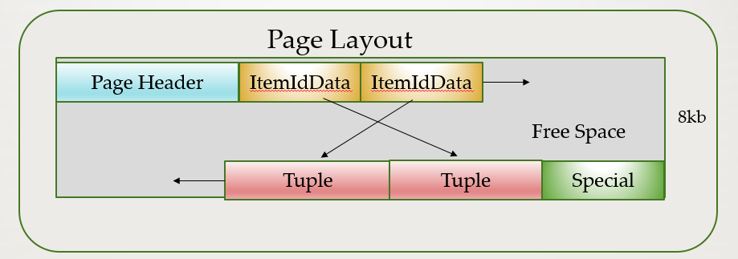

| Item | Description |
|:---|:---|
| PageHeaderData | 24 bytes long. General information about the page, including free-space pointers. |
| ItemIdData | Array of item identifiers (line pointers) pointing to the actual items. 4 bytes per item. |
| Free space | Unallocated space. New item pointers are allocated from the start of this area, new items from the end. |
| Items (tuples) | The actual rows themselves. |
| Special space | Access-method-specific data (used by indexes). Empty in ordinary tables. |

## 2. Installing PostgreSQL on Windows and Linux

### System Requirements

**Hardware (minimum for a lab system)**

- 1 GHz processor
- 2 GB RAM
- 512 MB of free disk space for the software, plus space for your data

**Software**

- Administrator privileges on Windows
- `root` or `sudo` access on Linux

### Installing PostgreSQL 17 on Windows

1.  Go to <https://www.postgresql.org/download/> and choose **Windows**.
2.  Click **Download the installer**.
3.  Choose the latest PostgreSQL 17 release for Windows x86-64 (for example 17.11). Always install the newest minor release: it contains all security and bug fixes (see Chapter 16).
4.  Right-click the downloaded setup file and choose **Run as administrator**.
5.  Follow the wizard: choose the installation directory, data directory, superuser password, port (default 5432) and components.
6.  Wait for the installation to complete.
7.  Open **SQL Shell (psql)** from the Start menu, or connect from a command prompt:

```bash
psql -U <username> -d <database_name> -p <port_number>
```

### Setting Up the Windows Environment

1.  Click **Start**, search for **This PC**, right-click it and choose **Properties**.

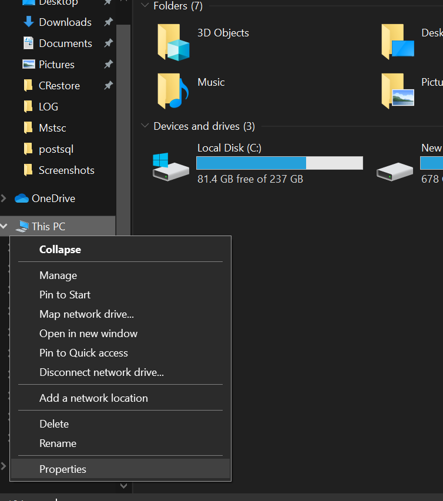

2.  Click **Advanced system settings**.
3.  In **System Properties**, click **Environment Variables**.

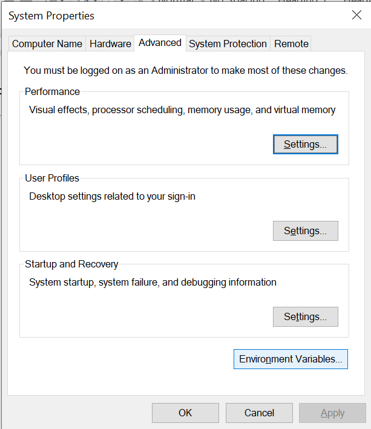

4.  Under **System variables**, select **Path** and click **Edit**.

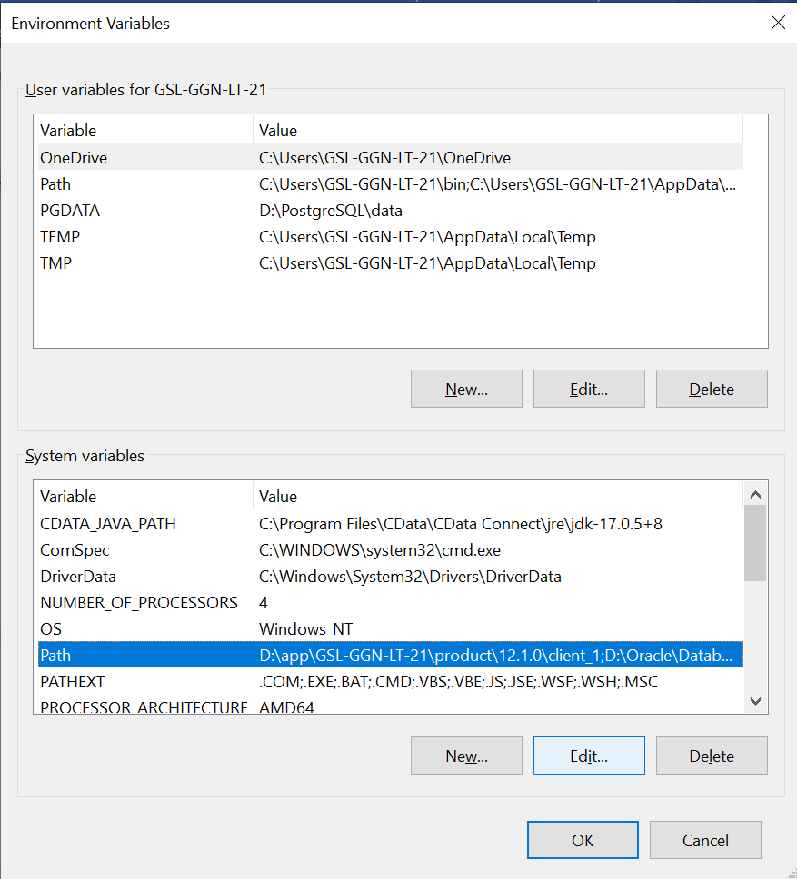

5.  Click **New** and add the PostgreSQL `bin` folder, for example `D:\PostgreSQL\17\bin`. Click **OK**.
6.  Back in **Environment Variables**, click **New** under **System variables**.
7.  Enter `PGDATA` as the variable name and the data directory as the value, for example `D:\PostgreSQL\17\data`.
8.  Click **OK** to save and close all windows. Open a new command prompt for the changes to apply.

### Installing PostgreSQL on Linux (Default Directory)

These steps use the PostgreSQL (PGDG) YUM repository on Red Hat Enterprise Linux 8. For RHEL 9 (or Rocky/AlmaLinux 9), replace `EL-8` with `EL-9` in the repository URL; the module-disable step is not needed on RHEL 9.

1.  Go to <https://www.postgresql.org/download/> and choose **Linux → Red Hat/Rocky/AlmaLinux**.
2.  In the **PostgreSQL Yum Repository** section, choose version **17**, platform **RHEL 8** and architecture **x86_64**. A setup script is generated.

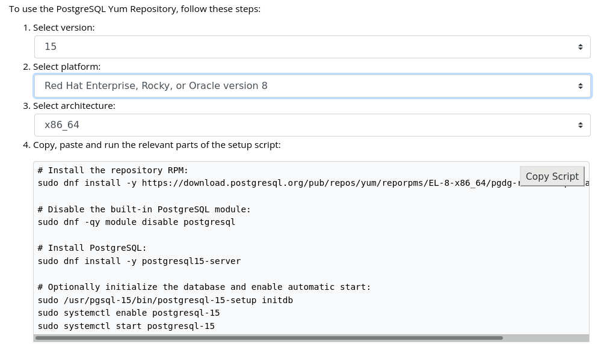

3.  Install the repository RPM:

```bash
sudo dnf install -y https://download.postgresql.org/pub/repos/yum/reporpms/EL-8-x86_64/pgdg-redhat-repo-latest.noarch.rpm
```

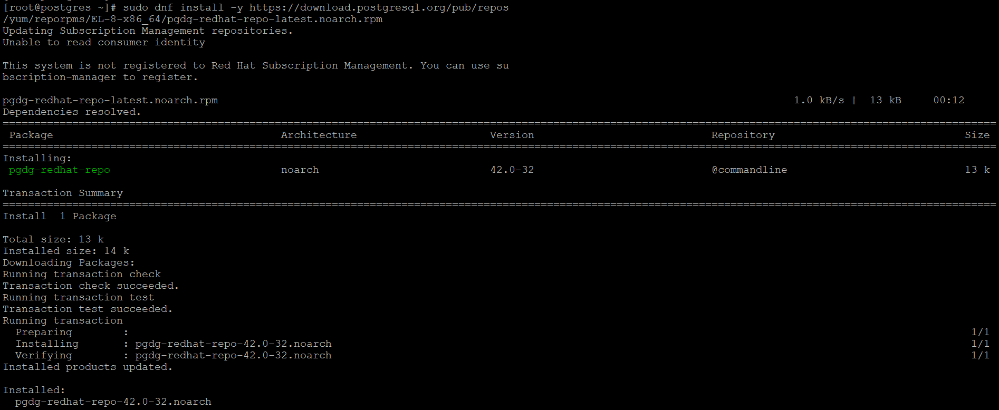

4.  Disable the built-in PostgreSQL module (RHEL 8 only) and install the server:

```bash
sudo dnf -qy module disable postgresql
sudo dnf install -y postgresql17-server
```

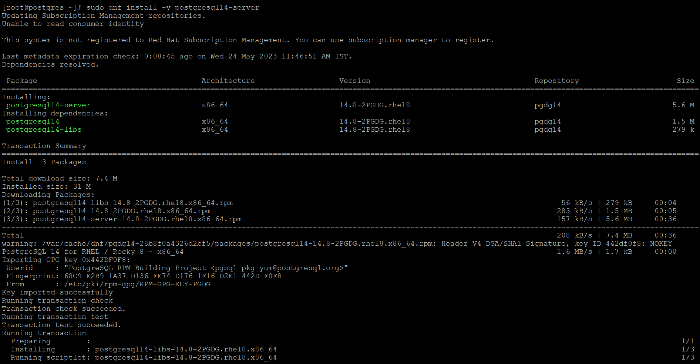

5.  Initialise the cluster, enable automatic start and start the service. `PGSETUP_INITDB_OPTIONS` passes extra options to `initdb`; here it enables data checksums:

```bash
sudo PGSETUP_INITDB_OPTIONS="--data-checksums" /usr/pgsql-17/bin/postgresql-17-setup initdb
sudo systemctl enable postgresql-17
sudo systemctl start postgresql-17
sudo systemctl status postgresql-17
```

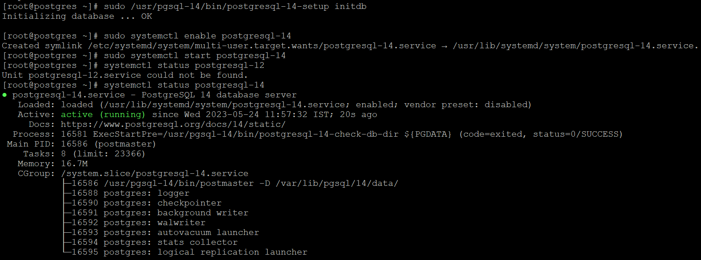

**Note:** these steps install the binaries in `/usr/pgsql-17` and create the data directory at `/var/lib/pgsql/17/data`.

### Setting Up the Linux Environment (Default Directory)

1.  The OS user `postgres` is created automatically during installation. Set its password:

```bash
sudo passwd postgres
```

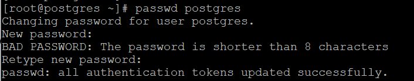

2.  Switch to the `postgres` user:

```bash
su - postgres
```

3.  Edit the `postgres` user’s profile:

```bash
vi ~/.bash_profile
```

4.  Add the following lines:

```bash
[ -f /etc/profile ] && source /etc/profile
PGDATA=/var/lib/pgsql/17/data
export PGDATA

# If you want to customize your settings, use the file below.
# It is not overridden by the RPMs.
[ -f /var/lib/pgsql/.pgsql_profile ] && source /var/lib/pgsql/.pgsql_profile

export PATH=/usr/pgsql-17/bin:$HOME/bin:$PATH
```

5.  Save the file and load it into the current session:

```bash
. ~/.bash_profile
```

### Installing PostgreSQL on Linux (Non-Default Directory)

1.  Add the PGDG repository and install the server exactly as in steps 1–4 of the default installation.


2.  Create the new data directory, for example `/u01/pgsql/17/data`, with the correct owner and permissions:

```bash
sudo mkdir -p /u01/pgsql/17/data
sudo chown -R postgres:postgres /u01/pgsql
sudo chmod 700 /u01/pgsql/17/data
```

3.  Point the service at the new directory. Use a systemd drop-in file rather than editing `/lib/systemd/system/postgresql-17.service` directly, because package updates overwrite that file:

```bash
sudo systemctl edit postgresql-17
```

Add these lines and save:

```bash
[Service]
# Location of database directory
Environment=PGDATA=/u01/pgsql/17/data/
```

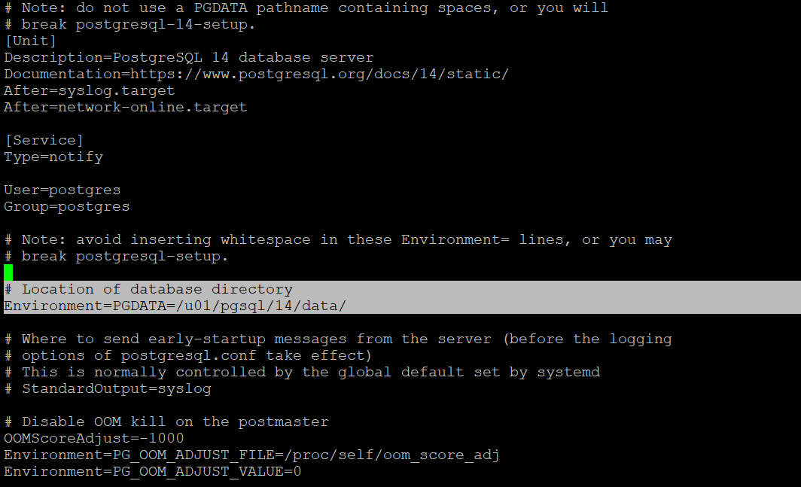

4.  Reload systemd:

```bash
sudo systemctl daemon-reload
```

5.  Initialise the cluster, enable automatic start and start the service:

```bash
sudo /usr/pgsql-17/bin/postgresql-17-setup initdb
sudo systemctl enable postgresql-17
sudo systemctl start postgresql-17
sudo systemctl status postgresql-17
```

### Setting Up the Linux Environment (Non-Default Directory)

Follow the same steps as for the default directory (set the password, `su - postgres`, edit `~/.bash_profile`).


The only difference is the `PGDATA` value:

```bash
[ -f /etc/profile ] && source /etc/profile
PGDATA=/u01/pgsql/17/data
export PGDATA

[ -f /var/lib/pgsql/.pgsql_profile ] && source /var/lib/pgsql/.pgsql_profile

export PATH=/usr/pgsql-17/bin:$HOME/bin:$PATH
```

Load the profile with `. ~/.bash_profile`.

## 3. PostgreSQL Architecture

### Fundamentals of PostgreSQL Architecture

- PostgreSQL is a relational database management system with a **client-server** architecture.
- It uses a **process-per-connection** model: each client connection is served by its own server process.
- A set of processes and shared memory structures together form an **instance**.
- Client programs connect to the instance and request read and write operations.
- The default port is **5432**.

### Process and Memory Architecture

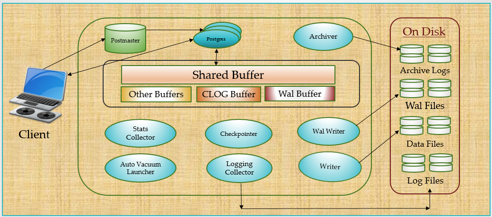

#### Postmaster (supervisor process)

- The postmaster is the first process started when PostgreSQL starts.
- It supervises the other processes and restarts them if they fail.
- It listens on the configured address and port for new connection requests.
- For every new connection it **forks a new backend process** (named `postgres`). The backend authenticates the client using `pg_hba.conf` and then serves all of that client’s queries.

#### Background (utility) processes

| Process | Role |
|:---|:---|
| Background writer | Periodically writes dirty buffers from shared buffers to the data files, so backends rarely have to. |
| WAL writer | Flushes the WAL buffers to the WAL files on disk. |
| Checkpointer | Runs a checkpoint every `checkpoint_timeout` (default 5 minutes) or when `max_wal_size` is about to be exceeded, writing **all dirty buffers** to the data files. |
| Autovacuum launcher | Starts autovacuum worker processes that vacuum and analyse tables (if `autovacuum = on`, the default). |
| Startup process | Replays WAL during crash recovery, and continuously on a standby. |
| Logical replication launcher | Starts the apply workers for logical replication subscriptions. |
| WAL summarizer (PG 17) | When `summarize_wal = on`, records which blocks each WAL range changed (in `pg_wal/summaries`). Needed for incremental backups. |
| Slot sync worker (PG 17) | On a standby with `sync_replication_slots = on`, copies failover-enabled logical slots from the primary. |
| Logger (logging collector) | Writes server messages to the log files (if `logging_collector = on`). |
| Archiver (optional) | When `archive_mode = on`, copies completed WAL segments to the archive location. |
| WAL sender / WAL receiver | Used by replication: the sender runs on the primary, the receiver on the standby. |

**No statistics collector process since PostgreSQL 15.** Activity statistics (table and index access counts, dead rows and so on, shown in the `pg_stat_*` views and used by autovacuum) are kept in **shared memory** by each backend and written to `pg_stat` at shutdown. Planner statistics (data distribution used to choose query plans) are a separate thing: they are gathered by `ANALYZE` and stored in `pg_statistic`.

### Memory Segments

| Area | Scope | Parameter | Used for |
|:---|:---|:---|:---|
| Shared buffers | Shared | `shared_buffers` | Cache of table and index pages |
| WAL buffers | Shared | `wal_buffers` | WAL records not yet written to disk |
| CLOG buffers | Shared | (automatic) | Commit status of transactions (`pg_xact`) |
| Work memory | Per operation | `work_mem` | Sorts and hash tables (ORDER BY, DISTINCT, hash joins, hash aggregates) |
| Maintenance work memory | Per operation | `maintenance_work_mem` | VACUUM, CREATE INDEX, ALTER TABLE ADD FOREIGN KEY |
| SLRU buffers (PG 17) | Shared | `transaction_buffers`, `subtransaction_buffers`, `multixact_*_buffers`, … | Caches for commit status, subtransactions, multixacts and more; sizes are configurable from PG 17 |
| Temp buffers | Per session | `temp_buffers` | Pages of **temporary tables** only |

#### Shared buffers

- Backends never read or write data files directly; all reads and changes go through the shared buffer area.
- A page changed in memory but not yet written to disk is called a **dirty** page.
- Dirty pages are written to the data files by the background writer and the checkpointer.
- Size is set by `shared_buffers` in `postgresql.conf` (restart required).

#### WAL buffers

- Also called transaction log buffers.
- WAL (write-ahead log) records describe every change to the data and are sufficient to reconstruct the data during recovery.
- WAL is written to a series of 16 MB files called **WAL segments** in `pg_wal`.
- WAL buffers are flushed to the WAL segments by the WAL writer and at every transaction commit.
- Size is set by `wal_buffers`.

#### CLOG and other buffers

- CLOG (“commit log”, stored in `pg_xact`) records the status of every transaction: in progress, committed or aborted. CLOG buffers cache these pages in memory.
- **Work memory** (`work_mem`) is used by a single sort or hash operation (hash operations may use `work_mem × hash_mem_multiplier`, default 2.0). A complex query can use several multiples of it at once.
- **Maintenance work memory** (`maintenance_work_mem`) is used by maintenance commands.
- **Temp buffers** (`temp_buffers`) cache the pages of temporary tables created by a session. Large sorts and hashes that exceed `work_mem` spill to temporary **files**, not to temp buffers.

### Physical Files

- **Data files:** store table and index data.
- **WAL files:** every change is written here first, before the change is considered committed.
- **Log files:** server messages (stderr, csvlog or syslog output).
- **Archived WAL files (optional):** copies of WAL segments kept for point-in-time recovery and standby servers.

**Parameters related to memory and WAL:** `shared_buffers`, `wal_buffers`, `work_mem`, `maintenance_work_mem`, `temp_buffers`, `max_wal_size`.

## 4. Database Clusters

### What Is a Database Cluster?

- A database cluster is a collection of databases managed by a single PostgreSQL instance (one postmaster, one port, one data directory).
- `initdb` creates a new cluster.
- Creating a cluster means creating the **data directory** and the files inside it.
- The storage area must be initialised before the server can be started.
- Default data directory locations (not mandatory):
  - Linux (PGDG packages): `/var/lib/pgsql/17/data`
  - Windows: `C:\Program Files\PostgreSQL\17\data`

### initdb

- `initdb` is the command-line utility that initialises a new cluster: it creates the directory structure, the system catalogs and the `template0`, `template1` and `postgres` databases.
- Run it as the OS user that will own the server process (normally `postgres`), never as `root`.
- It can be run directly, or through `pg_ctl initdb`.

```bash
# Linux
initdb -D /var/lib/pgsql/17/data -U postgres -W -E UTF8 --data-checksums
pg_ctl initdb -D /var/lib/pgsql/17/data -o "-U postgres -W -E UTF8 --data-checksums"
:: Windows
initdb -D "D:\PostgreSQL\17\data" -U postgres -W -E UTF8 --data-checksums
pg_ctl initdb -D "D:\PostgreSQL\17\data" -o "-U postgres -W -E UTF8 --data-checksums"
```

| Option | Meaning |
|:---|:---|
| `-D` | Data directory location |
| `-U` | Name of the database superuser for the new cluster |
| `-W` | Prompt for the superuser’s password |
| `-E` | Default encoding (use `UTF8`) |
| `-k`, `--data-checksums` | Enable data page checksums to detect storage corruption. Recommended; off by default in PG 17 (on by default from PG 18). Also lets `pg_rewind` work without `wal_log_hints`. |
| `--locale-provider` | `libc` (default), `icu`, or `builtin` (new in PG 17, e.g. `--locale-provider=builtin --builtin-locale=C.UTF-8` for fast, OS-independent sorting). |

### Starting and Stopping a Cluster

```bash
# Linux (systemd service)
sudo systemctl start postgresql-17
sudo systemctl stop postgresql-17

# Linux (as the postgres user)
pg_ctl start -D /var/lib/pgsql/17/data
pg_ctl stop  -D /var/lib/pgsql/17/data -m fast
:: Windows
pg_ctl start -D "C:\Program Files\PostgreSQL\17\data"
pg_ctl stop  -D "C:\Program Files\PostgreSQL\17\data" -m smart
pg_ctl stop  -D "C:\Program Files\PostgreSQL\17\data" -m fast
pg_ctl stop  -D "C:\Program Files\PostgreSQL\17\data" -m immediate
```

If `PGDATA` is set, `-D` can be omitted.

### Types of Shutdown

| Mode | Behaviour |
|:---|:---|
| **smart** | Refuses new connections and waits for all existing sessions to end, then shuts down. |
| **fast** (default) | Refuses new connections, rolls back open transactions, disconnects clients and shuts down cleanly. |
| **immediate** | Aborts all processes without a clean shutdown. Crash recovery runs at the next start. |

### Reload vs Restart

- After changing server parameters, the configuration must be **reloaded** or the server **restarted** for the change to take effect.
- A **reload** re-reads the configuration files without stopping the server. Most parameters take effect this way.
- Some parameters (for example `shared_buffers`, `max_connections`, `listen_addresses`, `wal_level`) only take effect after a **restart**. They are marked `# (change requires restart)` in `postgresql.conf`, and have `context = 'postmaster'` in `pg_settings`.
- A restart shuts down all activity, releases resources, closes all files and starts again with the new configuration.

```bash
# Reload
sudo systemctl reload postgresql-17          # Linux
pg_ctl reload -D "D:\PostgreSQL\17\data"     # Windows (or Linux as postgres)

# Restart
sudo systemctl restart postgresql-17         # Linux
pg_ctl restart -D "D:\PostgreSQL\17\data"    # Windows (or Linux as postgres)
```

From psql (any platform), a reload can also be triggered with:

```sql
SELECT pg_reload_conf();
```

### pg_controldata

`pg_controldata` displays control information about a cluster: version, cluster state, latest checkpoint location, WAL settings and more. It works even when the server is stopped.

```bash
/usr/pgsql-17/bin/pg_controldata -D /var/lib/pgsql/17/data     # Linux
pg_controldata -D "D:\PostgreSQL\17\data"                       # Windows
```

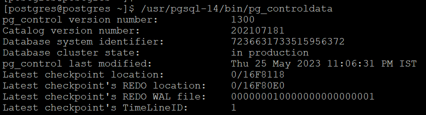

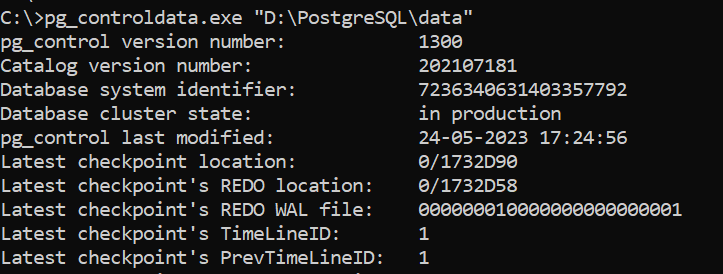

## 5. Directory Layout

### Installation Directory Layout

- Linux (PGDG packages): binaries in `/usr/pgsql-17`, data in `/var/lib/pgsql/17/data`. Source builds default to `/usr/local/pgsql`.
- Windows: `C:\Program Files\PostgreSQL\<version>` by default.

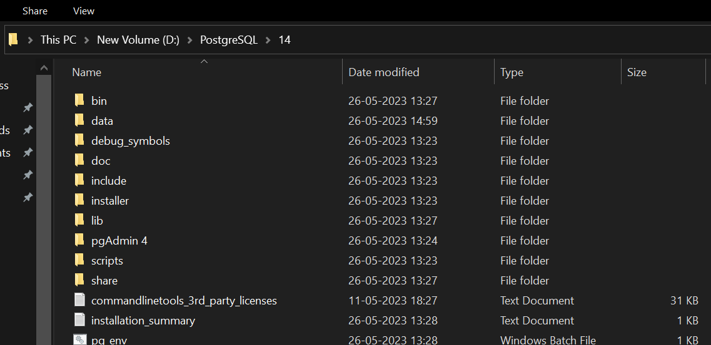

| Folder | Contents |
|:---|:---|
| bin | Programs (`psql`, `initdb`, `pg_ctl`, `createdb`, `createuser`, `pg_dump` and others) |
| data | Data directory (Windows default) |
| doc | Documentation |
| include | C header files |
| installer | Installer files |
| scripts | Helper scripts such as `runpsql` and server-control scripts |
| share | Sample configuration files, time zone data, extension files |
| pgAdmin 4 | pgAdmin files |

### Data Directory Layout

| Item | Description |
|:---|:---|
| `base` | One subdirectory per database, named after the database OID |
| `global` | Cluster-wide tables such as `pg_database`, `pg_authid` and `pg_tablespace` |
| `pg_commit_ts` | Transaction commit timestamps (when `track_commit_timestamp = on`) |
| `pg_dynshmem` | Files used by the dynamic shared memory subsystem |
| `pg_logical` | Status data for logical decoding |
| `pg_multixact` | Multitransaction status data (used for shared row locks) |
| `pg_notify` | LISTEN/NOTIFY status data |
| `pg_replslot` | Replication slot data |
| `pg_serial` | Information about committed serializable transactions |
| `pg_snapshots` | Exported snapshots |
| `pg_stat` | Activity statistics saved at clean shutdown and reloaded at startup |
| `pg_stat_tmp` | Temporary files for extensions such as `pg_stat_statements` (no longer used by the server itself since PG 15) |
| `pg_subtrans` | Subtransaction status data |
| `pg_tblspc` | Symbolic links to tablespaces |
| `pg_twophase` | State files for prepared transactions |
| `pg_wal` | WAL (write-ahead log) files. `pg_wal/summaries` holds WAL summaries for incremental backup (PG 17). |
| `pg_xact` | Transaction commit status data (CLOG) |
| `log` | Server log files (default `log_directory`) |
| `current_logfiles` | Records the log file(s) currently being written by the logging collector |
| `postgresql.conf` | Main configuration file |
| `postgresql.auto.conf` | Parameters set with `ALTER SYSTEM` |
| `pg_hba.conf` | Client authentication rules |
| `pg_ident.conf` | User name maps (OS user → database user) |
| `postmaster.opts` | Command-line options the server was last started with |
| `postmaster.pid` | Lock file with the postmaster PID, data directory, start time, port, socket directory, listen address and shared memory ID. Not present after shutdown. |
| `PG_VERSION` | Major version number of PostgreSQL |

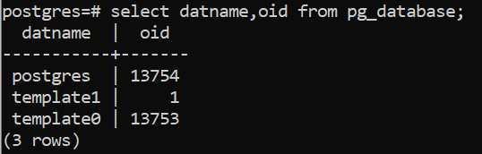

### The base Directory

- Each database is a subdirectory named after its object identifier (OID).
- `template1` always has OID 1. Since PostgreSQL 15, `template0` always has OID 4 and `postgres` has OID 5.
- To find database OIDs:

```sql
SELECT oid, datname FROM pg_database;
```

## 6. Configuration Files

### postgresql.conf

- `postgresql.conf` holds the parameters that configure the server and control its performance.
- `initdb` creates a default copy in the data directory.
- The file has one `name = value` parameter per line; lines starting with `#` are comments.
- Parameters that need a restart are marked `# (change requires restart)`.

### Catalog Views for Viewing Settings

- `pg_settings` shows the current run-time value of every parameter. It is an alternative to the `SHOW` command, with extra columns such as `unit`, `context` (when a change takes effect) and `source`.
- `pg_file_settings` summarises the contents of the configuration files. It is useful to check whether planned changes in the files are valid before reloading. Each `name = value` entry has an `applied` column and, if it cannot be applied, an `error` column.
- In short: `pg_settings` shows what the server is using now; `pg_file_settings` shows what is written in the files.

```sql
SELECT name, setting, unit, context FROM pg_settings;
```

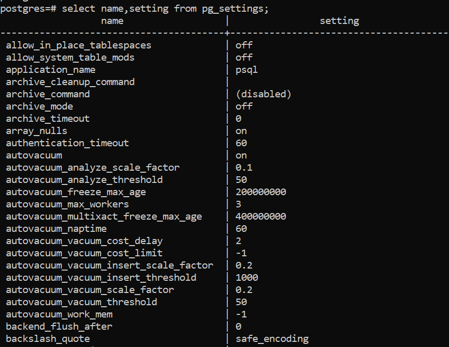

To check a single parameter, for example `archive_mode`, use either method:

```sql
SELECT name, setting FROM pg_settings WHERE name = 'archive_mode';
SHOW archive_mode;
```

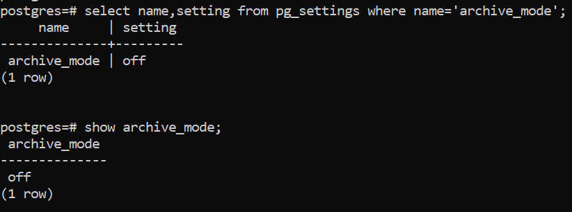

### Changing a Parameter in postgresql.conf

1.  Check the current value.
2.  Back up the file before editing it.
3.  Remove the leading `#` from the parameter if it is commented out.
4.  Check whether the parameter needs a restart.
5.  Set the new value.
6.  Reload or restart PostgreSQL as required.
7.  Verify the value with `SHOW` or `pg_settings`.

**Example:** change `shared_buffers` from 200 MB to 250 MB and `work_mem` from 10 MB to 20 MB.

**Step 1.** Check the current values.

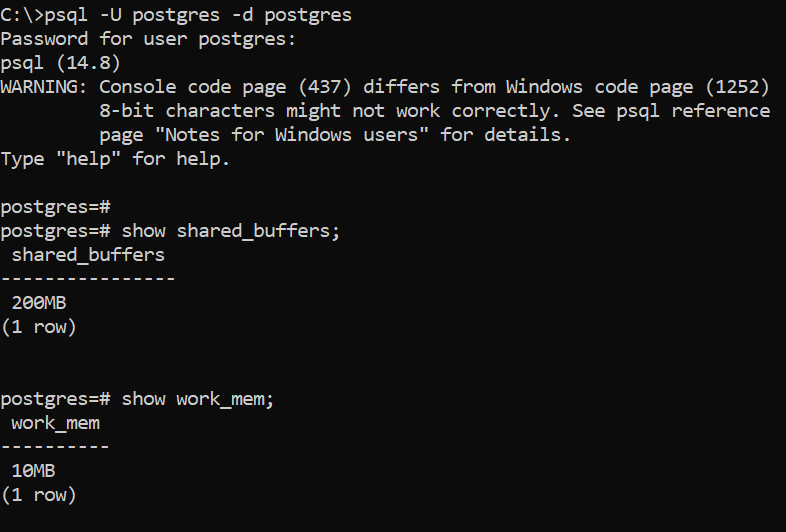

**Step 2.** Open `<data directory>\postgresql.conf` and edit both parameters.

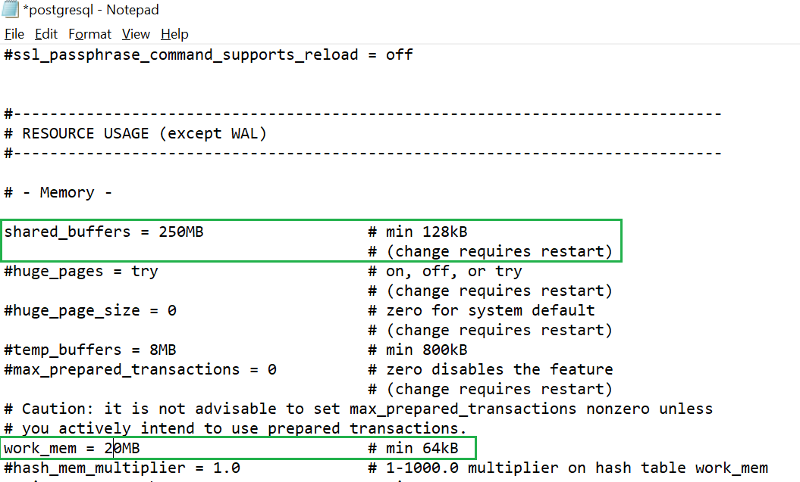

**Note:** the file shows that `shared_buffers` requires a restart, while `work_mem` does not.

**Step 3.** Save the file and reload the configuration from psql:

```sql
SELECT pg_reload_conf();
```

The function returns `true` if the reload signal was sent. Parameters that do not need a restart (here `work_mem`) take effect immediately for new and existing sessions.

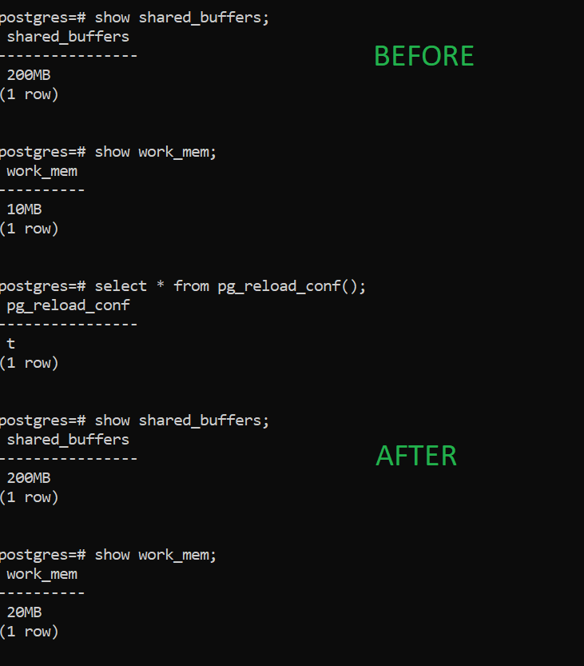

**Step 4.** `shared_buffers` still shows the old value because it requires a restart. Restart the server:

```bash
pg_ctl restart -D "D:\PostgreSQL\17\data"
```

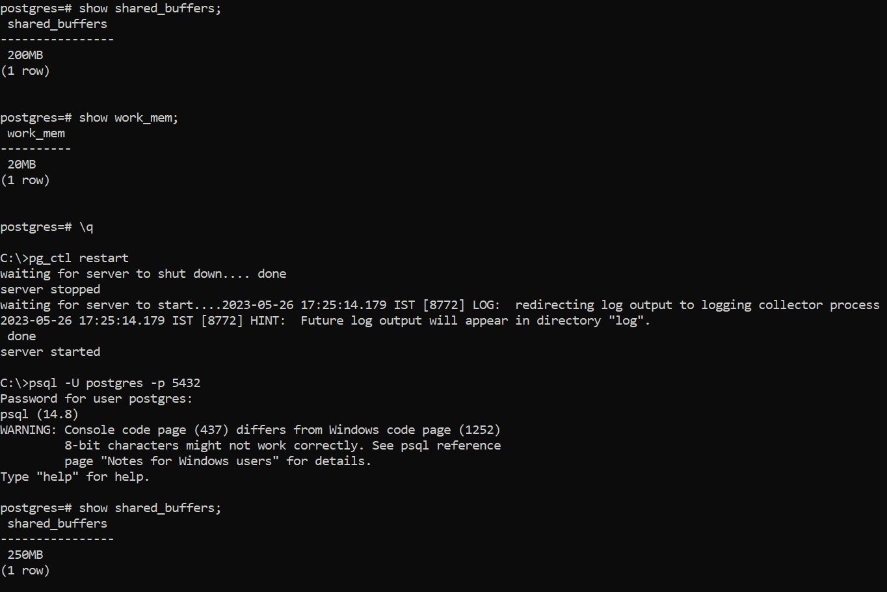

### postgresql.auto.conf

- This file holds settings made with the `ALTER SYSTEM` command. Do not edit it by hand.
- Values in `postgresql.auto.conf` **override** the same parameters in `postgresql.conf`.
- `ALTER SYSTEM` provides a SQL interface for changing server-wide defaults.

```sql
ALTER SYSTEM SET configuration_parameter = 'value';
ALTER SYSTEM RESET configuration_parameter;
ALTER SYSTEM RESET ALL;
```

**Example:** change `shared_buffers` and `work_mem` with `ALTER SYSTEM`.

**Step 1.** Set the parameters:

```sql
ALTER SYSTEM SET shared_buffers = '250MB';
ALTER SYSTEM SET work_mem = '20MB';
```

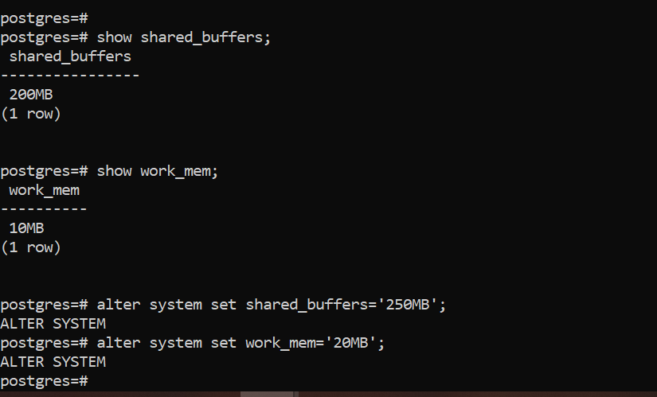

**Step 2.** Reload the configuration:

```sql
SELECT pg_reload_conf();
```

**Step 3.** Open `postgresql.conf`. It is unchanged, because `ALTER SYSTEM` writes only to `postgresql.auto.conf`.

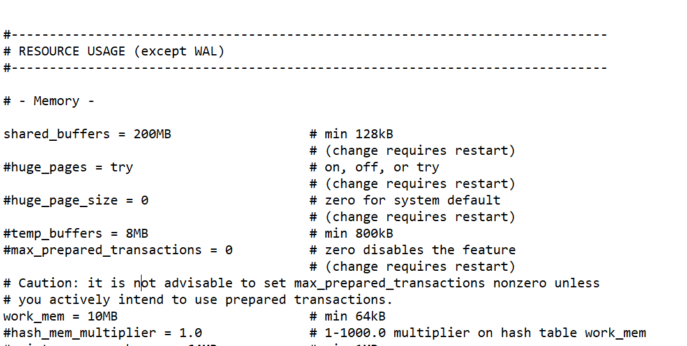

**Step 4.** Query `pg_file_settings` to see whether the planned changes will work:

```sql
SELECT sourcefile, name, setting, applied, error FROM pg_file_settings;
```

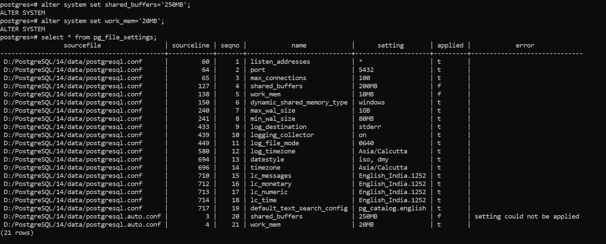

The last two rows show `shared_buffers` and `work_mem` from `postgresql.auto.conf`. The `applied` column shows whether the value is in effect. `shared_buffers` shows *setting could not be applied* because it still needs a restart.

**Step 5.** To roll back one or all `ALTER SYSTEM` changes:

```sql
ALTER SYSTEM RESET shared_buffers;
ALTER SYSTEM RESET ALL;
```

Then reload (or restart, for restart-only parameters).

**Note:** when the same parameter appears in both files, PostgreSQL uses the value from `postgresql.auto.conf`, because that file is read last.

**PostgreSQL 17 –** `allow_alter_system`**:** if configuration is managed by an external tool (Ansible, Patroni, a cloud control plane), set `allow_alter_system = off` in `postgresql.conf` so that `ALTER SYSTEM` is refused. This is a guard against accidental changes, not a security boundary: superusers can still change files in other ways.

### pg_ident.conf

`pg_ident.conf` maps external (operating system or certificate) user names to PostgreSQL user names.

- The OS user that starts a connection is not necessarily the same as the database user.
- A map is used together with an authentication method in `pg_hba.conf` (for example `peer`, `ident`, `cert` or `gss`) by adding `map=<mapname>` to the `pg_hba.conf` line.
- The file is read at startup and on every reload (`pg_ctl reload` or `SELECT pg_reload_conf();`).
- From PostgreSQL 16, check the loaded mappings and any errors with `SELECT * FROM pg_ident_file_mappings;`.

**Sample**

```bash
# MAPNAME   SYSTEM-USERNAME   PG-USERNAME
sales       admin             sales
sales       sagar             sales
test        sagar             postgres
```

- **MAPNAME** is any name; it is referenced from `pg_hba.conf`.
- **SYSTEM-USERNAME** is the user name detected for the client.
- **PG-USERNAME** is the PostgreSQL user the client may connect as.
- With map `sales`, OS users `admin` and `sagar` may connect as database user `sales`. With map `test`, OS user `sagar` may connect as `postgres`.

### pg_hba.conf

- Controls **client authentication** (HBA = host-based authentication).
- When a connection request arrives, PostgreSQL reads the lines from top to bottom and uses the **first line** that matches the connection type, database, user and client address.
- If no line matches, the connection is rejected.
- The file controls which hosts may connect, how clients authenticate, which database users they may use and which databases they may access.
- Changes need only a **reload**, not a restart.
- From PostgreSQL 16, database and user columns accept **regular expressions** (prefixed with `/`), and the file can pull in other files with `include`, `include_if_exists` and `include_dir`.

**Sample**

```bash
# TYPE    DATABASE      USER      ADDRESS            METHOD
local     all           all                          peer
host      all           all       127.0.0.1/32       scram-sha-256
host      all           all       ::1/128            scram-sha-256
hostssl   sales         sales     192.168.4.0/24     scram-sha-256
host      all           all       10.10.0.15/32      reject
host      replication   repuser   192.168.4.153/32   scram-sha-256
```

#### Column 1 – Connection type

| Type | Meaning |
|:---|:---|
| `local` | Connections through a Unix-domain socket on the same machine. No address column. (Not used on Windows.) |
| `host` | TCP/IP connections, with or without SSL. The server must listen on the address (`listen_addresses`). |
| `hostssl` | TCP/IP connections that use SSL only. |
| `hostnossl` | TCP/IP connections that do not use SSL. |
| `hostgssenc` | TCP/IP connections that use GSSAPI encryption. |
| `hostnogssenc` | TCP/IP connections that do not use GSSAPI encryption. |

#### Column 2 – Database

- `all` – matches all databases.
- `sameuser` – the database name must equal the user name.
- `samerole` – the user must be a member of a role with the same name as the database.
- `replication` – matches **physical** replication connections (logical replication connections match the database name instead).
- A database name, or a comma-separated list of names.

#### Column 3 – User

- The **database** user name (not the OS user).
- `all`, a user name, a group (role) name prefixed with `+`, or a comma-separated list.

**Note:** database and user names that contain spaces, commas, quotes or other special characters must be quoted. Quoting a keyword such as `"all"`, `"sameuser"` or `"replication"` makes it match a database or user with that literal name.

#### Column 4 – Address

- A host name, or an IP address with a CIDR mask, for example `192.168.4.10/32` (one host) or `192.168.4.0/24` (a whole subnet).
- Alternatively, an IP address and a netmask in two columns; for a single host the netmask is `255.255.255.255`.
- `local` lines have no address column.

#### Column 5 – Authentication method

| Method | Description |
|:---|:---|
| `trust` | Allows the connection without a password. Use only on fully trusted machines. |
| `reject` | Always rejects the connection. Useful to block specific hosts or users ahead of broader rules. |
| `scram-sha-256` | Challenge-response password authentication. **Recommended**, and the default `password_encryption` since PostgreSQL 14. |
| `md5` | Older hashed-password method. Still works in PG 17, but is weaker than SCRAM (a timing side-channel was fixed in 17.10, CVE-2026-6478) and is deprecated from PG 18. Migrate users to SCRAM (see note below). |
| `password` | Sends the password in **clear text**. Avoid unless the connection is SSL-encrypted. |
| `peer` | `local` only: uses the OS user name of the client process. |
| `ident` | Uses an ident server on the client host to get the OS user name (TCP/IP only). |
| `gss`, `sspi` | Kerberos (GSSAPI) and Windows single sign-on. |
| `ldap`, `radius`, `pam`, `cert`, `bsd` | External authentication services and client certificates. |

`ident`, `peer`, `cert` and `gss` can use a user name map from `pg_ident.conf` via the `map=` option.

**Moving users from MD5 to SCRAM:** make sure `password_encryption = 'scram-sha-256'` (the default), have each user set their password again (`\password username` in psql), then change `md5` to `scram-sha-256` in `pg_hba.conf` and reload. Find users still on MD5 with:

```sql
SELECT rolname FROM pg_authid WHERE rolpassword LIKE 'md5%';
```

### Steps to Allow a Remote Client

1.  Back up `pg_hba.conf` and `postgresql.conf`.
2.  In `postgresql.conf`, set `listen_addresses = '*'` (or a specific server IP). This change requires a restart.
3.  In `pg_hba.conf`, add a line for the client, for example `host  all  all  192.168.4.25/32  scram-sha-256`.
4.  Restart PostgreSQL if `listen_addresses` changed; otherwise a reload is enough.
5.  Check the file for errors:

```sql
SELECT rule_number, file_name, line_number, type, database, user_name,
       address, auth_method, error
FROM pg_hba_file_rules;
```

6.  Connect from the client:

```bash
psql -h <server_host> -U postgres -d postgres
```

Depending on the authentication method, the client may or may not be prompted for a password.

## 7. Databases, Users, Schemas and Privileges

### Creating a Database

- A database is an organised collection of structured data.
- The PostgreSQL `bin` folder contains command-line utilities that can run database tasks without opening psql, for example `createdb`, `dropdb`, `createuser` and `dropuser`.
- The same tasks can be done with SQL from psql.

From psql:

```sql
CREATE DATABASE samson OWNER postgres;
```

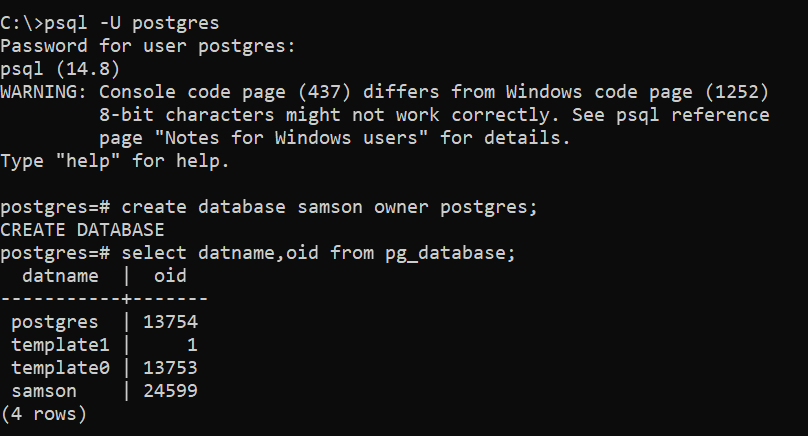

From the command line:

```bash
createdb -O postgres -U postgres samson
createdb --help
```

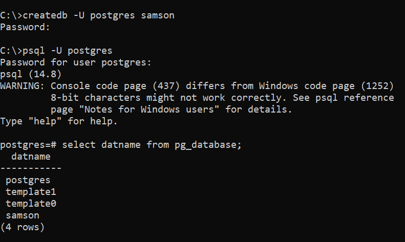

- `\l` or `\l+` in psql lists all databases.
- The `pg_database` catalog also holds database information.

### Dropping a Database

- You cannot drop the database you are connected to.
- Only a superuser or the database owner can drop a database.

```sql
scott=# DROP DATABASE nano;
ERROR:  cannot drop the currently open database
```

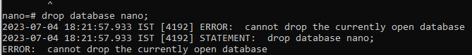

From psql (connected to a different database):

```sql
DROP DATABASE nano;
```

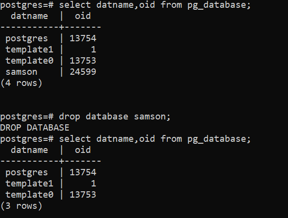

From the command line:

```bash
dropdb nano
dropdb --help
```

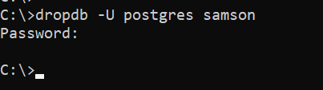

### Creating Users

- Database users (roles) are completely separate from operating system users.
- User names must be unique; names starting with `pg_` are reserved.
- The `postgres` superuser is created during installation and has all privileges.
- Only a superuser or a role with the `CREATEROLE` attribute can create users. Since PostgreSQL 16, a `CREATEROLE` user can only manage roles it has `ADMIN OPTION` on (by default, the roles it created itself), and cannot grant attributes it does not have.
- Roles are **global to the cluster**: one role can connect to any database in the instance, subject to `pg_hba.conf` and the `CONNECT` privilege.
- `CREATE USER` is the same as `CREATE ROLE` with the `LOGIN` attribute.

From psql (creates superuser `scott`):

```sql
CREATE USER scott WITH LOGIN SUPERUSER PASSWORD 'scott';
```

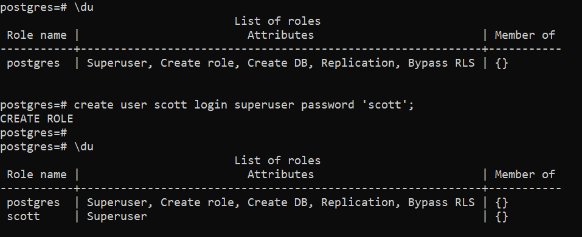

From the command line:

```bash
createuser -U postgres -P -S scott
```

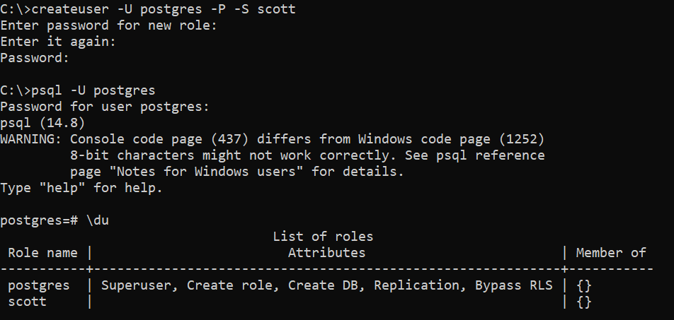

| Option  | Meaning                                              |
|:--------|:-----------------------------------------------------|
| `-U`    | User name to connect as (not the user being created) |
| `-P`    | Prompt for a password for the new role               |
| `-S`    | The new role is not a superuser (default)            |
| `scott` | The role to create                                   |

Interactive mode:

```bash
$ createuser --interactive joe
Shall the new role be a superuser? (y/n) n
Shall the new role be allowed to create databases? (y/n) y
Shall the new role be allowed to create more new roles? (y/n) y
```

Use `createuser --help` for all options.

### Dropping Users

```sql
DROP USER username;      -- from psql
dropuser username        # from the command line
```

A user that owns objects or holds privileges cannot be dropped:

```sql
postgres=# DROP USER test1;
ERROR:  role "test1" cannot be dropped because some objects depend on it
```

Transfer ownership and remove the privileges first. Run the first two commands **in every database** where the user owns objects:

```bash
REASSIGN OWNED BY test1 TO postgres;
DROP OWNED BY test1;         -- removes remaining privileges
DROP ROLE test1;
```

### Schemas and Their Benefits

- A schema is a namespace that contains named objects: tables, views, data types, functions and operators.
- One database can contain many schemas.
- Schemas separate the data of different applications and organise objects into logical groups.
- Objects in different schemas can have the same name without colliding.
- Many users can share one database without interfering with each other.
- Schemas belong to a database, not to the cluster, so the same schema name can exist in different databases.

### Creating and Dropping Schemas

```sql
CREATE SCHEMA schema_name;                         -- owned by the current user
CREATE SCHEMA schema_name AUTHORIZATION username;  -- owned by username
```

The owner has all privileges on the schema and can create objects in it.

```sql
DROP SCHEMA schema_name;            -- fails if the schema contains objects
DROP SCHEMA schema_name CASCADE;    -- also drops all objects in the schema
```

### Schema Search Path

- `search_path` sets the order in which schemas are searched when a query names an object without a schema.
- PostgreSQL uses the first matching object it finds.
- The default is `"$user", public`: first a schema with the same name as the current user (if it exists), then `public`.
- `search_path` can be set at session, role, database or cluster level.

```sql
SHOW search_path;
```

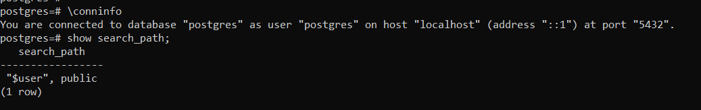

```sql
-- Session level
SET search_path TO test1, public;

-- Role level
ALTER ROLE app_user SET search_path TO main, ginview, public;

-- Database level
ALTER DATABASE appdb SET search_path TO main, ginssot, ginview, ginarchive, gateway, public;
```

### The public Schema

- `public` is created automatically in every new database.
- Objects created without a schema name go into the first schema in `search_path` that exists, normally `public`.
- **Since PostgreSQL 15** (so in PostgreSQL 17), ordinary users **cannot create objects in** `public` by default. Only the database owner can, because `public` is owned by the predefined role `pg_database_owner`. Everyone still has `USAGE` on it.
- Databases upgraded with `pg_upgrade` from PostgreSQL 14 or older keep their old, open permissions. Lock them down manually:

```sql
REVOKE CREATE ON SCHEMA public FROM PUBLIC;
ALTER SCHEMA public OWNER TO pg_database_owner;
```

- To let an application user create tables in `public` again, grant it explicitly: `GRANT CREATE ON SCHEMA public TO app_user;` (or, better, give the application its own schema).

```sql
CREATE TABLE employee (id int);        -- created in public
CREATE TABLE nano.employee (id int);   -- created in schema nano
```

### Privileges

- A privilege is the right to run a particular kind of SQL statement or to access another user’s object.
- PostgreSQL has two kinds:
  - **Role attributes** (cluster level): `SUPERUSER`, `CREATEDB`, `CREATEROLE`, `LOGIN`, `REPLICATION`, `BYPASSRLS`. They are set by a superuser (or a `CREATEROLE` role) with `CREATE ROLE` or `ALTER ROLE`.
  - **Object privileges**: `SELECT`, `INSERT`, `UPDATE`, `DELETE`, `TRUNCATE`, `REFERENCES`, `TRIGGER`, `CREATE`, `CONNECT`, `TEMPORARY`, `EXECUTE`, `USAGE`, `SET` and `ALTER SYSTEM` on parameters (PG 15), and `MAINTAIN` on tables (PG 17: allows VACUUM, ANALYZE, CLUSTER, REINDEX, REFRESH MATERIALIZED VIEW and LOCK TABLE).
  - **Predefined roles** grant ready-made capabilities, for example `pg_read_all_data`, `pg_monitor`, `pg_maintain` (PG 17). See Chapter 17. They are granted by the object owner, a superuser, or a role holding the privilege `WITH GRANT OPTION`.

### Granting and Revoking

**Object-level grants**

```sql
-- Allow use of a schema
GRANT USAGE ON SCHEMA schema_name TO username;

-- DML on all existing tables in a schema
GRANT SELECT, INSERT, UPDATE, DELETE ON ALL TABLES IN SCHEMA schema_name TO username;

-- All privileges on all existing tables and sequences
GRANT ALL PRIVILEGES ON ALL TABLES    IN SCHEMA schema_name TO username;
GRANT ALL PRIVILEGES ON ALL SEQUENCES IN SCHEMA schema_name TO username;

-- Column-level access
GRANT SELECT (col1), UPDATE (col1) ON mytable TO username;

-- Connect to a database
GRANT CONNECT ON DATABASE database_name TO username;

-- PG 17: allow a maintenance user to VACUUM/ANALYZE/REINDEX a table without owning it
GRANT MAINTAIN ON TABLE big_table TO dba_ops;
-- ...or on every table in the cluster
GRANT pg_maintain TO dba_ops;
```

**Important:** `ON ALL TABLES IN SCHEMA` only affects tables that exist now. For tables created later, set default privileges (they apply to objects created by the role running the command, or the role named in `FOR ROLE`):

```sql
ALTER DEFAULT PRIVILEGES IN SCHEMA schema_name
  GRANT SELECT, INSERT, UPDATE, DELETE ON TABLES TO username;
```

**Role attributes**

```sql
ALTER USER username CREATEDB;          -- allow creating databases
ALTER USER username WITH SUPERUSER;    -- make superuser
ALTER USER username WITH NOSUPERUSER;  -- remove superuser
```

**Revoking**

```sql
REVOKE DELETE, UPDATE ON products FROM username;   -- specific privileges
REVOKE ALL ON products FROM username;              -- all privileges
REVOKE SELECT ON products FROM PUBLIC;             -- from all users
```

## 8. psql Commands

### Connecting with psql

psql is the terminal-based front end to PostgreSQL. It lets you run queries interactively and see the results.

```bash
# Specific database and user (-W forces a password prompt)
psql -d database -U user -W

# Database on another host
psql -h host -p 5432 -d database -U user -W

# Require an SSL-encrypted connection
psql "host=host dbname=db user=user sslmode=require"
```

`sslmode` controls whether SSL is used (`disable`, `prefer`, `require`, `verify-ca`, `verify-full`). It is not an authentication method.

### Useful First Queries

```sql
SELECT version();
SELECT current_database();
SELECT current_user;
SELECT current_date;
SHOW data_directory;
SHOW port;
SELECT oid, datname, dattablespace FROM pg_database;
SELECT usename FROM pg_user;
SELECT datname AS database_name,
       pg_database_size(datname)/1024/1024 AS size_in_mb
FROM pg_database
ORDER BY size_in_mb;
SELECT name, setting FROM pg_settings WHERE name LIKE '%autovacuum%';
```

### psql Meta-Commands

| Command | Purpose |
|:---|:---|
| `\c dbname [user]` | Connect to another database (optionally as another user) |
| `\conninfo` | Show current connection information |
| `\l` / `\l+` | List databases |
| `\dn` / `\dn+` | List schemas |
| `\dt` / `\dt+` | List tables |
| `\d table_name` | Describe a table |
| `\dv` | List views |
| `\ds` | List sequences |
| `\df` | List functions |
| `\di` | List indexes |
| `\du` | List roles and their attributes |
| `\drg` | List role memberships (grants of roles to roles) – PG 16 |
| `\dconfig [pattern]` | List server parameters, e.g. `\dconfig *wal*` – PG 15 |
| `\dP` | List partitioned tables and indexes |
| `\watch [seconds]` | Re-run the current query every N seconds (stop with Ctrl+C) |
| `\bind v1 v2 …` | Run the next query with bind parameters, e.g. `SELECT $1 \bind 42 \g` – PG 16 |
| `\db` | List tablespaces |
| `\dx` | List installed extensions |
| `\x` | Toggle expanded (vertical) output |
| `\a` | Toggle between aligned and unaligned output |
| `\H` | Toggle HTML output format |
| `\timing` | Turn display of query execution time on or off |
| `\g` | Execute the current query buffer (or repeat the last query) |
| `\s [file]` | Show command history, or save it to a file |
| `\e` | Edit the query buffer in an external editor |
| `\ef func` | Edit a function definition in an editor |
| `\i file.sql` | Execute commands from a file |
| `\o [file]` | Send query output to a file; `\o` alone switches back to the screen |
| `\w file` | Write the current query buffer to a file |
| `\! command` | Run an OS command, e.g. `\! cls` (Windows), `\! clear` or `\! df -h` (Linux) |
| `\?` | Help on psql meta-commands |
| `\h [SQL command]` | Help on SQL syntax |
| `\q` | Quit psql |

To reload the server configuration from psql, use the SQL function `SELECT pg_reload_conf();`.

### psql File Operations

Run SQL statements from a file:

```bash
psql -d test1 -U test1 -f test1.sql        # from the OS command line
test1=> \i test1.sql                       -- from inside psql
```

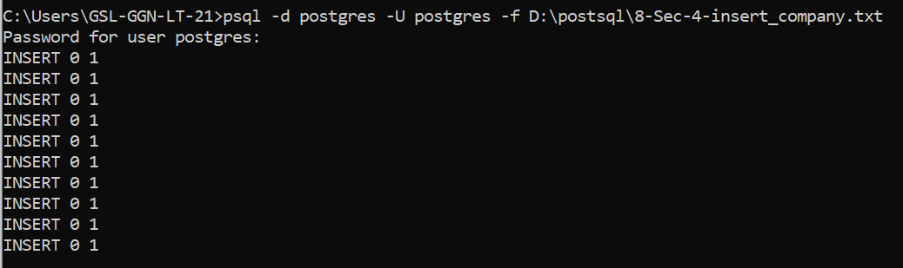

Send query output to a file:

```sql
postgres=# \o output.txt
postgres=# SELECT * FROM your_table;
postgres=# \o
```

`\o` without a file name switches output back to the screen.

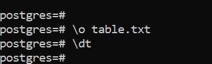

### Autocommit

- By default, psql runs every statement in its own transaction and commits it automatically.
- Turn autocommit off for the current session (the variable name must be in capitals):

```sql
postgres=# \set AUTOCOMMIT off
```

- With autocommit off, changes must be ended with `COMMIT;` or undone with `ROLLBACK;`.
- The setting applies only to the current session; new sessions start with autocommit on.
- Alternatively, wrap statements in an explicit `BEGIN; … COMMIT;` block.

## 9. System Catalogs and Time Zones

### Common System Catalogs and Views

| Name | Description |
|:---|:---|
| `pg_database` | Databases in the cluster |
| `pg_stat_database` | Activity statistics per database |
| `pg_stat_activity` | One row per server process: current query, state, wait events |
| `pg_stat_io` | I/O statistics by backend type, object and context (PG 16) |
| `pg_stat_checkpointer` | Checkpoint counts and timings (PG 17; previously in `pg_stat_bgwriter`) |
| `pg_stat_wal` | WAL generation statistics (PG 14) |
| `pg_wait_events` | Description of every wait event, to join with `pg_stat_activity` (PG 17) |
| `pg_tablespace` | Tablespaces |
| `pg_roles` / `pg_user` | Roles and users (safe to query) |
| `pg_shadow` | Users including password hashes (superuser only) |
| `pg_available_extensions` | Extensions available for installation |
| `pg_operator` | Operators |
| `pg_stats` | Planner statistics (readable view of `pg_statistic`) |
| `pg_locks` | Locks currently held or awaited |
| `pg_tables` | Tables in the current database |
| `pg_indexes` | Indexes in the current database |
| `pg_views` | Views in the current database |
| `pg_settings` | Server parameters |
| `pg_timezone_names` | Time zone names |
| `pg_user_mappings` | User mappings for foreign servers (foreign data wrappers) |

### Useful Catalog Queries

```sql
SELECT * FROM pg_database;                     -- databases
SELECT * FROM pg_stat_database;                -- database statistics
SELECT * FROM pg_stat_activity;                -- sessions and running queries
SELECT * FROM pg_tablespace;                   -- tablespaces
SELECT * FROM pg_available_extensions;         -- available extensions
SELECT * FROM pg_roles;                        -- roles
SELECT * FROM pg_stats;                        -- planner statistics
SELECT * FROM pg_timezone_names;               -- time zones
SELECT * FROM pg_locks;                        -- locks
SELECT * FROM pg_tables;                       -- tables
SELECT * FROM pg_indexes;                      -- indexes
SELECT * FROM pg_views;                        -- views
SELECT * FROM pg_settings WHERE name = 'max_connections';

SELECT current_schema();                       -- current schema
SELECT current_user;                           -- current user
SELECT current_database();                     -- current database
SELECT current_setting('max_connections');     -- current value of a parameter
SELECT pg_backend_pid();                       -- PID of this session's backend
SELECT pg_postmaster_start_time();             -- server start time
SELECT version();                              -- PostgreSQL version
SELECT pg_is_in_recovery();                    -- true on a standby
SELECT * FROM pg_stat_checkpointer;            -- checkpoint statistics (PG 17)

-- What are sessions waiting for? (PG 17 adds descriptions)
SELECT a.pid, a.wait_event_type, a.wait_event, w.description
FROM pg_stat_activity a
JOIN pg_wait_events w ON w.type = a.wait_event_type AND w.name = a.wait_event;
```

### Date, Time and Time Zones

```sql
-- Current date and time with time zone
SELECT now() AS current;

-- Current date and time without time zone
SELECT now()::timestamp;

-- One hour from now
SELECT now() + interval '1 hour' AS an_hour_later;

-- Same time tomorrow
SELECT now() + interval '1 day' AS this_time_tomorrow;

-- Two and a half hours ago
SELECT now() - interval '2 hours 30 minutes' AS two_hours_30_min_ago;
```

Working with time zones:

```sql
SHOW timezone;                                           -- session time zone
SET timezone = 'Asia/Kolkata';                           -- change for this session
SELECT now() AT TIME ZONE 'UTC';                         -- convert to another zone
SELECT name, utc_offset FROM pg_timezone_names WHERE name LIKE 'Asia/K%';
```

The server default is set with the `timezone` parameter in `postgresql.conf`. It can also be set per database or role with `ALTER DATABASE … SET timezone` or `ALTER ROLE … SET timezone`.

## 10. CRUD Operations and Database Objects

### What Is CRUD?

CRUD stands for the four basic data operations:

- **Create** – add new rows.
- **Read** – retrieve, search or view rows.
- **Update** – change existing rows.
- **Delete** – remove rows.

### Create

`CREATE` creates database objects; `INSERT` adds rows.

```sql
CREATE TABLE table_name (
    column1 datatype [NULL | NOT NULL],
    column2 datatype [NULL | NOT NULL],
    CONSTRAINT constraint_name UNIQUE (column1, column2)
);

INSERT INTO table_name (column1, column2) VALUES (value1, value2);
```

### Data Types

- **Character:** `char(n)`, `varchar(n)`, `text`
- **Numeric:** `smallint`, `integer`, `bigint`, `numeric(p,s)`, `real`, `double precision`
- **Boolean:** `boolean`
- **Date/time:** `date`, `time`, `timestamp`, `timestamptz`, `interval`
- **Arrays** of any type, e.g. `integer[]`, `text[]`
- **JSON:** `json` and `jsonb` (binary, indexable). PostgreSQL 16–17 add the SQL-standard JSON functions (`IS JSON`, `JSON_OBJECT`, `JSON_EXISTS`, `JSON_VALUE`, `JSON_QUERY` and `JSON_TABLE`); see Chapter 16.
- **Special types:** `uuid`, network addresses (`inet`, `cidr`), geometric types and more

### Constraints

- Constraints are rules on table columns that prevent invalid data from being entered.
- They ensure the accuracy and reliability of the data.
- Constraints can be defined at column level (one column) or table level (one or more columns).
- They can be created with `CREATE TABLE` or added later with `ALTER TABLE`.

| Constraint | Description |
|:---|:---|
| `NOT NULL` | The column cannot contain NULL. |
| `UNIQUE` | All values in the column (or column group) are different. |
| `PRIMARY KEY` | Uniquely identifies each row; implies `UNIQUE` and `NOT NULL`. |
| `FOREIGN KEY` | Values must exist in the referenced column of another table. |
| `CHECK` | Values must satisfy a condition. |
| `EXCLUDE` | No two rows may satisfy a given operator comparison (e.g. overlapping ranges). |

### Built-in Functions and Operators

| Category | Examples |
|:---|:---|
| Aggregate functions | `avg()`, `count()`, `max()`, `min()`, `sum()` |
| String functions | `chr()`, `concat()`, `format()`, `initcap()`, `lower()`, `upper()`, `ltrim()`, `rtrim()`, `substring()` |
| Date and time functions | `age(timestamp)`, `now()`, `current_date`, `current_time`, `current_timestamp`, `transaction_timestamp()` |
| Comparison operators | `<`, `>`, `<=`, `>=`, `=`, `<>` (or `!=`) |
| Mathematical functions and operators | `+`, `-`, `*`, `/`, `abs(x)`, `ceil()`, `floor()`, `mod(y, x)`, `round()` |

### Read (SELECT) and Column Aliases

```sql
SELECT * FROM employee;                              -- all columns
SELECT emp_name FROM employee;                       -- one column
SELECT DISTINCT dept FROM employee;                  -- distinct values
SELECT * FROM employee ORDER BY salary DESC;         -- sort
SELECT * FROM employee WHERE dept = 'HR';            -- filter
SELECT dept, count(*) FROM employee GROUP BY dept;   -- group
SELECT emp_name AS name FROM employee;               -- column alias
SELECT e.emp_name FROM employee AS e;                -- table alias
```

### Update

- `UPDATE` changes the specified columns in all rows that satisfy the condition.
- Only the columns being changed need to appear in the `SET` clause; other columns keep their values.
- You need the `UPDATE` privilege on the table, or at least on the columns being updated.

```sql
UPDATE films SET kind = 'Dramatic' WHERE kind = 'Drama';

UPDATE weather
SET temp_lo = temp_lo + 1, temp_hi = temp_lo + 15, prcp = DEFAULT
WHERE city = 'San Francisco' AND date = '2003-07-03';
```

**Warning:** without a `WHERE` clause, every row in the table is updated.

### Delete

- `DELETE` removes the rows that satisfy the `WHERE` clause.
- Without a `WHERE` clause it removes every row, leaving a valid but empty table.

```sql
DELETE FROM films
USING producers
WHERE films.producer_id = producers.id AND producers.name = 'foo';

DELETE FROM films
WHERE producer_id IN (SELECT id FROM producers WHERE name = 'foo');

DELETE FROM films;     -- all rows
```

#### DELETE vs TRUNCATE

| DELETE | TRUNCATE |
|:---|:---|
| Removes rows one at a time; can use `WHERE` | Removes **all** rows at once; no `WHERE` |
| Space is reused only after VACUUM | Space is released immediately |
| Fires `ON DELETE` triggers | Does not fire `ON DELETE` triggers |
| Takes row-level locks | Takes an `ACCESS EXCLUSIVE` lock on the table |
| Transactional | Also transactional in PostgreSQL (can be rolled back) |

Both keep the table definition (columns, indexes, constraints). Only `DROP TABLE` removes the table itself.

### Transactions

- A transaction is a unit of work: a sequence of statements that succeed or fail together.
- Transaction control ensures data integrity and consistency.
- A transaction starts with `BEGIN` (or `START TRANSACTION`).
- `COMMIT` saves all changes made in the transaction.
- `ROLLBACK` undoes all changes not yet committed.
- `SAVEPOINT` marks a point you can roll back to without abandoning the whole transaction.

```sql
BEGIN;
UPDATE accounts SET balance = balance - 100 WHERE id = 1;
SAVEPOINT before_credit;
UPDATE accounts SET balance = balance + 100 WHERE id = 2;
-- ROLLBACK TO before_credit;   -- undo only the second update
COMMIT;
```

### Views

- A view is a named query that behaves like a logical table over one or more underlying tables.
- It simplifies complex queries: users query the view with a simple `SELECT`.
- It provides a stable interface even if the underlying tables change.
- A normal view stores no data; the query runs each time the view is used. (A **materialized view** stores the result and is refreshed with `REFRESH MATERIALIZED VIEW`.)

```sql
CREATE VIEW view_name AS query;
```

### Sequences

- A sequence is a special object that generates unique numbers, typically for key columns.
- `CREATE SEQUENCE` creates and initialises a sequence generator.
- The functions `nextval()`, `currval()` and `setval()` operate on a sequence.

```sql
CREATE SEQUENCE order_seq START 101;
SELECT nextval('order_seq');

-- Modern alternative: an identity column creates and owns its sequence
CREATE TABLE orders (order_id bigint GENERATED ALWAYS AS IDENTITY PRIMARY KEY);
```

### Indexes and Index Types

- Indexes are mainly used to improve query performance: they let the server find rows without reading the whole table.
- `CREATE INDEX` builds an index on one or more columns (multicolumn indexes are supported by B-tree, GiST, GIN and BRIN).

```sql
CREATE INDEX title_idx ON films (title);
CREATE UNIQUE INDEX code_uidx ON films (code);

-- On busy production tables, build without blocking writes:
CREATE INDEX CONCURRENTLY title_idx ON films (title);
```

| Index type | Best for |
|:---|:---|
| **B-tree** (default) | Equality and range queries on sortable data (`=`, `<`, `>`, `BETWEEN`, `ORDER BY`). |
| **Hash** | Equality (`=`) comparisons only. |
| **GIN** (Generalized Inverted Index) | Values that contain many elements: arrays, `jsonb`, full-text search. |
| **GiST** (Generalized Search Tree) | Geometric data, ranges, full-text search, nearest-neighbour searches. |
| **SP-GiST** | Non-balanced structures such as quadtrees, k-d trees and radix trees. |
| **BRIN** (Block Range Index) | Very large tables whose values follow the physical row order (e.g. timestamps); stores a summary per block range. |

## 11. Table Inheritance and Partitioning

### Table Inheritance

- A child table inherits all the columns of its parent table and can add columns of its own.
- A query on the parent returns rows from the parent **and** all its children.
- The `ONLY` keyword restricts a query to the named table.
- `UPDATE` or `DELETE` on the parent without `ONLY` also affects rows in the child tables.
- Children inherit columns, `CHECK` constraints and `NOT NULL` constraints. **Indexes, primary keys, unique constraints and foreign keys are not inherited** and must be created on each child.

#### Example

**a)** Create a table called `orders` with five columns.

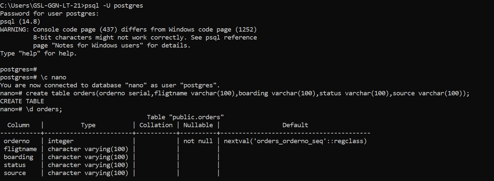

**b)** Create `online_bookings`, which inherits from `orders`. `orders` is the parent; `online_bookings` is the child.

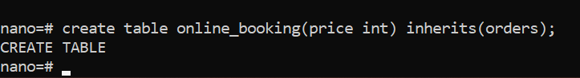

**c)** Create `agent_bookings`, which also inherits from `orders`.

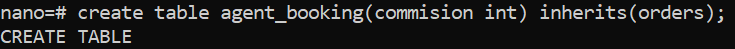

**d)** Insert one row into the parent table `orders`.

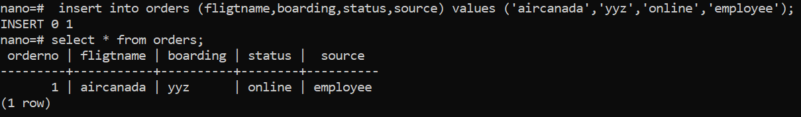

**e)** Insert two rows into the child table `online_bookings`.

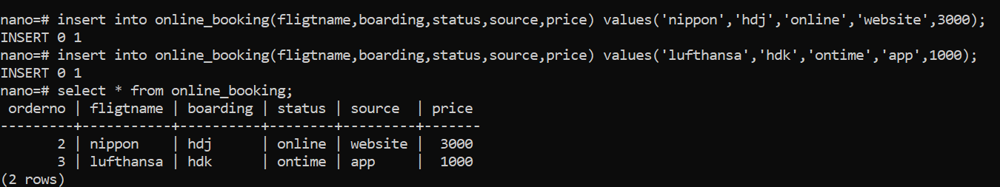

**f)** Insert two rows into `agent_bookings`.

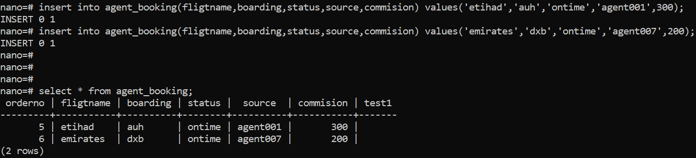

**g)** Query `orders`.

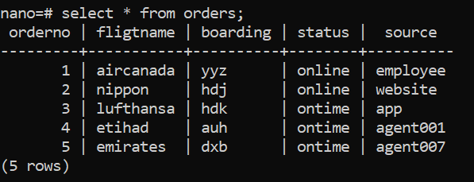

`orders` returns its own row plus the rows of both child tables. Querying a child table returns only the child’s rows. The child inherits the structure, not the parent’s data.

**h)** To see only the rows stored in `orders` itself, use `ONLY`:

```sql
SELECT * FROM ONLY orders;
```

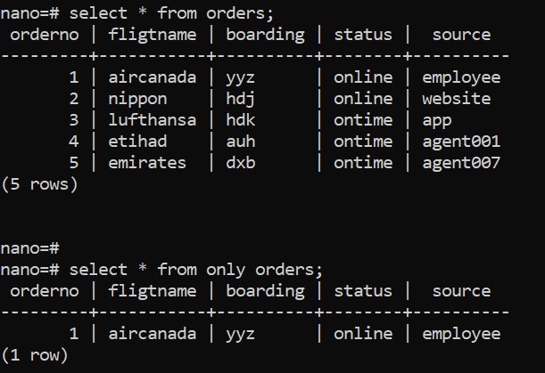

**i)** `UPDATE orders SET status = 'offline';` changes rows in `orders` **and** its children.

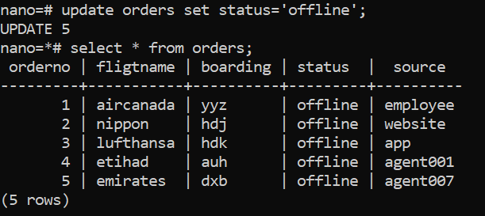

**j)** To change only the parent’s rows:

```sql
UPDATE ONLY orders SET status = 'offline';
```

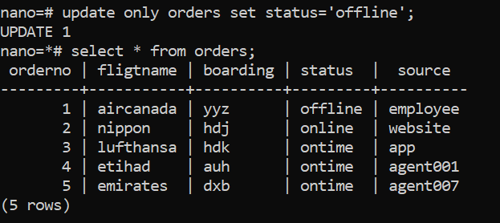

### Table Partitioning

- Partitioning splits one large logical table into smaller physical pieces called partitions.
- Benefits for large tables: queries scan only the relevant partitions (**partition pruning**), old data can be removed quickly by dropping or detaching a partition, and maintenance runs on smaller pieces.
- From PostgreSQL 10, partitioning is **declarative**. PostgreSQL 17 supports three methods:
  - **RANGE** – e.g. by date
  - **LIST** – by explicit values, e.g. region
  - **HASH** – spreads rows evenly by a hash of the key (PostgreSQL 11+)
- Declarative partitioning is the recommended method. The older inheritance-plus-trigger method is shown afterwards for reference.
- PostgreSQL 17 also allows **identity columns** and **exclusion constraints** on partitioned tables.

#### Declarative partitioning (recommended)

```sql
CREATE TABLE bookings (
    booking_id   varchar(10),
    airline      varchar(30),
    booking_date date NOT NULL
) PARTITION BY RANGE (booking_date);

-- The lower bound is inclusive, the upper bound is exclusive
CREATE TABLE bookings_2020_01 PARTITION OF bookings
    FOR VALUES FROM ('2020-01-01') TO ('2020-02-01');
CREATE TABLE bookings_2020_02 PARTITION OF bookings
    FOR VALUES FROM ('2020-02-01') TO ('2020-03-01');

-- Optional: catch rows that match no other partition
CREATE TABLE bookings_default PARTITION OF bookings DEFAULT;

-- An index on the parent is created on every partition automatically
CREATE INDEX ON bookings (booking_date);

INSERT INTO bookings VALUES ('dxb102', 'emirates', '2020-01-10');  -- goes to bookings_2020_01
INSERT INTO bookings VALUES ('dxb103', 'lufthansa', '2020-02-23'); -- goes to bookings_2020_02
```

Other methods and partition maintenance:

```sql
-- LIST partitioning
CREATE TABLE sales (region text, amount numeric) PARTITION BY LIST (region);
CREATE TABLE sales_north PARTITION OF sales FOR VALUES IN ('Delhi', 'Punjab');

-- HASH partitioning
CREATE TABLE events (id bigint, payload jsonb) PARTITION BY HASH (id);
CREATE TABLE events_p0 PARTITION OF events FOR VALUES WITH (MODULUS 4, REMAINDER 0);

-- Remove old data quickly / add an existing table as a partition
ALTER TABLE bookings DETACH PARTITION bookings_2020_01;
ALTER TABLE bookings ATTACH PARTITION bookings_2020_01
    FOR VALUES FROM ('2020-01-01') TO ('2020-02-01');
```

#### Legacy method: inheritance with a trigger

Before PostgreSQL 10, partitioning was built with inheritance, `CHECK` constraints and a trigger that routes each row to the right child.

**a)** Create the parent table `bookings` (without `PARTITION BY`).

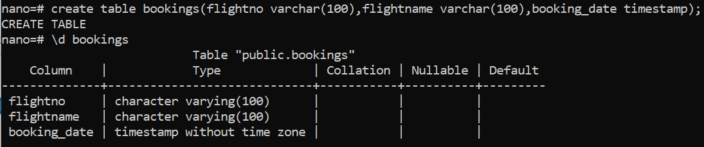

**b)** Create child tables that inherit from `bookings`:

```sql
CREATE TABLE jan_bookings (
    CHECK (booking_date >= DATE '2020-01-01' AND booking_date <= DATE '2020-01-31')
) INHERITS (bookings);

CREATE TABLE feb_bookings (
    CHECK (booking_date >= DATE '2020-02-01' AND booking_date <= DATE '2020-02-29')
) INHERITS (bookings);
```

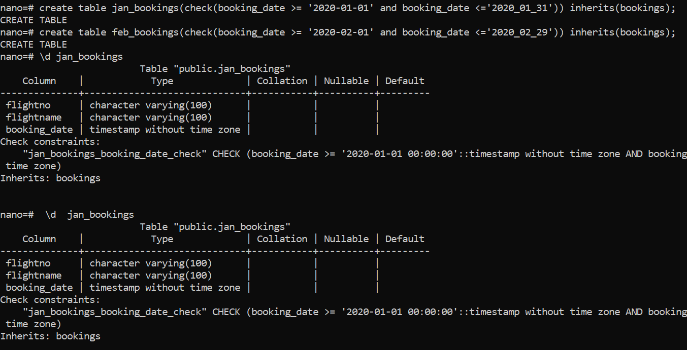

**c)** Create an index on each child table:

```sql
CREATE INDEX jan_idx ON jan_bookings USING btree (booking_date);
CREATE INDEX feb_idx ON feb_bookings USING btree (booking_date);
```

**d)** Create a trigger function that sends each new row to the correct child:

```sql
CREATE OR REPLACE FUNCTION on_insert() RETURNS trigger
AS $$
BEGIN
    IF (NEW.booking_date >= DATE '2020-01-01' AND NEW.booking_date <= DATE '2020-01-31') THEN
        INSERT INTO jan_bookings VALUES (NEW.*);
    ELSIF (NEW.booking_date >= DATE '2020-02-01' AND NEW.booking_date <= DATE '2020-02-29') THEN
        INSERT INTO feb_bookings VALUES (NEW.*);
    ELSE
        RAISE EXCEPTION 'Enter valid booking date';
    END IF;
    RETURN NULL;
END;
$$ LANGUAGE plpgsql;
```

The function inserts January dates into `jan_bookings` and February dates into `feb_bookings`; further months can be added the same way. Any other date raises an error. `RETURN NULL` stops the row from also being stored in the parent.

**e)** Create the trigger on the parent:

```sql
CREATE TRIGGER booking_entry
BEFORE INSERT ON bookings
FOR EACH ROW EXECUTE FUNCTION on_insert();
```

**f)** Insert some rows into `bookings`:

```sql
INSERT INTO bookings VALUES ('dxb102', 'emirates',  '2020-01-10');  -- 1
INSERT INTO bookings VALUES ('dxb103', 'lufthansa', '2020-02-23');  -- 2
INSERT INTO bookings VALUES ('dxb104', 'british',   '2020-02-08');  -- 3
INSERT INTO bookings VALUES ('dxb105', 'nipon',     '2020-01-19');  -- 4
INSERT INTO bookings VALUES ('dxb105', 'nipon',     '2020-03-19');  -- 5
```

**Result:** rows 1 and 4 go to `jan_bookings`; rows 2 and 3 go to `feb_bookings`; row 5 raises an error because March is not handled by the function.

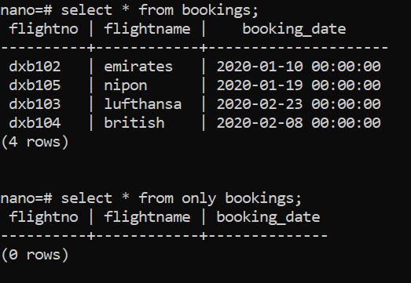

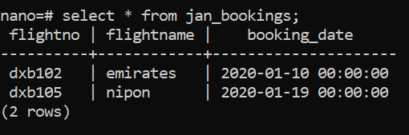

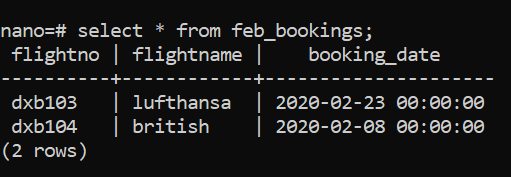

### Copying a Table

- `CREATE TABLE … AS TABLE` copies a table’s columns and, optionally, its data.
- Unlike inheritance, the copy has no relationship with the original table.
- It copies only column names and data types. It does **not** copy indexes, constraints (including `NOT NULL`), defaults or triggers.

```sql
-- Structure and data
CREATE TABLE new_table AS TABLE existing_table;

-- Structure only
CREATE TABLE new_table AS TABLE existing_table WITH NO DATA;

-- Full structure including defaults, constraints and indexes (no data)
CREATE TABLE new_table (LIKE existing_table INCLUDING ALL);
```

## 12. Tablespaces

### Tablespaces and Their Advantages

- A tablespace maps a logical name to a directory on disk where PostgreSQL stores data files.
- It lets you control the physical disk layout of a cluster.
- Typical uses:
  - Spread data across several disks or volumes to balance I/O.
  - Put heavily used tables and indexes on fast storage and archive data on cheaper, slower storage.
  - Add space when the main volume is full.

### Default Tablespaces

- Every cluster has two tablespaces out of the box:
  - `pg_default` – stores user data. Its location is `<data directory>/base`.
  - `pg_global` – stores cluster-wide system catalogs. Its location is `<data directory>/global`.
- `pg_default` is the default tablespace of `template0` and `template1`, so new databases use it unless `CREATE DATABASE … TABLESPACE` says otherwise.

### Creating a Tablespace

The directory must already exist, be empty and be owned by the OS user that runs PostgreSQL.

```sql
-- Windows
CREATE TABLESPACE hrd LOCATION 'D:\PostgreSQL\17\tablespace\hrd';

-- Linux
CREATE TABLESPACE hrd LOCATION '/u01/pgsql/tbs/hrd';
```

Create a table in the new tablespace and check where it is:

```sql
CREATE TABLE test1 (studid int, stuname varchar(50)) TABLESPACE hrd;

SELECT tablename, tablespace FROM pg_tables WHERE tablespace = 'hrd';
SELECT tablename, tablespace FROM pg_tables WHERE tablename = 'test1';
```

### Moving a Table to Another Tablespace

```sql
ALTER TABLE test1 SET TABLESPACE pg_default;
```

**Note:** moving a table rewrites it and holds an `ACCESS EXCLUSIVE` lock for the whole operation, so plan it outside business hours. Indexes do not move with the table; move them with `ALTER INDEX index_name SET TABLESPACE …`.

```sql
-- Confirm the move (tablespace is NULL when the table is in the database default)
SELECT tablename, tablespace FROM pg_tables WHERE tablename = 'test1';

-- Physical file of the table, relative to the data directory
SELECT pg_relation_filepath('test1');

-- Physical location of each tablespace
SELECT spcname, pg_tablespace_location(oid) FROM pg_tablespace;
```

### Dropping a Tablespace

- A tablespace can only be dropped when it is empty in **every** database of the cluster.
- Dropping it removes its directory contents and its symbolic link in `pg_tblspc`.

```sql
-- Find objects in the tablespace (repeat in each database)
SELECT tablename FROM pg_tables WHERE tablespace = 'hrd';
SELECT indexname FROM pg_indexes WHERE tablespace = 'hrd';

DROP TABLESPACE hrd;

-- Confirm
SELECT spcname FROM pg_tablespace;
```

### Temporary Tablespaces

- PostgreSQL writes temporary files when a sort or hash exceeds `work_mem`, and stores temporary tables and their indexes on disk.
- `temp_tablespaces` lets you place these on a dedicated (ideally fast) volume.
- Temporary files are deleted when no longer needed, and any leftovers are removed at server start.

```sql
CREATE TABLESPACE temp01 OWNER postgres LOCATION '/u01/pgsql/tbs/temp01';
```

Set `temp_tablespaces = 'temp01'` in `postgresql.conf` and reload, or set it per session with `SET temp_tablespaces = 'temp01';`. PostgreSQL creates a subdirectory inside the location the first time a temporary file is written.

## 13. Backup and Restore

### Backup Types

- A backup is a copy of data that can be used to rebuild the database after a failure.
- Backups are either **logical** or **physical**.
- **Logical backups** are SQL statements (or an archive of them) that recreate a cluster, database or table.
- **Physical backups** are copies of the files PostgreSQL uses: the data directory, WAL files and archived WAL.
- Physical backups are taken either **offline** (server stopped) or **online** (server running).

|  | Logical (pg_dump, pg_dumpall) | Physical (file copy, pg_basebackup) |
|:---|:---|:---|
| Granularity | Cluster, database, schema or table | Whole cluster only |
| Point-in-time recovery | No | Yes, with WAL archiving |
| Across major versions | Yes | No |
| Speed for large databases | Slower | Faster |

### Logical Backup

- Produces a consistent snapshot of a database as of the moment the dump started, without blocking normal reads and writes.
- Output formats: plain SQL text (default), custom, directory and tar.
- Well suited to small and medium databases, migrations and copying individual objects.
- Utilities: `pg_dump` (one database) and `pg_dumpall` (whole cluster).
- Use `pg_dump --help` to see all options.

### pg_dump

```bash
# Linux – plain SQL file
pg_dump -U postgres -d nano -f /backup/nano_backup.sql

# Windows – plain SQL file
pg_dump -U postgres -d nano -f D:\user_backup\nano_backup.sql

# Custom format (compressed, restorable with pg_restore)
pg_dump -U postgres -Fc -d dvdrental -f D:\user_backup\dvdrental.dump

# Directory format with 4 parallel jobs
pg_dump -U postgres -Fd -j 4 -d dvdrental -f /backup/dvdrental_dir

# PG 17: choose objects with a filter file
pg_dump -U postgres -Fc -d dvdrental --filter=/backup/filter.txt -f /backup/dvdrental.dump
```

A filter file has one rule per line, for example:

```bash
include table public.payment*
exclude table_data public.audit_log
exclude schema staging
```

| -F value | Format | Restore with |
|:---|:---|:---|
| `p` | Plain SQL text (default); readable in any editor | `psql` |
| `c` | Custom, compressed archive | `pg_restore` |
| `d` | Directory, one file per table; supports parallel dump and restore | `pg_restore` |
| `t` | Tar archive | `pg_restore` |

### Restoring a Plain-Text pg_dump with psql

- A plain-text dump does not create the database by default, so create an empty database first (or dump with `-C` to include `CREATE DATABASE`).
- Restore plain-text dumps with `psql`. Restore custom, directory and tar dumps with `pg_restore`.

**psql version for plain dumps:** since the August 2025 minor releases (17.6, 16.10, …), `pg_dump` writes `\restrict` and `\unrestrict` lines into plain-text dumps to block malicious meta-commands (CVE-2025-8714). An older psql cannot read these lines, so always restore plain dumps with a **current** psql (17.6 or later).

**Example: back up and restore** `dvdrental` **in plain-text format**

**Step 1.** List the databases. We will back up `dvdrental`.

**Step 2.** Take the backup:

```bash
pg_dump -U postgres -d dvdrental -f D:\user_backup\dvdrental_backup.sql
```

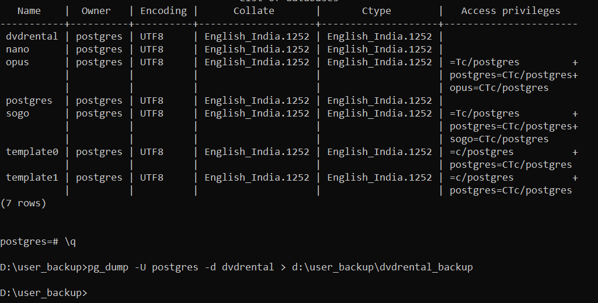

**Step 3.** Drop `dvdrental`.


**Step 4.** Create an empty database with the same name.


**Step 5.** Restore the plain-text backup with psql:

```bash
psql -U postgres -d dvdrental -f D:\user_backup\dvdrental_backup.sql
```


### Restoring with pg_restore

- `pg_restore` restores dumps in **custom, directory or tar** format.
- Plain-text dumps, including all `pg_dumpall` output, cannot be restored with `pg_restore`; use `psql`.

**Example: back up and restore** `dvdrental` **in custom format**

**Step 1.** Take a custom-format backup:

```bash
pg_dump -U postgres -Fc -d dvdrental -f D:\Pg_dump\dvdrental_backup.dump
```


**Step 2.** Drop `dvdrental` and create an empty database with the same name.


**Step 3.** Restore with `pg_restore`:

```bash
pg_restore -U postgres -d dvdrental D:\Pg_dump\dvdrental_backup.dump
```


**Restoring a single table.** `pg_restore` can restore one table from a full custom-format dump, which helps when a table is dropped or damaged by mistake:

```bash
pg_restore -U postgres -d dvdrental -t august test1.dump
```

**Tip:** `-t` restores the table definition and data but not its indexes. Use `pg_restore -l` to list the archive contents and `-L` with an edited list to choose exactly which objects to restore. `-j N` runs the restore in parallel. In PG 17, `--transaction-size=N` commits every N objects, which speeds up restores of databases with very many objects (and is what `pg_upgrade` uses internally). `pg_restore --filter` is also available.

### pg_dumpall

- Extracts the whole cluster into one plain-text SQL script: every database plus global objects (roles and tablespaces), which `pg_dump` does not include.

```bash
pg_dumpall -U postgres -f /backup/clusterall.sql            # Linux
pg_dumpall -U postgres -f "D:\user_backup\allbackup.sql"    # Windows

pg_dumpall -U postgres --globals-only -f globals.sql        # roles and tablespaces only (-g)
```

- The output is a plain SQL script; view it with any editor.
- A single database cannot be restored from it with a tool; you would have to extract that part of the script by hand.

**Recommended practice:** combine `pg_dumpall --globals-only` (roles and tablespaces) with a separate `pg_dump -Fc` for each database. This gives compressed, flexible per-database backups that can be restored selectively and in parallel.

### pg_dump vs pg_dumpall

| pg_dump | pg_dumpall |
|:---|:---|
| Backs up **one** database. If several `-d` options are given, only the last one is used. | Backs up **all** databases in the cluster plus roles and tablespaces. Database-selection options do not limit it. |
| Formats: plain (`-Fp`), custom (`-Fc`), directory (`-Fd`), tar (`-Ft`). | Plain SQL text only. |
| Does not include roles or tablespaces. | Includes global objects. `-g` / `--globals-only` dumps only those. |
| One restore per database backup file. | One script restores the whole cluster. |
| Restore plain dumps with `psql`; other formats with `pg_restore`. | Restore with `psql` only. |

### Example: pg_dumpall Backup and Restore

**Step 1.** Back up the whole cluster with `pg_dumpall`.

`pg_dumpall` connects to each database in turn, so it asks for the password once per database. Avoid this by setting the password for the session, or better, by using a password file:

```bash
:: Windows (current command prompt only)
set PGPASSWORD=postgres
# Linux (current shell only)
export PGPASSWORD=postgres
```

**Safer alternative:** store credentials in `%APPDATA%\postgresql\pgpass.conf` (Windows) or `~/.pgpass` with permission `0600` (Linux), one line per server: `hostname:port:database:username:password`.

```bash
pg_dumpall -U postgres -f "D:\user_backup\cluster_backup.sql"
```


**Step 2.** Initialise a new, empty cluster and start it:

```bash
initdb -D "D:\PostgreSQL\17\data" -U postgres -W -E UTF8
pg_ctl start -D "D:\PostgreSQL\17\data"
```


**Step 3.** Restore the backup into the new cluster with psql:

```bash
psql -U postgres -d postgres -f "D:\user_backup\cluster_backup.sql"
```


### Compressing and Splitting Dump Files

**Compression**

- Plain dumps of large databases can be very large.
- On Linux, pipe the output through a compression tool such as `gzip`:

```bash
pg_dump -d test1 | gzip > /backup/test1backup.sql.gz
gunzip -c /backup/test1backup.sql.gz | psql -d test1        # restore
```

- On any platform, the custom (`-Fc`) and directory (`-Fd`) formats are already compressed; set the level with `-Z 0–9`.

**Splitting**

Split a dump into smaller files for easier handling:

```bash
pg_dumpall | split -b 1G - /backup/all_database_backup_split_
cat /backup/all_database_backup_split_* | psql -d postgres     # restore
```

- `|` (pipe) sends the output of `pg_dumpall` to the input of `split`.
- `split` is a Unix/Linux utility that splits its input into several files.
- `-b 1G` sets the maximum size of each piece (for example `1k`, `100M`, `1G`).
- `-` tells `split` to read from standard input; the last argument is the file-name prefix.

### File System Backup (Offline)

- The server must be **shut down** to take a usable copy, and must also be stopped before restoring.
- Only the whole cluster can be backed up and restored; restoring a single database or table is not possible.
- A consistent storage snapshot (taken by the volume or cloud provider) can be used in the same way.

**Windows example**

**Step 1.** Check whether the server is running:

```bash
pg_ctl status -D "D:\PostgreSQL\17\data"
```


**Step 2.** Stop the server:

```bash
pg_ctl stop -D "D:\PostgreSQL\17\data"
```


**Step 3.** Archive the data directory with `tar` (built into Windows 10 and later):

```bash
tar -czvf D:\data_backup.tar.gz -C "D:\PostgreSQL\17" data
```

| Option | Meaning |
|:---|:---|
| `c` | Create a new archive |
| `z` | Compress with gzip |
| `v` | Verbose: list each file as it is processed |
| `f` | The next argument is the archive file name |
| `-C dir` | Change to `dir` first, so the archive holds the relative path `data` |


**Restore (offline)**

**Step 4.** On the target server, install the same PostgreSQL major version and make sure the service is stopped. Rename or remove any existing `data` folder.


**Step 5.** Copy the archive to the server and extract it:

```bash
tar -xzvf D:\data_backup.tar.gz -C "D:\PostgreSQL\17"
```

| Option   | Meaning                               |
|:---------|:--------------------------------------|
| `x`      | Extract files from the archive        |
| `z`      | Decompress with gzip                  |
| `v`      | Verbose                               |
| `f`      | The next argument is the archive file |
| `-C dir` | Extract into `dir`                    |


**Step 6.** Check that the extracted folder matches `PGDATA` and that the service account has full control of it, then start the server:

```bash
pg_ctl start -D "D:\PostgreSQL\17\data"
```

**Linux example**

```bash
# Backup (as postgres)
pg_ctl stop -D /var/lib/pgsql/17/data
tar -czvf /backup/data_backup.tar.gz -C /var/lib/pgsql/17 data
pg_ctl start -D /var/lib/pgsql/17/data

# Restore on the new server (as postgres, service stopped)
mv /var/lib/pgsql/17/data /var/lib/pgsql/17/data_old     # if a data directory exists
tar -xzvf /backup/data_backup.tar.gz -C /var/lib/pgsql/17
chmod 700 /var/lib/pgsql/17/data
pg_ctl start -D /var/lib/pgsql/17/data
```

### Continuous Archiving

- Continuous archiving copies each completed WAL segment to a separate, safe location.
- Together with a base backup, archived WAL allows **point-in-time recovery (PITR)** and can feed standby servers.
- It is enabled with `wal_level`, `archive_mode` and `archive_command` in `postgresql.conf`.

#### Steps to set up continuous archiving

**Step 1.** Check whether archiving is on:

```sql
SHOW archive_mode;
```


**Step 2.** Create the archive folder, for example `D:\archivedir` (Windows) or `/backup/arch` owned by `postgres` (Linux).

**Step 3.** Edit `postgresql.conf`:

```bash
wal_level = replica          # default since PostgreSQL 10
archive_mode = on            # on, off or always (change requires restart)

# Windows
archive_command = 'copy "%p" "D:\\archivedir\\%f"'

# Linux – do not overwrite an existing file
archive_command = 'test ! -f /backup/arch/%f && cp %p /backup/arch/%f'
```

`%p` is replaced by the path of the WAL file to archive and `%f` by its file name. The command must return success (exit code 0) only when the file has been archived safely.

Since PostgreSQL 15, an **archive module** can be used instead of a shell command by setting `archive_library` (for example the bundled `basic_archive` module, or a module from a backup tool). Set either `archive_command` or `archive_library`, not both.

**Step 4.** Restart PostgreSQL (`archive_mode` needs a restart):


**Step 5.** Check archiving:

```sql
SHOW archive_mode;
SELECT pg_switch_wal();                    -- force a segment switch to test
SELECT archived_count, last_archived_wal, failed_count, last_failed_wal
FROM pg_stat_archiver;
```

**To stop archiving:** set `archive_mode = off` and restart. Leave `wal_level` at `replica`; it is also required for replication and `pg_basebackup`.

### Online Low-Level API Backup

`pg_basebackup` (next section) is the simplest way to take an online backup. The low-level API is used when you copy the files with your own tools, such as storage snapshots or `rsync`. Since PostgreSQL 15 only the **non-exclusive** method exists, and the functions are named `pg_backup_start()` and `pg_backup_stop()`. (`pg_start_backup()`, `pg_stop_backup()` and `pg_is_in_backup()` no longer exist.)

Prerequisite: continuous archiving is working.

**Step 1.** Connect with psql as a superuser (or a role granted `EXECUTE` on these functions) and **keep this session open** until step 3:

```sql
SELECT pg_backup_start(label => 'weekly_backup', fast => false);
```

`fast => false` waits for the next regular checkpoint; `true` forces an immediate checkpoint (quicker, but causes an I/O spike).

**Step 2.** In another terminal, copy the data directory with any tool (tar, rsync, a storage snapshot). Leave out the contents of `pg_wal/` and `pg_replslot/`, `postmaster.pid`, `postmaster.opts`, `pgsql_tmp*` and `pg_internal.init` files. Keep tablespace symlinks as links.

**Step 3.** In the **same** psql session, finish the backup:

```sql
SELECT * FROM pg_backup_stop(wait_for_archive => true);
```

The function waits until the last WAL segment needed is archived and returns three values: the end LSN, the `labelfile` and the `spcmapfile`.

**Step 4.** Save the `labelfile` value byte for byte as a file named `backup_label` in the root of the backup copy, and the `spcmapfile` value as `tablespace_map` if it is not empty. Without `backup_label` the backup cannot be restored.

**If the session from step 1 disconnects, the backup is aborted** and the copy is not usable. Run the steps from a script or a `screen`/`tmux` session.

### pg_basebackup (Online)

- Takes a base backup of a running cluster over a replication connection.
- The result can be used for PITR or to build a standby server.
- It starts and stops backup mode automatically.
- It always backs up the **entire cluster**; it cannot back up a single database or object.
- The target directory must be empty or must not exist.
- The connecting user needs the `REPLICATION` attribute (or superuser), and `pg_hba.conf` must allow a `replication` connection.

```bash
pg_basebackup -D <backup_directory> -Ft -z -P -Xs
```

| Option | Meaning |
|:---|:---|
| `-D` | Target directory |
| `-Fp` / `-Ft` | Plain (a copy of the data directory) or tar format |
| `-z` | Compress the tar files with gzip (tar format only) |
| `-P` | Show progress |
| `-Xs` | **Stream** the WAL generated during the backup over a second connection, so the backup is self-contained and consistent on its own |
| `-R` | Write the configuration for a standby (`standby.signal` and `primary_conninfo`) |
| `-C -S name` | Create a replication slot `name` and use it |
| `--compress=…` | Compression method, level and location (PG 15+), e.g. `--compress=server-zstd:level=5` or `--compress=client-lz4` |
| `-i`, `--incremental=manifest` | Take an **incremental** backup relative to an earlier backup (PG 17, see below) |
| `--checkpoint=fast` | Start immediately instead of waiting for the next checkpoint |

```bash
:: Windows – tar
pg_basebackup -h localhost -p 5432 -U postgres -D "C:\basebackup" -Ft -z -P -Xs

:: Windows – plain
pg_basebackup -U postgres -D "D:\user_backup\bkp" -Fp -P -Xs
# Linux – tar
pg_basebackup -U postgres -p 5432 -D /backup/bkp2 -Ft -z -P -Xs

# Linux – plain
pg_basebackup -U postgres -D /backup/bkp -Fp -P -Xs
```

With `-Ft -Xs`, the backup directory contains `base.tar(.gz)` (the data directory), `pg_wal.tar(.gz)` (the WAL streamed during the backup) and `backup_manifest`. Check a backup with:

```bash
pg_verifybackup /backup/bkp        # plain-format backups (tar format supported from PG 18)
```

### Incremental Backup (PostgreSQL 17)

PostgreSQL 17 can take **incremental** base backups that copy only the blocks changed since an earlier backup. This cuts backup time and storage for large, mostly static databases.

**Step 1.** Enable WAL summarisation on the server (reload is enough):

```sql
ALTER SYSTEM SET summarize_wal = on;
SELECT pg_reload_conf();
```

The WAL summarizer process writes summaries to `pg_wal/summaries`; they are kept for `wal_summary_keep_time` (default 10 days).

**Step 2.** Take a normal full backup:

```bash
pg_basebackup -U postgres -D /backup/full_sun -Fp -P -Xs --checkpoint=fast
```

**Step 3.** Later, take incremental backups based on the previous backup’s manifest:

```bash
pg_basebackup -U postgres -D /backup/incr_mon -Fp -P -Xs \
  --incremental=/backup/full_sun/backup_manifest

pg_basebackup -U postgres -D /backup/incr_tue -Fp -P -Xs \
  --incremental=/backup/incr_mon/backup_manifest
```

**Step 4.** To restore, combine the chain (full first, then each incremental in order) into a new full backup with `pg_combinebackup`, then restore it as usual (`recovery.signal` + `restore_command` for PITR):

```bash
pg_combinebackup /backup/full_sun /backup/incr_mon /backup/incr_tue \
  -o /var/lib/pgsql/17/data
chmod 700 /var/lib/pgsql/17/data
```

**Keep the whole chain.** An incremental backup is useless without the full backup and every incremental before it. PostgreSQL does not track these dependencies; your backup scripts must. WAL archiving is still required for PITR. `pg_walsummary` can display the contents of WAL summary files for troubleshooting.

### Restoring an Online Backup and Point-in-Time Recovery

**Overview (PostgreSQL 12 and later)**

1.  WAL archiving must be enabled (`archive_mode`, `archive_command`).
2.  Take a base backup with `pg_basebackup`.
3.  To recover: stop the server and move the damaged data directory aside.
4.  Restore the base backup into an empty data directory (extract it if it is in tar format). Make sure the directory is owned by the service account and, on Linux, has permission `700`.
5.  In `postgresql.conf`, set `restore_command` so PostgreSQL can fetch archived WAL.
6.  For PITR, also set **one** recovery target, for example `recovery_target_time`. Without a target, recovery replays all available archived WAL.
7.  Create an empty file named `recovery.signal` in the data directory.
8.  Start the server and check the log.

**PostgreSQL 12 change:** `recovery.conf` no longer exists. Recovery parameters go in `postgresql.conf` (or `postgresql.auto.conf`), and the empty `recovery.signal` file tells the server to start in targeted recovery. Any contents of `recovery.signal` are ignored.

#### Recovery target parameters

Only one of the first five can be set at a time.

| Parameter | Recovery stops… |
|:---|:---|
| `recovery_target = 'immediate'` | As soon as a consistent state is reached (the end of the base backup). |
| `recovery_target_time` | At the given timestamp. |
| `recovery_target_xid` | At the given transaction ID. |
| `recovery_target_lsn` | At the given WAL location (LSN). |
| `recovery_target_name` | At a named restore point created with `pg_create_restore_point('name')`. |
| `recovery_target_inclusive` | `on` (default): stop just **after** the target; `off`: just before it. |
| `recovery_target_action` | What happens at the target: `pause` (default), `promote` or `shutdown`. |

#### Example: pg_basebackup, restore and PITR on Windows

**Step 1.** Make sure the cluster is archiving. Table `root1` has 150 rows before the backup.


**Step 2.** Take an online backup into an empty directory:

```bash
pg_basebackup -U postgres -D "D:\pg_dump" -Ft -P -Xs
```


The backup files are created in `D:\pg_dump`.

**Step 3.** Insert rows into `root1` (now 250 rows) and force a WAL switch so the change is archived (12:22):

```sql
SELECT pg_switch_wal();
```


**Step 4.** Insert more rows (now 350) and switch WAL again (12:24).


**Step 5.** Stop the server:

```bash
pg_ctl stop -D "D:\PostgreSQL\17\data"
```

**Step 6.** Rename the `data` folder (for example to `data_old`) and create a new, empty `data` folder with the same permissions.

**Step 7.** Restore the base backup. For a plain backup, copy its contents into `data`. For a tar backup, extract it:

```bash
tar -xvf D:\pg_dump\base.tar -C "D:\PostgreSQL\17\data"
tar -xzvf base.tar.gz -C /var/lib/pgsql/17/data        # Linux equivalent
```


**Step 8.** Set these parameters in `postgresql.conf`:

```bash
# Windows
restore_command = 'copy "D:\\archivedir\\%f" "%p"'
# Linux
# restore_command = 'cp /backup/arch/%f %p'

recovery_target_time = '2023-06-29 12:22:00'
```

Here the target is 12:22, when `root1` had 250 rows. Include seconds; check the modification times of the archived files to choose the target. If `recovery_target_time` is not set, all archived WAL is applied and `root1` will have 350 rows.

**Step 9.** Create an empty `recovery.signal` file in the data directory:

```bash
type nul > "D:\PostgreSQL\17\data\recovery.signal"
touch /var/lib/pgsql/17/data/recovery.signal           # Linux
```


**Step 10.** Start the server:

```bash
pg_ctl start -D "D:\PostgreSQL\17\data"
```

**Step 11.** Check the server log.


Because a recovery target was set and the default `recovery_target_action` is `pause`, the server stops at the target and accepts **read-only** connections. Check the data. If it is correct, end recovery and open the database for writes:

```sql
SELECT pg_wal_replay_resume();
```


**How to tell recovery has finished:** when recovery ends, the server promotes itself to read-write and deletes `recovery.signal`. Without a recovery target this happens automatically once all archived WAL has been applied. If `recovery.signal` is still present, recovery has not finished. After a successful PITR, remove `recovery_target_time` from `postgresql.conf`.

**Step 12.** Check the server log again.


**Step 13.** Verify the row count of `root1` (250).

#### Example: restore with pg_basebackup on Linux

**Prerequisite:** archiving is on and working.

**Step 1.** Create a table and run some transactions to generate WAL. Table `test1` has 5 rows.


**Step 2.** Check that the WAL files are being archived.


**Step 3.** Force a WAL switch to archive the current segment:

```sql
SELECT pg_switch_wal();
```


**Step 4.** Take a base backup in tar format. Two files are created: `base.tar.gz` (the data directory) and `pg_wal.tar.gz` (WAL streamed during the backup).

```bash
pg_basebackup -U postgres -D /backup/bkp2 -Ft -z -P -Xs
```


**Step 5.** Stop the cluster and remove the data directory, to simulate losing it.


**Step 6.** Create an empty data directory with permission `700`, and an empty `pg_wal` directory inside it:

```bash
mkdir -p /var/lib/pgsql/17/data/pg_wal
chmod 700 /var/lib/pgsql/17/data
```


Extract the data directory from the base backup:

```bash
tar -xzvf /backup/bkp2/base.tar.gz -C /var/lib/pgsql/17/data
```


Extract the WAL streamed during the backup into `pg_wal`:

```bash
tar -xzvf /backup/bkp2/pg_wal.tar.gz -C /var/lib/pgsql/17/data/pg_wal
```


**Step 7.** To also replay WAL that was archived **after** the backup, set `restore_command` in `postgresql.conf` and create `recovery.signal`:

```bash
restore_command = 'cp /var/lib/pgsql/17/archive_logs/%f %p'
touch /var/lib/pgsql/17/data/recovery.signal
```


Without `recovery.signal`, the server only replays the WAL in `pg_wal` and recovers to the end of the backup.

**Step 8.** Start the cluster. If it fails with a permission error on the data directory:


set the permission to `700`:

```bash
chmod 700 /var/lib/pgsql/17/data
```


and start the cluster again:


The cluster starts. Check that table `test1` has its 5 rows:


The database has been restored successfully with `pg_basebackup`.

#### Example: point-in-time recovery on Linux

**Step 1.** Use the same table. Add more rows to generate WAL:


Switch WAL:


Check that new files appear in the archive folder:


**Step 2.** Take a fresh base backup:


**Step 3.** Insert more rows after the backup. The table had 10 rows; it now has 15.


The goal is to restore the database to the moment when the table had **10** rows.

**Step 4.** Simulate a crash by removing the data directory:


**Step 5.** Create the data and `pg_wal` directories and restore the base backup from step 2:


Restore only `base.tar.gz`. Extracting `pg_wal.tar.gz` is not needed for PITR, because the required WAL is fetched from the archive by `restore_command`.

**Step 6.** Choose the recovery target. Check the archived WAL files and their times:


The table had 10 rows at 16:24, before the base backup. The archived files from 16:30 and 16:32 contain the 5 later rows, which we do not want.

**Step 7.** Create an empty `recovery.signal` file in the data directory:

```bash
touch /var/lib/pgsql/17/data/recovery.signal
```


Add the recovery settings to `postgresql.conf`:

```bash
restore_command = 'cp /var/lib/pgsql/17/archive_logs/%f %p'
recovery_target_time = '2020-12-14 16:24:00'
```


**Important:** both parameters are required for PITR. Without `recovery_target_time`, all archived WAL is applied and the table ends with 15 rows instead of 10. In PostgreSQL 12 and later these lines belong in `postgresql.conf`; anything written inside `recovery.signal` is ignored.

**Step 8.** Make sure the data directory has permission `700`:


**Step 9.** Start the cluster. Recovery stops at 16:24 and the server pauses in read-only mode.


**Step 10.** Check that `test1` has 10 rows, then run `SELECT pg_wal_replay_resume();` to finish recovery and open the database for writes.

## 14. Maintenance

### Introduction to Maintenance

- Every database needs regular maintenance to keep performance optimal.
- Maintenance tasks are ongoing and repetitive, so they should be automated: with autovacuum, and with cron jobs (Linux) or Task Scheduler (Windows) for anything extra.
- PostgreSQL’s main maintenance operations are:
  - Updating planner statistics (`ANALYZE`)
  - `VACUUM`
  - Routine reindexing
  - `CLUSTER`

### Updating Planner Statistics (ANALYZE)

- The query planner relies on statistics about the contents of each table to choose good plans.
- `ANALYZE` gathers these statistics: the number of rows and pages, and samples of the data distribution in each column (most common values, histograms).
- Inaccurate or stale statistics can mislead the planner into choosing slow plans.
- Tables with heavy inserts, updates or deletes need to be analysed regularly.
- The autovacuum daemon runs `ANALYZE` automatically; it can also be run manually.

#### Example: ANALYZE and EXPLAIN

**Step 1.** Create an empty table:

```sql
CREATE TABLE tel_directory (cust_id varchar(10), cust_name varchar(50), state varchar(10), zip integer);
```

**Step 2.** Disable autovacuum on this table, so it is not analysed automatically during the test:

```sql
ALTER TABLE tel_directory SET (autovacuum_enabled = false);
```

**Step 3.** Confirm the setting:

```sql
SELECT reloptions FROM pg_class WHERE relname = 'tel_directory';
```


**Step 4.** Insert 5,000 rows and look at the estimated plan:

```sql
EXPLAIN SELECT * FROM tel_directory;
```


The estimate (`rows=1152 width=198`) is wrong because the table has 5,000 rows and has never been analysed.

**Step 5.** Analyse the table:

```sql
ANALYZE tel_directory;
EXPLAIN SELECT * FROM tel_directory;
```


After `ANALYZE`, the estimated cost rises from 43 to 82, and the row count and width are now accurate.

Re-enable autovacuum when the test is finished:

```sql
ALTER TABLE tel_directory SET (autovacuum_enabled = true);
```

The plan can then be improved with an index.

**Step 1.** Check the plan of a filtered query:

```sql
EXPLAIN SELECT * FROM tel_directory WHERE state IN ('TX', 'NJ', 'NY');
```


**Step 2.** Create an index:

```sql
CREATE INDEX telidx ON tel_directory (state);
```


**Step 3.** Check the plan again:


### EXPLAIN and Query Cost

- `EXPLAIN` shows the plan the planner chooses for a `SELECT`, `INSERT`, `UPDATE` or `DELETE` statement, with estimated costs and row counts.
- `EXPLAIN ANALYZE` also runs the statement and shows actual times and row counts. (Wrap data-changing statements in `BEGIN; … ROLLBACK;` when using it.)

For a sequential scan without a filter, the estimated cost is:

```bash
cost = relpages × seq_page_cost + reltuples × cpu_tuple_cost
```


For `tel_directory`:

| Value            | Amount                        |
|:-----------------|:------------------------------|
| `relpages`       | 32                            |
| `seq_page_cost`  | 1                             |
| `reltuples`      | 5000                          |
| `cpu_tuple_cost` | 0.01                          |
| **Cost**         | 32 × 1 + 5000 × 0.01 = **82** |


### Bloat (Data Fragmentation)

- Fragmentation in PostgreSQL is usually called **bloat**.
- Because of MVCC, PostgreSQL does not overwrite or remove a row in place when it is updated or deleted. The old row version is kept and marked as dead once no transaction can see it.
- Dead rows stay in the table until `VACUUM` removes them.
- As dead rows accumulate, tables and indexes grow larger than their live data needs.

### VACUUM vs VACUUM FULL

| VACUUM | VACUUM FULL |
|:---|:---|
| Removes dead rows and marks the space reusable. | Rewrites the whole table into a new file with no free space. |
| Space is reused for new rows in the **same table**; it is generally not returned to the OS (only empty pages at the end of the table can be truncated). | Returns unused space to the operating system. |
| Does not block reads or writes (`SHARE UPDATE EXCLUSIVE` lock). | Takes an `ACCESS EXCLUSIVE` lock: the table cannot be read or written until it finishes. |
| Fast; can run frequently. Frequently updated tables are good candidates. | Much slower. Needs extra disk space for the new copy until it completes. |
| PG 17: uses far less memory for dead-row tracking and is no longer limited to 1 GB of `maintenance_work_mem`. | Prefer `pg_repack` (extension) for online rebuilding of large production tables. |
| SQL: `VACUUM table;` — CLI: `vacuumdb` | SQL: `VACUUM FULL table;` — CLI: `vacuumdb -f` |

#### Example: VACUUM and VACUUM FULL

**Step 1.** `tel_directory` has 5,000 rows and uses 280 kB.


**Step 2.** Disable autovacuum on the table and delete some rows. The size is still 280 kB, because deleted rows are only marked dead.


**Step 3.** Insert more rows. The table grows to 352 kB, because the dead rows’ space has not yet been made reusable.


**Step 4.** Run `VACUUM`:

```sql
VACUUM (VERBOSE) tel_directory;
```


**Step 5.** Run `VACUUM FULL`:

```sql
VACUUM (FULL, VERBOSE) tel_directory;
```


The table size drops significantly, and the space is returned to the disk.

From the command line:

```sql
vacuumdb -U postgres -d postgres            # VACUUM a database
vacuumdb -U postgres -d postgres -f         # VACUUM FULL a database
vacuumdb -U postgres -d postgres -z         # VACUUM and ANALYZE
vacuumdb -U postgres --all -j 4 -z          # all databases, 4 parallel jobs
vacuumdb -U postgres -d appdb --schema=main # one schema (PG 16)
```

Useful options in recent versions:

```sql
-- Limit the shared-buffer ring VACUUM uses (PG 16), so it does not evict hot data
VACUUM (BUFFER_USAGE_LIMIT '256MB', VERBOSE) big_table;

-- Watch progress, including index phases (indexes_total / indexes_processed, PG 17)
SELECT pid, relid::regclass, phase, heap_blks_scanned, heap_blks_total,
       indexes_total, indexes_processed
FROM pg_stat_progress_vacuum;
```

### Autovacuum

- Autovacuum automates `VACUUM` and `ANALYZE`.
- It checks for tables with many inserted, updated or deleted rows, based on the activity statistics.
- The **autovacuum launcher** starts worker processes. It tries to start one worker in each database every `autovacuum_naptime` seconds (default 60), up to `autovacuum_max_workers` (default 3).
- A table is vacuumed when its dead rows exceed `autovacuum_vacuum_threshold + autovacuum_vacuum_scale_factor × reltuples` (defaults 50 + 20 %), and analysed on a similar rule for changed rows.
- Thresholds can be set per table: `ALTER TABLE t SET (autovacuum_vacuum_scale_factor = 0.05);`

```sql
SELECT name, setting FROM pg_settings WHERE name LIKE '%autovacuum%';
```

### Transaction ID Wraparound

- MVCC decides which row versions a transaction can see by comparing transaction IDs (XIDs).
- XIDs are 32-bit, so there are about 4 billion of them, and they wrap around.
- Each XID treats roughly 2 billion XIDs as “in the past” and 2 billion as “in the future”. Without maintenance, very old rows would suddenly appear to be in the future and become invisible, which looks like data loss.
- To prevent this, every table in every database must be vacuumed (frozen) at least once every 2 billion transactions. Autovacuum forces an anti-wraparound vacuum when a table’s age reaches `autovacuum_freeze_max_age` (default 200 million), even if autovacuum is otherwise disabled.
- Monitor the age of each database:

```sql
SELECT datname,
       age(datfrozenxid) AS xid_age,
       current_setting('autovacuum_freeze_max_age') AS freeze_max_age
FROM pg_database
ORDER BY 2 DESC;
```


### VACUUM FREEZE

- **Freezing** marks old rows as visible to all transactions, so their XIDs no longer matter for wraparound.
- A frozen row never needs to be frozen again, but the table still needs normal vacuuming to remove dead rows created later.
- PostgreSQL treats frozen rows as older than every normal XID.
- `vacuum_freeze_min_age` (default 50 million) sets how old a row’s XID must be before VACUUM freezes it.
- Normal VACUUM skips pages that have no dead rows, so old XIDs can remain on them. When a table’s age reaches `vacuum_freeze_table_age` (default 150 million), VACUUM scans the whole table (an **aggressive** vacuum) to freeze them.
- To freeze manually:

```sql
VACUUM (FREEZE, VERBOSE) table_name;
vacuumdb -F -d database_name                 # whole database
vacuumdb -F -d database_name -t table_name   # one table
```

### Routine Reindexing

- Inserts, updates and deletes gradually fragment indexes and leave empty space in them (index bloat).
- In a fragmented index, the logical order of pages differs from their physical order, so more I/O is needed.
- `REINDEX` rebuilds an index from the table data and removes the empty space.
- `REINDEX` is built in. A plain `REINDEX` blocks writes to the table (and reads that use the index) while it runs. From PostgreSQL 12, `REINDEX … CONCURRENTLY` avoids blocking writes.

```sql
REINDEX INDEX id_comp;
REINDEX INDEX CONCURRENTLY id_comp;      -- production-friendly
REINDEX TABLE table_name;
```

#### Measuring index bloat with pgstattuple (optional)

The `pgstattuple` extension (from the contrib package) reports how full an index is, which helps decide whether to reindex.

1.  Install the contrib package if needed. On Linux: `sudo dnf install postgresql17-contrib`. The Windows installer includes it.
2.  Check that it is available and create it in the database:

```sql
SELECT * FROM pg_available_extensions WHERE name = 'pgstattuple';
CREATE EXTENSION pgstattuple;
```

3.  Check the index. Low `avg_leaf_density` or high `leaf_fragmentation` suggests a reindex:

```sql
SELECT avg_leaf_density, leaf_fragmentation FROM pgstatindex('id_comp');
```

4.  Rebuild it:

```sql
REINDEX INDEX CONCURRENTLY id_comp;
```

### CLUSTER

- `CLUSTER` physically reorders a table to match the order of one of its indexes.
- It is a one-time operation: rows inserted or updated later are not kept in order.
- It takes an `ACCESS EXCLUSIVE` lock and rewrites the table (extra disk space needed), so do not run it during peak hours.
- Benefit: queries that read a range of index values touch fewer pages.

```sql
CLUSTER table_name USING index_name;
```

#### Example: clustering a table

**Step 1.** Create a table.


**Step 2.** Insert some rows.


**Step 3.** Query the table.


Without `ORDER BY`, the order of the rows returned is not defined. To get a specific order you must use `ORDER BY`:

```sql
SELECT * FROM test ORDER BY id;
```


**Step 4.** Create an index on `id`:

```sql
CREATE INDEX idx_test_id ON test (id);
```


**Step 5.** Cluster the table on that index:

```sql
CLUSTER test USING idx_test_id;
```


**Step 6.** Query the table again.


Right after `CLUSTER`, a simple sequential scan usually returns rows in index order because that is their physical order. This is a side effect, **not a guarantee**: always use `ORDER BY` when order matters. New rows added after clustering are not placed in order.

## 15. Upgrading PostgreSQL

### What Is an Upgrade?

- Upgrading means moving a database from one PostgreSQL release to a newer one.
- From PostgreSQL 10 onwards, a version number has two parts: **major.minor**, for example 17.11 (major 17, minor 11). Before version 10 it had three parts, for example 9.6.24, where 9.6 is the major version.
- **Minor releases** never change the storage format. Upgrading within a major version only needs the new binaries installed and a restart.
- **Major releases** can change the internal format of system catalogs and data, so a special procedure is needed.
- Reasons to upgrade:
  - Security fixes
  - New features and better performance
  - Bug fixes
  - Lower running costs
  - End of community support (each major version is supported for 5 years)

**PostgreSQL 14 reaches end of life on 12 November 2026.** After that it receives no security or bug fixes. PostgreSQL 17 is supported until November 2029. Plan the move from 14 to 17 now; the example below shows it.

### Ways to Do a Major Upgrade

| Method | Downtime | Notes |
|:---|:---|:---|
| `pg_dump` / `pg_dumpall` and restore | Long for large databases | Simple and works across platforms. |
| `pg_upgrade` | Minutes (especially with `--link`) | In-place, on the same server. |
| Logical replication | Seconds (switchover) | Replicate to a new-version server, then switch the application. Physical replication cannot be used across major versions. |

### pg_upgrade

- `pg_upgrade` (formerly `pg_migrator`) upgrades a cluster to a newer major version without dumping and reloading the data.
- Major releases often change the system tables, but rarely the user data storage format. `pg_upgrade` creates new system tables and reuses the old user data files.
- It checks that the old and new clusters are compatible before doing anything.

```bash
/usr/pgsql-17/bin/pg_upgrade \
  --old-bindir=/usr/pgsql-14/bin  --new-bindir=/usr/pgsql-17/bin \
  --old-datadir=/var/lib/pgsql/14/data  --new-datadir=/var/lib/pgsql/17/data \
  --check
```

| Option | Meaning |
|:---|:---|
| `-b`, `--old-bindir` | Old version’s `bin` directory |
| `-B`, `--new-bindir` | New version’s `bin` directory |
| `-d`, `--old-datadir` | Old data directory |
| `-D`, `--new-datadir` | New data directory |
| `-p` / `-P` | Old / new cluster port |
| `-U` | Superuser name |
| `-c`, `--check` | Check the clusters only; change nothing |
| (none) | **Copy mode (default):** copies data files. Safest; needs double the disk space. |
| `-k`, `--link` | Use hard links instead of copying. Very fast, but once the new cluster is started the old one can no longer be used. |
| `--clone` | Use file cloning (reflinks) on supported file systems (e.g. XFS, Btrfs). As fast as link mode, and the old cluster stays usable. |
| `--copy-file-range` | PG 17: copy using the `copy_file_range()` system call; can be faster than plain copy and uses reflinks where the file system supports them. |
| `-j N` | Process N databases/tablespaces in parallel. |

**What pg_upgrade carries over in PostgreSQL 17:** when the *old* cluster is PostgreSQL 17 or later, logical replication slots on publishers and full subscription state on subscribers are preserved, so logical replication does not have to be rebuilt after future upgrades (17 → 18 and beyond). When upgrading **from 14 to 17**, logical slots are not migrated: drop them before the upgrade and recreate them afterwards. Planner statistics are never carried over in PG 17; run `vacuumdb --analyze-in-stages` after the upgrade.

#### Example: upgrade from PostgreSQL 14 to 17 on Linux (RHEL)

Run as the `postgres` OS user unless `sudo` is shown.

```bash
# 1. Install PostgreSQL 17 next to 14 (same PGDG repository)
sudo dnf install -y postgresql17-server postgresql17-contrib

# 2. Initialise the 17 cluster with the SAME encoding, locale and checksum setting as 14
psql -p 5432 -c "\l"                                  # check encoding/collation
/usr/pgsql-14/bin/pg_controldata -D /var/lib/pgsql/14/data | grep checksum
sudo PGSETUP_INITDB_OPTIONS="-E UTF8 --locale=en_US.UTF-8" /usr/pgsql-17/bin/postgresql-17-setup initdb
#    add --data-checksums only if the old cluster has checksums enabled

# 3. Install the same extensions for 17 (e.g. postgresql17-contrib, pg_repack_17, …)

# 4. Take a backup, stop the application, then stop the old server
sudo systemctl stop postgresql-14

# 5. Check, then upgrade (--link is fast; drop it to keep the old cluster usable)
cd /var/lib/pgsql
/usr/pgsql-17/bin/pg_upgrade -b /usr/pgsql-14/bin -B /usr/pgsql-17/bin \
  -d /var/lib/pgsql/14/data -D /var/lib/pgsql/17/data --link -j 4 --check
/usr/pgsql-17/bin/pg_upgrade -b /usr/pgsql-14/bin -B /usr/pgsql-17/bin \
  -d /var/lib/pgsql/14/data -D /var/lib/pgsql/17/data --link -j 4

# 6. Copy custom settings from 14's postgresql.conf / pg_hba.conf, then start 17
sudo systemctl enable --now postgresql-17

# 7. Rebuild planner statistics and update extensions
/usr/pgsql-17/bin/vacuumdb --all --analyze-in-stages -j 4
psql -f update_extensions.sql          # generated by pg_upgrade, if needed

# 8. When satisfied, remove the old cluster
./delete_old_cluster.sh
```

#### Example: upgrade on Windows

The screenshots below come from an earlier 13 → 14 upgrade; the steps are the same for 14 → 17. Directory names follow the 14 → 17 case.

**Step 1.** Check that PostgreSQL 14 is running and note the locations of its `data` and `bin` directories.

**Step 2.** Take a full backup of the old cluster:

```bash
pg_dumpall -U postgres -f "D:\Pg_dump\cluster14.sql"
:: or
pg_basebackup -U postgres -D "D:\user_backup\bkp" -Fp -P -Xs
```


**Step 3.** Install PostgreSQL 17 (see Chapter 2). Use a different port during installation (for example 5433).

**Step 4.** Check that both versions are in the installation location and that the folders have the right permissions.


**Step 5.** Initialise the new version 17 cluster (same encoding and locale as the old cluster):

```bash
initdb -D "D:\PostgreSQL\17\data" -U postgres -W -E UTF8
```


**Step 6.** Stop **both** clusters. Make sure the application is down and no one can connect (block connections in `pg_hba.conf` if needed).

**Step 7.** Run the compatibility check from the PostgreSQL 17 `bin` folder:

```bash
D:\PostgreSQL\17\bin\pg_upgrade -U postgres ^
  --old-bindir="D:\PostgreSQL\14\bin" --new-bindir="D:\PostgreSQL\17\bin" ^
  --old-datadir="D:\PostgreSQL\14\data" --new-datadir="D:\PostgreSQL\17\data" ^
  -p 5432 -P 5433 --check
Performing Consistency Checks on Old Live Server
------------------------------------------------
Checking cluster versions                                   ok
connection to server at "localhost" (::1), port 5432 failed: fe_sendauth: no password supplied
Failure, exiting
```

**Step 8.** `pg_upgrade` has no password option. Set the password for the session (or use `pgpass.conf`):

```sql
set PGPASSWORD=your_password
```


```bash
encodings for database "postgres" do not match:  old "UTF8", new "WIN1252"
```

**Step 9.** The new cluster was created with a different encoding. On Windows, `initdb` takes its default encoding from the system locale (here WIN1252), while the old cluster uses UTF8. Delete the new data directory and run `initdb` again with the same encoding and locale as the old cluster:

```bash
initdb -D "D:\PostgreSQL\17\data" -U postgres -W -E UTF8 --locale="English_United States.1252"
```

Check the old cluster’s settings with `\l` before choosing the locale.


**Step 10.** Run the check again. The clusters are now compatible.


**Step 11.** Before upgrading, make sure both servers are stopped. `pg_upgrade` needs exclusive access to both data directories.


**Step 12.** Run the upgrade by removing `--check`:

```bash
D:\PostgreSQL\17\bin\pg_upgrade -U postgres ^
  --old-bindir="D:\PostgreSQL\14\bin" --new-bindir="D:\PostgreSQL\17\bin" ^
  --old-datadir="D:\PostgreSQL\14\data" --new-datadir="D:\PostgreSQL\17\data" ^
  -p 5432 -P 5433
```


**Step 13.** At the end, `pg_upgrade` advises running `vacuumdb` to rebuild planner statistics, because statistics are not carried over.


**Step 14.** Copy any custom settings from the old `postgresql.conf` and `pg_hba.conf` to the new cluster, then start PostgreSQL 17.


**Step 15.** Generate planner statistics:

```sql
vacuumdb -U postgres --all --analyze-in-stages
```


**Step 16.** Connect to PostgreSQL 17 and check the version and your data:

```sql
SELECT version();
```


**Step 17.** When you are sure the new cluster is good, uninstall PostgreSQL 14 and remove its data directory. You can keep it for a while as a fallback (this is only possible in copy or clone mode).

### Uninstalling PostgreSQL

**Windows**

1.  Open the PostgreSQL installation folder.


2.  Run `uninstall-postgresql.exe`.
3.  Remove individual components or the whole installation.
4.  The uninstaller does not remove the data folder; delete it manually.
5.  Remove the environment variables you added: the `bin` entry in `Path`, and `PGDATA`.

**Linux (RHEL)**

```bash
sudo systemctl stop postgresql-14
sudo systemctl disable postgresql-14
sudo dnf remove 'postgresql14*'
# Data is kept in /var/lib/pgsql/14 – remove it manually when no longer needed
```

## 16. PostgreSQL 17: Enhancements, Bug Fixes and Advanced Options

PostgreSQL 17.0 was released on 26 September 2024. The community supports it with bug and security fixes until **8 November 2029**. This chapter covers what is new in PostgreSQL 17, the fixes delivered in its minor releases up to **17.11 (13 August 2026)**, and the advanced options that are worth knowing for production use.

### Version Support Timeline

| Major version | Released | End of life | Status (October 2026) |
|:---|:---|:---|:---|
| PostgreSQL 14 | Sep 2021 | **12 Nov 2026** | Final months – upgrade now |
| PostgreSQL 15 | Oct 2022 | 11 Nov 2027 | Supported |
| PostgreSQL 16 | Sep 2023 | 9 Nov 2028 | Supported |
| **PostgreSQL 17** | **Sep 2024** | **8 Nov 2029** | **Supported – target of this guide** |
| PostgreSQL 18 | Sep 2025 | 14 Nov 2030 | Current major release |

### Highlights at a Glance

| Area | What PostgreSQL 17 adds |
|:---|:---|
| VACUUM | New memory structure for dead-row tracking: up to 20× less memory, no 1 GB limit, faster vacuums |
| I/O | Streaming I/O for sequential scans and `ANALYZE` (`io_combine_limit`); up to 2× better WAL write throughput under high concurrency |
| Indexes | Faster B-tree searches for `IN (…)` / `= ANY(…)` lists; parallel BRIN index builds |
| Backup | **Incremental backups** with `pg_basebackup --incremental` and `pg_combinebackup` |
| Logical replication | **Failover slots**, `pg_createsubscriber`, slots and subscriptions preserved by `pg_upgrade` |
| SQL/JSON | `JSON_TABLE()`, `JSON_EXISTS()`, `JSON_QUERY()`, `JSON_VALUE()`, `JSON()`, `JSON_SCALAR()`, `JSON_SERIALIZE()` |
| MERGE | `RETURNING`, `merge_action()`, `WHEN NOT MATCHED BY SOURCE`, MERGE on updatable views |
| COPY | `ON_ERROR ignore` to skip bad rows; `LOG_VERBOSITY`; faster export |
| Security | `sslnegotiation=direct`; `MAINTAIN` privilege and `pg_maintain` role; safe `search_path` for maintenance |
| Administration | `transaction_timeout`, `allow_alter_system`, login event triggers, built-in collation provider |
| Monitoring | `pg_stat_checkpointer`, `pg_wait_events`, `EXPLAIN (SERIALIZE, MEMORY)`, `inactive_since` on slots, index progress in `pg_stat_progress_vacuum` |

### Performance Enhancements

#### VACUUM memory management

- VACUUM now stores dead-row identifiers in a compact radix-tree structure (TidStore). It uses up to **20 times less memory** for the same work.
- VACUUM is no longer limited to 1 GB of `maintenance_work_mem` / `autovacuum_work_mem`. Large tables are processed in fewer index passes, so vacuums finish sooner.
- `pg_stat_progress_vacuum` columns changed: `max_dead_tuples` → `max_dead_tuple_bytes`, `num_dead_tuples` → `num_dead_item_ids`, plus new `dead_tuple_bytes`, `indexes_total` and `indexes_processed`.

#### Streaming I/O and WAL throughput

- Sequential scans and `ANALYZE` read several adjacent blocks with a single system call. The size of these combined reads is set by `io_combine_limit` (default 128 kB).
- WAL insertion was reworked for heavy concurrency: workloads with many concurrent writers can see up to twice the WAL write throughput.
- `COPY … TO` exports large rows up to twice as fast.

#### Query planning and indexes

- B-tree indexes search many values of an `IN (…)` or `= ANY(array)` list in one pass instead of one search per value.
- `CREATE INDEX` on **BRIN** indexes can run in parallel.
- The planner removes redundant `IS NOT NULL` checks on `NOT NULL` columns, uses statistics and sort order of CTEs (`WITH` queries) in the outer query, and can reorder `GROUP BY` keys (`enable_group_by_reordering`).
- Cache sizes for SLRU data (commit status, subtransactions, multixacts, notifications, serializable transactions) can be tuned with new parameters such as `transaction_buffers` and `subtransaction_buffers`, which helps very busy systems with many subtransactions.

### Backup and Recovery

- **Incremental backup**: enable `summarize_wal = on`, take a full `pg_basebackup`, then take incremental backups with `--incremental=<previous backup_manifest>`. Restore by merging the chain with `pg_combinebackup`. Step-by-step instructions are in Chapter 13.
- New tools: `pg_combinebackup` (rebuilds a full backup from a chain) and `pg_walsummary` (shows WAL summary contents).
- New background process: the **WAL summarizer**, started when `summarize_wal = on` (visible in `pg_stat_activity`).

### Logical Replication and High Availability

#### Failover slots

Before PostgreSQL 17, logical replication slots existed only on the primary. After a failover, subscribers (and CDC tools such as Debezium) lost their position and had to be resynchronised. PostgreSQL 17 can **synchronise logical slots to a physical standby**, so logical replication continues after the standby is promoted.

**On the primary**

```sql
-- Create the subscription (on the subscriber) with failover enabled
CREATE SUBSCRIPTION mysub
  CONNECTION 'host=primary dbname=appdb user=repuser'
  PUBLICATION mypub
  WITH (failover = true);

-- Or, for a slot used by another tool:
SELECT pg_create_logical_replication_slot('cdc_slot', 'pgoutput', false, false, true);  -- last arg = failover
# postgresql.conf on the primary (recommended): logical consumers may not get ahead of this standby
synchronized_standby_slots = 'standby1_slot'
```

**On the standby**

```bash
sync_replication_slots = on
hot_standby_feedback = on
primary_slot_name = 'standby1_slot'
primary_conninfo = 'host=primary user=repuser dbname=postgres'   # dbname is required
```

**Check** on the standby that the slots are synchronised:

```sql
SELECT slot_name, slot_type, failover, synced, active FROM pg_replication_slots;
```

Only slots with `synced = true` before the failover can be used afterwards. After promotion, point the subscription at the new primary with `ALTER SUBSCRIPTION mysub CONNECTION '…';`. `pg_sync_replication_slots()` synchronises once by hand (mainly for testing).

#### pg_createsubscriber

`pg_createsubscriber` turns a **physical standby** into a **logical subscriber** without copying the data again. This is the fastest way to build a logical replica of a large database, for example for a major-version upgrade or to split one database off.

```bash
# The standby must be stopped; run as postgres on the standby host
pg_createsubscriber -D /var/lib/pgsql/17/data \
  -P "host=192.168.4.46 port=5432 user=repuser" \
  -d appdb --publication=appdb_pub --subscription=appdb_sub \
  --dry-run          # remove --dry-run to perform the conversion
```

The tool creates the publication on the primary, a subscription on the target, and ends the target’s recovery at a consistent point.

#### Other replication changes

- `pg_upgrade` keeps logical replication slots on publishers and full subscription state on subscribers, when the old cluster is PostgreSQL 17 or later.
- `pg_replication_slots` has new columns `inactive_since` (when the slot stopped being used) and `invalidation_reason` (why it was invalidated). These make inactive-slot monitoring much easier; see Appendix A.
- Logical decoding uses less memory for transactions with many subtransactions.

### SQL and Developer Features

#### SQL/JSON and JSON_TABLE

`JSON_TABLE` turns JSON documents into rows and columns, so JSON can be joined like a table.

```sql
SELECT jt.*
FROM orders o,
     JSON_TABLE(o.payload, '$.items[*]'
       COLUMNS (sku   text    PATH '$.sku',
                qty   int     PATH '$.qty',
                price numeric PATH '$.price')) AS jt
WHERE o.order_id = 1001;

-- Query functions
SELECT JSON_EXISTS(payload, '$.coupon')                       AS has_coupon,
       JSON_VALUE(payload, '$.customer.city')                 AS city,
       JSON_QUERY(payload, '$.items' WITH WRAPPER)            AS items
FROM orders;
```

#### MERGE improvements

```bash
MERGE INTO stock s
USING daily_receipts r ON s.sku = r.sku
WHEN MATCHED THEN
    UPDATE SET qty = s.qty + r.qty
WHEN NOT MATCHED THEN
    INSERT (sku, qty) VALUES (r.sku, r.qty)
WHEN NOT MATCHED BY SOURCE THEN          -- PG 17: rows in target with no source row
    UPDATE SET qty = 0
RETURNING merge_action(), s.*;           -- PG 17: see which action touched each row
```

#### COPY that skips bad rows

```sql
COPY customers FROM '/data/customers.csv'
WITH (FORMAT csv, HEADER true, ON_ERROR ignore, LOG_VERBOSITY verbose);
```

Rows with data-type errors are skipped instead of aborting the whole load; with `LOG_VERBOSITY verbose`, each skipped row is reported as a NOTICE.

#### Other SQL additions

- `random(min, max)` for integers and numerics; `to_bin()` and `to_oct()`.
- `AT LOCAL` converts a timestamp to the session time zone.
- `interval` values can be `'infinity'` and `'-infinity'`.
- Identity columns and exclusion constraints on partitioned tables.
- `ALTER TABLE … ALTER COLUMN … SET EXPRESSION` changes a generated column’s expression.

### Security Enhancements

- `sslnegotiation=direct` (client option): starts TLS immediately using ALPN, saving a network round trip. Requires `sslmode=require` or stricter and a PostgreSQL 17 server.

```bash
psql "host=db01 dbname=appdb user=app sslmode=verify-full sslnegotiation=direct"
```

- `MAINTAIN` **privilege and** `pg_maintain` **role**: let operations staff run VACUUM, ANALYZE, REINDEX, CLUSTER, REFRESH MATERIALIZED VIEW and LOCK TABLE without being table owners or superusers.
- **Safe** `search_path` **during maintenance**: `ANALYZE`, `CLUSTER`, `REFRESH MATERIALIZED VIEW`, `REINDEX` and `VACUUM` now run functions with `search_path = pg_catalog, pg_temp`. Functions used by expression indexes or materialized views must therefore **schema-qualify** the objects they reference, otherwise these commands fail after the upgrade.
- `allow_alter_system = off` blocks `ALTER SYSTEM` when configuration is managed externally.
- **Login event triggers** run a function when a user connects (for example, to record logins). If such a trigger fails, set `event_triggers = off` to get back in.

### Monitoring and Diagnostics

- `pg_stat_checkpointer` holds checkpoint statistics (`num_timed`, `num_requested`, `write_time`, `buffers_written`, …). They were removed from `pg_stat_bgwriter`, along with `buffers_backend` and `buffers_backend_fsync` (use `pg_stat_io` instead).
- `pg_wait_events` describes every wait event; join it to `pg_stat_activity` to understand what sessions are waiting for.
- `EXPLAIN (SERIALIZE)` includes the time to convert results for sending to the client; `EXPLAIN (MEMORY)` shows planner memory use. `EXPLAIN (ANALYZE, BUFFERS)` also reports local-buffer I/O timings.

```sql
EXPLAIN (ANALYZE, BUFFERS, SERIALIZE, MEMORY)
SELECT * FROM orders WHERE order_date >= current_date - 7;
```

- `pg_stat_statements`: `blk_read_time` / `blk_write_time` renamed to `shared_blk_read_time` / `shared_blk_write_time`; new `stats_since` and `minmax_stats_since` columns; `CALL` statements are normalised.
- `huge_pages_status` (read-only) shows whether huge pages are actually in use.
- `pg_buffercache_evict()` (extension `pg_buffercache`) evicts a buffer, for testing cold-cache behaviour.

### Advanced Configuration Options New in PostgreSQL 17

| Parameter | Default | Purpose |
|:---|:---|:---|
| `summarize_wal` | off | Run the WAL summarizer; required for incremental backups. |
| `wal_summary_keep_time` | 10d | How long WAL summary files are kept. |
| `sync_replication_slots` | off | On a standby: synchronise failover-enabled logical slots from the primary. |
| `synchronized_standby_slots` | ’’ | On a primary: physical slots whose standbys must confirm WAL before logical consumers receive it. |
| `transaction_timeout` | 0 (off) | Ends any transaction (idle or active) that runs longer than this. |
| `allow_alter_system` | on | Set `off` to refuse `ALTER SYSTEM`. |
| `event_triggers` | on | Set `off` to disable all event triggers temporarily (e.g. a broken login trigger). |
| `io_combine_limit` | 128kB | Maximum size of combined reads for streaming I/O. |
| `transaction_buffers`, `subtransaction_buffers`, `multixact_offset_buffers`, `multixact_member_buffers`, `notify_buffers`, `serializable_buffers`, `commit_timestamp_buffers` | automatic / small fixed sizes | SLRU cache sizes; raise for workloads with heavy subtransaction or multixact use. |
| `enable_group_by_reordering` | on | Lets the planner reorder `GROUP BY` keys. |
| `max_notify_queue_pages` | 1048576 | Maximum disk pages for the LISTEN/NOTIFY queue. |
| `huge_pages_status` | (read-only) | Shows `on`/`off`/`unknown` for huge pages. |
| `output_plugin_libraries` | ‘pgoutput, test_decoding’ | **Added in 17.11.** Allow-list of logical decoding output plugins (see below). |

**Example: stop runaway transactions for an application role**

```sql
ALTER ROLE app_user SET transaction_timeout = '15min';
ALTER ROLE app_user SET idle_in_transaction_session_timeout = '5min';
```

### Upgrade Checklist: Removed and Changed Features (14 → 17)

When moving from PostgreSQL 14, review the incompatibilities of versions 15, 16 and 17:

| PG | Change | Action |
|:---|:---|:---|
| 15 | Exclusive backup mode removed; `pg_start_backup`/`pg_stop_backup` renamed to `pg_backup_start`/`pg_backup_stop`; `pg_is_in_backup()` removed | Update custom backup scripts |
| 15 | `CREATE` on schema `public` no longer granted to everyone (new clusters) | Grant explicitly where applications need it |
| 15 | Statistics collector and `stats_temp_directory` removed | Remove the parameter from configs |
| 15 | PL/Python 2 (`plpythonu`) removed | Convert to `plpython3u` |
| 16 | `promote_trigger_file` and `vacuum_defer_cleanup_age` removed | Use `pg_ctl promote` / `pg_promote()`; use `hot_standby_feedback` or slots |
| 16 | `CREATEROLE` restricted | Review delegated role-administration setups |
| 17 | Safe `search_path` during maintenance | Schema-qualify objects in index-expression and MV functions |
| 17 | `old_snapshot_threshold`, `db_user_namespace`, `trace_recovery_messages` removed; `adminpack` extension removed | Remove from configs; drop `adminpack` before upgrade |
| 17 | Checkpoint columns moved from `pg_stat_bgwriter` to `pg_stat_checkpointer`; `buffers_backend*` removed | Update monitoring queries and dashboards |
| 17 | `pg_stat_statements` and `pg_stat_progress_vacuum` columns renamed | Update monitoring queries |
| 17 | `pg_database.daticulocale` → `datlocale`; `pg_collation.colliculocale` → `colllocale` | Update scripts that read these catalogs |
| 17 | `wal_sync_method = fsync_writethrough` no longer available on Windows | Use another method |

### Bug Fixes and Security Updates in PostgreSQL 17 Minor Releases

PostgreSQL publishes a **minor release** about every three months (second Thursday of February, May, August and November), plus out-of-cycle releases for urgent problems. Minor releases contain only bug and security fixes. They never change the storage format, so upgrading is just: install the new binaries and restart. **Always run the latest minor release.**

```sql
SELECT version();          -- e.g. PostgreSQL 17.11 on x86_64-pc-linux-gnu …
sudo dnf update -y 'postgresql17*'
sudo systemctl restart postgresql-17
```

| Release | Date | Main content |
|:---|:---|:---|
| 17.0 | 26 Sep 2024 | First release of PostgreSQL 17. |
| 17.1 | 14 Nov 2024 | 4 security fixes (CVE-2024-10976 RLS policies below subqueries; CVE-2024-10977 libpq trusting server error messages; CVE-2024-10978 `SET ROLE` reset; CVE-2024-10979 PL/Perl environment variables) and many bug fixes. |
| 17.2 | 21 Nov 2024 | Out-of-cycle fix for an ABI change in 17.1 that broke some extensions, and a regression with `ALTER USER … SET ROLE`. |
| 17.3 | 13 Feb 2025 | CVE-2025-1094: SQL injection through libpq quoting functions and psql with invalid encodings. |
| 17.4 | 20 Feb 2025 | Out-of-cycle fix for regressions introduced by 17.3’s text-encoding checks. |
| 17.5 | 8 May 2025 | CVE-2025-4207: buffer over-read in GB18030 encoding validation; bug fixes. |
| 17.6 | 14 Aug 2025 | CVE-2025-8713 (planner statistics leak via leaky functions), CVE-2025-8714 and CVE-2025-8715 (`pg_dump` output could carry malicious psql meta-commands or SQL; fixed with new `\restrict`/`\unrestrict`). **Reindex BRIN** `numeric_minmax_multi_ops` **indexes.** |
| 17.7 | 13 Nov 2025 | CVE-2025-12817 (`CREATE STATISTICS` schema privilege check), CVE-2025-12818 (libpq allocation-size overflow). |
| 17.8 | 12 Feb 2026 | CVE-2026-2003 to CVE-2026-2006 (vector type checks, `intarray` estimator, `pgcrypto` PGP decryption overrun, multibyte length validation). Behaviour changes: invalid stored text can now raise encoding errors; errors in `NOTIFY` processing end the session. |
| 17.9 | 26 Feb 2026 | Out-of-cycle regression fixes, including a standby WAL-replay failure (“could not access status of transaction”) when the primary runs an older minor version, and false encoding errors in `substring()`. |
| 17.10 | 14 May 2026 | 10 security fixes affecting 17 (including `CREATE TYPE` multirange schema privilege, `timeofday()` format string, symlink following in `pg_basebackup`/`pg_rewind`, SQL injection in `pg_createsubscriber`, MD5 password timing channel, `ALTER SUBSCRIPTION … REFRESH PUBLICATION` injection) and over 60 bug fixes, including `pg_stat_replication` showing NULL lag and walsender shutdown hangs. |
| 17.11 | 13 Aug 2026 | 28 security fixes (memory-safety fixes in `to_char()`, regexp functions, PL/Perl, `pg_stat_statements`, `pg_trgm`; `pgcrypto` silent weak encryption; role-dependent cached plans; `pg_dump`/psql injection hardening) and a new allow-list for logical decoding plugins. Bug fixes include partition pruning skipping the DEFAULT partition, visibility-map WAL logging (affecting incremental backups and index-only scans), and cascading standbys failing to reconnect. |

#### Post-update steps to remember

| After updating to | Do this |
|:---|:---|
| 17.6 or later | Reindex BRIN indexes that use `numeric_minmax_multi_ops`: `SELECT schemaname, indexname FROM pg_indexes WHERE indexdef LIKE '%numeric_minmax_multi_ops%';` then `REINDEX INDEX CONCURRENTLY …`. Restore plain-text dumps only with psql 17.6 or later. |
| 17.8 or later | Expect “invalid byte sequence” errors if the database already contains invalidly encoded text; find and clean such data. Attaching a custom selectivity estimator to an operator now needs superuser. |
| 17.11 or later | **Logical decoding plugins:** only `pgoutput` and `test_decoding` are allowed by default. If a CDC tool uses another plugin (for example `wal2json` or `decoderbufs`), add it to `output_plugin_libraries` before or right after updating, or that replication stops. `pg_upgrade --check` also fails if the new cluster does not allow the old cluster’s slot plugins. |
| 17.11 or later | `pgcrypto`: data encrypted with ciphers OpenSSL no longer supports now fails to decrypt instead of silently using weak encryption. Recover with `pgp_sym_decrypt(col, 'key', 'ignore-cipher-failure=1')` and re-encrypt. Reindex `btree_gist` indexes on float columns that may contain `NaN`, and `ltree` indexes with very long values. |

```bash
# Example for 17.11+ when a CDC tool uses wal2json
output_plugin_libraries = 'pgoutput, test_decoding, wal2json'
```

**Tip:** Debezium’s default PostgreSQL plugin is `pgoutput`, which stays allowed. Check which plugins your slots use before updating: `SELECT slot_name, plugin FROM pg_replication_slots WHERE slot_type = 'logical';`

## 17. Features Introduced in PostgreSQL 13–16

PostgreSQL 17 includes every feature added in earlier major versions. This chapter summarises the most useful changes from versions 13 to 16, which also matter when you upgrade an older cluster (for example 14 → 17). Chapter 16 covers PostgreSQL 17 itself.

### PostgreSQL 13 (2020)

#### B-tree Deduplication

- Duplicate key values in a B-tree index are stored once, followed by a list of the rows that contain them.
- Before: `'Key A' (1,1)`, `'Key A' (1,2)`, `'Key A' (1,3)`
- After: `'Key A' (1,1) (1,2) (1,3)`
- Indexes with many repeated values become much smaller.
- More of the index fits in shared buffers, so RAM is used more efficiently.
- Index scans are faster, and index bloat and vacuum overhead are reduced.
- Indexes carried over by `pg_upgrade` must be rebuilt with `REINDEX` to use deduplication.

```sql
CREATE TABLE testv13 (a int, b text);
INSERT INTO testv13 (b) SELECT 'toronto' FROM generate_series(1, 10000);
CREATE INDEX testv13_idx ON testv13 (b);
\di+ testv13_idx        -- check the index size
```

#### Incremental Sort

Incremental sort speeds up sorting when the data is already sorted by the leading columns.

Example: with an index on `c1`, a query that sorts by `c1, c2` can read rows in `c1` order and sort only each group of rows with the same `c1` value, instead of sorting the whole result. This helps most when the query has a `LIMIT`.

```sql
CREATE TABLE testv3 (a int, b int);
INSERT INTO testv3 (a, b) SELECT x, x FROM generate_series(1, 10000000) AS t(x);
CREATE INDEX testv3_idx ON testv3 (a);
ANALYZE testv3;

EXPLAIN SELECT * FROM testv3 ORDER BY a;
EXPLAIN SELECT * FROM testv3 ORDER BY a, b LIMIT 10;   -- shows "Incremental Sort"
```

#### Parallel VACUUM

- `VACUUM` can now process a table’s **indexes** in parallel using several worker processes.
- The degree of parallelism is set with the `PARALLEL` option or chosen from the number of indexes, limited by `max_parallel_maintenance_workers`. Only indexes larger than `min_parallel_index_scan_size` are processed in parallel.
- It is not available for `VACUUM FULL` or autovacuum.

```sql
VACUUM (PARALLEL 2, VERBOSE) table_name;
```

#### Insert-Triggered Autovacuum

Autovacuum can now be triggered by inserts alone (`autovacuum_vacuum_insert_threshold` and `autovacuum_vacuum_insert_scale_factor`). Insert-only tables are now vacuumed and frozen regularly, which helps index-only scans and avoids large anti-wraparound vacuums.

#### Trusted Extensions

Some extensions are marked *trusted* and can be installed by non-superusers who have `CREATE` privilege on the database, for example `pgcrypto`, `ltree`, `hstore` and `plperl`.

#### DROP DATABASE … WITH (FORCE)

Terminates the sessions connected to the database and then drops it:

```sql
SELECT datname, pid, usename, application_name FROM pg_stat_activity WHERE datname = 'dbname';
DROP DATABASE dbname WITH (FORCE);
```

#### WAL Usage Tracking

`EXPLAIN` can show how much WAL a statement generates (also available in `pg_stat_statements`):

```sql
EXPLAIN (ANALYZE, WAL, COSTS OFF) UPDATE testv3 SET b = 123;
```


#### New and Improved System Views

- `pg_stat_activity` shows the leader process of parallel workers (`leader_pid`).
- `pg_stat_progress_basebackup` reports the progress of base backups.
- `pg_stat_progress_analyze` reports `ANALYZE` progress.
- `pg_shmem_allocations` shows how shared memory is used.

### PostgreSQL 14 (2021)

- **Predefined roles** `pg_read_all_data`, `pg_write_all_data` and `pg_database_owner`.
- `password_encryption` defaults to `scram-sha-256`.
- **LZ4** compression for TOAST data (`default_toast_compression = lz4`, or per column with `COMPRESSION lz4`).
- `idle_session_timeout` ends sessions idle for too long (outside a transaction).
- `client_connection_check_interval` detects clients that disconnected during a long query.
- `compute_query_id` gives every statement a query ID, shown in `pg_stat_activity`, `EXPLAIN VERBOSE` and logs.
- **Multirange** data types (e.g. `datemultirange`).
- `pg_stat_wal` view for WAL statistics; `pg_stat_progress_copy` for `COPY` progress.
- `REINDEX … TABLESPACE` and `REINDEX` of partitioned tables; `CONCURRENTLY` for `ALTER TABLE … DETACH PARTITION`.
- Stored procedures can have `OUT` parameters; SQL-standard `SEARCH` and `CYCLE` clauses for recursive CTEs.
- `wal_keep_segments` had already been replaced by `wal_keep_size` (PG 13).

### PostgreSQL 15 (2022)

#### Server Statistics in Shared Memory

- The statistics collector process has been removed.
- Activity statistics are now kept in dynamic shared memory.
- `pg_stat_tmp` is no longer used for temporary statistics files.
- Each process accumulates statistics locally and flushes them to shared memory at transaction end or shortly after.
- Memory used for statistics can be seen in `pg_backend_memory_contexts`:

```sql
SELECT name, total_bytes, free_bytes, used_bytes
FROM pg_backend_memory_contexts
WHERE name LIKE 'PgStat%';
```

#### jsonlog Log Format

- `log_destination` accepts a new value, `jsonlog`, which writes the server log in JSON.
- This produces structured logs that other tools can store and analyse.
- The other values are `stderr`, `csvlog`, `syslog` and `eventlog` (Windows). Several can be combined, separated by commas.
- `jsonlog` and `csvlog` require `logging_collector = on`.
- Set it in `postgresql.conf` or with `ALTER SYSTEM SET log_destination = 'jsonlog';` and reload.

#### MERGE

- `MERGE` conditionally inserts, updates or deletes rows in one SQL statement, a task that otherwise needs several statements or procedural code.
- It changes rows in the target table using a data source (table, view or subquery).
- There is no separate MERGE privilege; the user needs the relevant `INSERT`, `UPDATE` or `DELETE` privileges on the target.
- `DO NOTHING` skips the source row.
- The target cannot be a materialized view or a foreign table.

```bash
MERGE INTO customer_history c
USING daily_orders d
ON c.customer_id = d.customer_id
WHEN MATCHED THEN
    -- Existing customer: update the order count and last order
    UPDATE SET order_count = c.order_count + 1,
               last_order_id = d.order_id
WHEN NOT MATCHED THEN
    -- New customer: insert a row
    INSERT (customer_id, last_order_id, order_center, order_count, last_order)
    VALUES (d.customer_id, d.order_id, d.order_center, 1, d.order_time);
```

#### Granting Permission to Change Parameters

Superusers can now let ordinary roles change specific parameters:

```sql
GRANT SET ON PARAMETER log_statement TO demo;           -- SET in a session
GRANT ALTER SYSTEM ON PARAMETER log_statement TO demo;  -- ALTER SYSTEM
```

#### psql \dconfig and Other Features

- psql has a new `\dconfig` command to list and search configuration parameters, e.g. `\dconfig *wal*`.
- `UNIQUE NULLS NOT DISTINCT`: by default a unique constraint allows many NULLs, because NULLs are treated as distinct. With `NULLS NOT DISTINCT`, NULLs are treated as **equal**, so only one NULL is allowed.

```sql
CREATE TABLE t (code text UNIQUE NULLS NOT DISTINCT);
```

- `pg_basebackup` can compress on the server or client side, with a choice of method (`gzip`, `lz4`, `zstd`) and level:

```bash
pg_basebackup --compress=none --format=tar -D back.1
pg_basebackup --compress=server-zstd:level=9,workers=2 --format=tar -D back.2
```

- `CREATE` permission on the `public` schema is no longer granted to all users by default (see Chapter 7).

#### Backup Function Changes

The exclusive backup mode has been removed, and the low-level backup functions have been renamed:

| Operation    | PostgreSQL 14       | PostgreSQL 15       |
|:-------------|:--------------------|:--------------------|
| Start backup | `pg_start_backup()` | `pg_backup_start()` |
| Stop backup  | `pg_stop_backup()`  | `pg_backup_stop()`  |

#### Other Changes

- The output of `VACUUM VERBOSE` has been redesigned and now includes read rates, buffer usage and WAL generated.
- Logical replication: row filters (`WHERE`), column lists, and `FOR TABLES IN SCHEMA` publications.
- `archive_library` (archive modules) as an alternative to `archive_command`.
- `hash_mem_multiplier` default raised to 2.0.
- Fixed OIDs for `template0` (4) and `postgres` (5).

### PostgreSQL 16 (2023)

- `pg_stat_io` view: detailed I/O statistics by backend type, object and context.
- **Logical decoding on standbys**: logical replication can be fed from a physical standby.
- **Parallel apply** of large transactions on subscribers (`CREATE SUBSCRIPTION … WITH (streaming = parallel)`).
- **Bidirectional logical replication** support: `origin = none` stops changes being sent back to where they came from.
- Subscriptions can run as the table owner (`run_as_owner`); new role `pg_create_subscription` lets non-superusers create subscriptions.
- **SQL/JSON** constructors and predicates: `JSON_ARRAY()`, `JSON_OBJECT()`, `JSON_ARRAYAGG()`, `JSON_OBJECTAGG()`, `IS JSON`.
- `VACUUM (BUFFER_USAGE_LIMIT …)`, `vacuumdb --schema`, and VACUUM options `SKIP_DATABASE_STATS` / `ONLY_DATABASE_STATS`.
- **CREATEROLE** made safer: such roles can only manage roles they hold `ADMIN OPTION` on.
- `GRANT … WITH INHERIT / SET` options for role membership; psql `\drg` shows role grants.
- `pg_hba.conf` and `pg_ident.conf` accept regular expressions and `include` directives; new view `pg_ident_file_mappings`.
- libpq: `load_balance_hosts=random` for spreading connections across hosts; `require_auth` to insist on an authentication method.
- `COPY … FROM` with a `DEFAULT` marker; psql `\bind` for extended-protocol queries.
- `reserved_connections` and role `pg_use_reserved_connections` keep slots free for monitoring/admin users.
- ICU support is built in by default.

### Predefined Roles Reference

Predefined roles give specific capabilities without making a user superuser. Grant them with `GRANT role TO user;`.

| Role | Allowed access | Since |
|:---|:---|:---|
| `pg_read_all_data` | Read all tables, views and sequences, as if it had `SELECT` on them and `USAGE` on all schemas. | 14 |
| `pg_write_all_data` | Write all tables, views and sequences, as if it had `INSERT`, `UPDATE` and `DELETE` on them and `USAGE` on all schemas. | 14 |
| `pg_database_owner` | Implicitly contains the owner of the current database. | 14 |
| `pg_read_all_settings` | Read all configuration parameters, including those normally visible only to superusers. | 10 |
| `pg_read_all_stats` | Read all `pg_stat_*` views and use statistics extensions, including data normally visible only to superusers. | 10 |
| `pg_stat_scan_tables` | Run monitoring functions that may take `ACCESS SHARE` locks on tables, possibly for a long time. | 10 |
| `pg_monitor` | Combination of the three monitoring roles above. | 10 |
| `pg_signal_backend` | Cancel queries or terminate sessions of other (non-superuser) backends. | 9.6 |
| `pg_read_server_files` | Read files on the server with `COPY` and other file-access functions. | 11 |
| `pg_write_server_files` | Write files on the server with `COPY` and other file-access functions. | 11 |
| `pg_execute_server_program` | Run programs on the server with `COPY … PROGRAM`. | 11 |
| `pg_checkpoint` | Run `CHECKPOINT`. | 15 |
| `pg_create_subscription` | Run `CREATE SUBSCRIPTION` (with `CREATE` on the database). | 16 |
| `pg_use_reserved_connections` | Use the connection slots kept by `reserved_connections`. | 16 |
| `pg_maintain` | Run `VACUUM`, `ANALYZE`, `CLUSTER`, `REFRESH MATERIALIZED VIEW`, `REINDEX` and `LOCK TABLE` on all relations. | 17 |

## 18. Replication

### Introduction to Replication

- Replication copies data from one PostgreSQL server to one or more others.
- The main aim is to keep one or more standby servers ready to take over if the primary fails.
- The server that sends the changes is the **primary** (older documents call it the *master*).
- A server that receives the changes is a **standby** or **replica** (older term: *slave*).

### Reasons for Replication

- **High availability:** an up-to-date copy is always available. If the primary fails, a standby can be promoted and start taking traffic.
- **Load balancing:** read-only queries (reports, analytics) can be spread across standbys to reduce the load on the primary.
- **Disaster recovery:** a standby in another location protects against the loss of a whole site.
- **Migration:** moving to new hardware or applying OS patches with minimal downtime; logical replication also allows major-version upgrades.

### Primary and Standby Roles

| Term | Meaning |
|:---|:---|
| Primary | The production server that accepts reads and writes. |
| Standby | The copy that receives changes from the primary. |
| Hot standby | A standby that accepts **read-only** connections while it applies changes (`hot_standby = on`, the default). |
| Warm standby | A standby that applies WAL but accepts **no** connections until it is promoted. |

### Synchronous and Asynchronous Replication

**Asynchronous (default)**

- A transaction on the primary is reported as committed as soon as its WAL is safely written on the primary.
- The changes reach the standby slightly later.
- The delay is called **replication lag**. If the primary fails, the most recent transactions may be lost.

**Synchronous**

- A commit on the primary waits until the synchronous standby (or standbys) listed in `synchronous_standby_names` confirm they have received the WAL.
- No committed transaction is lost if the primary fails.
- If the synchronous standby is unavailable, commits on the primary **wait** until it returns or until the setting is changed. Plan for at least two standbys if you use synchronous replication.
- How far the standby must get before a commit returns is controlled by `synchronous_commit` (`remote_write`, `on`, `remote_apply`).

### Single-Primary and Multi-Primary Replication

**Single-primary**

- Changes are made on one primary and replicated to one or more standbys.
- The replicated tables on the standbys do not accept changes from anywhere else.
- Also called **unidirectional** replication, because data flows one way. This is what PostgreSQL supports out of the box.

**Multi-primary**

- Changes can be made on several primaries and are replicated to each other.
- Needs conflict resolution to handle problems such as duplicate primary keys.
- Also called **bidirectional** replication. In PostgreSQL it needs third-party tools or extensions.

### Types of Replication

**Physical replication**

- Copies the WAL byte for byte, so the standby is an exact copy of the whole cluster (all databases).
- Methods: file-based log shipping and streaming replication.
- Primary and standby must run the same major version on the same platform and architecture.

**Logical replication**

- Replicates data changes for selected tables, identified by a **replica identity** (usually the primary key).
- Works per table and per database, and between different major versions.
- Can consolidate several databases into one, for example for analytics.

### Physical Replication: Log Shipping

With log shipping, the primary archives each completed WAL file to a location the standby can read, and the standby replays the files with `restore_command`. The standby is always at least one WAL file behind; `archive_timeout` limits how long a partly filled file waits.

**PostgreSQL 15+ change:** older versions of this procedure copied the data directory by hand between `pg_start_backup()` and `pg_stop_backup()`. Those functions no longer exist, so the steps below take the initial copy with `pg_basebackup`, which handles backup mode automatically. Log shipping is still useful where the standby cannot connect to the primary directly; otherwise prefer streaming replication.

#### Example: log shipping on Windows

Primary: 192.168.4.46 — Standby: 192.168.4.153

**Step 1. Prepare the primary**

- Stop the primary.
- Make sure the PostgreSQL service runs under an account that can write to the standby’s shared folder.
- Edit `postgresql.conf`:

```bash
archive_mode = on
archive_command = 'copy "%p" "\\\\192.168.4.153\\arch\\%f"'   # shared folder on the standby
archive_timeout = 60
```

`archive_command` copies each WAL file to the `arch` folder on the standby. To keep a second copy locally as well, chain two commands:

```bash
archive_command = 'copy "%p" "\\\\10.70.1.6\\arc\\%f" && copy "%p" "F:\\arc\\%f"'
```

Only one `archive_command` line is used; if it appears twice, the last one wins.


**Step 2. Prepare the standby**

- Create the folder `arch` and share it on the network so the primary’s service account can write to it.


**Step 3.** Stop PostgreSQL on the standby.

**Step 4.** Delete everything in the standby’s data directory.

**Step 5.** Start PostgreSQL on the primary. Make sure `pg_hba.conf` on the primary allows a `replication` connection from the standby (see *Streaming Replication*, step 3), and reload.

**Step 6.** On the standby, take the initial copy of the primary with `pg_basebackup`:

```bash
pg_basebackup -h 192.168.4.46 -U postgres -D "D:\PostgreSQL\17\data" -Fp -Xs -P --checkpoint=fast
```

**Step 7.** `pg_basebackup` starts and stops backup mode on the primary by itself and copies the WAL needed to make the copy consistent.

**Step 8.** Check that the standby’s data directory now contains the copied files, including `backup_label`.

**Step 9.** On the standby, comment out `archive_mode`, `archive_command` and `archive_timeout` in `postgresql.conf`.

**Step 10.** On the standby, set `restore_command` in `postgresql.conf`:

```bash
restore_command = 'copy "D:\\arch\\%f" "%p"'
```


**Step 11.** Create an empty `standby.signal` file in the standby’s data directory:

```bash
fsutil file createnew standby.signal 0
```


**standby.signal vs recovery.signal:** `standby.signal` keeps the server in standby mode, continuously waiting for new WAL. `recovery.signal` performs a one-time recovery and then promotes the server to read-write. Use `standby.signal` for a standby.

**Step 12.** Start the standby:

```bash
pg_ctl start -D "D:\PostgreSQL\17\data"
```


**Step 13.** Check the log file.


The message *database system is ready to accept read-only connections* confirms the standby is working. Any other message points to a configuration mistake.

DDL and DML fail on the standby, because it is read-only:


#### Failover

**Step 14.** If the primary fails, or you want the standby to become the new primary, promote it:

```sql
SELECT pg_promote();
```

or from the command line: `pg_ctl promote -D "D:\PostgreSQL\17\data"`.

After promotion, `standby.signal` is removed and the server accepts reads and writes. The log confirms the promotion.

#### Example: log shipping on Linux

Standby IP: 192.168.1.9

**Step 1.** The OS user `postgres` must exist on both servers. Work as `postgres`:

```bash
su - postgres
```

**Step 2.** Set up password-less SSH from the primary to the standby:

```bash
ssh-keygen
ssh-copy-id postgres@192.168.1.9
ssh postgres@192.168.1.9        # test: should not ask for a password
```

**Step 3.** Stop the primary:

```bash
sudo systemctl stop postgresql-17
```

**Step 4.** Edit `postgresql.conf` on the primary:

```bash
archive_mode = on
archive_command = 'rsync -a %p postgres@192.168.1.9:/var/lib/pgsql/17/archivedir/%f'
archive_timeout = 60
```

**Step 5.** Prepare the standby:

```bash
mkdir /var/lib/pgsql/17/archivedir
sudo systemctl stop postgresql-17
```

**Step 6.** Delete the standby’s data files:

```bash
rm -rf /var/lib/pgsql/17/data/*
```

**Step 7.** Start the primary. Allow a replication connection from the standby in the primary’s `pg_hba.conf` and reload:

```bash
host  replication  repuser  192.168.1.9/32  scram-sha-256
```

**Step 8.** On the standby (as `postgres`), copy the primary with `pg_basebackup`:

```bash
pg_basebackup -h <primary_ip> -U repuser -D /var/lib/pgsql/17/data -Fp -Xs -P --checkpoint=fast
```

**Step 9.** `pg_basebackup` handles backup mode on the primary automatically. (`pg_start_backup()` / `pg_stop_backup()` were removed in PostgreSQL 15.)

**Step 10.** On the standby, check the data directory and that WAL files are arriving in `archivedir`.

**Step 11.** On the standby, comment out `archive_mode`, `archive_command` and `archive_timeout` in `postgresql.conf`, and set:

```bash
restore_command = 'cp /var/lib/pgsql/17/archivedir/%f %p'
```

**Step 12.** Create `standby.signal`:

```bash
touch /var/lib/pgsql/17/data/standby.signal
```

**Step 13.** Start the standby and check the latest log file:

```bash
sudo systemctl start postgresql-17
tail -300f /var/lib/pgsql/17/data/log/postgresql-Wed.log
```

Failover is the same on both platforms.

### Physical Replication: Streaming Replication

- The standby connects to the primary and receives WAL records **as they are generated**, without waiting for a WAL file to fill.
- The standby therefore stays much more up to date than with log shipping.
- Streaming replication is asynchronous by default and can be made synchronous.


#### Replication parameters

| Parameter | Description |
|:---|:---|
| `wal_level = replica` | Writes enough WAL for archiving and replication, including read-only queries on a standby. Default since PostgreSQL 10. |
| `max_wal_senders` | Maximum number of concurrent WAL sender processes. Default 10; `0` disables replication. |
| `max_replication_slots` | Maximum number of replication slots. Default 10. |
| `wal_keep_size` | Minimum amount of past WAL kept in `pg_wal` for standbys (in MB). Replaces `wal_keep_segments` from PostgreSQL 13. If a standby falls further behind and no slot or archive covers it, the primary may remove WAL the standby still needs and replication breaks. |
| `max_slot_wal_keep_size` | Upper limit on the WAL a replication slot can retain (PostgreSQL 13+). Default `-1` (unlimited). |
| `hot_standby = on` | Allows read-only connections on a standby once it reaches a consistent state. Ignored on a primary. Default `on`. |
| `wal_log_hints = on` | Needed for `pg_rewind` (resyncing an old primary) unless the cluster was created with data checksums. Requires a restart. |
| `sync_replication_slots`, `synchronized_standby_slots` | PG 17: keep failover-enabled logical slots in sync on standbys (see Chapter 16). |

### Replication Slots

- A replication slot makes the primary keep the WAL a standby still needs, even while the standby is disconnected.
- The primary tracks each slot’s position, so WAL is removed only after all slots have consumed it.
- Slots were introduced in PostgreSQL 9.4. Before that, only `wal_keep_segments` controlled how much WAL was kept.
- Slots are created explicitly (by `pg_basebackup -C`, a subscription, or the functions below). Their number is limited by `max_replication_slots` (default 10).
- There are two types: **physical** slots (streaming replication) and **logical** slots (logical replication and logical decoding).

**Warning – inactive slots:** a slot whose standby or subscriber has gone away keeps retaining WAL **indefinitely**. `pg_wal` can grow until the disk fills and the primary stops. A slot also holds back VACUUM through its `xmin`. Monitor `pg_replication_slots` (columns `active`, `wal_status`, and in PG 17 `inactive_since` and `invalidation_reason`), drop slots that are no longer needed, and consider setting `max_slot_wal_keep_size`. A ready-made monitoring query is in Appendix A.

#### Example: streaming replication on Windows

Primary: 192.168.4.46 — Standby: 192.168.4.153

**On the primary**

**Step 1.** Set these parameters in `postgresql.conf`:

```bash
listen_addresses = '*'
wal_level = replica
hot_standby = on
```

**Step 2.** Give the replication user the `REPLICATION` attribute and a password. A dedicated user is better practice; this example uses `postgres`, which as a superuser already has replication rights:

```sql
ALTER USER postgres WITH REPLICATION ENCRYPTED PASSWORD 'abc';
-- Recommended: CREATE USER repuser WITH REPLICATION ENCRYPTED PASSWORD 'abc';
```


**Step 3.** In `pg_hba.conf`, allow replication connections from the standby (and from the primary, so the roles can be reversed later):

```bash
host  replication  postgres  192.168.4.46/32   scram-sha-256
host  replication  postgres  192.168.4.153/32  scram-sha-256
```


In the screenshot, `/24` allows the whole 192.168.4.x subnet; `/32` allows a single host.

**Step 4.** Restart the primary (needed for `listen_addresses` and `wal_level`).

**On the standby**

**Step 5.** Stop PostgreSQL on the standby.

**Step 6.** Delete everything in the standby’s data directory.

**Step 7.** Clone the primary with `pg_basebackup`:

```bash
pg_basebackup -h 192.168.4.46 -U postgres -p 5432 -D "D:\PostgreSQL\17\data" -Fp -Xs -P -R -C -S pgstandby
```


`-R` writes `standby.signal` and the connection settings for the standby. `-C -S pgstandby` creates a replication slot named `pgstandby` on the primary and uses it.

**Step 8.** Start the PostgreSQL service on the standby.

**Step 9.** Test: create a table on the primary and check that it appears on the standby.

### Monitoring Streaming Replication

**On the primary**

```sql
-- Replication slots
SELECT slot_name, slot_type, active, inactive_since, restart_lsn, wal_status
FROM pg_replication_slots;
```


```sql
-- Connected standbys, their state and lag
SELECT client_addr, state, sync_state,
       sent_lsn, write_lsn, flush_lsn, replay_lsn,
       write_lag, flush_lag, replay_lag
FROM pg_stat_replication;
```


A lag of 0 means the standby is fully caught up.

```sql
-- Current WAL position on the primary
SELECT pg_current_wal_lsn();

-- Lag in bytes per standby
SELECT client_addr,
       pg_wal_lsn_diff(pg_current_wal_lsn(), replay_lsn) AS replay_lag_bytes
FROM pg_stat_replication;

-- WAL file name for an LSN (works only on the primary)
SELECT pg_walfile_name('0/C019918');
```


**On the standby**

```sql
-- true = the server is in recovery (i.e. it is a standby)
SELECT pg_is_in_recovery();
```


```sql
-- Last WAL position received and replayed
SELECT pg_last_wal_receive_lsn(), pg_last_wal_replay_lsn();

-- Time of the last replayed transaction
SELECT now() - pg_last_xact_replay_timestamp() AS replay_delay;
```


Calculate the gap between two LSNs, for example the primary’s current LSN and the standby’s received LSN:

```sql
SELECT pg_wal_lsn_diff('0/C0197F8', '0/B000110');           -- bytes
SELECT round(67213032 / pow(1024, 2.0), 2) AS missing_in_mb;
```

### Managing Replication Slots

- A slot is created automatically by `pg_basebackup -C`, or later with these functions on the primary:

```sql
-- Physical slot (streaming replication)
SELECT pg_create_physical_replication_slot('slot_name');

-- Logical slot (logical replication)
SELECT pg_create_logical_replication_slot('slot_name', 'pgoutput');
```

- Drop slots that are no longer used. Unused slots retain WAL on disk and hold back VACUUM:

```sql
SELECT pg_drop_replication_slot('slot_name');
```

### Synchronous Streaming Replication

**Step 1.** On the primary, check the current mode:

```sql
SELECT application_name, sync_state FROM pg_stat_replication;
```


`sync_state` is `async`.

**Step 2.** Switch to synchronous mode. In synchronous mode a commit is confirmed only after the standby has received the WAL:

```sql
ALTER SYSTEM SET synchronous_standby_names TO '*';
SELECT pg_reload_conf();
```

The setting is written to `postgresql.auto.conf`. A reload is enough; no restart is needed.

**Step 3.** Check again: `sync_state` is now `sync`.

```sql
SELECT application_name, sync_state FROM pg_stat_replication;
```

To name specific standbys or require several, use for example `FIRST 1 (standby1, standby2)` or `ANY 2 (s1, s2, s3)`. The names are the standbys’ `application_name` values (set in `primary_conninfo`).

**Step 4.** To return to asynchronous mode:

```sql
ALTER SYSTEM RESET synchronous_standby_names;
SELECT pg_reload_conf();
```

If you set the parameter directly in `postgresql.conf`, comment it out and reload.

#### Key points

1.  `hot_standby = on` (default) allows read-only queries on the standby.
2.  To run the standby without accepting any connections (warm standby), set `hot_standby = off` on the standby and restart it.
3.  From PostgreSQL 12, `pg_basebackup -R` creates an empty `standby.signal` file and writes `primary_conninfo` (and `primary_slot_name`, if a slot is used) into `postgresql.auto.conf`. `recovery.conf` is no longer used.
4.  To change the replication connection (for example after an IP change), edit `primary_conninfo` in the standby’s `postgresql.auto.conf` (or use `ALTER SYSTEM`) and reload.
5.  Streaming replication is asynchronous by default. Use `synchronous_standby_names` on the primary to make it synchronous.
6.  To promote a standby, run `SELECT pg_promote();` on it.

### Introduction to repmgr

- repmgr is an open-source tool suite for managing replication and failover in a cluster of PostgreSQL servers.
- It builds on PostgreSQL’s built-in streaming replication.
- A repmgr cluster has one read-write primary and one or more read-only standbys with near-real-time copies of the primary.
- The **repmgrd** daemon actively monitors the servers in the cluster.
- PostgreSQL 17 is supported from **repmgr 5.5.0** onwards. Install the repmgr build that matches the PostgreSQL major version on every node.
- Other common HA managers are **Patroni** (with etcd/Consul) and **pg_auto_failover**. The concepts in this section (primary, standby, failover, rejoin) apply to them too.

| repmgr (command-line tool) | repmgrd (daemon) |
|:---|:---|
| Sets up (clones) standby servers | Monitors and records replication performance |
| Promotes a standby to primary | Detects primary failure and promotes the most suitable standby (automatic failover) |
| Switches over primary and standby | Sends cluster event notifications to a user-defined script, e.g. to send email alerts |
| Shows the status of the servers in the cluster |  |

#### repmgr terminology

- **Replication cluster:** the network of PostgreSQL servers connected by streaming replication.
- **Node:** one PostgreSQL server in the cluster.
- **Upstream node:** the node a standby receives WAL from: the primary, or another standby in cascading replication.
- **Failover:** an unplanned event: the primary fails and a suitable standby is promoted. repmgrd can do this automatically to reduce downtime.
- **Switchover:** a planned event: a standby is promoted and the old primary is demoted in a controlled way.
- **Witness server:** helps choose the new primary during failover when there is more than one standby (for example across two data centres). It is not part of the replication cluster but holds a copy of the repmgr metadata.

### Setting Up Primary/Standby Replication with repmgr

| Role             | Host          | Data directory           |
|:-----------------|:--------------|:-------------------------|
| Primary (node 1) | 192.168.4.237 | `/var/lib/pgsql/17/data` |
| Standby (node 2) | 192.168.4.173 | `/var/lib/pgsql/17/data` |

The repmgr configuration file is `/var/lib/pgsql/17/repmgr.conf` on every node.

**Step 1.** Check the installed PostgreSQL version (here 17) on both servers.

**Step 2.** Install repmgr on both servers. In the PGDG repository the package is called `repmgr_17`:

```bash
sudo dnf search repmgr
sudo dnf install -y repmgr_17
```

If the package is not available, the EDB repository can be used:

```bash
curl https://dl.enterprisedb.com/default/release/get/17/rpm | sudo bash
sudo dnf repolist
sudo dnf install repmgr17 --nobest
```

**Step 3.** Check the PostgreSQL service:

```bash
systemctl status postgresql-17
```

**Step 4.** On the **primary**, set these parameters in `postgresql.conf`:

```bash
listen_addresses = '*'
max_wal_senders = 10
max_replication_slots = 10
wal_level = replica
hot_standby = on
archive_mode = on
archive_command = '/bin/true'          # placeholder; replace with a real archive command
shared_preload_libraries = 'repmgr'    # required for repmgrd
wal_log_hints = on                     # required for pg_rewind / node rejoin
```

**Step 5.** Restart PostgreSQL on the primary.

**Step 6.** On the primary, create the `repmgr` superuser and a `repmgr` database owned by it:

```sql
CREATE USER repmgr WITH SUPERUSER;
CREATE DATABASE repmgr OWNER repmgr;
```

or from the command line: `createuser -s repmgr` and `createdb repmgr -O repmgr`.


**Step 7.** In `pg_hba.conf` on the primary, allow the repmgr user from the cluster subnet and reload:

```bash
host  repmgr       repmgr  192.168.4.0/24  trust
host  replication  repmgr  192.168.4.0/24  trust
```

**Lab only:** `trust` is used here for simplicity. In production use `scram-sha-256` and store the password in `~/.pgpass` for the `postgres` OS user on every node.

**Step 8.** Create `/var/lib/pgsql/17/repmgr.conf` on the primary with:

```bash
node_id=1
node_name='primary'
conninfo='host=192.168.4.237 user=repmgr dbname=repmgr connect_timeout=2'
data_directory='/var/lib/pgsql/17/data'
use_replication_slots=true
failover='automatic'
promote_command='/usr/pgsql-17/bin/repmgr standby promote -f /var/lib/pgsql/17/repmgr.conf --log-to-file'
follow_command='/usr/pgsql-17/bin/repmgr standby follow -f /var/lib/pgsql/17/repmgr.conf --log-to-file --upstream-node-id=%n'
pg_bindir='/usr/pgsql-17/bin'
log_file='/var/lib/pgsql/17/repmgr.log'
```

With `use_replication_slots=true`, repmgr creates and drops the standbys’ replication slots itself.

**Step 9.** Register the primary:

```bash
repmgr -f /var/lib/pgsql/17/repmgr.conf primary register
```

**Step 10.** Check that the primary is registered:

```bash
repmgr -f /var/lib/pgsql/17/repmgr.conf cluster show
```


**Step 11 (only if** `use_replication_slots` **is not set).** Create a slot for the standby manually:

```sql
SELECT pg_create_physical_replication_slot('standby');   -- create
SELECT * FROM pg_replication_slots;                      -- check
SELECT pg_drop_replication_slot('standby');              -- drop when no longer needed
```


**Step 12.** On the standby, create `/var/lib/pgsql/17/repmgr.conf`:

```bash
node_id=2
node_name='standby'
conninfo='host=192.168.4.173 user=repmgr dbname=repmgr connect_timeout=2'
data_directory='/var/lib/pgsql/17/data'
use_replication_slots=true
failover='automatic'
promote_command='/usr/pgsql-17/bin/repmgr standby promote -f /var/lib/pgsql/17/repmgr.conf --log-to-file'
follow_command='/usr/pgsql-17/bin/repmgr standby follow -f /var/lib/pgsql/17/repmgr.conf --log-to-file --upstream-node-id=%n'
pg_bindir='/usr/pgsql-17/bin'
log_file='/var/lib/pgsql/17/repmgr.log'
```

**Step 13.** Stop PostgreSQL on the standby. Its data directory must be empty (or use `--force`). Run a dry run of the clone:

```bash
repmgr -h 192.168.4.237 -U repmgr -d repmgr -f /var/lib/pgsql/17/repmgr.conf standby clone --dry-run
```


**Step 14.** Clone the standby by removing `--dry-run`:

```bash
repmgr -h 192.168.4.237 -U repmgr -d repmgr -f /var/lib/pgsql/17/repmgr.conf standby clone
```


**Step 15.** Start PostgreSQL on the standby and check its log.

**Step 16.** Register the standby:

```bash
repmgr -f /var/lib/pgsql/17/repmgr.conf standby register
```


**Step 17.** Check that the standby is registered and following the primary:

```bash
repmgr -f /var/lib/pgsql/17/repmgr.conf cluster show
```


Node 1 is the primary, node 2 is a standby whose upstream is node 1, and both nodes are running.

**Step 18.** Start the repmgrd daemon on both nodes:

```bash
repmgrd -f /var/lib/pgsql/17/repmgr.conf
# or, with the packaged service:
sudo systemctl enable --now repmgr-17
```


### Automatic Failover and Rejoining the Old Primary

Primary: 192.168.4.237 — Standby: 192.168.4.173

**Scenario:** stop the primary so that the standby is promoted automatically, then rejoin the old primary as the new standby.

**Step 1.** Check the current status and roles:

```bash
repmgr -f /var/lib/pgsql/17/repmgr.conf cluster show
```

**Step 2.** Stop PostgreSQL on the primary and watch the repmgrd logs on both nodes:

```bash
tail -300f /var/lib/pgsql/17/repmgr.log
```

**Step 3.** Check the standby. After the configured number of reconnection attempts, repmgrd promotes it to primary.


**Step 4.** When the old primary’s problem is fixed and it is started again, check its status:


Both nodes now report themselves as primary. The old primary must **not** be used; it has to rejoin as a standby.

**Step 5.** Stop PostgreSQL on the old primary.

**Step 6.** Make sure `/usr/pgsql-17/bin` is in the `postgres` user’s `PATH`:

```bash
export PATH=/usr/pgsql-17/bin:$PATH
```

**Step 7.** On the new primary (192.168.4.173), run a checkpoint so that `pg_rewind` sees the latest state:

```bash
psql -c "CHECKPOINT;"
# repmgr alternative (restarts the node with a checkpoint):
repmgr -f /var/lib/pgsql/17/repmgr.conf node service --action=restart --checkpoint
```


**Step 8.** Add a `pg_hba.conf` replication entry for the old primary on the new primary, if not already present. Then, on the old primary, do a dry run of the rejoin:

```bash
repmgr node rejoin -f /var/lib/pgsql/17/repmgr.conf \
  -d 'host=192.168.4.173 user=repmgr dbname=repmgr' \
  --force-rewind --config-files=postgresql.conf,pg_hba.conf --verbose --dry-run
```


`--force-rewind` uses `pg_rewind` to discard the changes the old primary made after the failover. It needs `wal_log_hints = on` or data checksums. `--config-files` lists configuration files to keep, because `pg_rewind` overwrites the data directory with the new primary’s copies.

**Step 9.** Run the rejoin by removing `--dry-run`.

**Step 10.** Check the cluster status:

```bash
repmgr -f /var/lib/pgsql/17/repmgr.conf cluster show
```

The roles are now reversed: node 1 (old primary) is a standby streaming from node 2.


### Adding a New Standby

| Node | Role                     | Host          |
|:-----|:-------------------------|:--------------|
| 1    | Primary                  | 192.168.4.237 |
| 2    | Standby                  | 192.168.4.173 |
| 3    | New standby (`standby1`) | 192.168.4.129 |

**Step 1.** On the primary, add `pg_hba.conf` entries for the new standby and reload:

```bash
host  repmgr       repmgr  192.168.4.129/32  trust
host  replication  repmgr  192.168.4.129/32  trust
```

**Step 2.** On the new standby, create `/var/lib/pgsql/17/repmgr.conf`:

```bash
node_id=3
node_name='standby1'
conninfo='host=192.168.4.129 user=repmgr dbname=repmgr connect_timeout=2'
data_directory='/var/lib/pgsql/17/data'
use_replication_slots=true
failover='automatic'
promote_command='/usr/pgsql-17/bin/repmgr standby promote -f /var/lib/pgsql/17/repmgr.conf --log-to-file'
follow_command='/usr/pgsql-17/bin/repmgr standby follow -f /var/lib/pgsql/17/repmgr.conf --log-to-file --upstream-node-id=%n'
pg_bindir='/usr/pgsql-17/bin'
log_file='/var/lib/pgsql/17/repmgr.log'
```

**Step 3.** Dry-run the clone from the primary:

```bash
repmgr -h 192.168.4.237 -U repmgr -d repmgr -f /var/lib/pgsql/17/repmgr.conf standby clone --dry-run
```

**Step 4.** Clone the standby:

```bash
repmgr -h 192.168.4.237 -U repmgr -d repmgr -f /var/lib/pgsql/17/repmgr.conf standby clone
```

**Step 5.** Start PostgreSQL on the new standby and register it:

```bash
repmgr -f /var/lib/pgsql/17/repmgr.conf standby register
```

**Step 6.** Check that the new standby is registered and following the primary:

```bash
repmgr -f /var/lib/pgsql/17/repmgr.conf cluster show
```

**Step 7.** Make sure repmgrd is running on all nodes:

```bash
repmgrd -f /var/lib/pgsql/17/repmgr.conf
```

### Cascading Streaming Replication

**Objective:** make `standby1` (node 3) receive WAL from `standby` (node 2) instead of from the primary (node 1), reducing the load on the primary.

**Step 1.** On `standby1`, unregister it:

```bash
repmgr -f /var/lib/pgsql/17/repmgr.conf standby unregister
```


**Step 2.** Check the cluster: the entry for node 3 has gone.

**Step 3.** Check the status on the primary as well. Stop PostgreSQL on `standby1` and empty its data directory.


**Step 4.** In `standby1`’s `repmgr.conf`, the upstream for cloning and following is now node 2 (node 1 = primary, node 2 = standby).


**Step 5.** Dry-run the clone from node 2:

```bash
repmgr -h 192.168.4.173 -U repmgr -d repmgr -f /var/lib/pgsql/17/repmgr.conf standby clone --upstream-node-id=2 --dry-run
```

**Step 6.** Clone, start PostgreSQL, and register with the new upstream:

```bash
repmgr -h 192.168.4.173 -U repmgr -d repmgr -f /var/lib/pgsql/17/repmgr.conf standby clone --upstream-node-id=2
sudo systemctl start postgresql-17
repmgr -f /var/lib/pgsql/17/repmgr.conf standby register --upstream-node-id=2
```

**Step 7.** Check the cluster status:

```bash
repmgr -f /var/lib/pgsql/17/repmgr.conf cluster show
```


`standby1` now streams from `standby` instead of from the primary.

### Switchover

**Objective:** swap the roles of the primary and the standby in a planned, controlled way.

The difference between switchover and failover: a switchover is planned (for example for maintenance), while a failover is unplanned (for example after a power or hardware failure).

| Role    | Host          |
|:--------|:--------------|
| Primary | 192.168.4.237 |
| Standby | 192.168.4.173 |

**Step 1.** Make sure `pg_bindir='/usr/pgsql-17/bin'` is set in `repmgr.conf` on both nodes.

**Step 2.** Make sure password-less SSH works between the `postgres` users on both nodes, in both directions.

**Step 3.** On the **standby**, run a dry run. It checks all prerequisites, including any sibling standbys:

```bash
repmgr standby switchover -f /var/lib/pgsql/17/repmgr.conf --siblings-follow --dry-run
```

**Step 4.** When the checks pass, run the switchover without `--dry-run`:

```bash
repmgr standby switchover -f /var/lib/pgsql/17/repmgr.conf --siblings-follow
```

**Step 5.** Check the cluster status.


To switch back, run the same steps on the new standby (the original primary).

### Removing repmgr

**On the standby**

1.  Unregister the standby and check the cluster:

```bash
repmgr -f /var/lib/pgsql/17/repmgr.conf standby unregister
repmgr -f /var/lib/pgsql/17/repmgr.conf cluster show
```

2.  Stop PostgreSQL on the standby:

```bash
pg_ctl stop -D /var/lib/pgsql/17/data
```

3.  Remove the repmgr package (as root):

```bash
sudo dnf remove repmgr_17
```

4.  If the standby server is being decommissioned, delete its data directory. To reuse the server, initialise a new, empty cluster with `initdb`.

**On the primary**

5.  Unregister the primary, remove the package and clean up:

```bash
repmgr -f /var/lib/pgsql/17/repmgr.conf primary unregister
sudo dnf remove repmgr_17
```

6.  Remove `repmgr` from `shared_preload_libraries` and restart PostgreSQL. Drop the `repmgr` database and user if they are no longer needed, along with any unused replication slots.

### Logical Replication

- Logical replication replicates data changes for selected tables, based on each table’s **replica identity** (usually the primary key).
- It gives fine-grained control over what is replicated and who can access it.
- It uses a **publish/subscribe** model: one or more subscribers subscribe to one or more publications on a publisher node.
- Subscribers pull data from their publications and can re-publish it, allowing cascading or more complex topologies.
- The subscriber database is fully writable and can have its own indexes and security settings.
- It works **across major versions** of PostgreSQL, unlike streaming replication.
- A publication can have several subscriptions.

**Typical uses**

- Migrations and major-version upgrades with minimal downtime.
- Consolidating several databases into one, for example for analytics.
- Sending incremental changes of a database, or a subset of it, to other databases.
- Sharing a subset of a database between several databases.
- Giving a different group of users access to replicated data.

**Requirements and restrictions**

- To replicate `UPDATE` and `DELETE`, each table needs a replica identity: a primary key (default), a unique index set with `REPLICA IDENTITY USING INDEX`, or `REPLICA IDENTITY FULL`. Without one, `INSERT` is replicated but `UPDATE` and `DELETE` fail on the publisher.
- **DDL (schema changes) is not replicated.** Create and change table structures on the subscriber yourself.
- Sequence values and large objects are not replicated (sync sequences manually before switching applications over).
- Tables are matched by their fully qualified name (schema and table), which must be the same on both sides.
- Columns are matched by **name**. The subscriber table can have extra columns or a different column order, but the data types of matching columns must be compatible.
- Creating a publication `FOR ALL TABLES` or `FOR TABLES IN SCHEMA` requires a superuser. Since PG 16, members of `pg_create_subscription` can create subscriptions without being superuser.

**Newer logical replication features (PG 15–17)**

| Feature | Version | Example |
|:---|:---|:---|
| Row filter | 15 | `CREATE PUBLICATION p FOR TABLE orders WHERE (region = 'north');` |
| Column list | 15 | `CREATE PUBLICATION p FOR TABLE customers (id, name, city);` |
| All tables in a schema | 15 | `CREATE PUBLICATION p FOR TABLES IN SCHEMA sales;` |
| Skip changes that came from replication (bidirectional setups) | 16 | `CREATE SUBSCRIPTION … WITH (origin = none);` |
| Parallel apply of large transactions | 16 | `CREATE SUBSCRIPTION … WITH (streaming = parallel);` |
| Logical decoding from a standby | 16 | Subscriber connects to a physical standby |
| Failover slots | 17 | `CREATE SUBSCRIPTION … WITH (failover = true);` (Chapter 16) |
| Convert a physical standby into a subscriber | 17 | `pg_createsubscriber` (Chapter 16) |
| Slots and subscriptions kept by `pg_upgrade` | 17 | Upgrades from 17 onwards |


| Publication | Subscription |
|:---|:---|
| Defined on the source server, called the **publisher**. | Defined on the destination server, called the **subscriber**. |
| A set of changes from one or more tables. It belongs to one database. | Holds the connection string to the publisher and the list of publications to subscribe to. |
| Several tables can be in one publication, and one table can be in several publications. | When created, it copies an initial snapshot of the published tables, then streams changes. |
| `FOR ALL TABLES` requires a superuser. | Created with `CREATE SUBSCRIPTION`; paused/resumed with `ALTER SUBSCRIPTION … DISABLE/ENABLE`; removed with `DROP SUBSCRIPTION`. |

### Setting Up Logical Replication

Publisher: 192.168.4.46 — Subscriber: 192.168.4.153 — Database: `learning`

**Step 1.** On the publisher, set these parameters in `postgresql.conf`:

```bash
listen_addresses = '*'
wal_level = logical
port = 5432
```

**Step 2.** On the publisher, allow connections from the subscriber in `pg_hba.conf`. Logical replication connections are matched against the **database name**, not the `replication` keyword:

```bash
host  all  repuser  192.168.4.153/32  scram-sha-256   # subscriber
host  all  repuser  192.168.4.46/32   scram-sha-256   # publisher (for reverse setup)
```


**Step 3.** Create the replication user. A superuser is used here for simplicity; in production a role with `REPLICATION`, `LOGIN` and `SELECT` on the published tables is enough (plus table ownership to create a publication):

```sql
CREATE USER repuser SUPERUSER ENCRYPTED PASSWORD 'abc';
```


**Step 4.** Restart PostgreSQL on the publisher (needed for `wal_level`).

**Step 5.** Make `repuser` the owner of the database:

```sql
ALTER DATABASE learning OWNER TO repuser;
```


**Step 6.** Connect to `learning` as `repuser` and create a table with a primary key:

```sql
\c learning repuser
CREATE TABLE reptab1 (sno int PRIMARY KEY, sname varchar(20));
INSERT INTO reptab1 VALUES (1, 'mike');
INSERT INTO reptab1 VALUES (2, 'kris');
INSERT INTO reptab1 VALUES (3, 'smith');
```


**Step 7.** Create a publication for one table or for all tables:

```sql
CREATE PUBLICATION mypub FOR TABLE reptab1;
-- or
CREATE PUBLICATION mypub FOR ALL TABLES;
```


**Step 8.** Check the publication:

```sql
\dRp+
```


**Step 9.** On the subscriber, create the database `learning` and the structure of every table to be replicated (DDL is not replicated):

```sql
CREATE TABLE reptab1 (sno int PRIMARY KEY, sname varchar(20));
```


**Step 10.** On the subscriber, create the subscription:

```sql
CREATE SUBSCRIPTION mysub
  CONNECTION 'host=192.168.4.46 dbname=learning user=repuser password=abc'
  PUBLICATION mypub;
```


This creates a logical replication slot named `mysub` on the publisher and copies the existing rows.

**Step 11.** Insert a row on the publisher and check that it appears on the subscriber:

```sql
INSERT INTO reptab1 VALUES (4, 'jone');
```

**Step 12.** Check replication on the publisher:

```sql
SELECT * FROM pg_stat_replication;
SELECT slot_name, plugin, active FROM pg_replication_slots;
\dRp
```

**Step 13.** Check replication on the subscriber (PG 15+ also shows error counts in `pg_stat_subscription_stats`):

```sql
SELECT * FROM pg_stat_subscription;
\dRs
```

### Logical Replication Between Two Databases in the Same Cluster

**Step 1.** In `postgresql.conf`:

```bash
listen_addresses = '*'
wal_level = logical
port = 5432
```

**Step 2.** In `pg_hba.conf`, make sure local TCP connections to the databases are allowed:

```bash
host  all  all  127.0.0.1/32  scram-sha-256
host  all  all  ::1/128       scram-sha-256
```

**Step 3.** In the source database, create the publication and check it:

```sql
CREATE PUBLICATION repl FOR TABLE public.src;
SELECT * FROM pg_catalog.pg_publication;
SELECT * FROM pg_stat_replication;      -- empty until a subscription connects
```

**Why CREATE SUBSCRIPTION hangs here:** when the publisher and subscriber are in the **same cluster**, a normal `CREATE SUBSCRIPTION` hangs forever (in pgAdmin the spinner never stops). The PostgreSQL documentation explains: *creating a subscription that connects to the same database cluster will only succeed if the replication slot is not created as part of the same command.* Create the slot separately and tell the subscription not to create one.

**Step 4.** In the source database, create the logical slot:

```sql
SELECT pg_create_logical_replication_slot('sub_test', 'pgoutput');
```

**Step 5.** In the destination database (where table `public.src` must already exist), create the subscription without creating a slot. By default the subscription uses a slot with the same name as the subscription:

```sql
CREATE SUBSCRIPTION sub_test
  CONNECTION 'dbname=source_db host=localhost port=5432 user=postgres password=12345'
  PUBLICATION repl
  WITH (create_slot = false);
```

**Same cluster vs different clusters**

|  | Same cluster | Different clusters |
|:---|:---|:---|
| Replication slot | Create it manually with `pg_create_logical_replication_slot()` before `CREATE SUBSCRIPTION`. | Created automatically on the publisher by `CREATE SUBSCRIPTION`. |
| `CREATE SUBSCRIPTION` options | `WITH (create_slot = false)` (and `slot_name` if it differs from the subscription name). | Defaults are fine. |

### Logical Replication – Test Case 1: Add a Table to an Existing Publication

**Step 1.** On the publisher, create a table and insert rows:

```sql
CREATE TABLE reptab2 (deptno int PRIMARY KEY, deptname varchar(20), city varchar(20));
INSERT INTO reptab2 VALUES (1, 'hr', 'Toronto');
INSERT INTO reptab2 VALUES (2, 'finance', 'New York');
```


**Step 2.** On the subscriber, create the same table. The column order may differ, but the names must match.


**Step 3.** Add the table to the publication:

```sql
ALTER PUBLICATION mypub ADD TABLE reptab2;
```


**Step 4.** Insert rows into `reptab2` on the publisher. They do not appear on the subscriber yet, because the subscription does not know about the new table.

**Step 5.** On the subscriber, refresh the subscription. This also copies the table’s existing rows:

```sql
ALTER SUBSCRIPTION mysub REFRESH PUBLICATION;
\dRs+
```


**Step 6.** Check the data on both sides.

**Step 7.** Change the publication to replicate only inserts and updates:

```sql
ALTER PUBLICATION mypub SET (publish = 'insert, update');
```

Rows can still be deleted on the publisher, but deletes (and truncates) are no longer sent to subscribers. The publication replicates only `INSERT` and `UPDATE`.

### Logical Replication – Test Case 2: Table Without a Primary Key

**Step 1.** On the publisher, connect to `learning` as `repuser` and create a table without a primary key:

```sql
CREATE TABLE reptab3 (billno int NOT NULL, billname varchar(20), city varchar(20));
INSERT INTO reptab3 VALUES (1, 'mike', 'Toronto');
INSERT INTO reptab3 VALUES (2, 'kris', 'Toronto');
INSERT INTO reptab3 VALUES (3, 'helen', 'Montreal');
```


**Step 2.** Create the same table on the subscriber.

**Step 3.** Add it to the publication:

```sql
ALTER PUBLICATION mypub ADD TABLE reptab3;
```

**Step 4.** Refresh the subscription on the subscriber:

```sql
ALTER SUBSCRIPTION mysub REFRESH PUBLICATION;
```


**Step 5.** Check the rows on both sides. Inserts replicate normally.

**Step 6.** Try an update on the publisher:

```sql
UPDATE reptab3 SET city = 'abc' WHERE billno = 3;
```


The update fails **on the publisher**, because the table has no replica identity and the publication replicates updates.

**Step 7.** Give the table a replica identity on the publisher:

```sql
ALTER TABLE reptab3 REPLICA IDENTITY FULL;
```


**Understanding replica identity**

| Setting | Meaning |
|:---|:---|
| `DEFAULT` | Uses the primary key. If there is no primary key, behaves like `NOTHING`. |
| `USING INDEX index_name` | Uses a unique index on `NOT NULL` columns. Recommended when there is no primary key. |
| `FULL` | Uses all columns: the whole old row is written to WAL. Works for any table but generates more WAL. Since PG 16 the subscriber can use a B-tree index to find the row; without any index it must scan the table for each change. |
| `NOTHING` | No identity. `UPDATE` and `DELETE` on the **publisher** fail when the table is in a publication that publishes them. |

**Step 8.** Run the update again; it now succeeds and replicates.


### Logical Replication – Test Case 3: Add a Column to a Replicated Table

Because DDL is not replicated, schema changes must be made on both sides.

**Recommended order:** add the column on the **subscriber first**, then on the publisher. The subscriber can then accept rows that contain the new column immediately.

The steps below show what happens when the publisher is changed first, and how to recover.

**Step 1.** Add a column on the publisher:

```sql
ALTER TABLE reptab2 ADD COLUMN deptbuild varchar(20);
```


**Step 2.** Check the subscriber’s table and its log. Changes that use the new column cannot be applied until the column exists on the subscriber.

**Step 3.** On the subscriber, pause the subscription and add the column:

```sql
ALTER SUBSCRIPTION mysub DISABLE;
ALTER TABLE reptab2 ADD COLUMN deptbuild varchar(20);
```


**Step 4.** On the publisher, update rows:

```sql
UPDATE reptab2 SET deptbuild = 'hrbuild'      WHERE deptno = 1;
UPDATE reptab2 SET deptbuild = 'financebuild' WHERE deptno = 2;
```


**Step 5.** On the subscriber, resume the subscription:

```sql
ALTER SUBSCRIPTION mysub ENABLE;
```


**Step 6.** Check the data on both sides. The changes made while the subscription was disabled are applied, because the slot on the publisher retained them.

### Logical Replication – Test Case 4: Cascading Logical Replication

| Node | Role | Host | Database |
|:---|:---|:---|:---|
| Primary | Publisher | 192.168.1.9 | `learning` |
| Standby1 | Subscriber of primary, publisher for standby2 | 192.168.1.8 | `learning` |
| Standby2 | Subscriber of standby1 | 192.168.1.7 | `targetdb2` |

**Step 1.** On standby1, set in `postgresql.conf`:

```bash
listen_addresses = '*'
wal_level = logical
port = 5432
```

**Step 2.** On standby1, allow standby2 in `pg_hba.conf`:

```bash
host  all  logstd  192.168.1.7/32  scram-sha-256
```

**Step 3.** Restart PostgreSQL on standby1:

```bash
pg_ctl restart -D /var/lib/pgsql/17/data
```

**Step 4.** On standby1, create the replication user:

```sql
CREATE USER logstd SUPERUSER ENCRYPTED PASSWORD 'abc';
```

**Step 5.** On standby1, in database `learning`, create a publication with the table:

```sql
CREATE PUBLICATION mystd1 FOR TABLE reptab2;
```

**Step 6.** On standby2, create the target database:

```sql
CREATE DATABASE targetdb2;
```

Logical replication works between databases on different servers, even on different operating systems or architectures, and also between databases on the same server (see the same-cluster section above).

**Step 7.** In `targetdb2`, create the structure of `reptab2`:

```sql
CREATE TABLE reptab2 (deptno int PRIMARY KEY, deptname varchar(20), city varchar(20), deptbuild varchar(20));
```

**Step 8.** On standby2, subscribe to standby1’s publication:

```sql
CREATE SUBSCRIPTION mysub2
  CONNECTION 'host=192.168.1.8 dbname=learning user=logstd password=abc'
  PUBLICATION mystd1;
```

**Step 9.** On standby1, check:

```sql
SELECT slot_name, active FROM pg_replication_slots;
\dRp
SELECT * FROM pg_stat_replication;
```

**Step 10.** Insert a row on the primary and check that it reaches standby1 and standby2:

```sql
INSERT INTO reptab2 VALUES (3, 'IT', 'Montreal', 'ITBUILD');
SELECT * FROM reptab2;
```

### Logical Replication – Test Case 5: Remove a Subscription and Publication

Drop the subscription **first**. `DROP SUBSCRIPTION` also drops its replication slot on the publisher, so the publisher stops retaining WAL for it.

1.  On standby2, drop the subscription:

```sql
DROP SUBSCRIPTION mysub2;
```

2.  Optionally drop the table and the database:

```sql
DROP TABLE reptab2;
\c postgres
DROP DATABASE targetdb2;
```

3.  On standby1, check that the slot has been removed:

```sql
SELECT slot_name FROM pg_replication_slots;
```

If the publisher could not be reached when the subscription was dropped, remove the leftover slot manually with `pg_drop_replication_slot('mysub2')`.

4.  On standby1, drop the publication that served the subscription:

```sql
\dRp
DROP PUBLICATION mystd1;
```

5.  Repeat for any other subscriptions and publications.

## 19. Server Parameter Tuning

### Introduction to Server Parameters

- Tuning is an ongoing process, not a one-time task: measure, change one thing, measure again.
- Server configuration parameters control how the database system behaves.
- The default (“out of the box”) settings are conservative and suit almost no production system.
- Every system is different: tune for your hardware, workload and number of connections.
- Parameters can be set:
  - In the configuration file (`postgresql.conf`, or `ALTER SYSTEM`)
  - With SQL, per session (`SET`), per role or per database (`ALTER ROLE/DATABASE … SET`)
  - On the command line when starting the server (`postgres -c name=value`)

The values below are common starting points for a dedicated database server. Adjust them for your workload.

| Parameter | Default (PG 17) | Common starting point | Restart? |
|:---|:---|:---|:---|
| `shared_buffers` | 128 MB | 25 % of RAM | Yes |
| `effective_cache_size` | 4 GB | 50–75 % of RAM | No |
| `work_mem` | 4 MB | 8–64 MB (see warning below) | No |
| `maintenance_work_mem` | 64 MB | 256 MB – 2 GB (VACUUM can use more than 1 GB since PG 17) | No |
| `autovacuum_work_mem` | -1 (uses `maintenance_work_mem`) | Set explicitly, e.g. 512 MB, so each autovacuum worker is bounded | No |
| `hash_mem_multiplier` | 2.0 | 2.0 | No |
| `wal_buffers` | -1 (automatic) | Automatic (up to 16 MB) | Yes |
| `checkpoint_timeout` | 5 min | 15 min | No |
| `max_wal_size` | 1 GB | Large enough that checkpoints are triggered by time, not WAL volume | No |
| `checkpoint_completion_target` | 0.9 | 0.9 | No |
| `random_page_cost` | 4.0 | 1.1 on SSD / cloud storage | No |
| `io_combine_limit` | 128 kB | Default; raise only after testing large sequential scans | No |

### Memory Parameters

#### shared_buffers

- The amount of memory PostgreSQL uses for its shared page cache.
- It holds the table and index pages being read and modified.
- When space is needed, pages are evicted with a **clock-sweep** algorithm (an approximation of least-recently-used).
- PostgreSQL also relies on the operating system’s file cache, so very large values rarely help; 25 % of RAM is a common starting point.
- Tools to see what is cached and how effective the cache is:
  - The `pg_buffercache` extension shows the contents of shared buffers.
  - `pg_stat_statements` shows shared block hits and reads for each SQL statement.
  - The `pg_statio_user_tables` and `pg_statio_user_indexes` views show cache hits and disk reads per table and index.

#### work_mem

- Memory for each **sort or hash operation** (`ORDER BY`, `DISTINCT`, merge-join input sorts, hash joins, hash aggregates) before it spills to temporary files on disk.
- In-memory sorts are much faster than sorts that spill to disk.
- Default is 4 MB.
- Hash operations may use up to `work_mem × hash_mem_multiplier` (default 2.0 since PostgreSQL 15).

**Warning:** `work_mem` is a limit **per operation**, not per session. One complex query can run several sort and hash operations at once, and each parallel worker gets its own allowance. Worst-case memory is roughly `work_mem × operations per query × active connections`. Keep the global value moderate and raise it per session or per role for heavy reports: `SET work_mem = '256MB';`

Check for queries that spill to disk with `log_temp_files = 0` or `EXPLAIN (ANALYZE, BUFFERS)` (look for *Sort Method: external merge*).

#### maintenance_work_mem

- Memory for maintenance operations.
- Default is 64 MB.
- A larger value speeds up:
  - `VACUUM`
  - `CREATE INDEX` and `REINDEX`
  - `ALTER TABLE … ADD FOREIGN KEY`
  - Restores (index builds during `pg_restore`)
- Autovacuum workers use `autovacuum_work_mem` if it is set; otherwise `maintenance_work_mem` for each worker.
- In PostgreSQL 17, VACUUM stores dead-row identifiers far more compactly and is no longer capped at 1 GB, so a large setting now really helps on big tables (fewer index-cleanup passes).

#### wal_buffers

- Shared memory for WAL data that has not yet been written to disk.
- PostgreSQL writes WAL records into these buffers, and they are flushed to disk at every transaction commit (and by the WAL writer).
- The default `-1` sizes it automatically to 1/32 of `shared_buffers`, between 64 kB and 16 MB (one WAL segment).
- A larger value can help when many sessions commit concurrently.

#### effective_cache_size

- The planner’s estimate of how much memory is available for caching data, in shared buffers **and** the OS file cache.
- It is only an estimate; no memory is allocated.
- A low value makes the planner assume index pages are unlikely to be cached, so it favours sequential scans over index scans even when indexes would help.
- Default is 4 GB; 50–75 % of RAM is common on a dedicated server.

### Checkpoint Parameters

#### checkpoint_timeout

- Maximum time between automatic checkpoints.
- Default is 5 minutes.
- A longer interval means less I/O and less WAL, because the first change to each page after a checkpoint writes a full page image to WAL.
- A shorter interval means more frequent writes to disk and more WAL.
- A longer interval increases crash-recovery time, and can make shutdown take longer because the shutdown checkpoint has more to write.
- Use it together with `max_wal_size` (checkpoint also triggers when WAL reaches this size) and `checkpoint_completion_target` (spreads checkpoint writes over 90 % of the interval by default).
- `log_checkpoints` is `on` by default since PG 15; the log shows how often checkpoints occur and why.
- In PG 17, check `pg_stat_checkpointer`: if `num_requested` is high compared with `num_timed`, checkpoints are being forced by WAL volume and `max_wal_size` should be raised.

## Appendix A. Useful Monitoring and Maintenance Queries

### Queries Running for More Than 1 Minute

```sql
SELECT pid, usename, datname, state,
       now() - query_start AS duration,
       left(query, 100) AS query
FROM pg_stat_activity
WHERE state = 'active'
  AND pid <> pg_backend_pid()
  AND now() - query_start > interval '1 minute'
ORDER BY duration DESC;
```

### Blocked and Blocking Sessions

```sql
SELECT a.pid                      AS blocked_pid,
       a.usename                  AS blocked_user,
       a.datname                  AS database_name,
       pg_blocking_pids(a.pid)    AS blocking_pids,
       now() - a.query_start      AS waiting_for,
       left(a.query, 100)         AS blocked_query
FROM pg_stat_activity a
WHERE cardinality(pg_blocking_pids(a.pid)) > 0
ORDER BY waiting_for DESC;
```

### Cancelling a Query or Ending a Session

```sql
SELECT pg_cancel_backend(3184);      -- cancel the running query, keep the session
SELECT pg_terminate_backend(3184);   -- end the whole session
```

Always try `pg_cancel_backend` first.

### Replication Slots (watch for inactive slots)

```sql
SELECT slot_name, slot_type, database, active,
       inactive_since,                 -- PG 17: when the slot became inactive
       wal_status, invalidation_reason, -- PG 17: why a slot was invalidated
       pg_size_pretty(pg_wal_lsn_diff(pg_current_wal_lsn(), restart_lsn)) AS retained_wal
FROM pg_replication_slots
ORDER BY pg_wal_lsn_diff(pg_current_wal_lsn(), restart_lsn) DESC NULLS LAST;
```

`wal_status = 'lost'` means the slot can no longer be used. Drop slots that are inactive and no longer needed.

### Checkpoint Activity (PostgreSQL 17)

```sql
SELECT num_timed, num_requested, restartpoints_done,
       write_time, sync_time, buffers_written, stats_reset
FROM pg_stat_checkpointer;
```

Many `num_requested` compared with `num_timed` means checkpoints are forced by WAL volume: consider raising `max_wal_size`.

### I/O by Backend Type (PostgreSQL 16+)

```sql
SELECT backend_type, object, context, reads, writes, extends, hits, evictions
FROM pg_stat_io
WHERE reads > 0 OR writes > 0
ORDER BY writes DESC NULLS LAST;
```

### Database Sizes

```sql
SELECT datname AS database,
       pg_size_pretty(pg_database_size(datname)) AS size
FROM pg_database
WHERE NOT datistemplate
ORDER BY pg_database_size(datname) DESC;
```

### Table and Index Sizes

```sql
SELECT schemaname || '.' || relname                     AS table_name,
       pg_size_pretty(pg_relation_size(relid))          AS table_size,
       pg_size_pretty(pg_indexes_size(relid))           AS index_size,
       pg_size_pretty(pg_total_relation_size(relid))    AS total_size
FROM pg_stat_user_tables
ORDER BY pg_total_relation_size(relid) DESC
LIMIT 20;
```

`pg_relation_size` is the table only; `pg_indexes_size` is all its indexes; `pg_total_relation_size` is the table plus indexes plus TOAST.

### Vacuum and Analyze Status per Table

Shows when each table was last vacuumed and whether it has passed its autovacuum threshold (`expect_av = *`).

```sql
SELECT psut.relname,
       to_char(psut.last_vacuum,     'YYYY-MM-DD HH24:MI') AS last_vacuum,
       to_char(psut.last_autovacuum, 'YYYY-MM-DD HH24:MI') AS last_autovacuum,
       to_char(pg_class.reltuples, '9G999G999G999')        AS n_tup,
       to_char(psut.n_dead_tup,    '9G999G999G999')        AS dead_tup,
       to_char(CAST(current_setting('autovacuum_vacuum_threshold') AS bigint)
               + CAST(current_setting('autovacuum_vacuum_scale_factor') AS numeric)
               * pg_class.reltuples, '9G999G999G999')     AS av_threshold,
       CASE WHEN CAST(current_setting('autovacuum_vacuum_threshold') AS bigint)
               + CAST(current_setting('autovacuum_vacuum_scale_factor') AS numeric)
               * pg_class.reltuples < psut.n_dead_tup
            THEN '*' ELSE '' END                           AS expect_av
FROM pg_stat_user_tables psut
JOIN pg_class ON psut.relid = pg_class.oid
ORDER BY 1;
```

This uses the global settings; tables with their own autovacuum settings may differ.

### Connections

```sql
-- Connections by state
SELECT state, count(*) FROM pg_stat_activity GROUP BY state;

-- Connections by database, user and client
SELECT datname AS database, usename AS "user", client_addr, state,
       count(*) AS total_connections
FROM pg_stat_activity
WHERE pid <> pg_backend_pid()
GROUP BY datname, usename, client_addr, state
ORDER BY total_connections DESC;
```

### Row Counts for All Tables (PostgreSQL)

Exact counts with `count(*)`. This reads every table, so run it off-peak on large databases.

```sql
CREATE TABLE table_counts (
    table_name   text,
    record_count bigint
);

DO $$
DECLARE
    r       record;
    v_count bigint;
BEGIN
    FOR r IN
        SELECT schemaname, tablename
        FROM pg_tables
        WHERE schemaname NOT IN ('pg_catalog', 'information_schema')
        -- AND schemaname = 'opus'          -- uncomment to limit to one schema
    LOOP
        EXECUTE format('SELECT count(*) FROM %I.%I', r.schemaname, r.tablename)
            INTO v_count;
        INSERT INTO table_counts VALUES (r.schemaname || '.' || r.tablename, v_count);
    END LOOP;
END
$$;

SELECT * FROM table_counts ORDER BY record_count DESC;
```

For a quick estimate without scanning tables: `SELECT relname, n_live_tup FROM pg_stat_user_tables ORDER BY n_live_tup DESC;`

### Row Counts for All Tables (Oracle)

```sql
CREATE TABLE table_counts (
    table_name   VARCHAR2(128),
    record_count NUMBER
);

DECLARE
    v_record_count NUMBER;
BEGIN
    FOR t IN (SELECT table_name FROM user_tables WHERE table_name <> 'TABLE_COUNTS') LOOP
        EXECUTE IMMEDIATE 'SELECT COUNT(*) FROM "' || t.table_name || '"' INTO v_record_count;
        INSERT INTO table_counts (table_name, record_count) VALUES (t.table_name, v_record_count);
    END LOOP;
    COMMIT;
END;
/
```

### Number of Tables in a Schema

```sql
SELECT count(*) AS table_count
FROM information_schema.tables
WHERE table_schema = 'opus' AND table_type = 'BASE TABLE';
```

## Appendix B. Revision History

| Edition | Date | Target version | Summary |
|:---|:---|:---|:---|
| First | May 2023 | PostgreSQL 14.8 | Original study notes and runbook |
| Revised | October 2026 | PostgreSQL 14 | Technical corrections and new layout |
| **PostgreSQL 17 edition** | **October 2026** | **PostgreSQL 17.11** | Updated for PostgreSQL 17; new Chapter 16 |

### Changes in the PostgreSQL 17 edition

- All paths, packages and services updated to version 17 (`/usr/pgsql-17`, `/var/lib/pgsql/17/data`, `postgresql17-server`, `postgresql-17`, `repmgr_17`, `D:\PostgreSQL\17`).
- **New Chapter 16:** PostgreSQL 17 enhancements, minor-release bug and security fixes (17.1–17.11), advanced configuration options and a 14 → 17 upgrade checklist.
- **Chapter 17** now summarises features from PostgreSQL 13, 14, 15 and 16, with a reference table of predefined roles.
- Architecture: statistics collector removed (PG 15); WAL summarizer, slot sync worker, startup and logical replication launcher processes added; configurable SLRU buffers.
- initdb: `--data-checksums` recommended; `PGSETUP_INITDB_OPTIONS`; new `builtin` locale provider.
- Security: `public` schema behaviour since PG 15; MD5 → SCRAM migration; `MAINTAIN` / `pg_maintain`; `allow_alter_system`; CREATEROLE changes (PG 16); `pg_hba.conf` regex and include (PG 16).
- Backup: `pg_backup_start()` / `pg_backup_stop()` replace removed functions; **incremental backup** with `pg_combinebackup`; `pg_basebackup` compression; `pg_dump --filter`; `pg_restore --transaction-size`; `archive_library`; psql `\restrict` note for plain dumps.
- Log shipping: initial copy now uses `pg_basebackup` (manual backup-mode functions were removed in PG 15).
- Maintenance: VACUUM memory improvements, `BUFFER_USAGE_LIMIT`, vacuum index progress.
- Upgrade: new **14 → 17 Linux example**; Windows example updated to 14 → 17; `--copy-file-range`, `-j`; slot and subscription preservation; PostgreSQL 14 end-of-life warning.
- Replication: failover slots, `pg_createsubscriber`, `inactive_since` / `invalidation_reason`, PG 15–17 logical replication features; repmgr 5.5 for PG 17.
- Monitoring: `pg_stat_checkpointer`, `pg_wait_events`, `pg_stat_io`; Appendix A gains slot, checkpoint and I/O queries.
- Tuning: PG 17 defaults (`hash_mem_multiplier`, `io_combine_limit`, `autovacuum_work_mem`, `log_checkpoints`).
- Screenshots from PostgreSQL 12–14 lab systems are kept where the steps are unchanged; screenshots of the removed `pg_start_backup()` / `pg_stop_backup()` functions were dropped.

### Corrections made in the revised edition (October 2026)

The revised edition corrected the following points in the May 2023 edition.

#### Errors in commands and examples

| Section | Original | Corrected |
|:---|:---|:---|
| Reload vs restart | The reload and restart commands were swapped (and `posgresql-14` was misspelled). | Commands placed under the correct headings. |
| Log shipping (Windows and Linux) | `archive_command` used `f%`. | `%f`. |
| repmgr setup | `archive_command = 'bin/true'` (relative path). | `'/bin/true'`. |
| repmgr `pg_hba.conf` | `192.168.4.0/32` (matches one address only). | `192.168.4.0/24` for the subnet. |
| repmgr | Config file path differed between creation (`/var/lib/pgsql/14/repmgr.conf`) and use (`…/14/data/repmgr.conf`, `/u01/pgsql/12/…`); duplicate step numbers; “verify” step repeated `standby register`. | One path used throughout; steps renumbered; verify uses `cluster show`. |
| Kill session | Used `pg_cancel_backend`, which only cancels the current query. | Added `pg_terminate_backend` to end the session. |
| Table size query | Titled “excluding index size” but used `pg_total_relation_size` (includes indexes); failed for tables outside `search_path`. | Separate table, index and total sizes, using schema-qualified OIDs. |
| Row-count procedure | PL/pgSQL variable names clashed with column names; table names were not quoted. | Rewritten with `format('%I.%I')`. |
| Logical test case 4 | `md4` in `pg_hba.conf`; mismatched database names; missing quote in `'Montreal'`; `deptbuld` vs `deptbuild`. | Fixed. |
| Typos in commands | `\ dt`, `pg_stat_subcription`, `drop subcription`, `standby unregisted`, `select pg_stop_backup;`, `cp/var/…`, `$PATH:HOME/bin`. | Fixed. |
| initdb / pg_ctl | `pg_ctl -U postgres … initdb` (pg_ctl has no `-U`); `-E=UTF8`. | `pg_ctl initdb -D … -o "-U postgres"`; `-E UTF8`. |
| `pg_hba.conf` sample | `local` line with an IP address. | `local` lines take no address. |
| tar backup | Archive named `.tar` though created with `-z`; Linux restore missing `-C`. | `.tar.gz`; `-C` added; option table corrected. |
| PITR | Windows step said to create the recovery file “in the installation location”; `type nul` described as working on Linux. | Data directory; `touch` for Linux. |

#### Outdated for PostgreSQL 12–14

| Topic | Original | Corrected |
|:---|:---|:---|
| `pg_basebackup -R` | Said it creates `recovery.conf`. | Creates `standby.signal` and writes `primary_conninfo` to `postgresql.auto.conf` (since PG 12). |
| Linux PITR | Recovery settings written inside `recovery.signal`. | Settings go in `postgresql.conf`; `recovery.signal` is an empty marker file. |
| Log shipping standby (Windows) | Created `recovery.signal` / mixed with `standby.signal`. | `standby.signal` for a standby; difference explained. |
| `wal_keep_segments` | Listed as current. | Replaced by `wal_keep_size` in PG 13; `max_slot_wal_keep_size` added. |
| Partitioning | Only the inheritance-plus-trigger method; said PostgreSQL offers range and list. | Declarative partitioning (RANGE, LIST, HASH) added as the recommended method; legacy method kept for reference. |
| `pg_hba.conf` methods | Listed `crypt`, `krb4`, `krb5`; `postmaster -i`. | Removed (dropped many releases ago); `scram-sha-256` recommended. |
| Systemd unit | Edited `/lib/systemd/system/postgresql-14.service` directly. | `systemctl edit` drop-in (survives package updates). |
| Online low-level backup | Marked “Pending”. | Section written (non-exclusive API). |
| Upgrade via replication | “Upgrading data via replication”. | Logical replication only; physical cannot cross major versions. |
| Predefined roles | `pg_read_all_data` / `pg_write_all_data` listed as PG 15 features. | Introduced in PG 14. |

#### Conceptual corrections

| Topic | Original | Corrected |
|:---|:---|:---|
| Introduction | “multisession concurrency control”; “Stonebreaker”. | Multiversion Concurrency Control; Stonebraker. |
| Postmaster | Said the postmaster authenticates every request. | The forked backend process authenticates the client. |
| Statistics collector | Said it updates the optimizer dictionary. | It collects activity statistics; planner statistics come from `ANALYZE`. |
| Temp buffers | Described as being for large sorts and hashes. | Used only for temporary tables; sorts and hashes use `work_mem` and spill to temp files. |
| `global` directory | Listed `pg_index` as cluster-wide. | `pg_index` is per database; `pg_authid` is cluster-wide. |
| `pg_hba.conf` USER column | “The operating system user”. | The database user. |
| Remote access steps | `listen_addresses` set “in `pg_hba.conf`”; server stopped to edit `pg_hba.conf`. | `listen_addresses` is in `postgresql.conf`; `pg_hba.conf` only needs a reload. |
| Users | “Users can connect to any node in the cluster”. | Roles are global to the instance (all databases), subject to `pg_hba.conf` and `CONNECT`. |
| Grants | Did not mention future tables. | Added `ALTER DEFAULT PRIVILEGES`. |
| `pg_user_mappings` | “All user mappings”. | User mappings for foreign servers (FDW). |
| DELETE vs TRUNCATE | “TRUNCATE removes DDL”. | Both keep the table definition; differences tabulated. |
| Inheritance | Said constraints are copied to the child. | Only columns, `CHECK` and `NOT NULL`; indexes, PK, UNIQUE and FK are not inherited. |
| Copy table | Implied structure is fully copied. | Only columns and data; `LIKE … INCLUDING ALL` for the full structure. |
| Temporary tablespace | “Does not store any data”. | Holds temporary files and temporary tables. |
| Tablespace drop | “Dropping a tablespace removes all references”. | Must be empty in every database. |
| `pg_dumpall -g` | Described as the plain-text flag. | `-g` dumps global objects only. |
| `pg_restore` | “Requires custom format”. | Custom, directory or tar. |
| `pg_basebackup -Xs` | “Includes a small amount of transaction log”. | Streams the WAL generated during the backup. |
| `pg_upgrade --clone` | Marked as the default. | Copy mode is the default; `--link` and `--clone` explained. |
| REINDEX | “You must enable an extension to use reindexing”. | REINDEX is built in; `pgstattuple` only measures bloat. `CONCURRENTLY` added. |
| VACUUM | Free space “available for re-use for other objects”. | Reused by the same table. |
| VACUUM FREEZE | “The table never needs to be vacuumed, ever”. | Frozen rows never need freezing again; the table still needs normal vacuuming. |
| CLUSTER | Rows “automatically appear in order without ORDER BY”. | Not guaranteed; always use `ORDER BY`. |
| Synchronous replication | Commit waits for “all the replicas”. | Waits for the standbys listed in `synchronous_standby_names`; reload is enough to enable it. |
| Replication slots | “Consume memory”; “default value is 10”. | Retain WAL on disk and hold back VACUUM; `max_replication_slots` defaults to 10; inactive-slot warning added. |
| Monitoring | `pg_current_wal_lsn()` listed under the standby. | Moved to the primary (it errors on a standby). |
| Logical replication | “Tables must have a primary key”; `NOTHING` = “read-only on the replica”; `replication` keyword in `pg_hba.conf` for logical. | Replica identity needed only for UPDATE/DELETE; with `NOTHING` they fail on the publisher; logical connections match the database name. |
| `UNIQUE NULLS NOT DISTINCT` | Said NULLs are treated distinctly. | NULLs are treated as equal. |
| `jsonlog` | Written as “json log”. | `jsonlog`, requires `logging_collector = on`. |
| Shared buffers | “Uses LRU”. | Clock-sweep algorithm. |
| `wal_buffers` | Default 16 MB. | Default `-1` (automatic, up to 16 MB). |
| `work_mem` | Used by “merge joins”. | Sorts and hash operations (hash joins, hash aggregates, sorts feeding merge joins); per-operation warning added. |

#### Other changes

- New layout: cover page, table of contents, numbered chapters, formatted code blocks, tables and callouts.
- Command examples aligned to PostgreSQL 14 paths (since updated to 17 in this edition). Screenshots from PostgreSQL 12 and 13 lab systems were kept where the steps were the same.
- Monitoring queries moved to Appendix A.
- Added: time zone commands, transactions with savepoints, `CREATE INDEX CONCURRENTLY`, identity columns, `pgpass`, `pg_stat_archiver`, `pg_hba_file_rules`, a parameter summary table in Chapter 19, and a warning about inactive replication slots.
- Removed decorative clip-art and an unrelated client/server diagram from the replication chapter.
