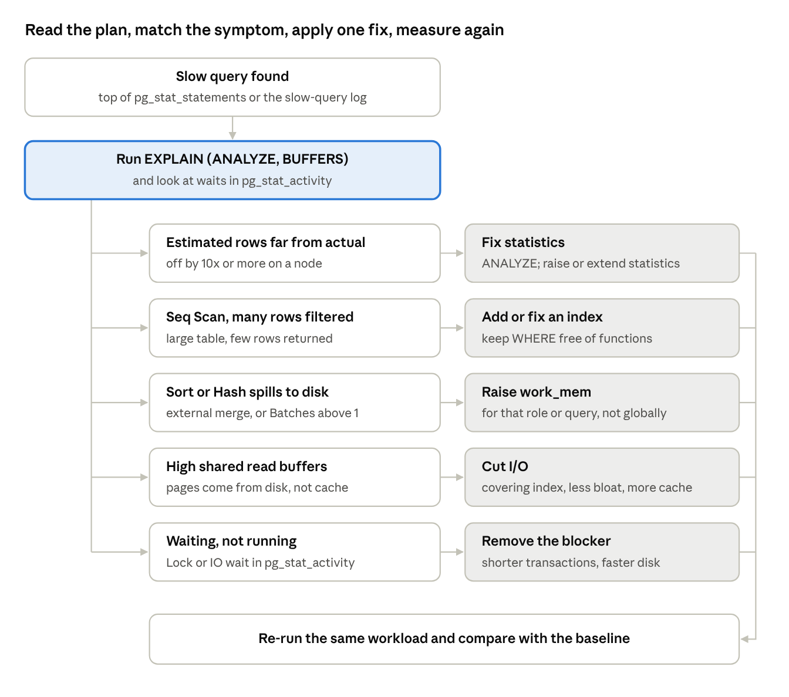

# PostgreSQL: Beginner to Advanced

Oct 12, 2026 · @Gaurav Bhati

A simple, step-by-step guide that starts from zero and ends at advanced DBA work, with most of the depth spent on performance tuning. Commands, paths and defaults are for PostgreSQL 17.

### Where each course folder is covered

| Folder | Topics | Sections |
|----|----|----|
| DB-1 (Modules 1–19, Tour of v16, DBA notes) | Intro, limits, install, architecture, cluster, directories, config files, users and schemas, psql, catalogs, CRUD, inheritance, partitioning, COPY, tablespaces, backup/PITR, maintenance, pg_profile, pgAdmin, pg_upgrade, v13/v15/v16 features | Levels 1–3, Level 1b, Level 2b, Backup and recovery in depth, Maintenance in depth, pg_upgrade runbook, Feature history |
| Backup&Restore Fundamental | pg_dump, pg_dumpall, pg_restore, psql restore, .pgpass, env variables, formats, parallel, selective restore | Backup and recovery in depth |
| DB-2 (Modules 1–7, v15&16 labs) | Log shipping, streaming, slots, sync replication, monitoring, repmgr (failover, rejoin, follow, cascade, switchover, witness, uninstall), libpq failover, logical replication test cases, v15/16 logical features, parameter tuning, pgbench | Replication, HA and scaling in depth; Level 4 |
| Replication + HA and Scalability | Scaling, streaming and logical replication, PgBouncer, HAProxy, partitioning, sharding, Pgpool-II | Replication, HA and scaling in depth |
| PostgreSQL-PT | Source build, file segregation, memory, pg_buffercache, pg_prewarm, connections, autovacuum, checkpoints, pg_stat_bgwriter, parallelism, statement processing, scans, joins, indexes, statistics, query rewrites, logging, pgBadger, pg_stat_statements, monitoring queries | Level 4 (all four parts), Day-to-day diagnostic queries |
| High_Performance | Architecture, vacuum, index use, index-only/covering/partial/FK indexes, CLUSTER, fill factor, statistics, EXPLAIN, joins and join order, query tips, parallel query, shared_buffers, scalability, cheat sheets | Level 4 (all four parts) |
| Beginner | Sample databases (Northwind, HR, movies, stocks, trades, rainfall, countries) and the crosstab pivot function | Level 1 and Level 1b (practice data, pivot) |

`Oracle_Changes_For_BIGQUERY.txt` in PostgreSQL-PT is about Oracle archive-log settings for BigQuery replication, not PostgreSQL, so it is not included.

## Contents

- [**Level 1 — Beginner**](#level-1-beginner)
    - [What PostgreSQL is](#what-postgresql-is)
    - [Install](#install)
    - [Connect with psql](#connect-with-psql)
    - [First database and table](#first-database-and-table)
    - [Basic SQL](#basic-sql)
- [**Level 1b — SQL and objects in depth**](#level-1b-sql-and-objects-in-depth)
    - [Limits and storage basics](#limits-and-storage-basics)
    - [Environment setup](#environment-setup)
    - [Data types](#data-types)
    - [Constraints](#constraints)
    - [Functions and operators](#functions-and-operators)
    - [Reading data](#reading-data)
    - [Transactions](#transactions)
    - [Views, sequences and identity](#views-sequences-and-identity)
    - [Copying tables and data](#copying-tables-and-data)
    - [Table inheritance](#table-inheritance)
    - [Pivot (crosstab)](#pivot-crosstab)
    - [psql reference](#psql-reference)
- [**Level 2 — Intermediate**](#level-2-intermediate)
    - [Architecture in one picture](#architecture-in-one-picture)
    - [Data directory](#data-directory)
    - [Start, stop, reload](#start-stop-reload)
    - [Configuration](#configuration)
    - [Users, roles and access](#users-roles-and-access)
    - [Schemas and tablespaces](#schemas-and-tablespaces)
    - [Backup and restore](#backup-and-restore)
- [**Level 2b — Administration in depth**](#level-2b-administration-in-depth)
    - [Create and control a cluster](#create-and-control-a-cluster)
    - [Run the data directory somewhere else](#run-the-data-directory-somewhere-else)
    - [Directory layout](#directory-layout)
    - [Configuration files](#configuration-files)
    - [Databases, users and privileges](#databases-users-and-privileges)
    - [Schemas and search_path](#schemas-and-search_path)
    - [System catalogs and useful functions](#system-catalogs-and-useful-functions)
    - [Tablespaces](#tablespaces)
    - [pgAdmin 4 and Stack Builder](#pgadmin-4-and-stack-builder)
- [**Backup and recovery in depth**](#backup-and-recovery-in-depth)
    - [Connection settings for scripts](#connection-settings-for-scripts)
    - [pg_dump](#pg_dump)
    - [pg_restore and psql](#pg_restore-and-psql)
    - [pg_dumpall (cluster-wide)](#pg_dumpall-cluster-wide)
    - [Offline (file-system) backup](#offline-file-system-backup)
    - [Online physical backup](#online-physical-backup)
    - [Continuous archiving](#continuous-archiving)
    - [Point-in-time recovery (PITR)](#point-in-time-recovery-pitr)
    - [Incremental backup (v17)](#incremental-backup-v17)
- [**Level 3 — Advanced DBA**](#level-3-advanced-dba)
    - [MVCC, dead rows and VACUUM](#mvcc-dead-rows-and-vacuum)
    - [Partitioning](#partitioning)
    - [Replication](#replication)
    - [High availability and scaling](#high-availability-and-scaling)
    - [Upgrades](#upgrades)
- [**Maintenance in depth**](#maintenance-in-depth)
    - [Planner statistics and ANALYZE](#planner-statistics-and-analyze)
    - [EXPLAIN and the cost formula](#explain-and-the-cost-formula)
    - [Bloat and VACUUM](#bloat-and-vacuum)
    - [Transaction ID wraparound and FREEZE](#transaction-id-wraparound-and-freeze)
    - [REINDEX and index health](#reindex-and-index-health)
    - [CLUSTER](#cluster)
    - [Autovacuum](#autovacuum)
    - [AWR-style reports with pg_profile](#awr-style-reports-with-pg_profile)
- [**Replication, HA and scaling in depth**](#replication-ha-and-scaling-in-depth)
    - [Concepts](#concepts)
    - [Log-shipping standby (DB-2 Module 2)](#log-shipping-standby-db-2-module-2)
    - [Streaming replication (DB-2 Module 3)](#streaming-replication-db-2-module-3)
    - [Failover, switchover and rejoin (manual)](#failover-switchover-and-rejoin-manual)
    - [repmgr: automatic failover (DB-2 Module 4)](#repmgr-automatic-failover-db-2-module-4)
    - [Client-side failover with libpq (v10+)](#client-side-failover-with-libpq-v10)
    - [Logical replication (DB-2 Module 5)](#logical-replication-db-2-module-5)
    - [Connection pooling: PgBouncer](#connection-pooling-pgbouncer)
    - [Load balancing: HAProxy](#load-balancing-haproxy)
    - [Pgpool-II](#pgpool-ii)
    - [Partitioning and sharding for scale](#partitioning-and-sharding-for-scale)
- [**pg_upgrade runbook: 16 → 17**](#pg_upgrade-runbook-16-17)
    - [Choose the method](#choose-the-method)
    - [1. Prepare (days before)](#1-prepare-days-before)
    - [2. Back up](#2-back-up)
    - [3. Install 17 next to 16](#3-install-17-next-to-16)
    - [4. Create the new cluster](#4-create-the-new-cluster)
    - [5. Check compatibility](#5-check-compatibility)
    - [6. Upgrade (downtime starts)](#6-upgrade-downtime-starts)
    - [7. Start 17 and finish](#7-start-17-and-finish)
    - [8. Verify](#8-verify)
    - [9. Replicas, slots and HA tools](#9-replicas-slots-and-ha-tools)
    - [10. Clean up](#10-clean-up)
    - [Rollback](#rollback)
    - [Upgrade with dump and restore (alternative)](#upgrade-with-dump-and-restore-alternative)
    - [Windows notes](#windows-notes)
- [**Level 4 — Performance tuning: method and server parameters**](#level-4-performance-tuning-method-and-server-parameters)
    - [The tuning loop](#the-tuning-loop)
    - [Storage layout](#storage-layout)
    - [Memory parameters](#memory-parameters)
    - [Checkpoints and WAL](#checkpoints-and-wal)
    - [Parallel query](#parallel-query)
    - [Planner cost settings](#planner-cost-settings)
    - [Connections](#connections)
    - [Sample starting config (32 GB RAM, SSD, mixed workload)](#sample-starting-config-32-gb-ram-ssd-mixed-workload)
- [**Level 4 — Performance tuning: vacuum, plans, indexes and queries**](#level-4-performance-tuning-vacuum-plans-indexes-and-queries)
    - [Autovacuum and bloat](#autovacuum-and-bloat)
    - [Reading EXPLAIN](#reading-explain)
    - [Indexes](#indexes)
    - [Statistics](#statistics)
    - [Query rewrites that pay off](#query-rewrites-that-pay-off)
- [**Level 4 — Performance tuning: monitoring, pooling and benchmarking**](#level-4-performance-tuning-monitoring-pooling-and-benchmarking)
    - [Turn on the instruments](#turn-on-the-instruments)
    - [Top queries (pg_stat_statements)](#top-queries-pg_stat_statements)
    - [Live activity, waits and locks](#live-activity-waits-and-locks)
    - [Health ratios](#health-ratios)
    - [Log analysis with pgBadger](#log-analysis-with-pgbadger)
    - [Connection pooling](#connection-pooling)
    - [Benchmarking with pgbench](#benchmarking-with-pgbench)
    - [Daily, weekly, monthly routine](#daily-weekly-monthly-routine)
- [**Level 4 — Performance tuning: deeper topics and lab exercises**](#level-4-performance-tuning-deeper-topics-and-lab-exercises)
    - [Custom build from source with separated files](#custom-build-from-source-with-separated-files)
    - [The read and write path](#the-read-and-write-path)
    - [pg_buffercache and pg_prewarm](#pg_buffercache-and-pg_prewarm)
    - [work_mem experiments](#work_mem-experiments)
    - [Connections](#connections_1)
    - [Parallel query lab](#parallel-query-lab)
    - [How a statement is processed](#how-a-statement-is-processed)
    - [Scan methods (course demos)](#scan-methods-course-demos)
    - [Join methods (course test case: emp 50,000 rows, dept 20,000 rows)](#join-methods-course-test-case-emp-50000-rows-dept-20000-rows)
    - [Index tips from the High Performance course](#index-tips-from-the-high-performance-course)
    - [Query tips from the High Performance course](#query-tips-from-the-high-performance-course)
    - [Logging for performance](#logging-for-performance)
    - [pgBadger setup](#pgbadger-setup)
    - [Reading planner statistics (pg_stats)](#reading-planner-statistics-pg_stats)
    - [Operating-system monitoring](#operating-system-monitoring)
- [**Slow-query troubleshooting**](#slow-query-troubleshooting)
- [**Day-to-day DBA diagnostic queries (PostgreSQL 17)**](#day-to-day-dba-diagnostic-queries-postgresql-17)
    - [1. Health snapshot (start of day)](#1-health-snapshot-start-of-day)
    - [2. Sessions and connections](#2-sessions-and-connections)
    - [3. Locks and blocking](#3-locks-and-blocking)
    - [4. Top SQL (pg_stat_statements)](#4-top-sql-pg_stat_statements)
    - [5. Vacuum, bloat and wraparound](#5-vacuum-bloat-and-wraparound)
    - [6. Indexes](#6-indexes)
    - [7. Storage and size](#7-storage-and-size)
    - [8. Checkpoints, background writer and I/O (v17 views)](#8-checkpoints-background-writer-and-io-v17-views)
    - [9. Replication and archiving](#9-replication-and-archiving)
    - [10. Configuration checks](#10-configuration-checks)
    - [11. Taking action](#11-taking-action)
    - [Fixes made to the course queries](#fixes-made-to-the-course-queries)
    - [Other course statements corrected for PostgreSQL 17](#other-course-statements-corrected-for-postgresql-17)
- [**Feature history 13 → 16**](#feature-history-13-16)
    - [PostgreSQL 13 (September 2020)](#postgresql-13-september-2020)
    - [PostgreSQL 14 (September 2021)](#postgresql-14-september-2021)
    - [PostgreSQL 15 (October 2022)](#postgresql-15-october-2022)
    - [PostgreSQL 16 (September 2023)](#postgresql-16-september-2023)
- [**PostgreSQL 17 notes**](#postgresql-17-notes)
    - [Performance](#performance)
    - [Monitoring changes (update your scripts)](#monitoring-changes-update-your-scripts)
    - [Backup and recovery](#backup-and-recovery)
    - [Replication and HA](#replication-and-ha)
    - [Administration and security](#administration-and-security)
    - [Upgrading to 17](#upgrading-to-17)
- [**Learning path checklist**](#learning-path-checklist)

---

## Level 1 — Beginner

Goal: install PostgreSQL, connect with psql, and create and query your own tables.

### What PostgreSQL is

PostgreSQL is a free, open-source relational database. It is ACID-compliant (transactions are all-or-nothing and survive crashes) and uses MVCC, so readers never block writers. It runs on Linux, Windows and macOS and listens on port 5432 by default.

Useful vocabulary: a table is a *relation*, a row is a *tuple*, a column is an *attribute*, and data is stored in 8 KB *pages*.

### Install

- **Windows:** download the installer from postgresql.org, run it as Administrator, then add the `bin` folder to `PATH`.

- **RHEL / Rocky:**

```bash
sudo dnf install -y https://download.postgresql.org/pub/repos/yum/reporpms/EL-8-x86_64/pgdg-redhat-repo-latest.noarch.rpm
sudo dnf -qy module disable postgresql
sudo dnf install -y postgresql17-server postgresql17-contrib
sudo /usr/pgsql-17/bin/postgresql-17-setup initdb
sudo systemctl enable --now postgresql-17
```

Always install the `contrib` package: it contains pg_stat_statements, pg_buffercache and other tuning tools used later.

### Connect with psql

```bash
sudo -iu postgres psql                       # local superuser
psql -h dbhost -p 5432 -U appuser -d sales   # remote
```

| Command       | Does                           |
|---------------|--------------------------------|
| \l            | List databases                 |
| \c sales      | Connect to database sales      |
| \dt, \d table | List tables; describe one      |
| \du           | List users                     |
| \timing       | Show how long each query takes |
| \x            | Expanded (vertical) output     |
| \i file.sql   | Run a script                   |
| \q            | Quit                           |

### First database and table

```sql
CREATE DATABASE shop;
\c shop

CREATE TABLE customers (
  id         serial PRIMARY KEY,
  name       text NOT NULL,
  email      text UNIQUE,
  city       text,
  created_at timestamptz DEFAULT now()
);

CREATE TABLE orders (
  id          serial PRIMARY KEY,
  customer_id int REFERENCES customers(id),
  amount      numeric(10,2) CHECK (amount > 0),
  order_date  date NOT NULL
);
```

Common types: `int`/`bigint`, `numeric`, `text`/`varchar(n)`, `boolean`, `date`/`timestamptz`, `jsonb`, arrays. Constraints: PRIMARY KEY, FOREIGN KEY, UNIQUE, NOT NULL, CHECK.

### Basic SQL

```sql
INSERT INTO customers (name, email, city) VALUES ('Asha', 'asha@x.com', 'Pune');

SELECT name, city FROM customers WHERE city = 'Pune' ORDER BY name LIMIT 10;

SELECT c.name, count(o.id) AS orders, sum(o.amount) AS total
FROM customers c LEFT JOIN orders o ON o.customer_id = c.id
GROUP BY c.name HAVING sum(o.amount) > 1000;

UPDATE customers SET city = 'Mumbai' WHERE id = 1;
DELETE FROM orders WHERE order_date < '2020-01-01';

BEGIN;  UPDATE ...;  ROLLBACK;   -- or COMMIT
```

Practice data: load `northwind.sql` or `hr.sql` from your Beginner folder with `psql -d shop -f northwind.sql`.

**First performance habit:** turn on `\timing` and always look at how long your queries take. Everything in Level 4 builds on this.

## Level 1b — SQL and objects in depth

Everything a beginner meets in DB-1 Modules 1, 2, 8, 10 and 11 and the Beginner sample data, in PostgreSQL 17 syntax.

### Limits and storage basics

| Item                   | Limit (default 8 KB block)     |
|------------------------|--------------------------------|
| Database size          | Unlimited                      |
| Databases per cluster  | 4,294,950,911                  |
| Relations per database | 1,431,650,303                  |
| Table (relation) size  | 32 TB                          |
| Rows per table         | Limited by 4,294,967,295 pages |
| Columns per table      | 1,600                          |
| Field size             | 1 GB                           |
| Identifier length      | 63 bytes                       |
| Columns per index      | 32                             |
| Partition keys         | 32                             |

A **page** (block) is 8 KB, fixed at compile time. Each page has a 24-byte header, an array of 4-byte item pointers growing from the front, tuples growing from the back, free space in the middle, and a "special" area used only by indexes. A page in memory is called a **buffer**.

### Environment setup

**Windows:** System Properties → Environment Variables → add `C:\Program Files\PostgreSQL\17\bin` to `Path` and a new variable `PGDATA = C:\Program Files\PostgreSQL\17\data`.

**Linux** (`~/.bash_profile` of the postgres user):

```bash
export PATH=/usr/pgsql-17/bin:$PATH
export PGDATA=/var/lib/pgsql/17/data
export PGPORT=5432 PGUSER=postgres PGDATABASE=postgres   # defaults for every client tool
```

Run `. ~/.bash_profile` to load it.

### Data types

| Group | Types |
|----|----|
| Character | char(n), varchar(n), text |
| Numeric | smallint, int, bigint, numeric(p,s), real, double precision, serial / identity |
| Boolean | boolean |
| Date and time | date, time, timestamp, timestamptz, interval |
| Structured | arrays, json, jsonb, composite, enum, range types |
| Special | uuid, inet / cidr, geometric types, bytea |

Prefer `int GENERATED ALWAYS AS IDENTITY` over `serial` in new designs, `timestamptz` over `timestamp`, and `jsonb` over `json`.

### Constraints

NOT NULL, UNIQUE, PRIMARY KEY, FOREIGN KEY, CHECK, and EXCLUDE. Define them per column or per table, at creation or with ALTER TABLE.

```sql
CREATE TABLE employees (
  empid       int GENERATED ALWAYS AS IDENTITY CONSTRAINT emp_pk PRIMARY KEY,
  emp_name    varchar(200) NOT NULL,
  computer_id varchar(50),
  salary      int CHECK (salary > 0),
  dept_id     int REFERENCES dept(dept_id) ON DELETE SET NULL,
  CONSTRAINT id_comp UNIQUE NULLS NOT DISTINCT (computer_id)   -- v15+: only one NULL allowed
);
```

Typical errors from the course demos: `duplicate key value violates unique constraint` and `null value in column ... violates not-null constraint`.

### Functions and operators

| Kind | Examples |
|----|----|
| Aggregate | count, sum, avg, min, max, string_agg, array_agg |
| String | concat, initcap, lower, upper, substring, trim, ltrim, rtrim, format, chr, length |
| Date and time | now(), current_date, current_timestamp, age(ts), date_trunc, extract, transaction_timestamp() |
| Math | +, -, \*, /, %, abs, ceil, floor, mod, round, power |
| Comparison | =, \<\> (or !=), \<, \>, \<=, \>=, BETWEEN, IN, LIKE, ILIKE, IS NULL |

```sql
SELECT now() + interval '1 hour', now() - interval '2 hours 30 minutes', now()::timestamp;
```

### Reading data

```sql
SELECT DISTINCT city FROM customers;
SELECT first_name AS name, email FROM customer WHERE first_name LIKE 'A%' ORDER BY 1 LIMIT 10;
SELECT customer_id, sum(amount) FROM payment GROUP BY customer_id HAVING sum(amount) > 200;

-- window functions: rank inside a group without collapsing rows
SELECT region, country, exports,
       rank() OVER (PARTITION BY region ORDER BY exports DESC) AS rank_in_region
FROM trades WHERE year = 2012;
```

### Transactions

A transaction is all-or-nothing: `BEGIN` … `COMMIT` saves, `ROLLBACK` undoes. psql auto-commits each statement unless you run `\set AUTOCOMMIT off`. An UPDATE or DELETE without WHERE changes every row, so test inside a transaction first.

### Views, sequences and identity

```sql
CREATE VIEW high_paid AS SELECT * FROM employees WHERE salary > 5000;   -- stores no data
CREATE MATERIALIZED VIEW sales_summary AS SELECT ...;                   -- stores data
REFRESH MATERIALIZED VIEW CONCURRENTLY sales_summary;                   -- needs a unique index

CREATE SEQUENCE emp_seq START 100 INCREMENT 1;
SELECT nextval('emp_seq'), currval('emp_seq'), setval('emp_seq', 500);
```

### Copying tables and data

```sql
CREATE TABLE train_dest AS TABLE train_bookings;                 -- structure + data
CREATE TABLE train_dest AS TABLE train_bookings WITH NO DATA;    -- structure only
CREATE TABLE train_dest (LIKE train_bookings INCLUDING ALL);     -- also defaults, constraints, indexes
```

`CREATE TABLE AS` copies columns and rows only: no defaults, sequences, constraints or indexes, and no link back to the source.

**COPY** loads or unloads files fast:

```sql
COPY test1 FROM '/data/example.csv' WITH (FORMAT csv, HEADER true);   -- server-side file
\copy test1 FROM 'example.csv' WITH (FORMAT csv)                      -- psql, client-side file
COPY test1 FROM '/data/example.csv' WITH (FORMAT csv, ON_ERROR ignore); -- v17: skip bad rows
COPY (SELECT * FROM orders WHERE order_date >= '2026-01-01') TO '/tmp/orders.csv' WITH (FORMAT csv, HEADER);
```

Watch a long load in `pg_stat_progress_copy`. COPY is much faster in v16/17 than in older releases; the course test loaded 15 million rows in about 7 s on v16 against 12 s on v15.

### Table inheritance

A child table inherits all parent columns and can add its own. Queries on the parent include child rows unless you write `ONLY`.

```sql
CREATE TABLE orders (orderno serial, flightname varchar(100), status varchar(100));
CREATE TABLE online_booking (price int) INHERITS (orders);
CREATE TABLE agent_booking (commission int) INHERITS (orders);

SELECT * FROM orders;                                  -- all rows, parent + children
SELECT * FROM ONLY orders;                             -- parent rows only
UPDATE ONLY orders SET status = 'Cancelled';           -- parent rows only
DROP TABLE orders CASCADE;                             -- children must go too
```

The course also builds partitioning from inheritance (CHECK constraints + an insert trigger). That method is obsolete: use declarative partitioning (Level 3).

### Pivot (crosstab)

The Beginner folder's `pivotcode.sql` builds crosstab queries dynamically. The underlying function comes from the `tablefunc` extension:

```sql
CREATE EXTENSION tablefunc;
SELECT * FROM crosstab(
  $$SELECT location, year, sum(raindays) FROM rainfalls GROUP BY 1, 2 ORDER BY 1, 2$$,
  $$SELECT DISTINCT year FROM rainfalls ORDER BY 1$$
) AS t(location text, "2017" bigint, "2018" bigint, "2019" bigint);
```

Without the extension, use `sum(raindays) FILTER (WHERE year = 2017)` per column.

### psql reference

| Command | Does |
|----|----|
| psql -h host -p port -U user -d db -W | Connect (-W asks for a password) |
| psql "host=h dbname=db sslmode=require" | Connect with SSL |
| psql -d db -f script.sql | Run a script |
| \c db \[user\] | Switch database / user |
| \conninfo | Current connection |
| \l, \dn, \dt, \di, \dv, \ds, \df, \du, \db, \dx | Databases, schemas, tables, indexes, views, sequences, functions, roles, tablespaces, extensions (add + for sizes and detail) |
| \d name, \d+ name | Describe an object |
| \dconfig pattern | Show settings (v15+), e.g. `\dconfig *work_mem*` |
| \x \[auto\] | Expanded output |
| \timing | Show run time |
| \e, \ef func | Edit query or function in an editor |
| \g, \watch 5 | Re-run the last query; repeat every 5 s |
| \s \[file\] | Show or save history |
| \o file | Send output to a file |
| \w file | Save the query buffer |
| \i file | Run a file |
| \a, \H | Unaligned output; HTML output |
| ! cmd | Run a shell command |
| \set AUTOCOMMIT off | Manual transactions |
| ?, \h CREATE TABLE, \q | psql help, SQL help, quit |

**psql command-line options** (`psql --help`):

| Option | Does |
|----|----|
| -c "SQL" | Run one command and exit |
| -f file, -1 | Run a file; -1 wraps it in one transaction |
| -l | List databases and exit |
| -v ON_ERROR_STOP=1 | Set a variable (stop scripts on the first error) |
| -X | Don't read ~/.psqlrc |
| -a / -b / -e / -E | Echo all input / failed commands / queries sent / queries behind \d commands |
| -L file, -o file | Log the session / send results to a file |
| -q, -s, -S | Quiet; single-step (confirm each query); single-line mode |
| -A, -t, -F ',', --csv, -H, -x | Unaligned, tuples only, field separator, CSV, HTML, expanded output |
| -P name=value | Set a \pset option |
| -h, -p, -U, -d, -w / -W | Host, port, user, database, never / always ask for a password |

Example, for a cron report: `psql -X -A -t -F ',' -v ON_ERROR_STOP=1 -c "SELECT datname, pg_database_size(datname) FROM pg_database" -o sizes.csv`.

## Level 2 — Intermediate

Goal: understand how the server works inside, configure it safely, control access, and protect data with backups.

### Architecture in one picture

Every client connection gets its own `postgres` backend process, forked by the **postmaster**. Backends never write data files directly: they read and change pages in **shared buffers** and write change records to **WAL buffers**. Background processes then flush to disk.

| Process | Job | Tuning link |
|----|----|----|
| Background writer | Writes some dirty pages ahead of need | bgwriter_lru_maxpages |
| Checkpointer | Flushes all dirty pages at each checkpoint | checkpoint_timeout, max_wal_size |
| WAL writer | Flushes WAL buffers to pg_wal | wal_buffers |
| Autovacuum launcher / workers | Remove dead rows, refresh statistics | autovacuum\_\* |
| Archiver | Copies finished WAL files for PITR | archive_command |
| Logger | Writes the server log | log\_\* |

Memory: **shared** (shared_buffers, WAL buffers, CLOG) is used by everyone; **per-session** (work_mem, maintenance_work_mem, temp_buffers) is allocated by each backend as needed. This split is the heart of memory tuning in Level 4.

### Data directory

| Path | Holds |
|----|----|
| base/ | One folder per database, named by OID |
| global/ | Cluster-wide catalogs |
| pg_wal/ | WAL segments (16 MB each) |
| pg_xact/ | Commit status |
| pg_tblspc/ | Links to tablespaces |
| postgresql.conf, postgresql.auto.conf, pg_hba.conf | Configuration |

### Start, stop, reload

```bash
pg_ctl -D $PGDATA start | stop -m fast | restart | reload | status
systemctl restart postgresql-17
```

Shutdown modes: **smart** (wait for sessions), **fast** (default; roll back and stop), **immediate** (crash-style; recovery at next start).

### Configuration

```sql
SHOW shared_buffers;
SELECT name, setting, unit, context, pending_restart FROM pg_settings WHERE name = 'work_mem';
ALTER SYSTEM SET work_mem = '64MB';   -- written to postgresql.auto.conf, overrides postgresql.conf
SELECT pg_reload_conf();               -- enough for 'sighup' / 'user' parameters
```

The `context` column tells you what a change needs: `postmaster` = restart, `sighup` = reload, `user` = can even be SET per session.

### Users, roles and access

```sql
CREATE ROLE app LOGIN PASSWORD 'secret';
GRANT CONNECT ON DATABASE shop TO app;
GRANT USAGE ON SCHEMA public TO app;
GRANT SELECT, INSERT, UPDATE, DELETE ON ALL TABLES IN SCHEMA public TO app;
ALTER DEFAULT PRIVILEGES IN SCHEMA public GRANT SELECT ON TABLES TO app;
GRANT pg_read_all_data TO reporting;   -- v14+ predefined role
GRANT pg_maintain TO dba_ops;          -- v17: VACUUM, ANALYZE, REINDEX without owning the tables
```

`pg_hba.conf` decides who may connect from where; the first matching line wins.

```bash
# TYPE  DATABASE  USER  ADDRESS        METHOD
local   all       all                  peer
host    shop      app   10.0.0.0/24    scram-sha-256
hostssl all       all   0.0.0.0/0      scram-sha-256
```

Set `listen_addresses = '*'` to accept remote connections, then reload.

### Schemas and tablespaces

- A **schema** is a namespace inside a database (`CREATE SCHEMA hr;`). Name resolution follows `search_path` (default `"$user", public`).

- A **tablespace** maps objects to a directory on another disk: `CREATE TABLESPACE fast LOCATION '/ssd/pg';` then `CREATE TABLE ... TABLESPACE fast;`. This is your first storage-performance tool.

### Backup and restore

| Type | Tool | Use for |
|----|----|----|
| Logical | pg_dump, pg_dumpall | One table, schema or database; moving between versions |
| Physical | pg_basebackup | Whole cluster; base for PITR and replicas |
| Continuous | WAL archiving + base backup | Point-in-time recovery |

```bash
pg_dump -d shop -Fc -f shop.dump               # custom format
pg_dump -d shop -Fd -j 4 -f shop_dir           # parallel dump
pg_restore -d shop -j 4 shop.dump              # parallel restore
pg_restore -d shop -t orders shop.dump         # one table
pg_dumpall -g > globals.sql                    # roles and tablespaces
pg_basebackup -D /backup/base -P -Xs           # online physical backup
pg_basebackup -D /backup/incr1 --incremental=/backup/base/backup_manifest   # v17 incremental (summarize_wal = on)
pg_combinebackup /backup/base /backup/incr1 -o /restore/data                # v17: merge for restore
```

For PITR set `wal_level = replica`, `archive_mode = on`, `archive_command = 'cp %p /archive/%f'`. To recover, restore the base backup, set `restore_command` and `recovery_target_time`, create `recovery.signal`, and start.

Performance note: use `-j` for parallel dump and restore on large databases, and put backups and archives on a different disk from the data.

## Level 2b — Administration in depth

Covers DB-1 Modules 2–7, 9, 12 and 15 plus the DBA command notes, for PostgreSQL 17.

### Create and control a cluster

A **cluster** is one data directory served by one instance on one port. `initdb` creates it; it must run as the `postgres` OS user.

```bash
initdb -D /var/lib/pgsql/17/data -U postgres -W --data-checksums -E UTF8   # -W asks for a superuser password
/usr/pgsql-17/bin/postgresql-17-setup initdb                                # RHEL packaged way

pg_ctl -D $PGDATA start | stop -m smart|fast|immediate | restart | reload | status
pg_ctl -D $PGDATA -o "-p 5433" start        # second cluster on another port
pg_controldata $PGDATA                       # state, checkpoint location, version, checksums
systemctl enable --now postgresql-17
```

| Shutdown       | Behaviour                                                 |
|----------------|-----------------------------------------------------------|
| smart          | No new connections; waits for all sessions to end         |
| fast (default) | Rolls back open transactions, disconnects, clean shutdown |
| immediate      | Aborts at once; crash recovery on next start              |

**Reload vs restart:** reload (`pg_ctl reload`, `systemctl reload`, `SELECT pg_reload_conf();`) re-reads configuration without disconnecting anyone; parameters marked `postmaster` in pg_settings.context (shared_buffers, max_connections, listen_addresses…) need a restart.

### Run the data directory somewhere else

```bash
systemctl stop postgresql-17
mkdir -p /u01/pgsql/17 && rsync -a /var/lib/pgsql/17/data /u01/pgsql/17/
chown -R postgres:postgres /u01/pgsql && chmod 700 /u01/pgsql/17/data
systemctl edit postgresql-17         # add:  [Service]  Environment=PGDATA=/u01/pgsql/17/data
systemctl daemon-reload && systemctl start postgresql-17
```

Also update `PGDATA` in the postgres user's `.bash_profile`, then confirm with `SHOW data_directory;`. Data directories must be mode 700 or 750, or the server refuses to start.

### Directory layout

Install directory: `/usr/pgsql-17` (RHEL) or `C:\Program Files\PostgreSQL\17` with bin, lib, share (sample configs), include and doc.

| Data directory entry | Contents |
|----|----|
| base/ | One folder per database, named by OID (`SELECT oid, datname FROM pg_database;`) |
| global/ | Cluster-wide catalogs (pg_database, pg_authid, pg_tablespace) |
| pg_wal/ | WAL segments, 16 MB each |
| pg_xact/ | Commit status (CLOG) |
| pg_multixact/, pg_subtrans/, pg_twophase/, pg_serial/ | Shared row locks, subtransactions, prepared and serializable transactions |
| pg_commit_ts/ | Commit timestamps (track_commit_timestamp) |
| pg_logical/, pg_replslot/ | Logical decoding state, replication slots |
| pg_snapshots/, pg_notify/, pg_dynshmem/ | Exported snapshots, LISTEN/NOTIFY, dynamic shared memory |
| pg_stat/, pg_stat_tmp/ | Saved statistics (stats live in shared memory since v15) |
| pg_tblspc/ | Symbolic links to tablespaces |
| pg_wal/summaries/ | WAL summaries for incremental backup (v17) |
| log/ | Server logs (logging_collector) |
| postgresql.conf, postgresql.auto.conf, pg_hba.conf, pg_ident.conf | Configuration |
| postmaster.pid, postmaster.opts, PG_VERSION, current_logfiles | PID/port/socket lock file, last start options, major version, active log file |

### Configuration files

**postgresql.conf** holds one `name = value` per line. Safe change routine: check the current value, back up the file, edit (remove the leading `#`), reload or restart, then verify.

```sql
SHOW max_connections;
SELECT name, setting, unit, context, boot_val, sourcefile, pending_restart FROM pg_settings WHERE name = 'shared_buffers';
SELECT name, setting, applied, error FROM pg_file_settings;      -- what the files say and whether it applied
ALTER SYSTEM SET work_mem = '10MB';     -- writes postgresql.auto.conf (wins over postgresql.conf)
ALTER SYSTEM RESET work_mem;            -- or RESET ALL
SELECT pg_reload_conf();
```

**pg_hba.conf** decides who may connect; lines are read top-down and the first match wins. No match means rejected.

```bash
# TYPE    DATABASE     USER      ADDRESS          METHOD
local     all          postgres                   peer
local     all          all                        scram-sha-256
host      all          all       127.0.0.1/32     scram-sha-256
hostssl   sales        app       10.0.0.0/24      scram-sha-256
host      replication  repuser   10.0.0.12/32     scram-sha-256
host      all          all       0.0.0.0/0        reject
```

| Field | Values |
|----|----|
| TYPE | local (Unix socket), host (TCP), hostssl, hostnossl, hostgssenc |
| DATABASE | all, sameuser, samerole, replication, a name, @file; v16+ also regular expressions (/^db\_) |
| USER | all, a name, +group, @file, /regex |
| ADDRESS | 10.0.0.5/32 (one host), 10.0.0.0/24 (network), a hostname, samehost, samenet |
| METHOD | trust (no password, dangerous), reject, scram-sha-256 (recommended), md5 (deprecated), password (clear text), peer / ident (OS user), ldap, gss, cert, radius, pam |

The course slides also list `crypt` and `krb4/krb5`: those were removed long ago. To allow remote clients set `listen_addresses = '*'` (restart), add a hba line, reload, and test with `psql -h server -U user -d db`. Check for errors with `SELECT * FROM pg_hba_file_rules WHERE error IS NOT NULL;`.

**pg_ident.conf** maps OS users to database users for `peer`, `ident`, `gss` or `cert` authentication, referenced by `map=name` in pg_hba.conf:

```bash
# MAPNAME  SYSTEM-USERNAME  PG-USERNAME
sales      rmartin          sales
sales      jpenny           sales
audit      auditor          sales
audit      auditor          postgres
```

### Databases, users and privileges

```bash
createdb -O scott sales      dropdb sales          # shell utilities (‑‑help for options)
createuser -P -S malcolm     createuser --interactive henry     dropuser malcolm
```

```sql
CREATE DATABASE sales OWNER scott TEMPLATE template0 TABLESPACE fast;
DROP DATABASE sales WITH (FORCE);           -- v13+: disconnects sessions first
CREATE USER scott LOGIN PASSWORD 'welcome';  -- CREATE USER = CREATE ROLE ... LOGIN
ALTER USER scott CREATEDB;  ALTER USER scott WITH SUPERUSER;  ALTER USER scott WITH NOSUPERUSER;
REASSIGN OWNED BY scott TO postgres;  DROP OWNED BY scott;  DROP ROLE scott;
```

Users are global to the cluster, separate from OS users, and must not start with `pg_`. You cannot drop the database you are connected to, or a role that still owns objects.

| Level | Examples |
|----|----|
| Cluster (role attributes) | SUPERUSER, CREATEDB, CREATEROLE, REPLICATION, LOGIN, BYPASSRLS |
| Database | CONNECT, CREATE, TEMP |
| Schema | USAGE, CREATE |
| Table / column | SELECT, INSERT, UPDATE, DELETE, TRUNCATE, REFERENCES, TRIGGER, MAINTAIN (v17) |
| Predefined roles | pg_read_all_data, pg_write_all_data, pg_monitor, pg_read_all_settings, pg_read_all_stats, pg_stat_scan_tables, pg_signal_backend, pg_read_server_files, pg_write_server_files, pg_checkpoint, pg_create_subscription, pg_maintain, pg_database_owner |

```sql
REVOKE CONNECT ON DATABASE nano FROM PUBLIC;                 -- lock a database down
GRANT CONNECT ON DATABASE nano TO app;
GRANT USAGE ON SCHEMA hr TO app;
GRANT SELECT, INSERT, UPDATE, DELETE ON ALL TABLES IN SCHEMA hr TO app;
GRANT USAGE, SELECT ON ALL SEQUENCES IN SCHEMA hr TO app;
ALTER DEFAULT PRIVILEGES IN SCHEMA hr GRANT SELECT ON TABLES TO app;   -- future tables too
GRANT SELECT (col1), UPDATE (col1) ON mytable TO app;          -- column level
REVOKE DELETE, UPDATE ON products FROM app;
REVOKE ALL ON products FROM PUBLIC;
GRANT ALTER SYSTEM ON PARAMETER log_statement TO demo;           -- v15+
```

Since v15 ordinary users can no longer create objects in the `public` schema by default.

### Schemas and search_path

```sql
CREATE SCHEMA hr;
CREATE SCHEMA AUTHORIZATION scott;                    -- schema named after and owned by scott
CREATE SCHEMA IF NOT EXISTS john AUTHORIZATION brett;
DROP SCHEMA hr CASCADE;                               -- needed if it still has objects
SHOW search_path;                                     -- "$user", public
SET search_path TO hr, public;                        -- session
ALTER ROLE scott SET search_path TO scott, public;    -- per user
ALTER DATABASE sales SET search_path TO app, public;  -- per database
```

### System catalogs and useful functions

| View | Holds |
|----|----|
| pg_database, pg_stat_database | Databases and their activity |
| pg_tables, pg_indexes, pg_views, pg_matviews, pg_sequences | Objects |
| pg_roles, pg_user, pg_authid | Roles (pg_authid / pg_shadow hold password hashes; superuser only) |
| pg_settings, pg_file_settings, pg_hba_file_rules | Configuration |
| pg_locks, pg_stat_activity | Locks and sessions |
| pg_stats, pg_statistic_ext | Planner statistics |
| pg_tablespace | Tablespaces |
| pg_available_extensions, pg_extension | Extensions |
| pg_timezone_names | Time zones |
| information_schema.\* | SQL-standard views of the same data |

```sql
SELECT current_database(), current_schema(), current_user, session_user, version();
SELECT current_setting('max_parallel_workers'), pg_backend_pid(), pg_postmaster_start_time();
SELECT inet_server_addr(), inet_server_port(), pg_is_in_recovery(), pg_is_in_backup();
SELECT pg_size_pretty(pg_database_size('sales')), pg_size_pretty(pg_total_relation_size('orders'));
SELECT pg_relation_filepath('orders');      -- file under base/
```

Note: `pg_is_in_backup()` only reported old exclusive backups and was removed in v15.

### Tablespaces

A tablespace maps a name to a directory, so you can put hot data on fast disks. Built-in: `pg_default` (user data) and `pg_global` (shared catalogs).

```sql
-- mkdir -p /u01/user_tablespace && chown postgres:postgres /u01/user_tablespace
CREATE TABLESPACE hrd LOCATION '/u01/user_tablespace';
CREATE TABLE test1 (id int) TABLESPACE hrd;
SELECT tablename, tablespace FROM pg_tables WHERE tablespace = 'hrd';
ALTER TABLE test1 SET TABLESPACE pg_default;                      -- moves it (table is locked)
ALTER TABLE ALL IN TABLESPACE hrd SET TABLESPACE pg_default;      -- move everything
ALTER DATABASE sales SET TABLESPACE fast;                         -- whole database (no connections)
DROP TABLESPACE hrd;                                              -- must be empty first
```

Three scenarios from the PT course: (1) existing cluster, new objects elsewhere → create a tablespace and set `default_tablespace`; (2) new install → create the tablespace first, then `CREATE DATABASE ... TABLESPACE`; (3) several databases → `ALTER DATABASE ... SET TABLESPACE` for each. For sort and temp files use `temp_tablespaces = 'temp01'` and reload; those files disappear when the query ends.

### pgAdmin 4 and Stack Builder

pgAdmin 4 is the open-source GUI (desktop or web) for browsing objects, running queries with a graphical EXPLAIN, managing roles and backups, and watching a live dashboard of sessions, locks and transactions. A master password encrypts saved connection passwords. Stack Builder (Windows installer) adds drivers, PostGIS and other add-ons.

## Backup and recovery in depth

Covers DB-1 Module 13 and the whole Backup&Restore Fundamental course, for PostgreSQL 17. A good plan combines both kinds: physical backups + WAL archive for full recovery to any moment, and logical dumps for single objects and migrations.

| Type | Tool | Server state | Restores | Point-in-time |
|----|----|----|----|----|
| Logical, plain SQL | pg_dump -Fp, pg_dumpall | Online | psql | No |
| Logical, archive | pg_dump -Fc / -Fd / -Ft | Online | pg_restore (selective, parallel) | No |
| Offline file copy | tar / rsync of PGDATA | Stopped | Copy back | No |
| Online physical | pg_basebackup, or pg_backup_start/stop + copy | Online | Copy back + WAL | Yes |
| Incremental (v17) | pg_basebackup --incremental + pg_combinebackup | Online | Combine, then as physical | Yes |

### Connection settings for scripts

```bash
export PGHOST=localhost PGPORT=5432 PGUSER=postgres PGDATABASE=sample
# ~/.pgpass  (chmod 0600)   host:port:database:user:password   (* = any)
localhost:5432:sample:postgres:secret
192.168.122.5:5432:*:backup_user:secret
```

With `.pgpass` cron jobs run without a password prompt. Check client versions with `pg_dump --version`: always dump with the **newer** pg_dump when moving to a newer server.

### pg_dump

| Option | Effect |
|----|----|
| -F p / c / d / t | Plain SQL (default), custom, directory, tar |
| -f file | Output file (directory for -Fd) |
| -j N | Parallel jobs (directory format only) |
| -Z level, --compress=gzip:9 / lz4 / zstd | Compression (lz4/zstd since v16) |
| -t / -T pattern | Include / exclude tables (repeatable, wildcards allowed) |
| -n / -N pattern | Include / exclude schemas |
| --exclude-table-data=pattern | Keep structure, skip rows (e.g. logs) |
| --filter=file | Read include/exclude rules from a file (v17) |
| -a / -s | Data only / schema only |
| -C | Add CREATE DATABASE and connect to it |
| -c --if-exists | DROP objects before creating them |
| -O / -x | No ownership commands / no GRANTs |
| --no-tablespaces | Ignore tablespace clauses |
| -b / -B | Include / exclude large objects |
| --inserts / --column-inserts | INSERT statements instead of COPY (portable, slow) |
| --lock-wait-timeout=60s | Fail instead of waiting forever for a table lock |
| -v | Verbose progress |

```bash
pg_dump -d sample -f sample.sql                                  # plain SQL
pg_dump -d sample -Fc -f sample.dump                             # custom (compressed, selective restore)
pg_dump -d sample -Fd -j 4 --compress=zstd -f sample_dir         # parallel directory dump
pg_dump -d sample -Ft -f sample.tar                              # tar
pg_dump -d sample -t ac_brands -t bad_records -f two_tables.sql  # chosen tables
pg_dump -d sample -a -t ac_brands -f data_only.sql               # rows only
pg_dump -d sample -s -f schema_only.sql                          # structure only
pg_dump -d sample -n hr -Fc -f hr.dump                           # one schema
pg_dump -d sample -C --no-tablespaces -c --if-exists -f portable.sql   # for another server/version
pg_dump sample | gzip > sample.sql.gz                            # pipe to compression
pg_dump sample | split -b 1G - sample.part_                      # split into chunks
```

### pg_restore and psql

| Option | Effect |
|----|----|
| -d db | Target database (with -C connect to postgres) |
| -l / -L list | Print the table of contents / restore only the lines kept in an edited list |
| -t, -n, -I, -P 'f(int)', -T | One table, schema, index, function, trigger |
| -a / -s | Data only / schema only |
| -C / -c --if-exists | Create the database / drop objects first |
| -j N | Parallel restore (custom and directory formats) |
| -e | Stop at the first error (default carries on) |
| -1 | One transaction: all or nothing (not with -j) |
| -O / -x / --role=r | Skip ownership / skip grants / run as another role |
| --no-data-for-failed-tables | Don't load rows if the CREATE failed |
| -f file | Write SQL to a file instead of a database |

```bash
psql -d sample -f sample.sql                      # plain dump
psql -d sample -v ON_ERROR_STOP=1 -1 -f sample.sql   # stop on error, single transaction
gunzip -c sample.sql.gz | psql sample             # compressed
cat sample.part_* | psql sample                   # split

pg_restore -d sample -j 4 sample.dump             # whole database, parallel
pg_restore -C -d postgres sample.dump             # recreate the database itself
createdb sample_copy && pg_restore -d sample_copy sample.dump   # under another name
pg_restore -d sample -t ac_brands sample.dump     # one table
pg_restore -d sample -O -x --role=app sample.dump # different owner
pg_restore -l sample.dump > toc.txt               # edit toc.txt (comment lines with ;)
pg_restore -d sample -L toc.txt sample.dump       # restore just those objects
pg_restore -f sample.sql sample.dump              # convert archive to SQL to read it
```

**-e vs -1:** `-e` stops at the first error but keeps what already loaded; `-1` rolls back everything on any error.

### pg_dumpall (cluster-wide)

```bash
pg_dumpall -f cluster.sql            # every database + roles + tablespaces
pg_dumpall -g -f globals.sql         # roles and tablespaces only
pg_dumpall -r -f roles.sql           # roles only
pg_dumpall -t -f tablespaces.sql     # tablespaces only
psql -d postgres -f cluster.sql      # restore
```

pg_dump never includes roles or tablespaces, so always keep a `pg_dumpall -g` next to per-database dumps. To restore one database out of a pg_dumpall file, cut its section between the `\connect` lines.

Other pg_dumpall options: `-a` / `-s` data or schema only, `-c --if-exists` drop databases before recreating, `-O` / `-x` no ownership / no privileges, `--exclude-database=PATTERN`, `--no-role-passwords` (for non-superuser dumps), `--no-publications` / `--no-subscriptions`, `--no-comments`, `--load-via-partition-root`, `--inserts` / `--column-inserts`, `--lock-wait-timeout`, `-l db` (database to connect to first), and `--filter=FILE` (v17).

### Offline (file-system) backup

```bash
pg_ctl -D $PGDATA stop
tar -czf /backup/data_backup.tgz -C /var/lib/pgsql/17 data    # include tablespace directories too
pg_ctl -D $PGDATA start
```

Simple and consistent, but the server is down, and you can only restore the whole cluster.

### Online physical backup

```bash
# simplest: pg_basebackup (needs a role with REPLICATION and a 'replication' hba line)
pg_basebackup -D /backup/base -Fp -Xs -P -c fast              # plain copy + WAL streamed
pg_basebackup -D /backup/base -Ft -Xs -P --compress=server-zstd:5   # tar, compressed on the server
pg_basebackup -h primary -U repuser -D $PGDATA -Xs -P -R -C -S standby1   # build a standby
```

| pg_basebackup option | Meaning |
|----|----|
| -F p / t | Plain directory or tar files |
| -X s / f / n | WAL: stream during backup (best), fetch at end, none |
| -P / -v | Progress / verbose |
| -c fast | Immediate checkpoint instead of waiting for the next one |
| -R | Write standby.signal and primary_conninfo |
| -C -S name | Create and use a replication slot |
| --compress=\[client-\|server-\]gzip\|lz4\|zstd\[:level\] | Compression |
| --incremental=manifest | Incremental backup (v17) |
| --max-rate=100M | Throttle I/O |

Low-level API (used with your own copy tool):

```sql
SELECT pg_backup_start('nightly', fast => true);   -- v15+ (was pg_start_backup); keep this session open
-- copy $PGDATA with tar/rsync/snapshots, excluding pg_wal and postmaster.pid
SELECT * FROM pg_backup_stop(wait_for_archive => true);  -- returns backup_label and tablespace_map: save them in the backup
```

Exclusive backup mode was removed in v15; the session that ran pg_backup_start must also run pg_backup_stop.

### Continuous archiving

```bash
wal_level = replica
archive_mode = on                                   # restart
archive_command = 'test ! -f /backup/arch/%f && cp %p /backup/arch/%f'
# Windows: archive_command = 'copy "%p" "C:\\server\\archivedir\\%f"'
archive_timeout = 300                               # force a switch at least every 5 min
```

Test it with `SELECT pg_switch_wal();` and check `pg_stat_archiver` (failed_count must stay 0). Useful: `SELECT pg_current_wal_lsn(), pg_walfile_name(pg_current_wal_lsn());`, `SELECT pg_create_restore_point('before_release');`. A failing archive_command makes pg_wal grow until the disk fills.

### Point-in-time recovery (PITR)

1.  Stop the server if it is running. Copy the current data directory (and pg_wal) aside in case you need unarchived WAL.

2.  Empty the data directory and restore the base backup into it. For a tar backup, extract `base.tar` into PGDATA and, for PITR, do **not** restore the old `pg_wal.tar`.

3.  Copy any unarchived WAL files from the old pg_wal into the new pg_wal.

4.  Set recovery parameters in postgresql.conf (or postgresql.auto.conf).

5.  Create an empty `recovery.signal` file in PGDATA.

6.  Block normal users in pg_hba.conf, set permissions to 700, start the server.

7.  Watch the log; when the target is reached the server pauses or promotes (see below) and removes recovery.signal.

8.  Check the data, then re-open pg_hba.conf.

```bash
restore_command = 'cp /backup/arch/%f %p'
recovery_target_time = '2026-10-12 16:24:00'
recovery_target_action = 'promote'        # or 'pause' to inspect first, then SELECT pg_wal_replay_resume();
```

| Target parameter | Stops at |
|----|----|
| recovery_target = 'immediate' | End of the base backup (first consistent point) |
| recovery_target_time | A timestamp |
| recovery_target_xid | A transaction ID |
| recovery_target_lsn | A WAL position |
| recovery_target_name | A named restore point |
| recovery_target_inclusive | on (default): stop just after the target; off: just before |
| recovery_target_timeline | 'latest' (default) or a timeline number |

Without a target, recovery replays all archived WAL (full recovery). The course PITR demo shows exactly this: without the two target lines, 15 rows came back instead of the wanted 10.

### Incremental backup (v17)

```bash
summarize_wal = on          # postgresql.conf, reload
```

```bash
pg_basebackup -D /backup/full  -c fast
pg_basebackup -D /backup/incr1 --incremental=/backup/full/backup_manifest
pg_basebackup -D /backup/incr2 --incremental=/backup/incr1/backup_manifest
pg_combinebackup /backup/full /backup/incr1 /backup/incr2 -o /restore/data   # then start, or PITR as above
pg_verifybackup /backup/full                                                 # check against its manifest
```

## Level 3 — Advanced DBA

Goal: keep a busy database healthy, replicate it for high availability, and upgrade it.

### MVCC, dead rows and VACUUM

An UPDATE writes a new row version; a DELETE marks the row dead. Old versions stay in the table until VACUUM removes them, which is why tables and indexes *bloat*.

| Command | Lock | Result |
|----|----|----|
| VACUUM t | None that blocks reads/writes | Dead space reusable inside the table |
| VACUUM FULL t | Exclusive (table offline) | Table rewritten, space returned to OS |
| VACUUM FREEZE t | Normal | Old rows frozen to prevent XID wraparound |
| ANALYZE t | Light | Fresh statistics for the planner |
| REINDEX INDEX CONCURRENTLY i | Light (v12+) | Rebuilds a bloated index online |
| CLUSTER t USING i | Exclusive | One-time physical reorder by an index |

Transaction IDs are 32-bit. If any table goes about 2 billion transactions without a freeze, PostgreSQL stops accepting writes to protect data. Check regularly:

```sql
SELECT datname, age(datfrozenxid) FROM pg_database ORDER BY 2 DESC;
```

Autovacuum does all of this automatically; never turn it off. Level 4 shows how to tune it.

### Partitioning

Split very large tables so queries and maintenance touch only the relevant part.

```sql
CREATE TABLE sales (id bigint, sale_date date, amount numeric) PARTITION BY RANGE (sale_date);
CREATE TABLE sales_2026_10 PARTITION OF sales FOR VALUES FROM ('2026-10-01') TO ('2026-11-01');
CREATE TABLE sales_default PARTITION OF sales DEFAULT;
```

Partition by RANGE (dates), LIST (regions) or HASH (even spread). Old partitions can be detached or dropped instantly instead of slow DELETEs.

### Replication

| Method | Copies | Standby use | Cross-version |
|----|----|----|----|
| Streaming (physical) | Whole cluster, WAL as generated | Read-only queries, failover | No |
| Logical | Chosen tables, row changes | Writable; reporting, migration | Yes |
| Log shipping | Whole WAL files via archive | Warm standby, DR | No |

**Streaming standby in three steps:**

```sql
-- primary
CREATE ROLE repuser REPLICATION LOGIN PASSWORD 'abc';
-- pg_hba.conf: host replication repuser <standby_ip>/32 scram-sha-256
```

```bash
# standby (empty data dir)
pg_basebackup -h <primary> -U repuser -D $PGDATA -Xs -P -R -C -S standby1
pg_ctl -D $PGDATA start
```

Monitor with `pg_stat_replication` on the primary and `pg_stat_wal_receiver` / `pg_last_xact_replay_timestamp()` on the standby. Promote with `SELECT pg_promote();`.

**Logical replication:**

```sql
-- publisher (wal_level = logical)
CREATE PUBLICATION pub FOR TABLE orders, customers;
-- subscriber (tables already created)
CREATE SUBSCRIPTION sub CONNECTION 'host=pub dbname=shop user=repuser' PUBLICATION pub;
```

### High availability and scaling

- **repmgr** or **Patroni** watch the primary and promote a standby automatically; a witness node prevents split-brain.

- **PgBouncer** pools connections (transaction mode is most common) so thousands of clients share a few server processes.

- **HAProxy / Pgpool-II** route reads to standbys and writes to the primary.

- Clients can fail over themselves: `psql 'postgres://n1,n2,n3/shop?target_session_attrs=read-write'`.

### Upgrades

Minor versions (17.2 → 17.4): install binaries, restart. Major versions: pg_dump/restore, logical replication, or pg_upgrade.

```bash
pg_upgrade -b /usr/pgsql-16/bin -B /usr/pgsql-17/bin \
  -d /var/lib/pgsql/16/data -D /var/lib/pgsql/17/data --link --check   # then run without --check
vacuumdb --all --analyze-in-stages                                      # statistics are not carried over
```

After any major upgrade, run ANALYZE before judging performance; the planner starts with no statistics.

## Maintenance in depth

Covers DB-1 Module 14 (with its tel_directory demos), the High Performance vacuum section and the AWR-style report guide. Schedule routine tasks with cron (Linux) or Task Scheduler (Windows), and let autovacuum do the everyday work.

### Planner statistics and ANALYZE

The planner chooses plans from row counts, page counts and value distributions gathered by ANALYZE. Stale statistics after big loads or deletes are a classic cause of slow plans.

```sql
SELECT relname, reltuples, relpages FROM pg_class WHERE relname = 'tel_directory';  -- what the planner believes
ANALYZE tel_directory;           -- refresh one table
ANALYZE;                         -- whole database
ALTER TABLE tel_directory SET (autovacuum_enabled = false);   -- only for demos; switch back on afterwards
```

### EXPLAIN and the cost formula

```sql
EXPLAIN SELECT * FROM tel_directory;
--  Seq Scan on tel_directory  (cost=0.00..114.00 rows=5000 width=24)
SHOW seq_page_cost;    -- 1.0
SHOW cpu_tuple_cost;   -- 0.01
SELECT 64 * 1.0 + 5000 * 0.01;   -- relpages × seq_page_cost + reltuples × cpu_tuple_cost = 114
```

A WHERE clause adds `rows × cpu_operator_cost` (0.0025) per condition. Costs are arbitrary units for comparing plans, not milliseconds; Level 4 explains reading plans.

### Bloat and VACUUM

MVCC never overwrites rows: UPDATE creates a new version and DELETE marks the old one dead. Dead rows (bloat) make tables and indexes larger than their data, slow scans, waste cache and disk, and can increase replication lag.

**How MVCC looks inside a table** (PT course lab). Oracle and MySQL keep old row versions in undo segments, which is where Oracle's ORA-01555 "snapshot too old" comes from. PostgreSQL keeps them in the table itself, and every row carries hidden system columns:

| Column      | Meaning                                                     |
|-------------|-------------------------------------------------------------|
| xmin        | Transaction ID that created this row version                |
| xmax        | Transaction ID that deleted or replaced it (0 = still live) |
| cmin / cmax | Command number inside the transaction                       |
| ctid        | Physical location (page, item)                              |
| tableoid    | OID of the table (useful with partitions and inheritance)   |

```sql
SELECT pg_current_xact_id();                              -- e.g. 646 (txid_current() in older material)
INSERT INTO scott.employee VALUES (1, 'A');
SELECT xmin, xmax, ctid, * FROM scott.employee;           -- xmin = 647, xmax = 0
BEGIN; DELETE FROM scott.employee WHERE id = 1; ROLLBACK;
SELECT xmin, xmax, * FROM scott.employee;                 -- row still there, xmax shows the aborted deleter

CREATE EXTENSION pageinspect;                             -- see dead versions physically
SELECT lp, t_xmin, t_xmax, t_ctid FROM heap_page_items(get_raw_page('scott.employee', 0));
```

After deleting 5 of 10 rows, pageinspect still shows 10 tuples, 5 with t_xmax set, until VACUUM removes them. An UPDATE is an insert of a new version plus a delete of the old one.

| Command | Lock | What happens |
|----|----|----|
| VACUUM t | Share update exclusive (reads and writes continue) | Dead rows removed; space reusable in the table; visibility map updated |
| VACUUM (VERBOSE, ANALYZE) t | Same | Plus statistics, plus a detailed report |
| VACUUM (PARALLEL 4) t | Same | Indexes vacuumed by parallel workers (v13+) |
| VACUUM (INDEX_CLEANUP OFF, TRUNCATE OFF) t | Same | Faster emergency vacuum, e.g. near wraparound |
| VACUUM FULL t | Access exclusive (table unavailable) | Rewrites table and indexes, returns space to the OS, needs free disk equal to the table size |
| VACUUM FREEZE t | Same as VACUUM | Freezes all old row versions now |

```bash
vacuumdb -d sales -z -v                  # vacuum + analyze one database
vacuumdb --all --jobs=4 --analyze-only   # statistics only, all databases, 4 in parallel
vacuumdb -f -t orders sales              # VACUUM FULL one table
vacuumdb -F sales                        # freeze
vacuumdb --all --analyze-in-stages       # after pg_upgrade or a restore
```

The course demo: delete the TX/NJ/NY rows, check `\dt+` (size unchanged), run VACUUM (size unchanged but space reusable), then VACUUM FULL (size shrinks). For online shrinking of large tables use the `pg_repack` extension instead of VACUUM FULL.

### Transaction ID wraparound and FREEZE

Transaction IDs are 32-bit, about 4 billion values, compared in a circle: anything more than 2 billion transactions old would suddenly look "in the future" and vanish. VACUUM prevents this by **freezing** old rows (marking them as visible to everyone).

| Parameter | Default | Role |
|----|----|----|
| vacuum_freeze_min_age | 50 million | How old a row must be before vacuum freezes it |
| vacuum_freeze_table_age | 150 million | Above this, vacuum scans the whole table to freeze |
| autovacuum_freeze_max_age | 200 million | Above this, autovacuum forces an anti-wraparound vacuum, even if disabled |
| vacuum_failsafe_age | 1.6 billion | Vacuum skips index work and throttling to finish fast (v14+) |

```sql
SELECT datname, age(datfrozenxid), current_setting('autovacuum_freeze_max_age') FROM pg_database ORDER BY 2 DESC;
```

If age approaches about 2 billion, the server stops assigning new transaction IDs; then run VACUUM (connected to that database, as superuser) until it recovers.

**Worked example:** age = current XID − the XID that froze or created the row. With the current XID at 500 million and rows created at 100 M, 300 M and 450 M, their ages are 400 M, 200 M and 50 M. Rows older than vacuum_freeze_min_age (50 M) are frozen by the next vacuum that visits their page, and a table whose oldest unfrozen XID exceeds autovacuum_freeze_max_age (200 M) gets a forced anti-wraparound autovacuum. Frozen rows count as infinitely old and never wrap. The real ceiling is about 2.1 billion (2^31). At about 3 million XIDs left the server refuses new write transactions until you VACUUM; it does not become read-only at 4 billion as the course notes say.

The PT course closes with a real cloud (PaaS) report from November 2024: about 40 production databases were all at 95–99.9% of the autovacuum_freeze_max_age trigger (anti-wraparound autovacuum imminent or running) but only about 9% of the way to the hard 2.1 B limit. That is normal and healthy: it shows freeze autovacuum doing its job long before any danger. Watch both numbers, plus the multixact equivalents (`mxid_age(datminmxid)`).

### REINDEX and index health

Indexes fragment over time: pages half-empty and out of order mean more I/O.

```sql
CREATE EXTENSION pgstattuple;
SELECT avg_leaf_density, leaf_fragmentation FROM pgstatindex('id_comp');   -- density well below ~70% = bloated
REINDEX INDEX CONCURRENTLY id_comp;            -- online rebuild (v12+)
REINDEX TABLE CONCURRENTLY employees;
REINDEX DATABASE CONCURRENTLY sales;
```

After an OS upgrade that changes glibc/ICU collation versions, reindex text indexes; PostgreSQL warns about collation version mismatches.

### CLUSTER

`CLUSTER t USING idx;` rewrites a table in index order, so range scans on that column read fewer pages. It takes an access exclusive lock, is a one-time operation (new rows are not kept in order), and should run off-peak. Check the effect through `correlation` in `pg_stats` (close to 1 or −1 means well ordered). A lower `fillfactor` (e.g. 90) leaves room for HOT updates on frequently updated tables.

### Autovacuum

The launcher wakes every `autovacuum_naptime` (1 min) and starts up to `autovacuum_max_workers` (3) workers. A table is vacuumed when dead rows exceed `autovacuum_vacuum_threshold (50) + autovacuum_vacuum_scale_factor (0.2) × rows`, analyzed when changes exceed `50 + 0.1 × rows`, and also vacuumed after enough inserts (`autovacuum_vacuum_insert_*`, v13+). Worker speed is limited by `autovacuum_vacuum_cost_limit` (−1 → uses vacuum_cost_limit 200) and `autovacuum_vacuum_cost_delay` (2 ms); page costs are hit 1, miss 2, dirty 20.

```sql
SELECT name, setting FROM pg_settings WHERE category LIKE 'Autovacuum%';
SELECT relname, last_vacuum, last_autovacuum, last_analyze, last_autoanalyze, autovacuum_count FROM pg_stat_user_tables;
SELECT reloptions FROM pg_class WHERE relname = 'orders';
```

Tuning per table and troubleshooting are in Level 4 (vacuum and bloat) and the daily queries (section 5).

**How fast can autovacuum go?** With the defaults (cost limit 200, delay 2 ms = 500 pauses per second, 8 kB pages): all cache hits ≈ 200/1 × 500 × 8 kB ≈ 780 MB/s; all misses ≈ 390 MB/s; all pages dirtied ≈ 39 MB/s. Raising the limit to 1000 gives about 3.9 GB/s, which can swamp the server.

| Strategy | cost_limit / cost_delay | When |
|----|----|----|
| Aggressive | 1000 / 1 ms | Off-peak, big backlog |
| Conservative | 200 / 10 ms | Peak hours |
| Mixed | Switch with `ALTER SYSTEM` + `SELECT pg_reload_conf();` from cron | Both |

**Workers and naptime:** each worker processes one table at a time, and the launcher starts one worker per database every naptime. With 50 databases, 3 workers can't keep up: raise `autovacuum_max_workers` to 8–10 (restart; each worker uses CPU, memory and I/O) and consider a shorter naptime. With one database and a few huge tables, more workers plus per-table thresholds help most.

### AWR-style reports with pg_profile

`pg_profile` takes snapshots of the statistics views and produces an Oracle-AWR-like HTML report comparing two snapshots.

```bash
shared_preload_libraries = 'pg_stat_statements'
track_activities = on
track_counts = on
track_io_timing = on
track_functions = all
pg_stat_statements.max = 10000
pg_stat_statements.track = top        # top | all | none
```

```sql
CREATE EXTENSION dblink;
CREATE EXTENSION pg_stat_statements;
CREATE SCHEMA profile;
CREATE EXTENSION pg_profile SCHEMA profile;   -- install the pg_profile package matching v17 first
SELECT profile.take_sample();                 -- older pg_profile versions call this snapshot()
SELECT * FROM profile.show_samples();
```

```bash
*/30 * * * *  psql -d postgres -c 'SELECT profile.take_sample()' >> /var/log/pg_profile.log 2>&1
psql -d postgres -qtc "SELECT profile.get_report(1, 8)" -o awr_report_1_8.html
```

The course used `snapshot()`, `snapshot_show()` and `report()`; current pg_profile releases (4.x) renamed them to `take_sample()`, `show_samples()` and `get_report()`.

## Replication, HA and scaling in depth

Covers the whole DB-2 course (Modules 1–7 and the v15/v16 replication labs), the HA and Scalability course and the High Performance scalability section, for PostgreSQL 17.

### Concepts

- **Why replicate:** high availability (a standby takes over), read scaling (queries on replicas), disaster recovery (copy in another site), migrations and upgrades with little downtime.

- **Primary / standby** (older material says master / slave). A **warm standby** only replays WAL; a **hot standby** (`hot_standby = on`, default) also answers read-only queries.

- **Asynchronous** (default): commit returns without waiting; a crash can lose the last few transactions on failover. **Synchronous**: commit waits for the chosen standbys; no loss, slower commits, and writes stop if no sync standby is available.

- **Single-master** (one-way) vs **multi-master** (writes on several nodes, needs conflict handling; in core PostgreSQL only via bidirectional logical replication).

- **Vertical scaling** (bigger server) is simplest; **horizontal** means read replicas, then partitioning, then sharding.

**Scaling strategy** (HA and Scalability course, Section 1):

1.  **Fix the basics first:** missing WHERE clauses, default parameters, missing or wrong indexes. Otherwise you also scale the technical debt.

2.  **Measure:** a handful of queries usually cause more than 90% of the load. Enable pg_stat_statements, run a workload (`pgbench -i postgres; pgbench -c 8 -t 25000 postgres`), and rank by total time (top-10 query in Level 4). In the course demo one pgbench UPDATE was about 60% of all time, so the workload was write-bound. If a query is fast per call but called enormously often, that is when to scale.

3.  **Decide read-bound or write-bound** from high CPU, latency and disk reads versus write volume. Try indexes, query fixes and caching first.

    - Read-bound: replicas behind a load balancer.

    - Write-bound: queue writes that need not be immediate, partition, then shard.

    - Both growing: split functionally (separate clusters for, say, users and billing) and scale each side independently.

4.  **Vertical first:** a bigger machine needs no code change, but has a ceiling and costs rise steeply; after upgrading, revisit shared_buffers, work_mem and planner settings.

5.  **Horizontal roadmap:** replication → read pool with load balancing and health checks → connection pooling → write queuing → partitioning → sharding → multi-master, with HA tooling built on the replication layer.

**CAP theorem** (Brewer, 2000): during a network partition a distributed system must choose **consistency** (every read sees the latest write) or **availability** (every request succeeds). A single PostgreSQL server is "CA": committed data is visible immediately and nothing half-done is visible, which banking needs (they would rather be down than wrong). Systems like Cassandra choose availability: a social-media like counter can be briefly inconsistent but must never be down.

**Read pool design:** a middle layer (HAProxy, Pgpool-II or a cloud load balancer) gives applications one read endpoint; writes go straight to the primary; some replicas can stay out of the pool for reports or backups; health checks remove lagging or dead nodes and add them back when healthy. **Multi-master** removes the need for failover tooling, but brings write conflicts, sequence clashes and harder upgrades and testing; avoid it for whole datasets.

| Method | What is sent | Scope | Lag | Versions / platforms | Replica writable |
|----|----|----|----|----|----|
| File-based log shipping | Complete 16 MB WAL files | Whole cluster | Up to one WAL file or archive_timeout | Same major version and platform | No |
| Streaming | WAL records as generated | Whole cluster | Sub-second usually | Same major version and platform | No (read-only) |
| Logical | Decoded row changes | Chosen tables | Seconds | Across major versions | Yes |

### Log-shipping standby (DB-2 Module 2)

On the **primary**, archive WAL to a place the standby can read:

```bash
archive_mode = on
archive_command = 'rsync -a %p postgres@standby:/var/lib/pgsql/17/archive/%f'   # Windows: copy "%p" "\\\\192.168.1.1\\archive\\%f"
archive_timeout = 60          # ship at least every minute even if the file is not full
```

Set up passwordless ssh first (`ssh-keygen`, `ssh-copy-id postgres@standby`).

On the **standby**: stop it, empty PGDATA, copy the primary with `pg_basebackup -D $PGDATA -Xs -P` (the course used pg_start_backup + rsync), then:

```bash
restore_command = 'cp /var/lib/pgsql/17/archive/%f %p'
archive_cleanup_command = 'pg_archivecleanup /var/lib/pgsql/17/archive %r'
```

Create `standby.signal` (Linux `touch standby.signal`, Windows `fsutil file createnew standby.signal 0`), comment out the archive settings copied from the primary, and start. The log shows "entering standby mode" and the server accepts read-only connections.

**What the log-shipping lab shows:** rows inserted on the primary do **not** appear on the standby straight away, because only complete 16 MB WAL files are shipped. They arrive when the segment fills, when `archive_timeout` (60 s) passes, or after `SELECT pg_switch_wal();`. Writes on the standby fail with `cannot execute CREATE TABLE in a read-only transaction`. After `SELECT pg_promote();` (or `pg_ctl promote`) the old standby accepts DDL and DML. On Windows, the course archives to a share on the standby: `archive_command = 'copy "%p" "\\\\192.168.2.20\\archivedir\\%f"'`, and the PostgreSQL service account needs rights on that share.

### Streaming replication (DB-2 Module 3)

The standby's **walreceiver** connects to a **walsender** on the primary and receives WAL as it is written.

| Parameter | Where | Value |
|----|----|----|
| listen_addresses | Primary | '\*' |
| wal_level | Primary | replica (default) |
| max_wal_senders | Primary | 10 (default) |
| max_replication_slots | Primary | 10 (default) |
| wal_keep_size | Primary | e.g. 1GB (replaced wal_keep_segments in v13); or use slots |
| wal_log_hints | Primary | on (needed for pg_rewind unless data checksums are on) |
| hot_standby | Standby | on (default) |
| hot_standby_feedback | Standby | on to stop long standby queries being cancelled (adds bloat on the primary) |
| primary_conninfo, primary_slot_name | Standby | Written by pg_basebackup -R |

```sql
-- primary
CREATE ROLE repuser WITH REPLICATION LOGIN ENCRYPTED PASSWORD 'abc';
-- pg_hba.conf:  host  replication  repuser  192.168.1.9/32  scram-sha-256   then reload
```

```bash
# standby
systemctl stop postgresql-17 && rm -rf /var/lib/pgsql/17/data/*
pg_basebackup -h 192.168.1.8 -U repuser -p 5432 -D /var/lib/pgsql/17/data -Fp -Xs -P -R -C -S pgstandby
systemctl start postgresql-17
```

**Replication slots** make the primary keep WAL until a standby has received it, so a disconnected standby can catch up. An abandoned slot keeps WAL forever: cap it with `max_slot_wal_keep_size` and drop unused slots.

```sql
SELECT pg_create_physical_replication_slot('standby1');
SELECT slot_name, active, wal_status, inactive_since FROM pg_replication_slots;
SELECT pg_drop_replication_slot('standby1');
```

**Synchronous replication:**

```sql
ALTER SYSTEM SET synchronous_standby_names = 'FIRST 1 (standby1, standby2)';   -- or 'ANY 1 (...)', or '*'
ALTER SYSTEM SET synchronous_commit = 'on';      -- remote_write / remote_apply / local per need
SELECT pg_reload_conf();
```

**Monitoring** (full queries in the daily diagnostics, section 9): `pg_stat_replication` on the primary (state, sent/write/flush/replay LSN, write/flush/replay_lag, sync_state); on the standby `pg_is_in_recovery()`, `pg_stat_wal_receiver`, `pg_last_wal_receive_lsn()`, `pg_last_wal_replay_lsn()`, `pg_last_xact_replay_timestamp()`. Compute byte lag with `pg_wal_lsn_diff()`. Replication breaks mostly because of network failures or heavy load on either side.

**Cascading:** a standby can feed further standbys (point their primary_conninfo at it), which offloads the primary.

**Streaming lab details (DB-2 and HA course):**

- **pg_hba for replication:** `host replication repuser 192.168.2.0/24 scram-sha-256` for a subnet, or one `/32` line per server when the hosts are on different subnets. Reload after editing.

- **Check after cloning:** the standby's data directory contains `standby.signal`, and `postgresql.auto.conf` holds `primary_conninfo` and `primary_slot_name`. On the primary, `pg_replication_slots` shows the slot as active.

- **One-machine practice setup** (HA course): `initdb -D /tmp/primary_db` with `port = 5433`; `CREATE USER repuser REPLICATION;`; then `pg_basebackup -h localhost -p 5433 -U repuser --checkpoint=fast -D /tmp/replica_db -R -C --slot=replica1`; set `port = 5434` in the replica's postgresql.conf and start it. Test with CREATE TABLE / INSERT / DELETE / TRUNCATE on 5433 and SELECT on 5434.

- **Lag in bytes, worked example:** standby `SELECT pg_last_wal_receive_lsn();` returns `0/B000110`; after inserting rows, primary `SELECT pg_current_wal_lsn();` returns `0/C0197F8`; `SELECT pg_wal_lsn_diff('0/C0197F8', '0/B000110');` returns 67,213,032 bytes; `SELECT round(67213032 / 1024.0 / 1024, 2);` returns about 64.10 MB behind. `SELECT pg_walfile_name('0/C019918');` names the WAL file holding that LSN; it works on the primary only.

- **Synchronous demo:** `ALTER SYSTEM SET synchronous_standby_names TO '*'; SELECT pg_reload_conf();` makes `pg_stat_replication.sync_state` = sync. Stop the standby and an INSERT on the primary hangs at COMMIT until the standby is back. Undo with `ALTER SYSTEM RESET synchronous_standby_names;` and reload. Sync vs async is chosen per transaction, session or role with `synchronous_commit`, not per table.

- **Slot gotcha:** a slot created later with `pg_create_physical_replication_slot('test')` is not used unless the standby's `primary_slot_name` names it. An unused (orphaned) slot keeps WAL until the disk fills, so drop it.

- **Before a manual failover:** compare `pg_current_wal_lsn()` on the primary with `pg_last_wal_receive_lsn()` on the standby, so you know how much, if anything, would be lost.

- Streaming lag is usually tiny. Asynchronous standbys suit remote disaster recovery, migrations and reporting. pgwatch (v3) or similar tools give continuous dashboards.

**repmgr lab details:** stop the OS firewall or open port 5432 between all nodes; when rejoining, add `--config-files=postgresql.conf,postgresql.local.conf --verbose` so pg_rewind keeps the local config; the witness needs `ALTER USER repmgr SET search_path TO repmgr, public;` and talks only to the primary; force-remove a primary with `repmgr -F primary unregister`. The course used repmgr 5.2 for PG12, which does not support 17; use repmgr 5.5 (`repmgr_17`).

### Failover, switchover and rejoin (manual)

PostgreSQL has no built-in automatic failover. To promote a standby:

```bash
pg_ctl promote -D $PGDATA          # or: SELECT pg_promote();
```

(`promote_trigger_file` from the course was removed in v16.) Then point applications at the new primary. The old primary must **not** come back as a primary (split brain). Turn it into a standby with pg_rewind:

```bash
pg_ctl -D $PGDATA stop
pg_rewind -D $PGDATA --source-server='host=newprimary user=postgres dbname=postgres' -R --progress
pg_ctl -D $PGDATA start            # -R wrote standby.signal and primary_conninfo
```

### repmgr: automatic failover (DB-2 Module 4)

repmgr (5.5 supports v17) manages a streaming-replication cluster: the `repmgr` command does setup and admin, the `repmgrd` daemon on every node detects a failed primary and promotes the best standby. Terms: **node** (one server), **upstream** (what a standby follows), **witness** (a small extra node that holds repmgr metadata and votes, to avoid promoting on a network split).

**Setup on every node:**

```bash
dnf install -y repmgr_17
```

```bash
# postgresql.conf
listen_addresses = '*'
max_wal_senders = 10
max_replication_slots = 10
wal_level = replica
hot_standby = on
wal_log_hints = on
archive_mode = on
archive_command = '/bin/true'      # placeholder if you don't archive
shared_preload_libraries = 'repmgr'
```

```bash
createuser -s repmgr && createdb repmgr -O repmgr
psql -c "ALTER USER repmgr SET search_path TO repmgr, \"\$user\", public;"
# pg_hba.conf: host repmgr repmgr 192.168.1.0/24 scram-sha-256
#              host replication repmgr 192.168.1.0/24 scram-sha-256
```

```bash
# /etc/repmgr/17/repmgr.conf  (node 1; change node_id, node_name, host on each node)
node_id=1
node_name='node1'
conninfo='host=192.168.1.8 user=repmgr dbname=repmgr connect_timeout=2'
data_directory='/var/lib/pgsql/17/data'
pg_bindir='/usr/pgsql-17/bin'
failover='automatic'
promote_command='/usr/pgsql-17/bin/repmgr standby promote -f /etc/repmgr/17/repmgr.conf --log-to-file'
follow_command='/usr/pgsql-17/bin/repmgr standby follow -f /etc/repmgr/17/repmgr.conf --log-to-file --upstream-node-id=%n'
log_file='/var/log/repmgr/repmgr.log'
service_start_command='sudo systemctl start postgresql-17'
service_stop_command='sudo systemctl stop postgresql-17'
service_restart_command='sudo systemctl restart postgresql-17'
```

**Labs from the course, as commands** (`R='repmgr -f /etc/repmgr/17/repmgr.conf'`):

| Task | Command |
|----|----|
| Register the primary | `$R primary register` |
| Clone a standby (empty PGDATA) | `$R -h 192.168.1.8 -U repmgr -d repmgr standby clone --dry-run`, then without --dry-run; start PostgreSQL |
| Register the standby | `$R standby register` |
| Start the daemon (all nodes) | `systemctl enable --now repmgr-17` or `repmgrd -f /etc/repmgr/17/repmgr.conf` |
| Cluster status and history | `$R cluster show`, `$R cluster event`, `$R cluster crosscheck` |
| Test automatic failover | Stop the primary, `tail -f` the repmgr log, `cluster show` on the survivor |
| Rejoin the failed primary as standby | Stop it, then `$R node rejoin -d 'host=newprimary user=repmgr dbname=repmgr' --force-rewind --dry-run`, then without --dry-run |
| Make another standby follow the new primary | `$R standby follow` (automatic when repmgrd runs follow_command) |
| Planned switchover (maintenance) | `$R standby switchover --siblings-follow --dry-run`, then without --dry-run, on the standby to promote (needs passwordless ssh between nodes) |
| Cascading standby from a standby | `$R -h standby1 -U repmgr standby clone --upstream-node-id=2`, then `$R standby register --upstream-node-id=2` |
| Witness server | On a separate small instance with the repmgr database: `$R witness register -h <primary ip>` |
| Remove a node | `$R standby unregister` (or `--node-id=3` from another node), `$R witness unregister`, `$R primary unregister` |
| Restart a node cleanly | `$R node service --action=restart --checkpoint` |
| Remove repmgr | Unregister every node, remove `repmgr` from shared_preload_libraries, `dnf remove repmgr_17`, drop the repmgr database |

Patroni (with etcd/Consul) is the other widely used HA manager; it also handles fencing and configuration centrally.

### Client-side failover with libpq (v10+)

List every node in the connection string and say what kind of server you want; libpq tries them in order.

```bash
psql 'postgresql://192.168.1.8:5432,192.168.1.9:5432,192.168.1.5:5432/postgres?target_session_attrs=read-write' -c 'SELECT inet_server_addr()'
```

| target_session_attrs | Connects to |
|----|----|
| any (default) | First node that answers |
| read-write / read-only | The primary / a non-writable node |
| primary / standby / prefer-standby | Primary / standby / standby if one is up (v14+) |

Drivers built on libpq (psycopg, many others) accept the same: `psycopg2.connect(host='192.168.1.8,192.168.1.9', port='5432', dbname='postgres', target_session_attrs='read-write')`. Add `load_balance_hosts=random` (v16+) to spread read-only connections.

### Logical replication (DB-2 Module 5)

Publish/subscribe of row changes per table. The publisher's walsender decodes WAL through a logical slot; the subscriber's apply worker writes the rows. Works across versions and platforms, and the subscriber stays writable.

**Limits:** DDL is not replicated (create and change tables on both sides yourself); sequences, large objects and TRUNCATE of partitioned roots have caveats; UPDATE/DELETE need a replica identity (primary key, unique index, or FULL); table names must match (subscriber may have extra columns).

```bash
# publisher postgresql.conf
wal_level = logical          # restart
```

```sql
-- publisher
CREATE ROLE repuser WITH REPLICATION LOGIN PASSWORD 'abc';
GRANT SELECT ON ALL TABLES IN SCHEMA public TO repuser;
CREATE PUBLICATION mypub FOR TABLE reptab1;              -- or FOR ALL TABLES / FOR TABLES IN SCHEMA hr (v15+)
SELECT * FROM pg_stat_replication;

-- subscriber (create the same tables first)
CREATE SUBSCRIPTION mysub
  CONNECTION 'host=192.168.1.8 dbname=repdb user=repuser password=abc'
  PUBLICATION mypub;
SELECT * FROM pg_stat_subscription;
```

**Course test cases:**

| Case | Commands |
|----|----|
| 1\. Add a table, publish only inserts and updates | `ALTER PUBLICATION mypub ADD TABLE reptab2; ALTER PUBLICATION mypub SET (publish = 'insert, update');` then on the subscriber `ALTER SUBSCRIPTION mysub REFRESH PUBLICATION;` |
| 2\. Table without a primary key | UPDATE/DELETE fail until `ALTER TABLE reptab3 REPLICA IDENTITY FULL;` (or `USING INDEX` a unique NOT NULL index). `REPLICA IDENTITY NOTHING` blocks them again |
| 3\. Add a column | `ALTER TABLE ... ADD COLUMN` on the subscriber first (or disable the subscription, change both sides, enable) |
| 4\. Cascading | The subscriber creates its own publication of the same table; a third node subscribes to it |
| 5\. Remove | `DROP SUBSCRIPTION mysub;` on the subscriber (drops its slot on the publisher), then `DROP PUBLICATION mypub;`, and confirm with `pg_replication_slots` |

**v15–17 features (DB-2 Module 7 and the v15&16 labs):**

```sql
CREATE PUBLICATION eu_pub FOR TABLE customers WHERE (region = 'EU');      -- row filter (v15)
CREATE PUBLICATION slim_pub FOR TABLE customers (id, name, email);       -- column list (v15)
CREATE PUBLICATION hr_pub FOR TABLES IN SCHEMA hr;                       -- whole schema (v15)

CREATE SUBSCRIPTION mysub1 CONNECTION '...' PUBLICATION mypub2 WITH (disable_on_error = true);  -- v15
-- after a conflict (e.g. unique violation) the subscription disables; read the LSN from the log, then:
ALTER SUBSCRIPTION mysub1 SKIP (lsn = '0/AAE7A98');
ALTER SUBSCRIPTION mysub1 ENABLE;
SELECT subname, apply_error_count, sync_error_count FROM pg_stat_subscription_stats;

CREATE SUBSCRIPTION fast_sub CONNECTION '...' PUBLICATION mypub
  WITH (binary = true, copy_data = true, streaming = parallel);         -- v16: binary initial copy, parallel apply
GRANT pg_create_subscription TO app_admin;                              -- v16: non-superusers can subscribe
```

**Bidirectional replication (v16+):** each node publishes the table and subscribes to the other with `origin = none`, so changes that came from replication are not sent back (otherwise they loop forever):

```sql
-- node 1
CREATE PUBLICATION pub1 FOR TABLE test1;
-- node 2
CREATE PUBLICATION pub2 FOR TABLE test1;
CREATE SUBSCRIPTION sub1 CONNECTION 'host=node1 dbname=repdb user=repuser' PUBLICATION pub1 WITH (copy_data = false, origin = none);
-- node 1
CREATE SUBSCRIPTION sub2 CONNECTION 'host=node2 dbname=repdb user=repuser' PUBLICATION pub2 WITH (copy_data = false, origin = none);
```

You must avoid conflicting writes yourself (for example, different key ranges per node).

**Logical replication from a standby (v16+):** set `wal_level = logical` on primary and standby, `hot_standby_feedback = on` on the standby, then create the subscription pointing at the **standby**. Run `SELECT pg_log_standby_snapshot();` on the primary if slot creation waits. In v17, add `failover = true` to the subscription and `sync_replication_slots = on` + `synchronized_standby_slots` so the slot survives a failover. `pg_createsubscriber` (v17) converts a physical standby into a logical subscriber without a new initial copy.

**Logical replication labs in detail (v15/v16 course and DB-2 notes):**

**Quick lab on one machine** (HA course): two clusters on ports 5433 (publisher, `wal_level = logical`) and 5434. Copy the table definition with `pg_dump -p 5433 -s -t table_1 pub | psql -p 5434 sub`, then `CREATE PUBLICATION mypub FOR TABLE table_1;` and `CREATE SUBSCRIPTION mysub CONNECTION 'dbname=pub host=localhost port=5433 user=postgres' PUBLICATION mypub;`. The NOTICE confirms a slot was created on the publisher; the initial snapshot is copied, then inserts, updates, deletes and truncates flow. `\dRp+` and `\dRs+` describe publications and subscriptions.

**Errors you will meet:**

| Error | Cause | Fix |
|----|----|----|
| `cannot delete from table "reptab3" because it does not have a replica identity and publishes deletes` | No PK or unique index | `ALTER TABLE reptab3 REPLICA IDENTITY FULL;` (logs whole old rows: avoid on busy tables) or add a PK |
| `logical replication target relation "public.reptab2" is missing replicated column: "deptbuild"` | Column added only on the publisher | `ALTER SUBSCRIPTION mysub DISABLE;` add the column on the subscriber, `ENABLE` |
| `duplicate key value violates unique constraint` on the subscriber | Row already exists there | Fix the data, or SKIP the transaction (below) |

**Row filter lab:** `CREATE PUBLICATION pub1 FOR TABLE reptab1 WHERE (salary > 5000);` (parentheses required). Only rows matching the filter are copied and replicated, and `\dRp+` shows the filter. Rules (v17): if the publication publishes UPDATE or DELETE, the filter may only use replica-identity columns; only simple, immutable expressions are allowed (no user functions, system columns or volatile functions); an UPDATE that moves a row into or out of the filter becomes an INSERT or DELETE on the subscriber; if a table is in several publications of one subscription, the filters are ORed, and a publication without a filter means all rows.

**Column list lab:** `CREATE PUBLICATION mypub3 FOR TABLE reptab3 (empno, empname, badgeno);` hides salary and department; the subscriber table may have just those three columns (extra columns stay NULL). If UPDATE or DELETE is published, the list must include the replica-identity columns, and a table can't have different column lists in publications of the same subscription.

**SKIP lab step by step:** the subscriber table has `empno int UNIQUE`, the publisher's doesn't. Subscribe `WITH (disable_on_error = true)`, then insert 101 and a duplicate 100 on the publisher. The subscriber log shows `ERROR: duplicate key value violates unique constraint`, then `CONTEXT: processing remote data for replication origin ... in transaction ... finished at 0/AAE7A98`, then `subscription "mysub1" has been disabled because of an error`, and `SELECT subname, subenabled FROM pg_subscription;` shows false. Later inserts wait. Run `ALTER SUBSCRIPTION mysub1 SKIP (lsn = '0/AAE7A98');` using the "finished at" LSN (the whole transaction is skipped), then `ALTER SUBSCRIPTION mysub1 ENABLE;`, because SKIP doesn't re-enable. `pg_stat_subscription_stats` now shows apply_error_count = 1.

**Bidirectional loop demo:** two nodes publishing and subscribing the same table with the default `origin = any`. One INSERT bounces back and forth: the row count grows 47 → 75 → 1185 and keeps growing, until you drop both subscriptions and publications. Recreated with `origin = none, copy_data = false`, inserts on either node appear once on the other, and the walsender log shows `origin 'none'`. There is still no conflict detection in 17, so never update the same rows on both nodes.

**Binary copy lab:** initial sync of 15 million rows took 29 s in text format and 21 s with `binary = true` (about 30% faster). Time it from the subscriber log lines `table synchronization worker ... has started / has finished`. Column types must match exactly on both sides (e.g. smallint vs int fails).

**Parallel apply lab:** streaming of a large in-progress transaction starts once it exceeds `logical_decoding_work_mem` (64 MB) on the publisher. With `streaming = parallel`, apply workers apply it while it is still running; if none is free, changes spill to temp files on the subscriber. `max_parallel_apply_workers_per_subscription` (default 2, reload) draws from `max_logical_replication_workers` (default 4, restart), which counts against max_worker_processes. Course result for a 3-million-row INSERT: about 1 min 40 s with `streaming = off` (the v17 default) and 46 s with parallel. The timing procedure used on the subscriber:

```sql
CREATE OR REPLACE PROCEDURE count_time() LANGUAGE plpgsql AS $$
BEGIN
  WHILE (SELECT count(*) = 0 FROM test1) LOOP
    COMMIT;            -- see newly committed rows on each pass
  END LOOP;
END $$;
\timing
CALL count_time();     -- returns as soon as the first replicated rows arrive
```

**From-standby lab:** with the subscription pointed at the standby, CREATE SUBSCRIPTION hangs until `SELECT pg_log_standby_snapshot();` runs on the primary. After stopping the primary and `SELECT pg_promote();` on the standby, new rows still reach the subscriber, because it was connected to the standby all along.

**Least privilege instead of superuser:** the course creates `repuser` as SUPERUSER. In 17 the publisher side needs only `REPLICATION LOGIN` plus SELECT on the published tables (and table ownership or superuser to create the publication), and the subscriber side can use a role with `pg_create_subscription` and CREATE on the database. Non-superuser subscriptions must use a password in the connection string. Sequences and DDL are still not replicated in 17: for a logical failover, `setval()` the sequences on the target first.

### Connection pooling: PgBouncer

Each PostgreSQL connection is a process; PgBouncer keeps a small pool of server connections and hands them to thousands of clients (about 2 KB per client connection).

```ini
; /etc/pgbouncer/pgbouncer.ini
[databases]
sales = host=127.0.0.1 port=5432 dbname=sales

[pgbouncer]
listen_addr = *
listen_port = 6432
auth_type = scram-sha-256
auth_file = /etc/pgbouncer/userlist.txt     ; or auth_user + auth_query
pool_mode = transaction
max_client_conn = 2000
default_pool_size = 20
admin_users = pgbouncer_admin
```

| pool_mode | Server connection returned to pool | Use when |
|----|----|----|
| session (default) | When the client disconnects | Apps using session features (SET, temp tables, advisory locks, LISTEN) |
| transaction | After each transaction | Most web/OLTP apps; best scaling |
| statement | After each statement | Autocommit-only workloads; multi-statement transactions not allowed |

Admin console: `psql -p 6432 -U pgbouncer_admin pgbouncer` then `SHOW POOLS; SHOW STATS; SHOW CLIENTS; RELOAD;`. Benchmark with `pgbench -p 6432 ...` to see the gain.

**PgBouncer course lab:**

```bash
dnf install pgbouncer          # apt-get install pgbouncer / brew install pgbouncer
cp /etc/pgbouncer/pgbouncer.ini /etc/pgbouncer/pgbouncer.ini.bak
# [databases]  test_db = dbname=postgres host=localhost port=5432
pgbouncer -d /etc/pgbouncer/pgbouncer.ini        # -d = run as daemon
psql -p 6432 -U postgres test_db

echo 'SELECT 1;' > select.sql
pgbench -i postgres
pgbench -c 20 -t 1000 -C -f select.sql -p 5432 postgres   # direct, new connection per transaction (-C)
pgbench -c 20 -t 1000 -C -f select.sql -p 6432 test_db    # through PgBouncer
```

| Path                 | TPS        | Average connection time |
|----------------------|------------|-------------------------|
| Direct to PostgreSQL | about 310  | 3.21 ms                 |
| Through PgBouncer    | over 4,000 | 0.23 ms                 |

The gain comes from skipping the process fork and authentication on every connect. Other settings: `min_pool_size` keeps connections pre-opened for bursts (e.g. after a web-server restart); `default_pool_size` (20) is per user + database pair, and extra clients queue; `max_client_conn` caps how many may queue. Keep PgBouncer close to the database (network latency eats the gain). PgBouncer points at one server and has no failover, so combine it with HAProxy, Pgpool-II or Patroni for HA. Transaction mode breaks session features (SET, advisory locks, WITH HOLD cursors); PgBouncer 1.21+ supports prepared statements in transaction mode via `max_prepared_statements`. Don't copy the course's passwordless superuser for `auth_user`: use a dedicated user with `auth_query` and SCRAM.

### Load balancing: HAProxy

HAProxy gives applications one address and spreads read-only connections across replicas, removing nodes that fail a health check. The course runs it on Google Compute Engine in front of Cloud SQL read replicas.

```bash
# /etc/haproxy/haproxy.cfg (excerpt)
global
    maxconn 1000
defaults
    mode tcp
    timeout connect 5s
    timeout client 30m
    timeout server 30m
frontend pg_read
    bind *:5000
    default_backend pg_replicas
backend pg_replicas
    balance leastconn                  # roundrobin can unbalance long sessions
    server replica1 10.0.0.11:5432 check
    server replica2 10.0.0.12:5432 check
```

The four parts are global, defaults, frontend (bind address and port) and backend (servers and balancing). Writes still go straight to the primary; combine with libpq `target_session_attrs` or Patroni's REST health checks to route by role.

**Course lab: read load balancing for Google Cloud SQL with HAProxy.** Cloud SQL has no load balancing across read replicas.

1.  Create a project (e.g. `load-balancing-postgres`) so everything can be deleted together; enable the Compute Engine and Cloud SQL Admin APIs.

2.  Cloud SQL → Create instance → PostgreSQL 17: name `primary`, set the postgres password, single zone, small machine, 10 GB, **private IP**, same region as the VM. Add read replicas `replica-1` and `replica-2`, and a least-privilege user `test_client`. (Plain read replicas don't fail over; use a Cloud SQL HA instance and cross-region DR replicas for that.)

3.  Compute Engine VM `haproxy` (e2-micro, Debian 12) in the same region: `sudo apt-get update && sudo apt-get install -y haproxy`. To call `gcloud sql instances list` from the VM, stop it and set its access scopes (Cloud SQL enabled).

4.  Write `/etc/haproxy/haproxy.cfg`, then `sudo systemctl restart haproxy`:

```bash
global
    maxconn 100
defaults
    log global
    mode tcp
    retries 2
    timeout client 5m
    timeout server 5m
    timeout connect 5s
    timeout check 5s
frontend fe_postgres
    bind *:5432
    default_backend be_postgres
backend be_postgres
    balance leastconn
    server replica-1 <replica-1 private IP>:5432 check
    server replica-2 <replica-2 private IP>:5432 check
```

5.  Test from the VM (install `postgresql-client-17` from the PGDG apt repository): `psql -h <haproxy IP> -p 5432 -U test_client postgres -c 'SELECT inet_server_addr();'`. Light traffic keeps landing on one replica; hold one session with `SELECT pg_sleep(60);` and a second session goes to the other replica, which is leastconn at work.

`mode tcp` is faster than http and is what PostgreSQL needs. A plain `check` only tests the TCP port: use `option pgsql-check user haproxy_check`, or an HTTP check against Patroni's REST API, to route by role and lag.

### Pgpool-II

Pgpool-II sits between apps and PostgreSQL and provides connection pooling, **read/write splitting with load balancing** (SELECTs to standbys, writes to the primary), automatic failover (`failover_command`, `follow_primary_command`, health checks), online recovery of failed nodes, and its own HA through a **watchdog** with a virtual IP shared by several Pgpool nodes.

```bash
# pgpool.conf (v4.5+, streaming-replication mode, excerpt)
backend_clustering_mode = 'streaming_replication'
listen_addresses = '*'
port = 9999
backend_hostname0 = 'pg1'
backend_port0 = 5432
backend_weight0 = 1
backend_flag0 = 'ALLOW_TO_FAILOVER'
backend_hostname1 = 'pg2'
backend_port1 = 5432
backend_weight1 = 1
backend_flag1 = 'ALLOW_TO_FAILOVER'
load_balance_mode = on
sr_check_user = 'pgpool'
health_check_period = 10
health_check_user = 'pgpool'
failover_command = '/etc/pgpool-II/failover.sh %d %h %p %D %m %H %M %P %r %R %N %S'
use_watchdog = on
delegate_ip = '192.168.1.100'
```

Check nodes with `psql -p 9999 -c 'SHOW pool_nodes;'`. Use a Pgpool-II release that lists PostgreSQL 17 as supported.

The HA course lists Pgpool-II labs (streaming setup, load-balancing and read/write-split tests, an HA setup with separate primary, Pgpool and replica servers, failover testing, restoring failed nodes), but its transcript has titles only for those lectures. These are the standard steps from the Pgpool-II documentation:

```bash
psql -h pgpool -p 9999 -U postgres -c 'SHOW pool_nodes;'        # status, role, lb_weight, select_cnt per node
psql -h pgpool -p 9999 -c 'SELECT inet_server_addr();'          # repeat: reads spread across nodes
pcp_node_info -h pgpool -p 9898 -U pgpool -n 1                  # one node via the PCP admin port
pcp_detach_node -h pgpool -p 9898 -U pgpool -n 1                # take a node out (test failover)
pcp_recovery_node -h pgpool -p 9898 -U pgpool -n 1              # online recovery: rebuild and reattach a failed node
pcp_attach_node -h pgpool -p 9898 -U pgpool -n 1                # put a recovered node back
pcp_watchdog_info -h pgpool -p 9898 -U pgpool                   # which Pgpool node holds the virtual IP
```

Online recovery needs `recovery_user`, `recovery_1st_stage_command` (a script that runs pg_basebackup or pg_rewind) and the `pgpool_recovery` extension on the primary. Test failover by stopping the primary and confirming that `failover_command` promoted a standby and that `follow_primary_command` re-pointed the others.

### Partitioning and sharding for scale

- **Partitioning** (Level 3) splits one big table inside one server by RANGE, LIST or HASH; partitions can be sub-partitioned. It speeds queries that filter on the key and makes dropping old data instant.

- **Sharding** spreads rows across servers by a **shard key** using an algorithm (hash, range, list or a lookup table). Pain points: queries that need several shards, rebalancing when adding servers, keeping IDs unique (e.g. reserve digits for the shard ID), and complex data models. Tools: Citus extension, or postgres_fdw with partitioning. Exhaust vertical scaling, replicas and partitioning first.

**When to partition** (HA course): not as the first fix, and it is hard to change later. Consider it when response times grow on a table of about 200 GB or more, or when vacuum keeps rescanning a huge table of which 90% never changes. Choose the partition key from columns in WHERE and JOIN conditions, so queries touch few partitions. Declarative partitioning (v10+) needs almost no maintenance; the older inheritance-plus-trigger method needs code but is occasionally more flexible. The course's claim that a table can't exceed 32 GB is wrong: the limit is 32 TB.

```sql
CREATE TABLE customers (name text, age int NOT NULL) PARTITION BY RANGE (age);
CREATE TABLE customers_young  PARTITION OF customers FOR VALUES FROM (MINVALUE) TO (25);
CREATE TABLE customers_medium PARTITION OF customers FOR VALUES FROM (25) TO (75);
CREATE TABLE customers_old    PARTITION OF customers FOR VALUES FROM (75) TO (MAXVALUE);
INSERT INTO customers VALUES ('Bob', 20), ('Alice', 20), ('Tom', 38), ('Richard', 80);
SELECT tableoid::regclass AS partition, * FROM customers;   -- which partition holds each row
-- LIST:  PARTITION BY LIST (region) ... FOR VALUES IN ('EU', 'UK')
-- HASH:  PARTITION BY HASH (product_id) ... FOR VALUES WITH (MODULUS 4, REMAINDER 0)
```

No DEFAULT partition is needed here because MINVALUE to MAXVALUE covers every non-null age.

**Sharding design** (HA course, Section 7):

- Shard after query tuning, queuing and partitioning; typical signals are around 100 million writes a day or tables far beyond 10 million rows.

- **Data sharding** splits rows of the same schema across nodes. Many *logical* shards can live on one *physical* node, so you can later move logical shards without re-splitting. **Functional sharding** puts whole areas (users vs billing) in separate clusters so a registration surge doesn't hurt month-end billing.

- Shard only what grows: 10 million users fit on one server, 500 million don't, while posts and comments almost always need sharding.

- Pick the key from the ERD, usually the central entity's ID (user_id), and carry that column into related tables so all of a user's rows live on one shard.

- A mapping table (key → shard), kept on every shard, lets the application route queries; it can be skipped if a fixed algorithm computes the shard. Single-shard queries must include the key.

- Make IDs globally unique (reserve the last two digits of article_id for the shard number, or use UUIDs) so data can be moved or merged later.

- **Second-level sharding:** when data is read along two dimensions (articles by user, comments by article), store a small copy (headline and ID) on the second dimension and fetch the full row from its home shard.

- Pain points: queries that must fan out to every shard (e.g. global counts, so sharding suits OLTP more than analytics), resharding live data, and complex data models. Options are your own routing code, the Citus extension, or managed services (for example Aurora PostgreSQL Limitless Database).

## pg_upgrade runbook: 16 → 17

Covers DB-1 Module 17 (the v10 → v12 lab), rewritten for 16 → 17 on RHEL. The same steps work for any older version, as long as it is 9.2 or newer.

### Choose the method

| Method | Downtime | When to use |
|----|----|----|
| Minor upgrade (17.2 → 17.4) | One restart | Always: install new binaries, restart. Standbys first, then the primary |
| pg_upgrade --link | Minutes, any size | Standard major upgrade; old cluster unusable once the new one starts |
| pg_upgrade --clone | Minutes | Same speed as link but keeps the old cluster; needs XFS/Btrfs reflinks |
| pg_upgrade (copy, default) or --copy-file-range (v17) | Grows with database size | Old cluster stays intact; needs double disk space |
| pg_dumpall + restore | Long | Small databases, changing platform/encoding, or very old versions |
| Logical replication | Seconds (switch over) | Near-zero downtime; set up a 17 subscriber, sync, then move the apps |

Why upgrade: security fixes, bug fixes, new features and performance, and end of community support (each major version gets 5 years).

### 1. Prepare (days before)

- Read the 17 release notes ("Migration to Version 17") for removed features: `old_snapshot_threshold`, `db_user_namespace`, the `adminpack` extension, and renamed monitoring columns (see PostgreSQL 17 notes).

- Inventory the old cluster:

```sql
SELECT version();
SELECT datname, pg_size_pretty(pg_database_size(datname)) FROM pg_database;
SELECT extname, extversion FROM pg_extension;        -- in every database
SELECT name, setting FROM pg_settings WHERE source NOT IN ('default', 'override');
SELECT slot_name, slot_type FROM pg_replication_slots;
```

```bash
pg_controldata /var/lib/pgsql/16/data | grep -E 'checksum|Catalog version'
```

- Make sure every extension (PostGIS, repmgr, pg_profile, pg_repack…) has a build for 17.

- Rehearse on a copy of production and time it.

- Check free disk space: copy mode needs as much again as the data; link and clone need little.

### 2. Back up

```bash
pg_basebackup -D /backup/pre_upgrade_base -Ft -Xs -P -c fast      # physical
pg_dumpall -g -f /backup/pre_upgrade_globals.sql                   # roles + tablespaces
cp -p /var/lib/pgsql/16/data/*.conf /backup/pre_upgrade_conf/     # configuration
```

### 3. Install 17 next to 16

```bash
dnf install -y postgresql17-server postgresql17-contrib   # plus extension packages, e.g. repmgr_17, postgis35_17
```

Both versions now live side by side in `/usr/pgsql-16` and `/usr/pgsql-17`, with data in `/var/lib/pgsql/16/data` and `/var/lib/pgsql/17/data`.

### 4. Create the new cluster

Run as the postgres user. Use the same encoding, locale and checksum setting as the old cluster, or pg_upgrade stops.

```bash
/usr/pgsql-17/bin/initdb -D /var/lib/pgsql/17/data --encoding=UTF8 --locale=en_US.UTF-8 --data-checksums   # drop --data-checksums if 16 had them off
```

Copy `pg_hba.conf` and `pg_ident.conf` from 16. For `postgresql.conf`, start from the new 17 file and re-apply your changed settings one by one, leaving out removed parameters. Keep the default port for now; pg_upgrade uses its own ports (50432) while it runs.

### 5. Check compatibility

```bash
cd /tmp     # pg_upgrade writes logs and scripts into the current directory
/usr/pgsql-17/bin/pg_upgrade \
  --old-bindir=/usr/pgsql-16/bin   --new-bindir=/usr/pgsql-17/bin \
  --old-datadir=/var/lib/pgsql/16/data --new-datadir=/var/lib/pgsql/17/data \
  --link --jobs=4 --check
```

The check can run while 16 is still up. It must end with *Clusters are compatible*. Typical failures: an extension missing in 17, prepared transactions, reg\* data types in user tables, incompatible encodings or locales, or a different checksum setting. Logs are in `/var/lib/pgsql/17/data/pg_upgrade_output.d/`.

### 6. Upgrade (downtime starts)

1.  Stop the applications, and block logins in pg_hba.conf if needed.

2.  If you skipped the backup in step 2 or data changed since, take a final one now.

3.  Stop both clusters: `systemctl stop postgresql-16` (17 must also be stopped).

4.  Run pg_upgrade without `--check`:

```bash
cd /tmp
/usr/pgsql-17/bin/pg_upgrade -b /usr/pgsql-16/bin -B /usr/pgsql-17/bin \
  -d /var/lib/pgsql/16/data -D /var/lib/pgsql/17/data --link --jobs=4
```

| Option | Meaning |
|----|----|
| -b / -B | Old / new bin directory (env PGBINOLD / PGBINNEW) |
| -d / -D | Old / new data directory (env PGDATAOLD / PGDATANEW) |
| -c, --check | Check only, change nothing |
| -k, --link | Hard-link data files instead of copying |
| --clone | Reflink files (copy-on-write file systems) |
| --copy (default), --copy-file-range (v17) | Copy files |
| -j N | Parallel jobs (one per database / tablespace) |
| -p / -P | Old / new port used during the upgrade |
| -U | Install user (default: current OS user) |
| -r | Keep logs and scripts after success |
| --sync-method=syncfs | Faster final sync on Linux (v17) |

### 7. Start 17 and finish

```bash
systemctl disable --now postgresql-16
systemctl enable --now postgresql-17
psql -c 'SELECT version();'
/usr/pgsql-17/bin/vacuumdb --all --analyze-in-stages    # statistics are not carried over: run this straight away
psql -f /tmp/update_extensions.sql                       # created by pg_upgrade when extensions need it
```

Then in every database: `ALTER EXTENSION pg_stat_statements UPDATE;` (and any other extension listed by `SELECT * FROM pg_available_extensions WHERE installed_version <> default_version;`). The old `analyze_new_cluster.sh` from the course no longer exists since v14; vacuumdb replaces it.

### 8. Verify

- Compare database sizes, table counts and row counts for key tables with the inventory from step 1.

- Run the application smoke tests and check the server log for errors.

- Compare the top queries and cache hit ratio with your baseline (Level 4).

- Update monitoring scripts for v17 view names, backup jobs (new paths and binaries), and the postgres user's `.bash_profile` (PATH, PGDATA).

### 9. Replicas, slots and HA tools

- **Physical standbys** cannot be upgraded by replaying WAL. Either rebuild them from the new primary with `pg_basebackup -R`, or, if you used `--link`, follow the documented rsync method *before* starting the new primary: stop the standbys, then run `rsync --archive --delete --hard-links --size-only --no-inc-recursive /var/lib/pgsql/16 /var/lib/pgsql/17 standby:/var/lib/pgsql` from the primary, and copy configuration.

- **Logical replication:** from 17 onward pg_upgrade keeps logical slots and subscriptions, but only when the old cluster is already 17 or newer. For 16 → 17, drop slots before upgrading and recreate publications/subscriptions after (use `copy_data = false` if the data is in sync).

- **repmgr:** install repmgr_17, update repmgr.conf paths (data_directory, pg_bindir, commands), `ALTER EXTENSION repmgr UPDATE;`, re-register nodes, then restart repmgrd.

### 10. Clean up

Once you are sure you won't go back, run `/tmp/delete_old_cluster.sh` and remove the old packages: `dnf remove postgresql16*`.

### Rollback

| Situation | How to go back |
|----|----|
| --check failed | Nothing changed; fix the issue and repeat |
| Copy or clone mode | The old cluster is untouched: stop 17, start 16 |
| Link mode, new cluster never started | Rename `/var/lib/pgsql/16/data/global/pg_control.old` back to `pg_control` and start 16 |
| Link mode, new cluster started | The old cluster is no longer valid: restore the step 2 backup |

### Upgrade with dump and restore (alternative)

```bash
# with the 17 binaries, against the running 16 server
/usr/pgsql-17/bin/pg_dumpall -p 5432 | /usr/pgsql-17/bin/psql -p 5433 -d postgres
# or per database, in parallel:
/usr/pgsql-17/bin/pg_dumpall -p 5432 -g | psql -p 5433 -d postgres
/usr/pgsql-17/bin/pg_dump -p 5432 -Fd -j 8 -f /backup/sales_dir sales
/usr/pgsql-17/bin/pg_restore -p 5433 -C -d postgres -j 8 /backup/sales_dir
```

### Windows notes

Run everything from a command prompt opened as the postgres service account (or with `RUNAS /USER:postgres "CMD.EXE"`), quote paths with spaces, and set `PATH=%PATH%;C:\Program Files\PostgreSQL\17\bin` first. `--link` works on NTFS; `--clone` does not.

## Level 4 — Performance tuning: method and server parameters

Most gains come from fixing queries and indexes; parameters set the ceiling. Work in a loop and change one thing at a time.

### The tuning loop

1.  **Baseline.** Record TPS, latency, top queries (pg_stat_statements), cache hit ratio and checkpoint stats before changing anything.

2.  **Find the biggest cost.** Sort queries by total time, not by the single slowest run.

3.  **Diagnose.** Run `EXPLAIN (ANALYZE, BUFFERS)` and check waits, locks, bloat and I/O.

4.  **Fix one thing.** Query, index, statistics, or a parameter.

5.  **Measure again** with the same workload (pgbench or a replay) and keep or roll back.

Typical causes, roughly in order of frequency: bad queries, missing or wrong indexes, stale statistics, bloat from weak autovacuum, too-small memory settings, checkpoint storms, too many connections, slow or shared disks.

Tuning is both **proactive** (routine maintenance, capacity planning) and **reactive** (troubleshooting a slow system). The PT course groups the techniques as: parameter tuning (memory, connections and pooling, checkpoints); query optimisation (EXPLAIN, rewriting subqueries as joins, better WHERE clauses, pagination); index management (index WHERE/JOIN/GROUP BY/ORDER BY columns, drop unused, rebuild bloated, composite indexes); defragmentation (VACUUM); resource management (balance and schedule heavy jobs off-peak, scale out); partitioning (range, list, hash); and scheduled maintenance (ANALYZE, VACUUM, reindex and backups in quiet hours). Storage matters too: SSD/NVMe, sensible RAID, enough cache.

### Storage layout

Separate I/O streams onto their own disks when you can:

| Files | Why separate |
|----|----|
| Data (`base/`) | Random reads and writes |
| WAL (`pg_wal/`) | Sequential, latency-critical on every commit |
| Temp files (`temp_tablespaces`) | Large sorts and hashes spilling from work_mem |
| WAL archive and backups | Must survive loss of the data disk |

Move WAL with the server stopped: copy `pg_wal` to the new disk, rename the old folder, and symlink it (or use `initdb --waldir`). Point temp files at a tablespace with `ALTER SYSTEM SET temp_tablespaces = 'temp1';`.

### Memory parameters

| Parameter | Default | Starting value | Notes |
|----|----|----|----|
| shared_buffers | 128 MB | 25% of RAM (up to ~40%) | Restart needed. Check hit ratio and pg_buffercache before going higher |
| effective_cache_size | 4 GB | 50–75% of RAM | Planner hint only; too low makes it avoid indexes |
| work_mem | 4 MB | 16–64 MB | Per sort/hash node, per session; total can be many times this. Raise per role or per query for reports |
| maintenance_work_mem | 64 MB | 512 MB–2 GB | Faster VACUUM, CREATE INDEX, restore |
| autovacuum_work_mem | -1 | 256 MB–1 GB | Per autovacuum worker; -1 uses maintenance_work_mem. v17 removed the old 1 GB cap and uses far less memory per dead row |
| wal_buffers | -1 (auto, max 16 MB) | 16–64 MB | Helps many concurrent writers |
| huge_pages | try | on (Linux, large shared_buffers) | Cuts page-table overhead |

Rule of thumb for work_mem: (RAM − shared_buffers) ÷ (max_connections × 3). Spot spills with `log_temp_files = 0`; a plan line `Sort Method: external merge Disk:` means work_mem was too small for that query.

```sql
SET work_mem = '256MB';                       -- this session only
ALTER ROLE reporting SET work_mem = '512MB';  -- every session of this role
```

### Checkpoints and WAL

A checkpoint flushes every dirty page to disk. Too frequent means I/O storms and extra WAL (full-page writes); too rare means longer crash recovery.

| Parameter | Default | Starting value |
|----|----|----|
| checkpoint_timeout | 5 min | 15–30 min |
| max_wal_size | 1 GB | 4–16 GB (enough that most checkpoints are timed) |
| min_wal_size | 80 MB | 1–2 GB |
| checkpoint_completion_target | 0.9 | 0.9 (spread writes over the interval) |
| wal_compression | off | on (or lz4/zstd in v15+) |
| synchronous_commit | on | off only for data you can afford to lose; never for money |

Check the result in `pg_stat_checkpointer` (v17; earlier versions keep these columns in pg_stat_bgwriter): `num_requested` should be small compared with `num_timed`. Writes done by client backends themselves, the old `buffers_backend`, are now in `pg_stat_io` and should also stay small. Queries are in the daily diagnostics section, part 8.

**What triggers a checkpoint:** checkpoint_timeout elapsed (skipped if no WAL was written since the last one), max_wal_size reached (a soft limit that can be exceeded under heavy load, a failing archive_command or a large wal_keep_size), a manual `CHECKPOINT`, the start of a base backup, `CREATE DATABASE`, and shutdown or restart. Recovery replays WAL since the last checkpoint: with a 24-hour timeout, a checkpoint at 12:00 and a crash at 16:00, four hours of WAL must be replayed. With checkpoint_timeout 10 min and completion target 0.9, writes are spread over 9 minutes. (The default checkpoint_timeout is still 5 min in v16 and v17; the course note saying 10 min is wrong.)

Background writer settings: `bgwriter_delay` 200 ms (pause between rounds), `bgwriter_lru_maxpages` 100 (max pages per round; raise if maxwritten_clean grows), `bgwriter_lru_multiplier` 2.0 (how far ahead of demand it cleans).

```sql
-- average minutes between checkpoints since startup (v17)
SELECT num_timed + num_requested AS checkpoints,
       round(extract(epoch FROM now() - pg_postmaster_start_time()) / 60 / nullif(num_timed + num_requested, 0), 1) AS minutes_between
FROM pg_stat_checkpointer;
SELECT 'too many requested checkpoints' FROM pg_stat_checkpointer WHERE num_requested > num_timed;
```

### Parallel query

| Parameter | Default | Guide |
|----|----|----|
| max_worker_processes | 8 | About the number of CPU cores |
| max_parallel_workers | 8 | ≤ max_worker_processes |
| max_parallel_workers_per_gather | 2 | 2–4 for analytics, lower for many small OLTP queries |
| max_parallel_maintenance_workers | 2 | Speeds CREATE INDEX and VACUUM |

Each worker is a full process that can use its own work_mem.

### Planner cost settings

On SSD or NVMe set `random_page_cost = 1.1` (default 4.0 assumes spinning disks) and `effective_io_concurrency = 200`. This alone often switches bad sequential scans to index scans.

### Connections

Each connection is a process using several MB; hundreds of active ones cause CPU and lock contention. Keep `max_connections` modest (100–300) and put **PgBouncer** in front in transaction mode. Clean up stuck sessions:

```bash
idle_in_transaction_session_timeout = '5min'
idle_session_timeout = '30min'
statement_timeout = '60s'          -- per role or app, not globally for DBAs
transaction_timeout = '10min'      -- v17: caps whole transactions; set per application role
tcp_keepalives_idle = 60
```

### Sample starting config (32 GB RAM, SSD, mixed workload)

```bash
shared_buffers = 8GB
effective_cache_size = 24GB
work_mem = 32MB
maintenance_work_mem = 1GB
wal_buffers = 64MB
checkpoint_timeout = 15min
max_wal_size = 8GB
checkpoint_completion_target = 0.9
random_page_cost = 1.1
effective_io_concurrency = 200
max_connections = 200
max_parallel_workers_per_gather = 2
```

Treat it as a starting point and validate every change with your own baseline.

## Level 4 — Performance tuning: vacuum, plans, indexes and queries

### Autovacuum and bloat

By default a table is vacuumed after 20% of its rows + 50 change and analyzed after 10% + 50. On a 100-million-row table that is 20 million dead rows before cleanup, which is far too late. Tune big, busy tables individually:

```sql
ALTER TABLE orders SET (
  autovacuum_vacuum_scale_factor = 0.01,  autovacuum_vacuum_threshold = 1000,
  autovacuum_analyze_scale_factor = 0.005, autovacuum_analyze_threshold = 1000);
```

| Symptom | Likely cause | Fix |
|----|----|----|
| Autovacuum always running, never catches up | Throttled too hard | Raise autovacuum_vacuum_cost_limit (200 → 1000–2000), lower cost_delay, raise autovacuum_work_mem |
| Many tables waiting | Too few workers | autovacuum_max_workers 3 → 5–8 (share the cost limit) |
| Big tables rarely vacuumed | Scale factor too high | Per-table scale factor as above; insert_scale_factor for append-only tables |
| Dead rows stay after vacuum | Long or idle-in-transaction session, stale replication slot, hot_standby_feedback | End the session, drop unused slots |
| Autovacuum slows the app | Too aggressive | Raise cost_delay, lower cost_limit |

```sql
-- dead rows and last vacuum per table
SELECT relname, n_live_tup, n_dead_tup,
       round(100.0 * n_dead_tup / nullif(n_live_tup, 0), 1) AS dead_pct,
       last_autovacuum, last_autoanalyze
FROM pg_stat_user_tables ORDER BY n_dead_tup DESC LIMIT 20;

-- what holds back cleanup
SELECT pid, state, now() - xact_start AS xact_age, left(query, 60)
FROM pg_stat_activity WHERE xact_start IS NOT NULL ORDER BY xact_start LIMIT 5;

SELECT * FROM pg_stat_progress_vacuum;
```

To remove existing heavy bloat without downtime use the `pg_repack` extension instead of VACUUM FULL.

### Reading EXPLAIN

```sql
EXPLAIN (ANALYZE, BUFFERS) SELECT * FROM orders WHERE customer_id = 42;
```

Read plans from the most indented node outward. On each node compare:

- **estimated rows vs actual rows**: a 10× or bigger gap means bad statistics, and it is the most common root cause of a bad plan.

- **actual time** (ms, per loop) × **loops**: where the time really goes.

- **Buffers: shared hit / read**: hit = from cache, read = from disk or OS cache.

- **Rows Removed by Filter**: large numbers suggest a missing index.

- **Sort Method: external merge Disk**: work_mem too small.

| Node | Good when | Warning sign |
|----|----|----|
| Seq Scan | Reading a large share of a table | Big table, few rows returned |
| Index Scan | Few rows, or ordered output | Many loops over large ranges |
| Bitmap Heap Scan | Medium selectivity, OR / IN lists | Lossy heap blocks (work_mem) |
| Index Only Scan | All columns in the index | High Heap Fetches → needs VACUUM |
| Nested Loop | Small outer side, indexed inner | Large outer side (row estimate wrong) |
| Hash Join | Large unsorted inputs | Batches \> 1 → raise work_mem |
| Merge Join | Both inputs already sorted | Extra Sort nodes feeding it |

To log slow plans automatically, load `auto_explain` with `auto_explain.log_min_duration = '2s'`.

### Indexes

| Type | Use for |
|----|----|
| B-tree (default) | =, \<, \>, BETWEEN, ORDER BY, LIKE 'abc%' |
| Hash | Equality only |
| GIN | jsonb, arrays, full-text search, pg_trgm for LIKE '%abc%' |
| GiST / SP-GiST | Geometry, ranges, nearest-neighbour |
| BRIN | Huge tables where values follow insert order (timestamps); tiny size |

```sql
CREATE INDEX CONCURRENTLY idx_orders_cust_date ON orders (customer_id, order_date);  -- equality column first
CREATE INDEX ON orders (order_date) WHERE status = 'OPEN';    -- partial: only hot rows
CREATE INDEX ON customers (lower(email));                     -- expression: matches WHERE lower(email) = ...
CREATE INDEX ON orders (customer_id) INCLUDE (amount);        -- covering: index-only scans
```

Every index slows INSERT and UPDATE and blocks HOT updates on its columns, so remove the ones you don't use:

```sql
-- candidates for new indexes: large tables read by seq scan
SELECT relname, seq_scan, seq_tup_read, idx_scan, seq_tup_read / seq_scan AS avg_rows
FROM pg_stat_user_tables WHERE seq_scan > 0 ORDER BY seq_tup_read DESC LIMIT 10;

-- unused indexes (check replicas too before dropping)
SELECT relname, indexrelname, idx_scan, pg_size_pretty(pg_relation_size(indexrelid)) AS size
FROM pg_stat_user_indexes WHERE idx_scan = 0 ORDER BY pg_relation_size(indexrelid) DESC;

-- HOT update ratio (higher is better; lower fillfactor can help)
SELECT relname, n_tup_upd, n_tup_hot_upd, round(100.0 * n_tup_hot_upd / nullif(n_tup_upd, 0), 1) AS hot_pct
FROM pg_stat_user_tables WHERE n_tup_upd > 0 ORDER BY hot_pct;
```

### Statistics

The planner guesses row counts from statistics gathered by ANALYZE.

- Run `ANALYZE` after bulk loads, big deletes and every major upgrade.

- Skewed columns: `ALTER TABLE orders ALTER COLUMN status SET STATISTICS 1000;` (default 100).

- Correlated columns (city and zip, a and b): `CREATE STATISTICS s1 (dependencies, ndistinct) ON city, zip FROM customers;` then ANALYZE.

### Query rewrites that pay off

| Instead of | Write | Why |
|----|----|----|
| `SELECT *` | Only needed columns | Less I/O, allows index-only scans |
| `WHERE lower(email) = ...` without an index on it | Expression index, or store normalized data | Function on a column blocks a plain index |
| `WHERE date(created_at) = '2026-10-01'` | `created_at >= '2026-10-01' AND created_at < '2026-10-02'` | Range uses the index |
| `LIKE '%abc%'` | `LIKE 'abc%'`, or pg_trgm GIN index | Leading wildcard can't use B-tree |
| `NOT IN (subquery)` | `NOT EXISTS (...)` | NULL-safe and plans as an anti-join |
| `OFFSET 100000 LIMIT 20` | Keyset: `WHERE id > :last ORDER BY id LIMIT 20` | Doesn't read and discard rows |
| Row-by-row loops in the app | One set-based statement, or COPY for bulk loads | Far fewer round trips |
| Join then aggregate a big table | Aggregate first in a CTE or subquery, then join | Smaller join input |
| Mismatched types in joins (int = text) | Same data types on both sides | Allows index use |

Always confirm a rewrite with EXPLAIN ANALYZE, because the planner sometimes already does it for you.

## Level 4 — Performance tuning: monitoring, pooling and benchmarking

### Turn on the instruments

```bash
shared_preload_libraries = 'pg_stat_statements,auto_explain'
pg_stat_statements.track = all
track_io_timing = on
track_activity_query_size = 4096
logging_collector = on
log_line_prefix = '%t [%p]: db=%d,user=%u,app=%a,client=%h '
log_min_duration_statement = 1000      # ms; slow queries to the log
log_checkpoints = on
log_lock_waits = on
log_temp_files = 0
log_autovacuum_min_duration = '1s'
auto_explain.log_min_duration = '2s'
```

Restart, then `CREATE EXTENSION pg_stat_statements; CREATE EXTENSION pg_buffercache;` in each database you watch.

### Top queries (pg_stat_statements)

```sql
SELECT round(100 * total_exec_time / sum(total_exec_time) OVER (), 1) AS pct,
       round(total_exec_time) AS total_ms, calls,
       round(mean_exec_time, 2) AS mean_ms, rows,
       shared_blks_read, temp_blks_written,
       left(query, 80) AS query
FROM pg_stat_statements ORDER BY total_exec_time DESC LIMIT 10;
```

Fix the queries at the top of this list first. A fast query called a million times often costs more than one slow report. Reset after a change with `SELECT pg_stat_statements_reset();`.

### Live activity, waits and locks

```sql
-- what is running now and what it waits on
SELECT pid, usename, state, wait_event_type, wait_event,
       now() - query_start AS runtime, left(query, 60)
FROM pg_stat_activity WHERE state <> 'idle' AND pid <> pg_backend_pid()
ORDER BY runtime DESC;

-- who blocks whom
SELECT a.pid, left(a.query, 50) AS waiting, b.pid AS blocker, left(b.query, 50) AS blocking
FROM pg_stat_activity a JOIN pg_stat_activity b ON b.pid = ANY (pg_blocking_pids(a.pid));

SELECT pg_cancel_backend(pid);      -- stop the query
SELECT pg_terminate_backend(pid);   -- end the session
```

| wait_event_type | Usually means |
|----|----|
| IO (DataFileRead) | Data not in cache: indexes, shared_buffers, or disk speed |
| IO (WALWrite / WALSync) | Slow WAL disk or too many small commits |
| Lock | Blocking transactions; keep transactions short |
| LWLock | Internal contention, often too many active connections |
| Client (ClientRead) | Waiting on the application, e.g. idle in transaction |

### Health ratios

```sql
-- cache hit ratio per database (aim > 99% for OLTP)
SELECT datname, round(100.0 * blks_hit / nullif(blks_hit + blks_read, 0), 2) AS hit_pct,
       temp_files, pg_size_pretty(temp_bytes) AS temp, deadlocks
FROM pg_stat_database WHERE datname IS NOT NULL;

-- what occupies shared_buffers
SELECT c.relname, pg_size_pretty(count(*) * 8192) AS cached,
       round(100.0 * count(*) * 8192 / pg_relation_size(c.oid), 1) AS pct_of_table
FROM pg_buffercache b JOIN pg_class c ON b.relfilenode = pg_relation_filenode(c.oid)
WHERE b.reldatabase = (SELECT oid FROM pg_database WHERE datname = current_database())
GROUP BY c.oid, c.relname ORDER BY count(*) DESC LIMIT 10;

-- I/O by backend type and context (v16+)
SELECT backend_type, object, context, reads, writes, evictions, hits FROM pg_stat_io WHERE reads > 0 OR writes > 0;
```

High `evictions` in pg_stat_io or a falling hit ratio suggest shared_buffers is too small for the working set. `pg_prewarm` reloads hot tables after a restart.

### Log analysis with pgBadger

pgBadger turns the server log into an HTML report: slowest and most frequent queries, lock waits, temp files, checkpoints, autovacuum activity and errors by hour.

```bash
pgbadger /var/lib/pgsql/17/data/log/postgresql-*.log -o /tmp/report.html
pgbadger --incremental --outdir /var/www/pgbadger /var/lib/pgsql/17/data/log/*.log   # daily cron
```

It needs `log_min_duration_statement` and the log_line_prefix above.

### Connection pooling

```ini
; /etc/pgbouncer/pgbouncer.ini
[databases]
shop = host=127.0.0.1 port=5432 dbname=shop
[pgbouncer]
listen_port = 6432
pool_mode = transaction
max_client_conn = 2000
default_pool_size = 20
```

Apps connect to port 6432; 2000 clients share about 20 server connections per database/user. Transaction mode breaks session features (SET, advisory locks, some prepared statements), so use session mode for apps that rely on them.

### Benchmarking with pgbench

```bash
pgbench -i -s 100 bench                          # ~1.5 GB test data
pgbench -c 20 -j 4 -T 300 -P 30 bench            # 20 clients, 5 minutes, progress every 30 s
pgbench -c 20 -j 4 -T 300 -S bench               # read-only
pgbench -c 20 -T 300 -f my_workload.sql bench    # your own queries
```

Record TPS and average latency, change one parameter, restart if required, and run the identical test again.

### Daily, weekly, monthly routine

| When | Check |
|----|----|
| Daily | Top 10 in pg_stat_statements; long or blocked sessions; replication lag; disk space for data, WAL and archive; errors in the log |
| Weekly | pgBadger report; dead-row % and last autovacuum on big tables; temp file growth; checkpoint timed vs requested |
| Monthly | Unused and duplicate indexes; table and index bloat; XID age; cache hit trend; review parameters against growth |

## Level 4 — Performance tuning: deeper topics and lab exercises

Everything in the PostgreSQL-PT and High Performance courses that the three Level 4 sections above don't already cover, with the course lab steps, for PostgreSQL 17.

### Custom build from source with separated files

```bash
dnf install -y gcc make readline-devel zlib-devel libicu-devel openssl-devel   # Debian: build-essential zlib1g-dev libreadline-dev libicu-dev pkg-config
tar -xzf postgresql-17.2.tar.gz && cd postgresql-17.2
./configure --prefix=/u01/app/17/init --with-openssl      # ./configure --help lists options; meson is the newer alternative
make world-bin && make install-world-bin                  # server + contrib, no docs
mkdir -p /u02/app/17/data /u03/app/17/wal_files /u04/app/17/archive_logs /u05/app/17/temp_files
chown -R postgres:postgres /u0{1,2,3,4,5}/app/17
su - postgres -c '/u01/app/17/init/bin/initdb -D /u02/app/17/data --waldir=/u03/app/17/wal_files'
export PATH=/u01/app/17/init/bin:$PATH LD_LIBRARY_PATH=/u01/app/17/init/lib
/u01/app/17/init/bin/pg_config        # shows how the binaries were built
```

`initdb --waldir` puts WAL on its own disk from the start, instead of the symlink method shown earlier.

### The read and write path

1.  A backend needs a page and looks it up in the shared buffer hash table (buffer tag → buffer id).

2.  **Hit:** the page is in shared_buffers; its usage count goes up.

3.  **Miss:** the page is read from the OS cache or disk into a free buffer. If none is free, the **clock-sweep** algorithm decrements usage counts until it finds a victim; a dirty victim must be written out first (an "eviction").

4.  Changes go to the buffer (now dirty) and a WAL record goes to WAL buffers; COMMIT flushes WAL to disk.

5.  The background writer and checkpointer later write the dirty pages to data files.

**Clock sweep, worked example:** each buffer has a usage count from 0 to 5; a newly loaded page starts at 1 and each access raises it. When a free buffer is needed, the clock hand moves around the buffers, decrementing each count it passes, and takes the first unpinned buffer at 0. **Pinned** buffers (in use right now) are skipped; dirty ones are written out before reuse. Empty buffers are used first. PostgreSQL also relies on the OS cache, so a page can be cached twice (double buffering), which is why shared_buffers is usually 25–40% of RAM rather than most of it. effective_cache_size tells the planner roughly how big shared_buffers + OS cache are: on a 64 GB server with 32 GB shared_buffers, leaving it at the 4 GB default makes index scans look too expensive; 50% (conservative) to 70% of RAM is typical.

Large sequential scans, VACUUM and COPY use a small **buffer ring** instead of the whole cache, so one big scan cannot flush everyone else's hot data. Size it with `vacuum_buffer_usage_limit` (v16+, default 2 MB in 17) or `VACUUM (BUFFER_USAGE_LIMIT '256MB')`.

`EXPLAIN (ANALYZE, BUFFERS)` shows per node `shared hit` (from cache), `read` (from OS/disk), `dirtied` and `written`. The course lab: run `pgbench -S -c 8 -t 25000` with shared_buffers 128 MB, then 256 MB, and compare hit counts and TPS.

**Course lab, cache vs disk:** `EXPLAIN (ANALYZE, BUFFERS) SELECT * FROM pgbench_branches WHERE bid = 34;` shows `Buffers: shared read=2` the first time and `shared hit=2` (faster) the second time.

**Course lab, buffer ring:** with pgbench_accounts at 641 MB and shared_buffers 128 MB, repeated full scans show `shared hit=32 read=81989`, then `hit=64 read=81957`. The table never becomes cached, because a sequential scan of a table larger than a quarter of shared_buffers uses a 256 kB ring (32 × 8 kB pages) instead of the whole cache.

### pg_buffercache and pg_prewarm

```sql
CREATE EXTENSION pg_buffercache;

-- clean / dirty / empty buffers
SELECT CASE WHEN isdirty THEN 'dirty' WHEN isdirty = false THEN 'clean' ELSE 'empty' END AS status, count(*)
FROM pg_buffercache GROUP BY 1;

-- cached blocks per database
SELECT coalesce(d.datname, '<shared>') AS database, count(*) AS buffers
FROM pg_buffercache b LEFT JOIN pg_database d ON b.reldatabase = d.oid
GROUP BY 1 ORDER BY 2 DESC;

-- usage-count distribution (many at 5 = hot working set)
SELECT usagecount, count(*) FROM pg_buffercache GROUP BY 1 ORDER BY 1;

-- summary in one row (v16+)
SELECT * FROM pg_buffercache_summary();
SELECT * FROM pg_buffercache_usage_counts();

-- v17: evict a buffer for testing cold-cache behaviour (superuser)
SELECT pg_buffercache_evict(bufferid) FROM pg_buffercache WHERE relfilenode = pg_relation_filenode('labs');
```

A `CHECKPOINT` turns dirty buffers clean; run the status query before and after to see it.

```sql
CREATE EXTENSION pg_prewarm;
SELECT pg_prewarm('labs');                   -- load a table into shared_buffers now
SELECT pg_prewarm('labs_pkey');              -- and its index
-- automatic: shared_preload_libraries = 'pg_prewarm' (restart)
-- a worker saves the buffer list to autoprewarm.blocks every pg_prewarm.autoprewarm_interval (300 s)
-- and reloads it after the next start, so the cache is warm again
```

### work_mem experiments

```sql
SET log_temp_files = 0;            -- log every temp file
SET trace_sort = on;               -- detailed sort messages (send to client: SET client_min_messages = log)
EXPLAIN (ANALYZE, BUFFERS) SELECT * FROM pgbench_history ORDER BY aid;
--   Sort Method: external merge  Disk: 10232kB      (spilled)
SET work_mem = '64MB';
EXPLAIN (ANALYZE, BUFFERS) SELECT * FROM pgbench_history ORDER BY aid;
--   Sort Method: quicksort  Memory: 45000kB          (in memory)
RESET work_mem;
ALTER ROLE reporting SET work_mem = '1GB';           -- big reports only
```

work_mem is used by sorts (ORDER BY, DISTINCT, merge joins), hash joins and hash aggregates; hash operations may use up to `hash_mem_multiplier` (2.0) × work_mem. One query can use several multiples, and every session can do this at once.

**Course lab results** (`pgbench -i -s 50`, then `SELECT a.aid FROM pgbench_accounts a, pgbench_accounts b WHERE a.bid = b.bid ORDER BY a.bid LIMIT 10;`):

| work_mem       | Sort method                             | Time    |
|----------------|-----------------------------------------|---------|
| 4 MB (default) | external merge, Disk ≈ 29 MB per worker | 1180 ms |
| 64 MB          | still external merge, Disk ≈ 28 MB      | 993 ms  |
| 128 MB         | quicksort, Memory ≈ 98 MB               | 959 ms  |

**Sizing work_mem:** start from 25% of RAM ÷ max_connections, remembering that 200 concurrent queries with 100 sorts at 128 MB would need 12.8 GB, on top of shared_buffers, the OS cache and maintenance memory. Workflow: set `log_temp_files = 0` (reload is enough), collect the spilling queries from the log, then raise work_mem only for those sessions, queries or roles.

**maintenance_work_mem sizing** (course rule of thumb): about 50 MB per GB of RAM, e.g. 512 MB on 32 GB and 1–2 GB on 64 GB or more. With autovacuum_work_mem = −1 each autovacuum worker may use this much, so 3 workers × 1 GB = 3 GB. In v17 vacuum stores dead row IDs far more compactly and is no longer capped at 1 GB. The DB-2 lab shows the effect: `SET maintenance_work_mem = '1MB'; CREATE INDEX ...` is much slower than with 10 MB or the 64 MB default.

### Connections

Why not set max_connections very high? Each connection is a process with its own memory (several MB plus work_mem per operation), more connections mean more lock and CPU contention, and snapshots get slower to take. Size it from what the hardware can actually run in parallel (a few times the CPU cores of active sessions) and pool the rest with PgBouncer. Reserve slots for admins with `superuser_reserved_connections` (3) and `reserved_connections` (v16+, for roles granted `pg_use_reserved_connections`).

| Parameter | What it does | Level |
|----|----|----|
| idle_session_timeout | Ends sessions idle (outside a transaction) for this long | Session / role |
| idle_in_transaction_session_timeout | Ends sessions idle inside an open transaction | Session / role |
| transaction_timeout (v17) | Ends any transaction running longer than this | Session / role |
| statement_timeout | Cancels a single statement that runs too long | Session / role |
| lock_timeout | Gives up waiting for a lock | Session / role |
| tcp_keepalives_idle / \_interval / \_count | Detect dead client connections at TCP level | Server |
| client_connection_check_interval | Stop work for clients that disconnected mid-query | Server |
| authentication_timeout | Drop clients that don't finish logging in (60 s) | Server |

**Timeout lab:**

```sql
ALTER USER mike SET idle_session_timeout = '5min';                 -- per role, not server-wide
ALTER USER mike SET idle_in_transaction_session_timeout = '5s';
SET idle_in_transaction_session_timeout = 3000;   -- plain number = milliseconds
BEGIN; SELECT pg_sleep(5); SELECT 1;             -- connection is terminated
```

Example server values from the course: `tcp_keepalives_idle = 300`, `tcp_keepalives_interval = 20`, `tcp_keepalives_count = 5`, `client_connection_check_interval = 5s`. On max_connections: size it by load testing with pgbench while watching resources; "unlimited" ends in out-of-memory or crashes, so use a pooler for more clients.

### Parallel query lab

```sql
EXPLAIN SELECT count(*) FROM pgbench_accounts;   -- Gather, Workers Planned: 2, Parallel Seq Scan
SHOW max_parallel_workers_per_gather;             -- 2
SHOW min_parallel_table_scan_size;                -- 8MB: smaller tables are not scanned in parallel
SET max_parallel_workers_per_gather = 8;
ALTER TABLE pgbench_accounts SET (parallel_workers = 8);   -- per-table override
SHOW max_worker_processes;  SHOW max_parallel_workers;      -- the pools workers come from
```

If the pools are exhausted, a query runs with fewer workers than planned (`Workers Launched` \< `Workers Planned`). Higher values favour response time of single big queries; lower values favour total throughput. Standbys need max_worker_processes ≥ the primary's.

### How a statement is processed

1.  **Parser:** checks syntax and builds a parse tree.

2.  **Analyzer:** resolves names and checks privileges → query tree.

3.  **Rewriter:** applies rules and expands views → rewritten tree.

4.  **Planner/optimizer:** generates possible paths (scan methods, join orders, join methods), estimates their cost from statistics, and picks the cheapest plan.

5.  **Executor:** runs the plan and returns rows.

**How a connection is served** (High Performance architecture PDF): the client contacts the postmaster → the postmaster forks a backend → the backend authenticates → the client sends queries directly to its backend → the backend returns results. Exceeding max_connections returns an error at this step.

**Processes you will see on a v17 server** (`ps -ef | grep postgres` or `SELECT backend_type FROM pg_stat_activity;`): postmaster, checkpointer, background writer, walwriter, autovacuum launcher (and workers), logical replication launcher, archiver (if archiving), logger (if logging_collector), walsender (per standby or replication client), walreceiver and startup (on a standby), WAL summarizer (v17, if summarize_wal = on), parallel workers, and one client backend per connection. The stats collector shown in older diagrams was removed in v15, and pg_xlog was renamed pg_wal in v10.

**Architecture takeaways:** the default configuration isn't production-ready (set memory, connections and logging); the planner needs accurate memory settings and statistics; tune checkpoints to balance recovery time against I/O spikes; keep autovacuum on. Never set `fsync = off` on data you value; for faster commits with a small, bounded loss window use `synchronous_commit = off`.

### Scan methods (course demos)

| Scan | Characteristics | Demo |
|----|----|----|
| Seq Scan | Reads every block once, fast start, unordered; good for large shares of a table | `EXPLAIN ANALYZE SELECT * FROM pgbench_tellers WHERE bid = 30;` → many "Rows Removed by Filter" = index candidate |
| Index Scan | B-tree walk then heap fetch per row; random I/O; ordered output | `... WHERE tid = 204` |
| Bitmap Index + Heap Scan | Collects all matching row pointers, sorts them by block, reads each block once; good for medium selectivity, IN/ANY, combining indexes | `... WHERE tid > 0 AND tid < 100` |
| Index Only Scan | All columns come from the index; heap visited only for pages not all-visible (`Heap Fetches`) | `SELECT count(*) FROM pgbench_tellers WHERE tid < 300;` |

**Selectivity matters:** an index on a column with few distinct values (bob/alice in the course) is ignored for common values and used for rare ones. The planner switches from index to bitmap to seq scan as the share of rows grows.

### Join methods (course test case: emp 50,000 rows, dept 20,000 rows)

| Join | How it works | Best for | Tuning |
|----|----|----|----|
| Nested Loop | For each outer row, scan the inner side | Small outer side, indexed inner side; the only method for inequality (`<`) joins and CROSS JOIN | Index the inner join column (4× faster in the course test) |
| Hash Join | Build a hash table of the smaller input, probe with the larger | Large unsorted inputs, equality only | Enough work_mem (Batches = 1), hash_mem_multiplier |
| Merge Join | Walk two sorted inputs in step | Both inputs already sorted (indexes) or very large | Indexes on both join columns avoid explicit sorts |

**Join order:** the planner reorders up to `join_collapse_limit` (8) and `from_collapse_limit` (8) tables. With `SET join_collapse_limit = 1`, explicit JOIN syntax fixes the order, which helps when you know better than the planner or when planning time explodes with many tables. Also watch outer-join semantics: `LEFT JOIN ... ON a = b AND b = 3` keeps all left rows, while `WHERE b = 3` filters them out.

**Join lab details (PT course, emp 50,000 × dept 20,000):**

- *Nested loop:* `EXPLAIN ANALYZE SELECT * FROM emp e, dept d WHERE e.deptid < d.deptid;` shows Seq Scan on emp (outer) and a **Materialize** node over dept (inner rows cached for each of the 50,000 loops), with a huge "Rows Removed by Join Filter". Index the inner join column, `CREATE INDEX ON dept(deptid);` (the course file has the table names swapped), which makes it about 4× faster.

- *Hash join:* `... WHERE e.deptid = d.deptid;` builds a hash of dept (Hash node: `Buckets: 32768 Batches: 1 Memory Usage: 1038kB`) and probes it with emp. The hash table may use work_mem × hash_mem_multiplier (4 MB × 2 = 8 MB). After `SET work_mem = '128kB';` it shows `Batches: 8` and runs much slower: **Batches \> 1 means raise work_mem.**

- *Merge join:* with indexes on both emp(deptid) and dept(deptid) the planner chooses Merge Join over two Index Scans.

- *Forcing plans for testing:* `SET enable_mergejoin = off;` (likewise enable_hashjoin, enable_nestloop, enable_seqscan, enable_indexscan, enable_bitmapscan) makes the planner pick the next-best method so you can compare timings. Use it per session for diagnosis only, never in production config.

- *Other nodes:* Aggregate (count/sum/min/max), Sort (ORDER BY), Limit (stops reading as soon as it has enough rows, unless a Sort or Aggregate sits below it).

|  | Nested loop | Hash join | Merge join |
|----|----|----|----|
| Algorithm | Scan inner for each outer row | Hash inner, scan outer and probe | Sort both, merge |
| Indexes that help | Inner join key | None needed | Join keys on both sides |
| Good when | Outer side small | Hash fits in work_mem | Both inputs large and sorted |

**Reading one EXPLAIN line** (annotated course example):

```bash
Bitmap Heap Scan on pgbench_tellers (cost=91.37..900.79 rows=302 width=352) (actual time=0.091..0.173 rows=249 loops=1)
  Recheck Cond: ((tid > 0) AND (tid < 250))
  Heap Blocks: exact=65
  ->  Bitmap Index Scan on pgbench_tellers_pkey (cost=0.00..91.30 rows=302 width=0) (actual time=0.080..0.080 rows=249 loops=1)
Planning Time: 0.707 ms   Execution Time: 0.214 ms
```

| Field | Meaning |
|----|----|
| cost=a..b | Planner units (not time): a = start-up cost before the first row, b = cost to return all rows |
| rows / width | Estimated rows and average row size in bytes |
| actual time=a..b | Milliseconds per loop to the first and last row (needs ANALYZE) |
| rows (actual) / loops | Average rows per loop and how many times the node ran; multiply for totals |
| -\> | A plan node, a unit of work; read the deepest first |
| Planning / Execution Time | Time to choose the plan / to run it |

Estimated 302 vs actual 249 is fine; a gap of 10× or more points to statistics problems. v17 adds `EXPLAIN (ANALYZE, BUFFERS, SERIALIZE, MEMORY)`.

### Index tips from the High Performance course

- **Index foreign keys:** joining or deleting by an unindexed FK column scans the child table each time; the course lab speeds up an orders–items join by adding `CREATE INDEX ON items(order_no);`.

- **Combined vs separate indexes:** one index on (a, b) serves `WHERE a = ? AND b = ?` and `WHERE a = ?`, but not `WHERE b = ?` alone; two separate indexes can be combined with a BitmapAnd but are slower.

- **Correlation and CLUSTER:** a range scan on a randomly ordered table reads far more blocks than on an ordered one (compare `correlation` in pg_stats for t_test vs t_random).

- **Fill factor:** `ALTER TABLE t SET (fillfactor = 80);` leaves room for HOT updates on heavily updated tables; default 100.

- **Expression index for estimates:** `WHERE cos(id) > 4` gets a poor row estimate; `CREATE INDEX ON t (cos(id)); ANALYZE t;` gives the planner statistics on the expression.

**Index labs from the PT course** (sample tables loaded from cust.sql, orders.sql and staff.sql):

| Lab | Before | Index | After | Lesson |
|----|----|----|----|----|
| Expression | `WHERE lower(firstname) = 'jose'` → Seq Scan, 1.77 ms | `CREATE INDEX ON cust (lower(firstname));` | Bitmap Index Scan, 0.106 ms | Used only when the query has the same expression; `WHERE firstname = 'jose'` still seq-scans. Recomputed on every insert/update; must be IMMUTABLE |
| Partial | `WHERE billed IS NOT TRUE AND amount < 75000` → Seq Scan, 6.27 ms | `CREATE INDEX orders_unbilled_index ON orders (amount) WHERE billed IS NOT TRUE;` (16 kB) | 0.166 ms | Used only when the query implies the predicate; `WHERE amount < 75000` alone seq-scans. Small, cheap to maintain |
| Multi-column | `WHERE firstname = 'kasey' AND salary = 20880` → Seq Scan, 1.03 ms | `CREATE INDEX idx_staff1 ON staff (firstname, salary);` | Index Scan, 0.108 ms | Predicate order in the query doesn't matter; `WHERE salary = ...` alone can't use it (no skip scan before v18). Extra conditions become Filters |
| Covering | `SELECT bid, tid, tbalance FROM pgbench_tellers WHERE bid = 24` → Bitmap scan, 0.072 ms with an index on (bid) | `DROP INDEX idx_test1; CREATE INDEX idx_test1 ON pgbench_tellers (bid) INCLUDE (tid, tbalance); ANALYZE pgbench_tellers;` | Index Only Scan, 0.037 ms | INCLUDE columns are stored but not searchable or unique; allowed in UNIQUE/PK constraints |

**Common index mistakes:** indexing every column (each index costs space, write time, vacuum and reindex work); indexing low-selectivity columns such as booleans or gender; using B-tree where GIN/GiST/BRIN fits; ignoring bloat and maintenance; and stale statistics, so the planner ignores a new index (run ANALYZE). Put equality-filtered columns first in a multi-column index and range columns after; keep it to about 3–5 columns.

**Index facts to remember for v17:**

- Multi-column indexes: B-tree, GiST, GIN, BRIN. INCLUDE: B-tree, GiST, SP-GiST.

- Hash indexes are crash-safe since v10. They support equality only, no uniqueness, multi-column, ordering or index-only scans, and don't index NULLs. B-tree with deduplication is usually as small.

- Range types use GiST or SP-GiST (not GIN). GIN serves jsonb, arrays, full-text (tsvector) and trigrams: `CREATE EXTENSION pg_trgm; CREATE INDEX ON t USING gin (col gin_trgm_ops);` for `LIKE '%abc%'`.

- BRIN helps only when values follow the physical row order (e.g. insert timestamps).

- **NULLs in B-tree:** ascending indexes store NULLs **last** by default (`NULLS LAST`), and DESC indexes store them first. Match the query's ORDER BY: `CREATE INDEX ON t (id DESC NULLS LAST);`. For columns that are mostly NULL, index only real values: `CREATE INDEX ON t (col) WHERE col IS NOT NULL;`. The course note saying NULLs sort first, and suggesting hash indexes for NULL-heavy columns, is incorrect.

### Query tips from the High Performance course

```sql
-- avoid SELECT *: only the needed column allows an index-only scan
EXPLAIN ANALYZE SELECT order_no FROM orders WHERE order_no < 1000;

-- ORDER BY ... LIMIT with an index reads 10 rows instead of sorting 500,000
CREATE INDEX y_idx ON test_order_by (y);
EXPLAIN SELECT x FROM test_order_by ORDER BY y LIMIT 10;

-- one pass instead of three UNIONed scans
SELECT count(*) FILTER (WHERE abalance <= 100)                 AS up_to_100,
       count(*) FILTER (WHERE abalance BETWEEN 101 AND 1000)   AS up_to_1000,
       count(*) FILTER (WHERE abalance > 1000)                 AS above_1000
FROM pgbench_accounts;
```

Also: avoid DISTINCT used only to hide duplicate rows from a wrong join; replace `IN (subquery)` with a JOIN or EXISTS where the plan improves; aggregate before joining (CTE); avoid leading wildcards; use LIMIT when exploring data.

### Logging for performance

| Parameter | Typical value | Purpose |
|----|----|----|
| logging_collector | on | Capture stderr into log files (restart) |
| log_directory / log_filename | log / 'postgresql-%a.log' | Where and how files are named |
| log_rotation_age / log_rotation_size | 1d / 0 | When to start a new file |
| log_truncate_on_rotation | on | Overwrite last week's file of the same name |
| log_min_duration_statement | 1000 (ms) | Log slow statements (0 = all, for pgBadger) |
| log_statement | none / ddl / mod / all | Log statement types regardless of duration |
| log_line_prefix | '%t \[%p\]: db=%d,user=%u,app=%a,client=%h ' | Context on every line |
| log_checkpoints, log_connections, log_disconnections, log_lock_waits | on | Events worth tracking |
| log_temp_files | 0 | Every temp file (work_mem spills) |
| log_autovacuum_min_duration | 1s (default 10 min) | Slow autovacuum runs |
| log_destination | stderr, csvlog, jsonlog (v15+), syslog, eventlog | Output formats; several allowed |

Filename patterns: `postgresql-%H.log` + 1 h rotation keeps one day; `postgresql-%a.log` + 1 day keeps a week; `postgresql-%d.log` + 1 day keeps a month.

### pgBadger setup

```bash
dnf install -y pgbadger          # needs Perl; or build: perl Makefile.PL && make && sudo make install
pgbadger /var/lib/pgsql/17/data/log/postgresql-*.log -o /tmp/pgbadger.html
pgbadger -j 4 --prefix '%t [%p]: db=%d,user=%u,app=%a,client=%h ' /var/lib/pgsql/17/data/log/*.log -o report.html
```

The report shows slowest, most frequent and most time-consuming queries, waits and locks, temp files, checkpoints, autovacuum activity, errors by class, and session and connection histograms; it can also parse PgBouncer logs. Keep `lc_messages = 'C'` so it can read the messages.

**More pgBadger usage** (course demo):

```bash
pgbadger /var/lib/pgsql/17/data/log/postgresql-Sun.log                        # writes out.html here
pgbadger /var/lib/pgsql/17/data/log/postgresql* -O /var/lib/pgsql/reports       # -O = output directory
pgbadger /var/lib/pgsql/17/data/log/postgresql* -o /var/lib/pgsql/reports/today.html   # -o = output file
pgbadger -q -w /var/lib/pgsql/17/data/log/postgresql* -o errors.html            # quiet, errors only
pgbadger --last-parsed /var/lib/pgsql/lastparse.file /var/lib/pgsql/17/data/log/postgresql* -o report.html  # resume where it stopped
# daily incremental reports with a weekly summary, from cron:
0 4 * * * /usr/local/bin/pgbadger -I -q /var/lib/pgsql/17/data/log/postgresql* -O /var/lib/pgsql/reports/
```

Output formats are html (default), text, json, bin and tsung; CSV is an input format only in current pgBadger.

**Logging corrections to the course notes:** `log_rotation_age = 1440` is one day (minutes), not seven; a seven-day cycle comes from `log_filename = 'postgresql-%a.log'` + `log_rotation_age = 1d` + `log_truncate_on_rotation = on`. log_filename, log_temp_files and similar settings need only a reload. The default log_directory is `log` (not pg_log). `log_checkpoints` is on by default since v15, and its "checkpoints are occurring too frequently" warning means raise max_wal_size. Use either `log_statement = all` or a `log_min_duration_statement` threshold, not both, and enable heavy logging only when needed.

**Course logging lab** (all at once; logging_collector needs a restart, the rest a reload):

```sql
ALTER SYSTEM SET logging_collector = 'on';
ALTER SYSTEM SET log_truncate_on_rotation = 'on';
ALTER SYSTEM SET log_rotation_age = '1d';
ALTER SYSTEM SET log_filename = 'postgresql-%a.log';           -- one file per weekday, 7-day cycle
ALTER SYSTEM SET log_line_prefix = '%t [%p]: user=%u,db=%d,app=%a,client=%h ';
ALTER SYSTEM SET log_checkpoints = 'on';
ALTER SYSTEM SET log_connections = 'on';
ALTER SYSTEM SET log_disconnections = 'on';
ALTER SYSTEM SET log_lock_waits = 'on';                         -- waits longer than deadlock_timeout
ALTER SYSTEM SET deadlock_timeout = '1s';
ALTER SYSTEM SET log_temp_files = 0;
ALTER SYSTEM SET log_autovacuum_min_duration = 0;
ALTER SYSTEM SET log_min_duration_statement = '50ms';
ALTER SYSTEM SET log_error_verbosity = 'default';
SELECT pg_reload_conf();
```

In log_filename, `%a` is the weekday name, `%w` the weekday number (0–6), `%d` the day of month, `%H` the hour. A custom log_line_prefix for pgBadger must include at least `%t` (or `%m`) and `%p`. pgBadger auto-detects stderr, csvlog, syslog and jsonlog formats; install the Perl modules `perl-JSON-XS` and `perl-Text-CSV_XS` for JSON and CSV input.

### Reading planner statistics (pg_stats)

```sql
\x
SELECT attname, null_frac, avg_width, n_distinct, most_common_vals, most_common_freqs, histogram_bounds, correlation
FROM pg_stats WHERE tablename = 'pgbench_tellers';
```

| Column | Meaning |
|----|----|
| null_frac | Share of NULLs |
| avg_width | Average size in bytes |
| n_distinct | Positive = number of distinct values; negative = fraction of rows (−1 = all unique) |
| most_common_vals / \_freqs | Frequent values and their share (bid 17 appearing 10 times in 500 rows = 0.02) |
| histogram_bounds | About 100 equal-population buckets of the remaining values |
| correlation | −1..1 match between value order and physical order; near ±1 favours index range scans |
| inherited | true for statistics over a parent including its children |

The raw data lives in pg_statistic (superuser only); pg_stats is the readable view. ANALYZE samples 300 × `default_statistics_target` (100) = 30,000 rows; after mass DML, until ANALYZE runs, pg_stats still describes the old data. Raise a skewed column's target to 200–1000 (range 0–10000, −1 = default), not globally.

**Extended statistics lab:**

```sql
CREATE TABLE data_stats (a int, b int);
INSERT INTO data_stats SELECT i / 100, i / 500 FROM generate_series(1, 1000000) s(i);
ANALYZE data_stats;
SET max_parallel_workers_per_gather = 0;
EXPLAIN ANALYZE SELECT * FROM data_stats WHERE a = 1;            -- estimate 100, actual 100
EXPLAIN ANALYZE SELECT * FROM data_stats WHERE a = 1 AND b = 0;  -- estimate 1, actual 100: columns assumed independent
CREATE STATISTICS data_stats_ext (dependencies) ON a, b FROM data_stats;
ANALYZE data_stats;
EXPLAIN ANALYZE SELECT * FROM data_stats WHERE a = 1 AND b = 0;  -- estimate 100
```

Other kinds: `ndistinct` (GROUP BY on several columns) and `mcv` (common value combinations). Typical correlated pairs: city and state, zip and city.

### Operating-system monitoring

Gather OS evidence before involving the system administrators.

**Linux:**

| Command | Look at |
|----|----|
| `top` (`-o +%CPU`, `-o +%MEM`) | Load average (1/5/15 min), CPU us/sy/id/**wa** (I/O wait), memory and swap use, top processes |
| `vmstat 5`, `vmstat -a`, `vmstat -s` | Free memory, swap in/out, active/inactive memory, run queue |
| `iostat -x 5` (package sysstat) | Per-device reads/writes, await, %util, %iowait |
| `iotop` | Disk I/O per process |
| `free -h`, `sar` | Memory summary; history (sysstat) |

Swap in use or free memory near zero means memory pressure; high wa and await mean the disk is the bottleneck.

**Windows:** Task Manager → Performance (CPU, memory, disk, network); Resource Monitor → Disk shows response time per file (4–5 ms good, 20–100 ms means the disk can't keep up) and can expose non-database culprits such as antivirus scans; Performance Monitor (`perfmon`) for counters over time. Typical CPU baseline: 50–70% at peak, 20–30% off-peak; sustained 100% needs investigation.

## Slow-query troubleshooting



Slow-query troubleshooting · 5 symptoms and their first fix

Start with the query that costs the most total time. Match what EXPLAIN shows to one of the five symptoms, apply only that fix, then measure again. If nothing matches, check server-level signs: checkpoint storms, autovacuum falling behind, or too many active connections.

## Day-to-day DBA diagnostic queries (PostgreSQL 17)

These are the diagnostic queries from the course material (DB-1, DB-2, PostgreSQL-PT, High_Performance), checked against the PostgreSQL 17 system views, corrected where they were broken or outdated, and grouped by task. Save them in a file such as `dba.sql` and run single blocks in psql.

**Prerequisites:** connect as a superuser or a role granted `pg_monitor`; load `pg_stat_statements` (shared_preload_libraries + CREATE EXTENSION); set `track_io_timing = on` for I/O timings.

### 1. Health snapshot (start of day)

```sql
SELECT version(),
       now() - pg_postmaster_start_time()            AS uptime,
       pg_is_in_recovery()                           AS is_standby,
       (SELECT count(*) FROM pg_stat_activity WHERE backend_type = 'client backend') AS connections,
       current_setting('max_connections')::int       AS max_connections;

-- per database: size, cache hit %, commits vs rollbacks, temp files, deadlocks
SELECT datname,
       pg_size_pretty(pg_database_size(datname))                         AS size,
       round(100.0 * blks_hit / nullif(blks_hit + blks_read, 0), 2)      AS cache_hit_pct,
       xact_commit, xact_rollback,
       temp_files, pg_size_pretty(temp_bytes)                            AS temp_written,
       deadlocks, conflicts
FROM pg_stat_database
WHERE datname IS NOT NULL
ORDER BY pg_database_size(datname) DESC;
```

Aim for cache_hit_pct above 99% on OLTP databases. Rising temp_written means work_mem is too small for some queries; any deadlocks need investigating in the log.

### 2. Sessions and connections

```sql
-- connections by state (watch 'idle in transaction')
SELECT state, count(*)
FROM pg_stat_activity WHERE backend_type = 'client backend'
GROUP BY state ORDER BY 2 DESC;

-- who is connected from where
SELECT datname, usename, application_name, client_addr, count(*)
FROM pg_stat_activity WHERE backend_type = 'client backend'
GROUP BY 1, 2, 3, 4 ORDER BY 5 DESC;

-- active queries running longer than 5 minutes
SELECT pid, usename, datname, client_addr,
       now() - query_start AS runtime, wait_event_type, wait_event,
       left(query, 100) AS query
FROM pg_stat_activity
WHERE state <> 'idle' AND pid <> pg_backend_pid()
  AND now() - query_start > interval '5 minutes'
ORDER BY runtime DESC;

-- idle-in-transaction sessions (hold locks and block vacuum)
SELECT pid, usename, datname, now() - state_change AS idle_for, left(query, 80) AS last_query
FROM pg_stat_activity
WHERE state IN ('idle in transaction', 'idle in transaction (aborted)')
ORDER BY idle_for DESC;

-- oldest open transactions (the xmin horizon that stops vacuum cleanup)
SELECT pid, usename, state, now() - xact_start AS xact_age,
       age(backend_xmin) AS xmin_age, left(query, 80) AS query
FROM pg_stat_activity
WHERE backend_xmin IS NOT NULL
ORDER BY age(backend_xmin) DESC LIMIT 10;
```

### 3. Locks and blocking

```sql
-- blocked sessions and who blocks them
SELECT w.pid                 AS waiting_pid,
       w.usename             AS waiting_user,
       now() - w.query_start AS waiting_for,
       left(w.query, 60)     AS waiting_query,
       b.pid                 AS blocking_pid,
       b.usename             AS blocking_user,
       b.state               AS blocking_state,
       left(b.query, 60)     AS blocking_query
FROM pg_stat_activity w
JOIN pg_stat_activity b ON b.pid = ANY (pg_blocking_pids(w.pid))
ORDER BY waiting_for DESC;

-- ungranted locks with table names
SELECT l.pid, l.locktype, l.mode, l.relation::regclass AS relation,
       a.usename, now() - a.query_start AS waiting_for, left(a.query, 60) AS query
FROM pg_locks l JOIN pg_stat_activity a ON a.pid = l.pid
WHERE NOT l.granted;

-- forgotten prepared (two-phase) transactions
SELECT gid, prepared, owner, database, now() - prepared AS age FROM pg_prepared_xacts;
```

The root blocker is usually a session that is `idle in transaction`. Fix the application; end the session only if needed (section 11).

### 4. Top SQL (pg_stat_statements)

```sql
-- by total time (where the server really spends time)
SELECT round(100 * total_exec_time / sum(total_exec_time) OVER (), 1) AS pct,
       round(total_exec_time / 1000 / 60, 1) AS total_min,
       calls, round(mean_exec_time, 2) AS mean_ms, rows,
       left(query, 100) AS query
FROM pg_stat_statements
ORDER BY total_exec_time DESC LIMIT 10;

-- slowest on average (called at least 10 times)
SELECT calls, round(mean_exec_time, 2) AS mean_ms, round(max_exec_time, 2) AS max_ms,
       left(query, 100) AS query
FROM pg_stat_statements WHERE calls >= 10
ORDER BY mean_exec_time DESC LIMIT 10;

-- most disk I/O time (v17 column names; needs track_io_timing)
SELECT calls,
       round(shared_blk_read_time + shared_blk_write_time) AS io_ms,
       shared_blks_read, shared_blks_written,
       left(query, 100) AS query
FROM pg_stat_statements
ORDER BY shared_blk_read_time + shared_blk_write_time DESC LIMIT 10;

-- worst cache hit ratio among frequent queries
SELECT calls, shared_blks_hit, shared_blks_read,
       round(100.0 * shared_blks_hit / nullif(shared_blks_hit + shared_blks_read, 0), 1) AS hit_pct,
       left(query, 100) AS query
FROM pg_stat_statements WHERE calls > 100
ORDER BY hit_pct ASC NULLS LAST LIMIT 10;

-- biggest temp-file writers (work_mem candidates)
SELECT calls, temp_blks_written,
       pg_size_pretty(temp_blks_written * current_setting('block_size')::bigint) AS temp_written,
       left(query, 100) AS query
FROM pg_stat_statements
ORDER BY temp_blks_written DESC LIMIT 10;

-- most WAL generated (write-heavy statements)
SELECT calls, pg_size_pretty(wal_bytes) AS wal, wal_fpi, left(query, 100) AS query
FROM pg_stat_statements ORDER BY wal_bytes DESC LIMIT 10;

-- since when are these numbers collected? then reset after a tuning change
SELECT min(stats_since) FROM pg_stat_statements;
SELECT pg_stat_statements_reset();
```

```sql
-- CPU share including planning time, with database name
SELECT d.datname,
       round((s.total_exec_time + s.total_plan_time)::numeric, 0) AS total_ms,
       s.calls,
       round((100 * (s.total_exec_time + s.total_plan_time) / sum(s.total_exec_time + s.total_plan_time) OVER ())::numeric, 2) AS cpu_pct,
       left(s.query, 100) AS query
FROM pg_stat_statements s JOIN pg_database d ON d.oid = s.dbid
ORDER BY s.total_exec_time + s.total_plan_time DESC LIMIT 20;

-- most buffer activity (memory pressure) and full I/O breakdown
SELECT calls, shared_blks_hit + shared_blks_dirtied AS mem_blocks,
       shared_blks_hit + shared_blks_read + shared_blks_dirtied + shared_blks_written
         + local_blks_hit + local_blks_read + temp_blks_read + temp_blks_written AS total_blocks,
       left(query, 100) AS query
FROM pg_stat_statements ORDER BY total_blocks DESC LIMIT 10;

-- only your own statements
SELECT calls, round(mean_exec_time, 2) AS mean_ms, left(query, 100) AS query
FROM pg_stat_statements WHERE userid = (SELECT oid FROM pg_roles WHERE rolname = current_user)
ORDER BY mean_exec_time DESC LIMIT 10;
```

Settings worth knowing: `pg_stat_statements.max` (default 5000; the course uses 10000), `pg_stat_statements.track = all` to include statements inside functions, `track_activity_query_size = 2048` (restart) for longer query text, and `pg_stat_statements_reset()` (v17 can reset one user, database or query, or only the min/max values). Create the extension in each database you query it from. In a test system lower the `calls > 100` filters to `calls > 0`. A frequent statement with a hit ratio below about 95% is a tuning candidate (index, shared_buffers, pg_prewarm).

### 5. Vacuum, bloat and wraparound

```sql
-- dead rows, last (auto)vacuum and the default trigger point per table
SELECT s.relid::regclass AS table_name,
       s.n_live_tup, s.n_dead_tup,
       round(100.0 * s.n_dead_tup / nullif(s.n_live_tup + s.n_dead_tup, 0), 1) AS dead_pct,
       round(current_setting('autovacuum_vacuum_threshold')::int
             + current_setting('autovacuum_vacuum_scale_factor')::numeric * greatest(c.reltuples, 0)) AS vacuum_trigger,
       s.last_autovacuum, s.last_autoanalyze, s.n_mod_since_analyze
FROM pg_stat_user_tables s JOIN pg_class c ON c.oid = s.relid
ORDER BY s.n_dead_tup DESC LIMIT 20;

-- autovacuum workers running now, and their progress (v17 columns)
SELECT a.pid, now() - a.xact_start AS running_for, p.relid::regclass AS table_name, p.phase,
       round(100.0 * p.heap_blks_scanned / nullif(p.heap_blks_total, 0), 1) AS scanned_pct,
       p.index_vacuum_count, p.num_dead_item_ids,
       pg_size_pretty(p.dead_tuple_bytes) AS dead_mem, pg_size_pretty(p.max_dead_tuple_bytes) AS mem_limit
FROM pg_stat_progress_vacuum p JOIN pg_stat_activity a ON a.pid = p.pid;

-- tables with their own autovacuum settings
SELECT relname, reloptions FROM pg_class WHERE reloptions IS NOT NULL AND relkind = 'r';

-- transaction ID wraparound risk (alarm well before 1.5 billion)
SELECT datname, age(datfrozenxid) AS xid_age,
       round(100.0 * age(datfrozenxid) / 2147483647, 1) AS pct_to_wraparound
FROM pg_database ORDER BY 2 DESC;

SELECT c.oid::regclass AS table_name, age(c.relfrozenxid) AS xid_age,
       pg_size_pretty(pg_total_relation_size(c.oid)) AS size
FROM pg_class c WHERE c.relkind IN ('r', 'm', 't')
ORDER BY age(c.relfrozenxid) DESC LIMIT 10;

-- real bloat of one table / index (CREATE EXTENSION pgstattuple)
SELECT * FROM pgstattuple_approx('public.orders');      -- dead_tuple_percent, approx_free_percent
SELECT avg_leaf_density, leaf_fragmentation FROM pgstatindex('public.orders_pkey');
```

If dead rows stay high after vacuum runs, check the oldest transactions (section 2), replication slots (section 9) and `pg_prepared_xacts` (section 3).

### 6. Indexes

```sql
-- unused indexes, biggest first (excludes unique/PK; check standbys before dropping)
SELECT s.relid::regclass AS table_name, s.indexrelid::regclass AS index_name,
       s.idx_scan, s.last_idx_scan,
       pg_size_pretty(pg_relation_size(s.indexrelid)) AS size
FROM pg_stat_user_indexes s JOIN pg_index i ON i.indexrelid = s.indexrelid
WHERE s.idx_scan = 0 AND NOT i.indisunique
ORDER BY pg_relation_size(s.indexrelid) DESC;

-- large tables read mostly by sequential scan (missing index?)
SELECT relid::regclass AS table_name, seq_scan, idx_scan,
       seq_tup_read / nullif(seq_scan, 0) AS avg_rows_per_seq_scan,
       round(100.0 * idx_scan / nullif(seq_scan + idx_scan, 0), 1) AS idx_scan_pct,
       pg_size_pretty(pg_relation_size(relid)) AS size
FROM pg_stat_user_tables
WHERE pg_relation_size(relid) > 100 * 1024 * 1024
ORDER BY seq_tup_read DESC LIMIT 20;

-- duplicate indexes (same table, columns, opclasses, expression and predicate)
SELECT indrelid::regclass AS table_name, array_agg(indexrelid::regclass) AS duplicate_indexes
FROM pg_index
GROUP BY indrelid, indkey::text, indclass::text,
         coalesce(indexprs::text, ''), coalesce(indpred::text, '')
HAVING count(*) > 1;

-- invalid indexes (left behind by a failed CREATE INDEX CONCURRENTLY)
SELECT indexrelid::regclass AS index_name, indrelid::regclass AS table_name
FROM pg_index WHERE NOT indisvalid;

-- foreign keys without a supporting index (slow deletes on the parent, lock waits)
SELECT c.conrelid::regclass AS table_name, c.conname, pg_get_constraintdef(c.oid) AS definition
FROM pg_constraint c
WHERE c.contype = 'f'
  AND NOT EXISTS (
        SELECT 1 FROM pg_index i
        WHERE i.indrelid = c.conrelid
          AND (i.indkey::int2[])[0:cardinality(c.conkey) - 1] @> c.conkey);

-- HOT update ratio (low = indexed columns updated, or no room on the page)
SELECT relid::regclass AS table_name, n_tup_upd, n_tup_hot_upd,
       round(100.0 * n_tup_hot_upd / nullif(n_tup_upd, 0), 1) AS hot_pct
FROM pg_stat_user_tables WHERE n_tup_upd > 1000
ORDER BY hot_pct;

-- index cache hit ratio
SELECT round(100.0 * sum(idx_blks_hit) / nullif(sum(idx_blks_hit + idx_blks_read), 0), 2) AS idx_hit_pct
FROM pg_statio_user_indexes;
```

### 7. Storage and size

```sql
-- biggest tables: total, heap, indexes, TOAST
SELECT relid::regclass AS table_name,
       pg_size_pretty(pg_total_relation_size(relid)) AS total,
       pg_size_pretty(pg_relation_size(relid))       AS heap,
       pg_size_pretty(pg_indexes_size(relid))        AS indexes,
       pg_size_pretty(pg_total_relation_size(relid) - pg_relation_size(relid) - pg_indexes_size(relid)) AS toast
FROM pg_stat_user_tables
ORDER BY pg_total_relation_size(relid) DESC LIMIT 20;

-- tablespaces
SELECT spcname, pg_tablespace_location(oid) AS location,
       pg_size_pretty(pg_tablespace_size(oid)) AS size
FROM pg_tablespace;

-- WAL directory and temp files right now
SELECT count(*) AS wal_files, pg_size_pretty(sum(size)) AS wal_size FROM pg_ls_waldir();
SELECT count(*) AS temp_files, pg_size_pretty(coalesce(sum(size), 0)) AS temp_size FROM pg_ls_tmpdir();
```

A pg_wal that keeps growing usually means a stuck replication slot or failing archive_command (section 9).

### 8. Checkpoints, background writer and I/O (v17 views)

```sql
-- checkpoints: most should be timed, not requested
SELECT num_timed, num_requested,
       round(100.0 * num_requested / nullif(num_timed + num_requested, 0), 1) AS requested_pct,
       buffers_written, round(write_time / 1000) AS write_s, round(sync_time / 1000) AS sync_s,
       stats_reset
FROM pg_stat_checkpointer;

-- background writer
SELECT buffers_clean, maxwritten_clean, buffers_alloc FROM pg_stat_bgwriter;

-- writes and fsyncs done by client backends themselves (was buffers_backend)
SELECT backend_type, object, context, writes, fsyncs, evictions, hits, reads
FROM pg_stat_io
WHERE backend_type = 'client backend' AND object = 'relation';

-- WAL volume and full WAL buffers
SELECT pg_size_pretty(wal_bytes) AS wal_written, wal_fpi, wal_buffers_full, stats_reset FROM pg_stat_wal;

-- reset a view after a tuning change
SELECT pg_stat_reset_shared('checkpointer');
SELECT pg_stat_reset_shared('bgwriter');
SELECT pg_stat_reset_shared('io');
```

requested_pct above about 10% means max_wal_size is too small. High `maxwritten_clean` means raise bgwriter_lru_maxpages. Many client-backend `writes` or `evictions` point to shared_buffers being too small. A rising `wal_buffers_full` means raise wal_buffers.

### 9. Replication and archiving

```sql
-- on the primary: each standby and its lag
SELECT application_name, client_addr, state, sync_state,
       pg_size_pretty(pg_wal_lsn_diff(pg_current_wal_lsn(), replay_lsn)) AS replay_lag_size,
       write_lag, flush_lag, replay_lag
FROM pg_stat_replication;

-- replication slots: inactive slots keep WAL forever
SELECT slot_name, slot_type, database, active, wal_status, inactive_since, failover, synced,
       pg_size_pretty(pg_wal_lsn_diff(pg_current_wal_lsn(), restart_lsn)) AS retained_wal
FROM pg_replication_slots
ORDER BY pg_wal_lsn_diff(pg_current_wal_lsn(), restart_lsn) DESC;

-- on a standby
SELECT pg_is_in_recovery(), pg_last_wal_receive_lsn(), pg_last_wal_replay_lsn(),
       now() - pg_last_xact_replay_timestamp() AS replay_delay;
SELECT status, sender_host, last_msg_receipt_time FROM pg_stat_wal_receiver;

-- logical replication (subscriber)
SELECT subname, worker_type, received_lsn, latest_end_time FROM pg_stat_subscription;
SELECT subname, apply_error_count, sync_error_count FROM pg_stat_subscription_stats;

-- WAL archiving health
SELECT archived_count, last_archived_wal, last_archived_time,
       failed_count, last_failed_wal, last_failed_time
FROM pg_stat_archiver;
```

On an idle primary `replay_delay` on the standby grows even when nothing is wrong; compare LSNs instead. Drop a slot you no longer need with `SELECT pg_drop_replication_slot('name');`.

### 10. Configuration checks

```sql
-- everything changed from the default, and where it was set
SELECT name, setting, unit, source, sourcefile
FROM pg_settings WHERE source NOT IN ('default', 'override') ORDER BY name;

-- changes waiting for a restart
SELECT name, setting FROM pg_settings WHERE pending_restart;

-- typos in postgresql.conf / pg_hba.conf (check before reload)
SELECT sourcefile, sourceline, name, error FROM pg_file_settings WHERE error IS NOT NULL;
SELECT line_number, error FROM pg_hba_file_rules WHERE error IS NOT NULL;

-- what a wait event means (v17)
SELECT type, name, description FROM pg_wait_events WHERE name = 'DataFileRead';
```

### 11. Taking action

```sql
SELECT pg_cancel_backend(12345);      -- stop the running query, keep the session
SELECT pg_terminate_backend(12345);   -- end the session (rolls back its transaction)

-- end sessions idle in a transaction for more than 15 minutes
SELECT pid, usename, pg_terminate_backend(pid)
FROM pg_stat_activity
WHERE state IN ('idle in transaction', 'idle in transaction (aborted)')
  AND state_change < now() - interval '15 minutes'
  AND pid <> pg_backend_pid();

-- end every other session on one database (e.g. before DROP or restore)
SELECT pg_terminate_backend(pid) FROM pg_stat_activity
WHERE datname = 'shop' AND pid <> pg_backend_pid() AND backend_type = 'client backend';

VACUUM (VERBOSE, ANALYZE) public.orders;
REINDEX INDEX CONCURRENTLY public.orders_pkey;
CHECKPOINT;
```

Safer than killing sessions: set `idle_in_transaction_session_timeout` and, new in v17, `transaction_timeout` for application roles.

### Fixes made to the course queries

| Course query used | Problem | Use instead |
|----|----|----|
| `procpid` in pg_cancel_backend / pg_terminate_backend | Column renamed in 9.2 | `pid` |
| `WHERE query != '<IDLE>'` | Idle sessions now report `state` | `WHERE state <> 'idle'` |
| `WHERE waiting` | Column removed in 9.6 | `wait_event_type = 'Lock'` or pg_blocking_pids() |
| `age(query_start, clock_timestamp())` | Arguments reversed, gives negative runtime | `clock_timestamp() - query_start` |
| `SELECT user, ...` in the long-running query | `user` is your own name, not the session's | `usename` |
| pg_stat_statements `total_time`, `mean_time` | Renamed in v13 | `total_exec_time`, `mean_exec_time` |
| pg_stat_statements `blk_read_time`, `blk_write_time` | Renamed in v17 | `shared_blk_read_time`, `shared_blk_write_time` |
| pg_stat_bgwriter `checkpoints_timed`, `checkpoints_req`, `buffers_checkpoint`, `checkpoint_write_time` | Moved in v17 | pg_stat_checkpointer `num_timed`, `num_requested`, `buffers_written`, `write_time` |
| pg_stat_bgwriter `buffers_backend`, `buffers_backend_fsync` | Removed in v17 | pg_stat_io `writes`, `fsyncs` for backend_type 'client backend' |
| pg_stat_progress_vacuum `max_dead_tuples`, `num_dead_tuples` | Renamed in v17 | `max_dead_tuple_bytes`, `num_dead_item_ids` |
| `pg_relation_size(relname::regclass)` | Fails for tables outside search_path or with mixed case | `pg_relation_size(relid)` |
| `indexrelname::regclass` | Same problem for indexes | `indexrelid` |
| `100 * idx_scan / (seq_scan + idx_scan)` | Division by zero; integer maths | `100.0 * idx_scan / nullif(seq_scan + idx_scan, 0)` |
| `seq_scan / seq_tup_read AS seq_tup_avg` | Inverted, and integer division | `seq_tup_read / nullif(seq_scan, 0)` |
| Index cache ratio `(hit - read) / hit` | Wrong formula | `hit / (hit + read)` |
| `'fillfactor=(d+)'` in regexp_matches | Missing backslash, never matches | `'fillfactor=(\d+)'` |
| "All databases and their sizes" = `SELECT * FROM pg_user` | Labels swapped with the next query | Use the pg_database size query in section 1 |
| Kill-all query without `pid <> pg_backend_pid()` | Kills your own session too | Always exclude your own pid |
| `old_snapshot_threshold` | Parameter removed in v17 | Use `idle_in_transaction_session_timeout` / `transaction_timeout` |
| `pg_last_wal_receive__lsn`, `pg_stat_subcription`, `pg_stat_statments`, `checkpoints_reg`, `select * form` | Typos | Spellings as above |

### Other course statements corrected for PostgreSQL 17

| Course says | Correct for v17 |
|----|----|
| A table can't exceed 32 GB | 32 TB (8 kB blocks) |
| checkpoint_timeout default is 10 min in v16 | Still 5 min in 16 and 17 |
| log_rotation_age = 1440 is seven days | 1440 minutes is one day; seven days comes from `%a` in log_filename + truncate on rotation |
| log_temp_files / log_filename need a restart | A reload is enough (logging_collector does need a restart) |
| Default log directory pg_log, WAL directory pg_xlog | `log` and `pg_wal` since v10 |
| checkpoint_segments | Replaced by max_wal_size / min_wal_size in 9.5 |
| Stats collector process | Removed in v15; statistics live in shared memory |
| autovacuum memory is capped at 1 GB | Cap removed in v17; dead-row storage is far more compact |
| Wraparound: database goes read-only at 4 billion | The limit is about 2.1 billion (2^31); writes are refused about 3 million XIDs before it |
| VACUUM (VERBOSE, ANALYZE) does not freeze | Every VACUUM freezes rows older than vacuum_freeze_min_age; FREEZE does it for all |
| Exceeding max_connections gives "out of memory" | `FATAL: sorry, too many clients already` |
| Heap fetches happen because someone changed the page | Pages not marked all-visible in the visibility map; VACUUM sets the bit |
| NULLs sort first in a B-tree; use hash indexes for NULL-heavy columns | ASC indexes store NULLs last; hash indexes don't index NULLs at all |
| GIN for range types | GiST / SP-GiST for ranges |
| Expression indexes can use max/min/count | Only IMMUTABLE functions and operators, never aggregates |
| `ANALYZE TABLE t` | `ANALYZE t` |
| `pg_total_index_size()` | Doesn't exist; use `pg_indexes_size(table)` |
| Hash join is fastest for any big join; LIMIT reads the whole table | Depends on input sizes and memory; Limit stops early unless a Sort or Aggregate is below it |
| CTE rewrite makes the query faster | CTEs are inlined since v12; the gain comes from aggregating before the join |
| Sync or async can be chosen per table | Per transaction, session or role via synchronous_commit |
| Pgpool-II / HAProxy are PostgreSQL extensions | They are separate middleware |
| PostgreSQL alone handles only about 350 TPS | That was connection-setup overhead without pooling, not a server limit |
| "Three ways to promote" (trigger file) | promote_trigger_file removed in v16: use pg_ctl promote or pg_promote() |
| pg_start_backup / pg_stop_backup, pg_is_in_backup | Removed in v15: pg_backup_start / pg_backup_stop |
| origin = all | Valid values are `none` and `any` |
| pg_stat_subscription_status | `pg_stat_subscription_stats` |
| repmgr 5.2 (repmgr12) | repmgr 5.5 (`repmgr_17`) for v17 |
| md4 in pg_hba.conf; md5 recommended | md4 is invalid; use scram-sha-256 (md5 deprecated) |
| pgBadger CSV output, `--format csv` | `--format` sets the input format; output is html, text, json or bin |
| CentOS 7 / Debian 10 / PostgreSQL 12–14 packages in labs | Use RHEL 8/9 or Debian 12 with postgresql17 packages |

## Feature history 13 → 16

The courses have a module per release (DB-1 Modules 18–19, the Tour of PostgreSQL 16, DB-2 Module 7). Everything listed here is still in 17 unless marked. Use it to know which features exist on older servers you still run.

### PostgreSQL 13 (September 2020)

| Feature | Use |
|----|----|
| B-tree deduplication | Repeated key values stored once, so indexes are smaller and faster. Indexes carried over by pg_upgrade from ≤12 need REINDEX to benefit |
| Incremental sort | Reuses an existing sort order, e.g. index on c1 when sorting by c1, c2; great with LIMIT |
| Parallel VACUUM of indexes | `VACUUM (PARALLEL 2, VERBOSE) t;` governed by max_parallel_maintenance_workers and min_parallel_index_scan_size |
| Insert-triggered autovacuum | Append-only tables now get vacuumed (autovacuum_vacuum_insert_threshold / \_scale_factor) |
| Backup manifests | pg_basebackup writes backup_manifest; check with `pg_verifybackup` |
| EXPLAIN (WAL) | WAL records and bytes per statement: `EXPLAIN (ANALYZE, WAL, COSTS OFF) UPDATE t1 SET id = 1 WHERE id = 1;` |
| DROP DATABASE ... WITH (FORCE) | Disconnects users, then drops |
| Trusted extensions | Database owners can install e.g. pgcrypto, plperl, ltree without superuser |
| New views | pg_stat_progress_basebackup, pg_stat_progress_analyze, pg_shmem_allocations; leader_pid in pg_stat_activity |
| wal_keep_size | Replaced wal_keep_segments |

### PostgreSQL 14 (September 2021)

| Feature | Use |
|----|----|
| Predefined roles pg_read_all_data / pg_write_all_data | Read-only or read-write access to everything without per-table grants |
| idle_session_timeout, client_connection_check_interval | Clean up idle or vanished clients |
| Faster connection scalability and snapshot handling | Many more idle connections tolerated |
| vacuum_failsafe_age, REINDEX ... CONCURRENTLY on partitioned tables | Safer anti-wraparound vacuum, online partition reindexing |
| pg_stat_wal, pg_stat_replication_slots | WAL and logical slot statistics |
| libpq target_session_attrs primary / standby / prefer-standby | Finer client failover |
| analyze_new_cluster.sh removed from pg_upgrade | Use `vacuumdb --all --analyze-in-stages` |

### PostgreSQL 15 (October 2022)

| Feature | Use |
|----|----|
| MERGE | One statement that conditionally inserts, updates or deletes; needs the matching DML privileges; not on materialized views or foreign tables (see example below) |
| Statistics in shared memory | Stats collector process removed; pg_stat_tmp no longer used. Check its memory with `SELECT name, total_bytes FROM pg_backend_memory_contexts WHERE name LIKE 'PgStat%';` |
| jsonlog | `log_destination = 'jsonlog'` (with logging_collector) for structured logs; combine with stderr, csvlog, syslog |
| Logical replication row filters, column lists, FOR TABLES IN SCHEMA | Publish only part of a table or a whole schema |
| ALTER SUBSCRIPTION ... SKIP, disable_on_error, pg_stat_subscription_stats | Handle and monitor replication conflicts |
| New roles: pg_checkpoint; GRANT ... ON PARAMETER | Delegate CHECKPOINT and specific ALTER SYSTEM rights |
| psql \dconfig | Search settings: `\dconfig *mem*` |
| UNIQUE NULLS NOT DISTINCT | Treat NULLs as equal in unique constraints |
| pg_basebackup server-side compression, lz4 and zstd | `pg_basebackup --compress=server-zstd:level=9,workers=2 -Ft -D back.2` |
| Exclusive backup mode removed | pg_start_backup / pg_stop_backup became pg_backup_start / pg_backup_stop; pg_is_in_backup removed |
| VACUUM VERBOSE output | Adds read rates, buffer use and WAL generated |
| CREATE privilege on public schema revoked from PUBLIC | New databases are more secure by default |

```sql
MERGE INTO customer_history c
USING daily_orders d ON c.customer_id = d.customer_id
WHEN MATCHED THEN
  UPDATE SET order_count = c.order_count + 1, last_order_id = d.order_id
WHEN NOT MATCHED THEN
  INSERT (customer_id, last_order_id, order_center, order_count, last_order)
  VALUES (d.customer_id, d.order_id, d.order_center, 1, d.order_time);
-- v17 adds:  WHEN NOT MATCHED BY SOURCE THEN DELETE   and   RETURNING merge_action(), c.*
```

### PostgreSQL 16 (September 2023)

| Feature | Use |
|----|----|
| pg_stat_io | I/O by backend type (9 types), object (relation / temp relation) and context (normal, vacuum, bulkread, bulkwrite) with reads, writes, extends, hits, evictions, reuses, fsyncs. High evictions → shared_buffers too small. Reset: `SELECT pg_stat_reset_shared('io');` Drawback: no per-database or per-table split |
| Faster COPY | Bulk loading up to 3× faster; course demo 15 M rows: ~12 s on 15, ~7 s on 16 |
| Parallel FULL and RIGHT joins | More queries can use Gather with parallel workers |
| Incremental sort for SELECT DISTINCT | Automatic |
| auto_explain logs parameter values | `auto_explain.log_parameter_max_length` shows the bind values of slow statements |
| Regular expressions in pg_hba.conf / pg_ident.conf | Match many databases or users with one line |
| Logical replication from a standby, bidirectional (origin = none), binary initial copy, parallel apply, pg_create_subscription role | See the replication section |
| load_balance_hosts in libpq | Spread connections across listed hosts |
| reserved_connections, pg_use_reserved_connections | Keep slots free for named roles |
| vacuum_buffer_usage_limit, VACUUM (BUFFER_USAGE_LIMIT) | Control the buffer ring size for VACUUM |
| last_seq_scan / last_idx_scan columns | When a table or index was last used, which helps find unused indexes |

**Auto-explain setup** (from the v16 tour):

```bash
session_preload_libraries = 'auto_explain'     # or shared_preload_libraries
auto_explain.log_min_duration = '5s'
auto_explain.log_analyze = on
auto_explain.log_buffers = on
auto_explain.log_parameter_max_length = -1     # v16: log all bind parameter values
```

**pg_stat_io reading guide:** combine backend_type + object + context to read a row. For example, client backend + relation + normal + reads = ordinary query reads, and client backend + relation + bulkwrite + writes = COPY. extends = files growing; op_bytes = 8 KB block; hits = served from shared_buffers (want high); reuses = ring-buffer reuse during bulk operations; fsyncs = forced syncs (want near zero for client backends). Reset monthly and compare before and after configuration changes.

## PostgreSQL 17 notes

PostgreSQL 17 (released September 2024) keeps the same architecture as 16, so everything in this guide applies. The changes below matter most for DBAs; the course material was written for 12–16, so watch for the renamed views and columns.

### Performance

| Change | What it means for you |
|----|----|
| New VACUUM memory structure (TID store) | Uses up to 20× less memory and is no longer capped at 1 GB, so a larger `maintenance_work_mem` / `autovacuum_work_mem` now really helps big tables. Index passes are much rarer |
| Streaming / combined I/O for sequential scans and ANALYZE | Fewer, larger reads; tune with `io_combine_limit` (default 128 kB) |
| Faster WAL writes under high concurrency | Better commit throughput on busy OLTP systems |
| B-tree `IN (...)` lists scanned more efficiently | Faster multi-value lookups, no change needed |
| Better planning for CTEs, `IS NOT NULL` on NOT NULL columns, correlated subqueries | Some query rewrites from older courses are no longer needed; check with EXPLAIN |
| `EXPLAIN (ANALYZE, SERIALIZE, MEMORY)` | Shows time to send results to the client and planner memory use |
| `COPY ... (ON_ERROR ignore)` | Bulk loads skip bad rows instead of failing |

### Monitoring changes (update your scripts)

| Before 17 | In 17 |
|----|----|
| pg_stat_bgwriter: checkpoints_timed, checkpoints_req, buffers_checkpoint, checkpoint_write_time, checkpoint_sync_time | pg_stat_checkpointer: num_timed, num_requested, buffers_written, write_time, sync_time (plus restartpoint counters on standbys) |
| pg_stat_bgwriter: buffers_backend, buffers_backend_fsync | Removed; use pg_stat_io (backend_type = 'client backend') |
| pg_stat_statements: blk_read_time, blk_write_time | shared_blk_read_time, shared_blk_write_time, plus local_blk\_\* times; stats_since / minmax_stats_since show when counting started |
| pg_stat_progress_vacuum: max_dead_tuples, num_dead_tuples | max_dead_tuple_bytes, dead_tuple_bytes, num_dead_item_ids |
| — | pg_wait_events: description of every wait event |
| — | pg_replication_slots: inactive_since, failover, synced |
| old_snapshot_threshold | Removed |

### Backup and recovery

**Incremental backups** with pg_basebackup (needs `summarize_wal = on`):

```bash
pg_basebackup -D /backup/full -c fast                                     # full backup
pg_basebackup -D /backup/incr1 --incremental=/backup/full/backup_manifest  # only changed blocks
pg_combinebackup /backup/full /backup/incr1 -o /restore/data              # rebuild a full data dir
```

This cuts backup time and space for large, mostly static databases. Also new: `pg_walsummary` to inspect WAL summaries.

### Replication and HA

- **Failover slots:** logical replication slots created with `failover = true` (and `sync_replication_slots = on` on the standby) are copied to the standby, so logical subscribers keep working after a failover.

- **pg_createsubscriber** turns a physical standby into a logical subscriber without copying the data again.

- **pg_upgrade keeps logical replication slots and subscriptions** when upgrading from 17 onward, so logical setups survive major upgrades.

### Administration and security

- `transaction_timeout`: ends any transaction (not just idle ones) that runs longer than the limit.

- New predefined role `pg_maintain`: lets a role run VACUUM, ANALYZE, REINDEX, CLUSTER, REFRESH MATERIALIZED VIEW and LOCK TABLE without being the owner, which is good for maintenance accounts.

- `allow_alter_system = off` blocks ALTER SYSTEM when configuration is managed by tools such as Ansible or Patroni.

- SQL: `MERGE ... RETURNING`, MERGE on views, `JSON_TABLE` and other SQL/JSON functions.

- Install packages are named `postgresql17-server` / `postgresql17-contrib`, with binaries in `/usr/pgsql-17/bin` and data in `/var/lib/pgsql/17/data` on RHEL.

### Upgrading to 17

1.  Read the release notes for removed features (for example old_snapshot_threshold, `db_user_namespace`, the `adminpack` extension).

2.  Update monitoring scripts for the renamed views and columns above.

3.  Run `pg_upgrade --check`, then upgrade with `--link` or `--clone`.

4.  Run `vacuumdb --all --analyze-in-stages`, then `ALTER EXTENSION pg_stat_statements UPDATE;` in each database.

5.  Re-check your baseline (top SQL, cache hit ratio, checkpoints) before and after.

## Learning path checklist

Tick an item once you can do it on a test server without notes.

**Beginner**

- [ ] Install PostgreSQL with contrib and connect with psql

- [ ] Create a database, tables with keys and constraints, and load sample data

- [ ] Write SELECT with WHERE, JOIN, GROUP BY, HAVING, ORDER BY, LIMIT

- [ ] Use transactions (BEGIN, COMMIT, ROLLBACK) and \timing

**Intermediate**

- [ ] Explain postmaster, backends, shared buffers, WAL and the background processes

- [ ] Change a parameter with ALTER SYSTEM and know whether it needs reload or restart

- [ ] Create roles, grant privileges and write pg_hba.conf rules

- [ ] Take and restore pg_dump (custom, parallel, one table) and pg_basebackup backups

- [ ] Set up WAL archiving and do a point-in-time recovery

**Advanced DBA**

- [ ] Explain MVCC, dead rows, VACUUM vs VACUUM FULL, and XID wraparound

- [ ] Build a declaratively partitioned table and drop an old partition

- [ ] Set up a streaming standby, monitor lag, and promote it

- [ ] Set up logical replication for selected tables

- [ ] Run pg_upgrade with --check and --link

**Performance tuning**

- [ ] Record a baseline with pg_stat_statements and pgbench

- [ ] Size shared_buffers, effective_cache_size, work_mem and maintenance_work_mem for a given server

- [ ] Tune checkpoints so most are timed; read pg_stat_bgwriter / pg_stat_checkpointer

- [ ] Set random_page_cost and effective_io_concurrency for SSD storage

- [ ] Tune autovacuum per table and find what blocks cleanup

- [ ] Read EXPLAIN (ANALYZE, BUFFERS) and spot bad row estimates, disk sorts and filter waste

- [ ] Choose B-tree, GIN, BRIN, partial, expression and covering indexes; find missing and unused ones

- [ ] Fix estimates with ANALYZE, SET STATISTICS and CREATE STATISTICS

- [ ] Rewrite slow queries (sargable ranges, NOT EXISTS, keyset pagination, select only needed columns)

- [ ] Diagnose waits and locks from pg_stat_activity

- [ ] Configure logging, produce a pgBadger report, and set up PgBouncer

**Operations, HA and upgrades**

- [ ] Run the daily diagnostic queries and explain each result

- [ ] Restore a single table and a single schema from a custom-format dump; restore a database under a new name

- [ ] Take full and incremental (v17) backups and combine them; verify with pg_verifybackup

- [ ] Recover to a timestamp and to a named restore point

- [ ] Build a log-shipping standby and a streaming standby with a slot; switch to synchronous mode

- [ ] Set up repmgr with automatic failover, rejoin the old primary, add a witness, do a switchover

- [ ] Rebuild an old primary with pg_rewind

- [ ] Configure logical replication with a row filter, fix a conflict with SKIP, and set up bidirectional replication with origin = none

- [ ] Put PgBouncer in front of an application and compare pgbench results

- [ ] Upgrade a 16 cluster to 17 with pg_upgrade --link, including standbys and extensions, and know the rollback options

- [ ] Produce a pg_profile report and a pgBadger report for the same day

Source material: the course folders under `PostgreSQL\Study` (DB-1, DB-2, Backup&Restore Fundamental, the HA and Scalability course, PostgreSQL-PT, High_Performance, Beginner sample data). Parameter defaults, view names and paths are for PostgreSQL 17.
